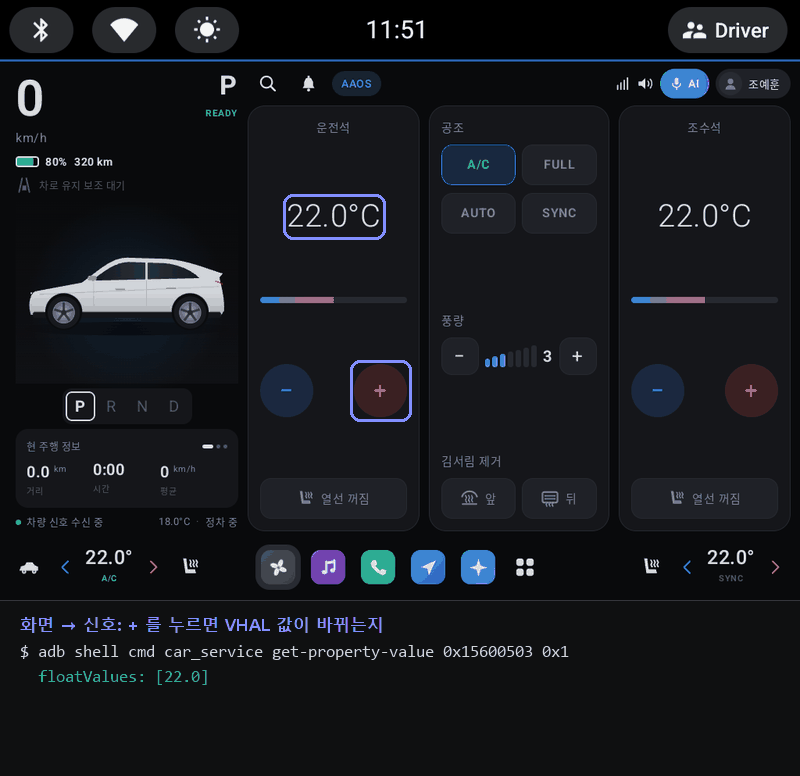
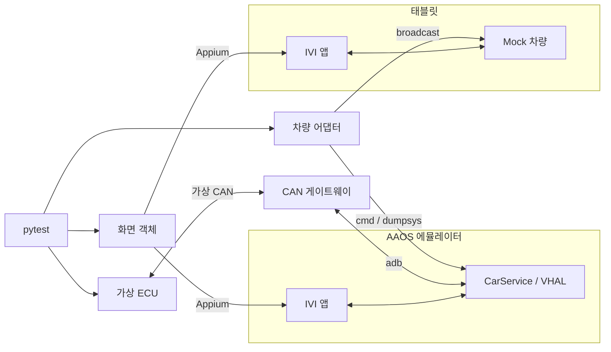

# OpenCabin IVI: AAOS 인포테인먼트 테스트 자동화

42dot Test Automation Engineer (<abbr title="In-Vehicle Infotainment. 내비, 미디어, 공조 화면 같은 차량 인포테인먼트">IVI</abbr> System) 지원 포트폴리오입니다.

| 항목 | 내용 |
|---|---|
| 대상 | 이 프로젝트에서 만든 가상 IVI 앱. 같은 <abbr title="End-to-End. 화면 조작부터 차량 값까지 실제 경로 전체를 거치는 테스트">E2E</abbr> 129개를 <abbr title="Android Automotive OS. 차량에 직접 들어가는 안드로이드">AAOS</abbr> 에뮬레이터(<abbr title="AAOS에서 앱과 VHAL 사이에서 차량 값을 주고받는 시스템 서비스">CarService</abbr>, 가상 <abbr title="Vehicle HAL. 차량 신호를 안드로이드에 넘겨 주는 층. 여기서는 에뮬레이터의 가상 값">VHAL</abbr>)와 화웨이 태블릿(앱 안 <abbr title="실제 대신 쓰는 가짜 구현. 태블릿에서는 앱 안의 가짜 차량 서비스">Mock</abbr> 차량)에서 돌립니다 |
| 결과 | 2026-11-21, 커밋 `d54741b`: 두 기기 × 3회, 750건에서 실패 0, <abbr title="같은 코드인데 실행마다 통과와 실패가 바뀌는 테스트. 여기서는 실패 뒤 재시도에서 통과한 경우">flaky</abbr> 0, <abbr title="릴리스 후보를 내보내도 되는지 정하는 자동 판정 (여섯 조건)">Release 게이트</abbr> 통과. GitHub 호스트 러너에서 AAOS <abbr title="이 빌드를 받아도 되는지 보는 가장 짧은 확인 (13개, PR마다)">smoke</abbr> 13개 3회 연속 통과 ([원자료](docs/evidence/2026-11-21-main/README.md)) |
| 한계 | 실제 차량, <abbr title="Hardware-in-the-Loop. 실제 제어 장치를 붙여 하는 시험. 이 프로젝트에서는 쓰지 않음">HIL</abbr>, <abbr title="차량 안의 제어 장치끼리 신호를 주고받는 통신 버스. 여기서는 PC 안의 가상 버스">CAN</abbr> 장비는 쓰지 않았습니다. VHAL은 에뮬레이터의 가상 값이고, CAN과 원격 전원은 PC 안의 모의 환경입니다. 태블릿과 전체 회귀는 작업 PC에서 돌렸습니다 |
| 만든 사람 | 게임 QA 8년차(2017.12부터 약 7년 8개월, 회사 4곳: 멀티플랫폼 호환성, 라이브 업데이트·BM, 글로벌 현지화 검수, AI R&D 연계 테스트 대시보드 구축. ISTQB CTFL)와 웹 <abbr title="Build Verification Test. 새 빌드가 기본 동작을 하는지 보는 테스트">BVT</abbr> 도구 구축 경험(엑셀 BVT 대시보드 + <abbr title="웹 브라우저 자동화 도구">Playwright</abbr>·<abbr title="파이썬 테스트 프레임워크">pytest</abbr>, 공개 웹 서비스 BVT 70개 중 47개 자동화). 모바일·AAOS 자동화는 이 프로젝트에서 처음 구축했습니다(2026-11-13부터, 혼자). 코드는 거의 전부 AI 코딩 도구(Claude Code)가 작성했습니다. 저는 Claude가 제안한 변경과 외부 검토 항목을 확인해 반영 여부를 확정했고, <abbr title="Pull Request. 변경을 main에 합치기 전에 올리는 검토 요청">PR</abbr>을 병합했습니다. E2E 테스트 설계는 Claude와 함께 정했습니다. 무엇을 고르고 버렸는지는 [결정 기록](docs/decisions.md)에 있습니다 |



화면 + → VHAL 22.0→22.5, VHAL에 25.0 주입 → 화면 25.0 (AAOS 에뮬레이터)

> [!TIP]
> **공고 항목별 근거는 [소개 사이트](https://bugspeaker.github.io/opencabin-ivi/)에서** 항목을 누르면 근거 테스트와 판정 직후 화면으로 이동합니다. 문서: [공고 항목별 대응표](docs/portfolio.md#1-공고-요구사항과-한-일)

## 이 프로젝트에서 한 일

1. **화면과 차량 값을 따로 판정합니다.** A/C를 끄면 전 좌석 <abbr title="같은 차량 신호의 위치 구분 (운전석, 조수석, 문 하나하나)">area</abbr> 값을 모두 읽고, 다른 좌석의 차량 값처럼 '바뀌지 않아야 함'은 1.5초 동안 계속 봅니다. [양방향 검증](docs/portfolio.md#5-1-양방향-검증과-area-단위-판정)
2. **경계값 테스트로 앱 결함을 찾았습니다.** 차량 온도 22.3°C에서 + 버튼이 22.8°C를 차량에 썼습니다. [원인 분석](docs/portfolio.md#3-결함과-원인-분석) · [실패 자료](docs/samples/off-grid-temperature-aaos/)
3. **원인은 측정으로 좁혔습니다.** 태블릿 탭 한 번 10,377 ms → <abbr title="Android Debug Bridge. PC에서 안드로이드 기기를 명령으로 다루는 도구">adb</abbr> 탭 117 ms. [결정 기록 2번](docs/decisions.md#2-화웨이-태블릿에서는-누르기만-adb로)
4. **<abbr title="릴리스 후보를 내보내도 되는지 정하는 자동 판정 (여섯 조건)">Release 게이트</abbr>는 실패 0과 실행 완전성을 따로 확인합니다.** 두 기기, 129개 전부, 종료 코드 0, 같은 커밋과 같은 <abbr title="안드로이드 앱 설치 파일">APK</abbr>. [게이트 기준](docs/portfolio.md#4-1-게이트-단계와-기준)
5. **재시도로 통과한 테스트는 <abbr title="같은 코드인데 실행마다 통과와 실패가 바뀌는 테스트. 여기서는 실패 뒤 재시도에서 통과한 경우">flaky</abbr>로 따로 셉니다.** 두 기기 × 3회, 750건에서 flaky 0건(2026-11-21). 2026-11-18의 5회 1,250건에서도 0건이었습니다. [반복 실행 통계](docs/flaky-report.md)

<details>
<summary>용어 풀이 (주요 10개)</summary>

| 용어 | 뜻 |
|---|---|
| <abbr title="Android Automotive OS. 차량에 직접 들어가는 안드로이드">AAOS</abbr> | Android Automotive OS. 차량에 직접 들어가는 안드로이드 |
| <abbr title="In-Vehicle Infotainment. 내비, 미디어, 공조 화면 같은 차량 인포테인먼트">IVI</abbr> | In-Vehicle Infotainment. 내비, 미디어, 공조 화면 같은 차량 인포테인먼트 |
| <abbr title="온도, 속도처럼 차량 값 하나를 가리키는 AAOS의 단위">CarProperty</abbr> | 온도, 속도처럼 차량 값 하나를 가리키는 AAOS의 단위 |
| <abbr title="Vehicle HAL. 차량 신호를 안드로이드에 넘겨 주는 층. 여기서는 에뮬레이터의 가상 값">VHAL</abbr> | Vehicle HAL. 차량 신호를 안드로이드에 넘겨 주는 층. 여기서는 에뮬레이터의 가상 값 |
| <abbr title="AAOS에서 앱과 VHAL 사이에서 차량 값을 주고받는 시스템 서비스">CarService</abbr> | AAOS에서 앱과 VHAL 사이에서 차량 값을 주고받는 시스템 서비스 |
| <abbr title="End-to-End. 화면 조작부터 차량 값까지 실제 경로 전체를 거치는 테스트">E2E</abbr> | End-to-End. 화면 조작부터 차량 값까지 실제 경로 전체를 거치는 테스트 |
| <abbr title="실제 대신 쓰는 가짜 구현. 태블릿에서는 앱 안의 가짜 차량 서비스">Mock</abbr> | 실제 대신 쓰는 가짜 구현. 태블릿에서는 앱 안의 가짜 차량 서비스 |
| flaky | 같은 코드인데 실행마다 통과와 실패가 바뀌는 테스트. 여기서는 실패 뒤 재시도에서 통과한 경우 |
| <abbr title="실패할 것을 알고 있는 테스트 표시 (pytest). 알려진 결함에 쓴다">xfail</abbr> | 실패할 것을 알고 있는 테스트 표시 (<abbr title="파이썬 테스트 프레임워크">pytest</abbr>). 알려진 결함에 쓴다 |
| Release 게이트 | 릴리스 후보를 내보내도 되는지 정하는 자동 판정 (여섯 조건) |

그 밖의 용어는 본문에서 점선 밑줄이 있는 낱말에 마우스를 올리면 보입니다.

</details>

## 결과 자료와 검증 시점

| 자료 | 실행 | 테스트 코드 | 결과 |
|---|---|---|---|
| [반복 실행 3회](docs/evidence/2026-11-21-main/README.md) | 2026-11-21<br>`20261121-121421-r1`<br>~ `20261121-123610-r3` | `d54741b`<br>(결과 파일에 기록,<br>커밋하지 않은 변경 없음) | 129개 × 두 기기 × 3회<br>750건, <abbr title="같은 코드인데 실행마다 통과와 실패가 바뀌는 테스트. 여기서는 실패 뒤 재시도에서 통과한 경우">flaky</abbr> 0, 실패 0<br><abbr title="릴리스 후보를 내보내도 되는지 정하는 자동 판정 (여섯 조건)">Release 게이트</abbr> `--commit` 통과 |
| [GitHub 호스트 러너 smoke](docs/evidence/2026-11-21-main/README.md#github-호스트-러너의-aaos-smoke) | 2026-11-21<br>Actions 수동 실행 3회 | `8bb3a33` | <abbr title="Android Automotive OS. 차량에 직접 들어가는 안드로이드">AAOS</abbr> <abbr title="이 빌드를 받아도 되는지 보는 가장 짧은 확인 (13개, PR마다)">smoke</abbr> 13개<br>3회 연속 통과 |

- 이 실행 뒤에 바뀐 것은 문서, 소개 사이트, 단위 테스트, <abbr title="Continuous Integration. 변경을 올릴 때마다 자동으로 빌드하고 테스트하는 것. 여기서는 GitHub Actions">CI</abbr> 설정입니다. <abbr title="End-to-End. 화면 조작부터 차량 값까지 실제 경로 전체를 거치는 테스트">E2E</abbr> 테스트 코드(`ivi-tests/tests`, `ivi-tests/ivi`)와 앱은 `d54741b`와 같습니다(`git diff --stat d54741b HEAD -- ivi-tests/tests ivi-tests/ivi ivi-app`).
- 같은 날 첫 시도는 전원 테스트에서 다시 켠 에뮬레이터가 멈춰 실패했습니다. 원인을 고친 뒤 처음부터 다시 돌렸고, 그 기록도 [원자료](docs/evidence/2026-11-21-main/README.md#첫-시도-전원-테스트가-멈춘-에뮬레이터를-기다리다-실패)에 남겼습니다.
- [결과 페이지](docs/test-results.md)의 판정과 화면은 3회차입니다.
- 2026-11-18 ~ 11-20의 이전 실행과 그때의 코드 시점은 [결과 원자료와 검증 시점](docs/evidence/README.md)에 있습니다.

## 게이트와 CI

아래 범위는 워크플로에 정의한 것입니다. GitHub에서 실제로 도는 것은 build, unit, e2e-hosted(호스트 러너의 <abbr title="Android Automotive OS. 차량에 직접 들어가는 안드로이드">AAOS</abbr> 에뮬레이터 <abbr title="이 빌드를 받아도 되는지 보는 가장 짧은 확인 (13개, PR마다)">smoke</abbr> 13개) job이고, 태블릿과 <abbr title="서비스마다 대표 경로를 하나씩 보는 확인 (25개, main에 합칠 때)">sanity</abbr> 이상은 self-hosted Bench용 e2e job이라 GitHub에서는 돌리지 않았습니다.

<abbr title="Pull Request. 변경을 main에 합치기 전에 올리는 검토 요청">PR</abbr> <abbr title="이 빌드를 받아도 되는지 보는 가장 짧은 확인 (13개, PR마다)">smoke</abbr> 13 / main push +<abbr title="서비스마다 대표 경로를 하나씩 보는 확인 (25개, main에 합칠 때)">sanity</abbr> 25 / <abbr title="매일 밤 자동으로 도는 전체 테스트">Nightly</abbr> 전체 / Release는 전체를 반복한 뒤 [Release 게이트](docs/portfolio.md#4-1-게이트-단계와-기준) 여섯 조건을 봅니다. smoke는 개수보다 실패했을 때의 결정이 기준입니다. smoke가 하나라도 실패하면 그 빌드는 머지하지 않고 다음 단계(sanity, <abbr title="경계값, 조합, 예전 결함 재발까지 보는 전체 회귀 테스트">regression</abbr>)로 넘기지 않습니다.
GitHub Actions가 PR마다 앱 빌드, 앱 단위 테스트 22개, 프레임워크 단위 테스트(기기 없음) 168개를 돌리고(통과 수는 실행 요약에 나옵니다), 요구사항 26개 ↔ 테스트 함수 101개(매개변수 조합까지 <abbr title="End-to-End. 화면 조작부터 차량 값까지 실제 경로 전체를 거치는 테스트">E2E</abbr> 129개) 추적이 빠지면 실패합니다.
e2e-hosted는 매번 새 AAOS 에뮬레이터에 build job의 <abbr title="안드로이드 앱 설치 파일">APK</abbr>를 <abbr title="시스템 권한을 받는 앱 설치 위치. 공조 제어 권한에 필요">priv-app</abbr>으로 넣고 smoke를 돌립니다([`ci_hosted_aaos.sh`](ivi-tests/tools/ci_hosted_aaos.sh)). 위 결과(두 기기 × 3회)는 같은 명령(`tools\run_bench.py`, `tools\release_gate.py`)을 작업 PC에서 돌린 것입니다.

## 구조



```
ivi-app/              IVI 앱 (Kotlin, Compose). privileged/ 는 priv-app 설치 스크립트
ivi-tests/
  ivi/                adb, 대기, 차량 어댑터, 기기, 화면 객체, 결과 기록, 격리 목록, Test Bench API, 전원 제어, CAN 게이트웨이
  dbc/                가상 CAN 버스의 프레임 정의 (opencabin.dbc)
  tests/              기기 E2E 테스트와 conftest.py
  unit/               프레임워크 단위 테스트 (기기 없이 돎)
  tools/              병렬 실행, flaky 통계, 앱 설치, 에뮬레이터 기본값, 주행 영상 올리기, 결과 사이트, 추적표, API 서버
.github/workflows/    ivi-ci.yml (build, unit, e2e), pages.yml (소개 사이트)
docs/                 포트폴리오, 단계별 기록, 요구사항과 추적표, 결정 기록, 반복 실행 통계
site/                 소개 사이트
```

## 실행

에뮬레이터를 `-writable-system`으로 켜고 <abbr title="모바일 앱 화면을 코드로 조작하는 자동화 도구">Appium</abbr> 서버를 띄운 뒤, `ivi-tests`에서 `pytest -m smoke` 또는 두 기기 병렬 실행 `tools\run_bench.py`를 돌립니다.
테스트마다 판정과 판정 직후 화면은 [docs/test-results.md](docs/test-results.md)에서 볼 수 있습니다.
자세한 방법과 환경 변수는 [docs/run.md](docs/run.md)에 있습니다.

## 찾은 결함과 알려진 결함

앱 결함, 실기기 문제, 플랫폼 결함, 테스트 코드의 경쟁 조건까지 찾은 결함의 증상, 원인, 조치는 [포트폴리오 3장](docs/portfolio.md#3-결함과-원인-분석)의 표(9개 항목)에 있고, 같은 기록을 [GitHub 이슈](https://github.com/bugspeaker/opencabin-ivi/issues?q=is%3Aissue+label%3Amigrated)로도 옮겨 두었습니다(이슈 생성일은 옮긴 날, 실제 발견일은 본문 첫 줄). 새로 찾는 결함은 이슈의 결함 양식으로 남깁니다.

알려진 결함 1건은 <abbr title="Android Automotive OS. 차량에 직접 들어가는 안드로이드">AAOS</abbr> 에뮬레이터 기본 <abbr title="안드로이드의 상태 표시줄, 홈 버튼 같은 시스템 화면">SystemUI</abbr>(1024×768, `automotive_1024p_landscape`)에서 운전석 온도 ▲ 버튼이 홈 버튼과 72×76px 겹쳐 눌리지 않는 문제입니다([#21](https://github.com/bugspeaker/opencabin-ivi/issues/21)). 플랫폼 쪽 문제라 `xfail(strict=True, raises=DefectReproduced)`로 걸어 두었습니다. 두 버튼이 겹치는 증상일 때만 '알려진 결함'이 되고, 버튼을 못 찾는 등 다른 이유의 실패는 그대로 실패입니다. <abbr title="릴리스 후보를 내보내도 되는지 정하는 자동 판정 (여섯 조건)">Release 게이트</abbr>가 [알려진 결함 목록](ivi-tests/known_defects.txt)과 맞춰 봅니다.

건너뛴 테스트는 그 기기에 해당하지 않는 테스트입니다(태블릿: AAOS 전용 7개, AAOS: 태블릿 전용 시계 1개). 사유는 결과에 남고, Release 게이트는 이 밖의 건너뜀(예: 기기에 주행 영상이 없어 건너뛴 영상 테스트)을 막습니다.

<details>
<summary>단계별 진행 (1~9단계)</summary>

| 단계 | 한 일 | 기록 |
|---|---|---|
| 1. 기술 검증 | AAOS 에뮬레이터에서 <abbr title="Vehicle HAL. 차량 신호를 안드로이드에 넘겨 주는 층. 여기서는 에뮬레이터의 가상 값">VHAL</abbr> 값을 넣고 읽어 보고, <abbr title="모바일 앱 화면을 코드로 조작하는 자동화 도구">Appium</abbr>을 붙여 신호와 화면이 이어지는지 확인했습니다. | [phase1-spike.md](docs/phase1-spike.md) |
| 2. <abbr title="In-Vehicle Infotainment. 내비, 미디어, 공조 화면 같은 차량 인포테인먼트">IVI</abbr> 앱 | Kotlin과 Compose로 홈, 공조, 미디어, 영상 화면을 만들었습니다. 차량 데이터는 <abbr title="앱이 차량 값(CarProperty)을 읽고 쓰는 AAOS API">CarPropertyManager</abbr>와 <abbr title="실제 대신 쓰는 가짜 구현. 태블릿에서는 앱 안의 가짜 차량 서비스">Mock</abbr> 두 가지로 구현했습니다. | [phase2-app.md](docs/phase2-app.md) |
| 3. 테스트 프레임워크 | 기기 어댑터와 화면 객체를 만들고 테스트 31개를 <abbr title="이 빌드를 받아도 되는지 보는 가장 짧은 확인 (13개, PR마다)">smoke</abbr>, <abbr title="서비스마다 대표 경로를 하나씩 보는 확인 (25개, main에 합칠 때)">sanity</abbr>, <abbr title="경계값, 조합, 예전 결함 재발까지 보는 전체 회귀 테스트">regression</abbr>으로 나눴습니다. 실패하면 자료를 자동으로 모읍니다. | [phase3-framework.md](docs/phase3-framework.md) |
| 4. 운영 | 재시도와 <abbr title="같은 코드인데 실행마다 통과와 실패가 바뀌는 테스트. 여기서는 실패 뒤 재시도에서 통과한 경우">flaky</abbr> 판정, 격리, 통계를 만들고 두 기기 병렬 실행과 GitHub Actions를 붙였습니다. | [phase4-operations.md](docs/phase4-operations.md) |
| 5. 재점검과 디자인 | 1~4단계를 다시 점검하고, 양산 IVI 화면 구조를 참고해 디자인을 바꿨습니다. 회귀 테스트에서 찾은 결함 3건을 고쳤습니다. | [phase5-design.md](docs/phase5-design.md) |
| 6. 기능 확장 | 내비게이션, 라디오, 전화, 설정, 후방 카메라, 음성 명령을 더했습니다. 테스트가 64개가 됐습니다. | [phase6-features.md](docs/phase6-features.md) |
| 7. 화면 구조 개편 | 양산 IVI 공개 자료의 3영역 구조를 참고해 화면을 세 영역으로 나누고 분할 화면, 아래 공조 바, AI 어시스턴트, 빠른 제어, 알림 센터를 넣었습니다. 테스트가 84개가 됐습니다. | [phase7-layout.md](docs/phase7-layout.md) |
| 8. 차량 신호 확장 | 화면 안에서만 바뀌던 공조와 도어 잠금을 VHAL 신호에 연결하고, 주행 가능 거리와 배터리, 외기 온도를 주행 정보에 보여 줍니다. 양방향 테스트를 더했고, 영상 화면은 직접 찍은 블랙박스 영상을 재생합니다. | [phase8-signals.md](docs/phase8-signals.md) |
| 9. <abbr title="테스트 기기와 PC를 묶은 시험 환경. 여기서는 PC 한 대, AAOS 에뮬레이터, 태블릿">Test Bench</abbr> 확장 | Test Bench REST API와 원격 전원 제어, 가상 <abbr title="차량 안의 제어 장치끼리 신호를 주고받는 통신 버스. 여기서는 PC 안의 가상 버스">CAN</abbr> 버스와 VHAL 게이트웨이, 요구사항 추적표, 후방 카메라 2초 시험을 더했습니다(모의 환경). 검토를 반영해 경계값 테스트로 결함 1건을 찾아 고치고, 두 기기에서 전체를 5회 반복했습니다. <abbr title="End-to-End. 화면 조작부터 차량 값까지 실제 경로 전체를 거치는 테스트">E2E</abbr>는 129개입니다. | [phase9-bench.md](docs/phase9-bench.md) |

| 시점 | AAOS 에뮬레이터 | 화웨이 태블릿 (Mock) |
|---|---|---|
| 9단계 (2026-11-18, 129개, 5회 반복의 마지막 회차) | 127개 통과, 1개 건너뜀, 1개 알려진 결함 (9분 45초) | 122개 통과, AAOS 전용 7개 건너뜀 (10분 15초) |
| 9단계 (2026-11-18 낮, 123개) | 121개 통과, 1개 건너뜀, 1개 알려진 결함 (10분 11초) | 116개 통과, 7개 건너뜀 (9분 44초) |
| 8단계 끝 (2026-11-18 아침, 115개) | 113개 통과, 1개 건너뜀, 1개 알려진 결함 (9분 35초) | 109개 통과, 6개 건너뜀 (9분 11초) |
| 8단계 중간 (2026-11-16, 108개) | 106개 통과, 1개 건너뜀, 1개 알려진 결함 (6분 40초) | 102개 통과, 6개 건너뜀 (7분 6초) |
| 7단계 (2026-11-14, 84개) | 82개 통과, 1개 건너뜀, 1개 알려진 결함 (5분 47초) | 78개 통과, 6개 건너뜀 (5분 46초) |
| 5단계 (2026-11-13, 31개) | 30개 통과, 1개 알려진 결함 (약 2분 30초) | 25개 통과, 6개 건너뜀 (약 1분 22초) |

</details>
