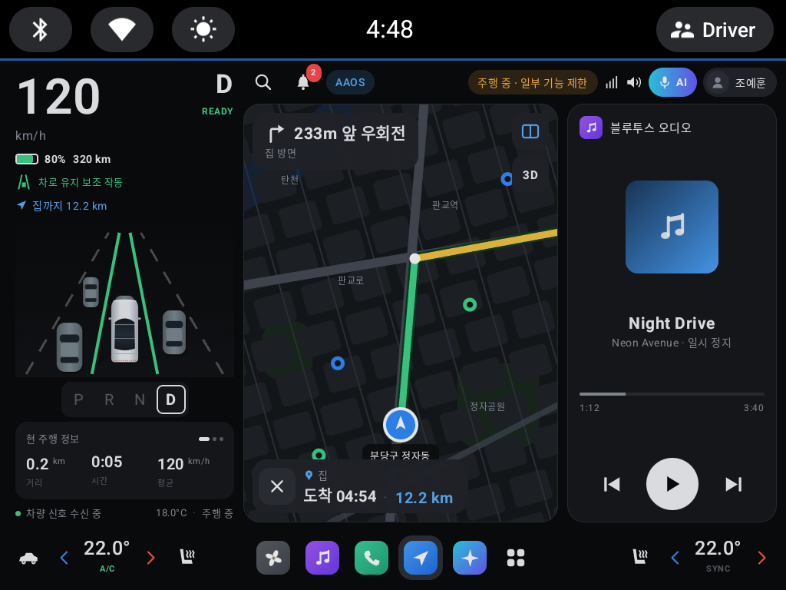

# OpenCabin IVI: AAOS 인포테인먼트 테스트 자동화

가상 차량용 인포테인먼트(IVI) 앱을 만들고, 화면 조작이 차량 신호(VHAL)까지 이어지는지 E2E 테스트로 검증하는 프로젝트입니다.
같은 테스트 코드를 AAOS 에뮬레이터와 일반 Android 태블릿에서 돌립니다. 에뮬레이터에서는 실제 CarService와 VHAL을 거치고, 태블릿에서는 앱 안에 둔 Mock 차량 서비스를 씁니다.



테스트 자동화 내용만 따로 정리한 문서는 [docs/portfolio.md](docs/portfolio.md)에 있습니다.

## 진행 상황

| 단계 | 한 일 | 기록 |
|---|---|---|
| 1. 기술 검증 | AAOS 에뮬레이터에서 VHAL 값을 넣고 읽어 보고, Appium을 붙여 신호와 화면이 이어지는지 확인했습니다. | [phase1-spike.md](docs/phase1-spike.md) |
| 2. IVI 앱 | Kotlin과 Compose로 홈, 공조, 미디어, 영상 화면을 만들었습니다. 차량 데이터는 CarPropertyManager와 Mock 두 가지로 구현했습니다. | [phase2-app.md](docs/phase2-app.md) |
| 3. 테스트 프레임워크 | 기기 어댑터와 화면 객체를 만들고 테스트 31개를 smoke, sanity, regression으로 나눴습니다. 실패하면 자료를 자동으로 모읍니다. | [phase3-framework.md](docs/phase3-framework.md) |
| 4. 운영 | 재시도와 flaky 판정, 격리, 통계를 만들고 두 기기 병렬 실행과 GitHub Actions를 붙였습니다. | [phase4-operations.md](docs/phase4-operations.md) |
| 5. 재점검과 디자인 | 1~4단계를 다시 점검하고, 양산 IVI 화면 구조를 참고해 디자인을 바꿨습니다. 회귀 테스트에서 찾은 결함 3건을 고쳤습니다. | [phase5-design.md](docs/phase5-design.md) |
| 6. 기능 확장 | 내비게이션, 라디오, 전화, 설정, 후방 카메라, 음성 명령을 더했습니다. 테스트가 64개가 됐습니다. | [phase6-features.md](docs/phase6-features.md) |
| 7. 화면 구조 개편 | Pleos Connect처럼 화면을 세 영역으로 나누고 분할 화면, 아래 공조 바, AI 어시스턴트, 빠른 제어, 알림 센터를 넣었습니다. 테스트가 84개가 됐습니다. | [phase7-pleos.md](docs/phase7-pleos.md) |
| 8. 차량 신호 확장 | 화면 안에서만 바뀌던 공조와 도어 잠금을 VHAL 신호에 연결하고, 주행 가능 거리와 배터리, 외기 온도를 주행 정보에 보여 줍니다. 양방향 테스트를 더했고, 영상 화면은 직접 찍은 블랙박스 영상을 재생합니다. | [phase8-signals.md](docs/phase8-signals.md) |
| 9. Test Bench 확장 | Test Bench REST API와 원격 전원 제어, 가상 CAN 버스와 VHAL 게이트웨이, 요구사항 추적표, 후방 카메라 2초 시험을 더했습니다. 실제 장비가 아닌 모의 환경입니다. E2E는 123개입니다. | [phase9-bench.md](docs/phase9-bench.md) |

## 구조

```
ivi-app/              IVI 앱 (Kotlin, Compose). privileged/ 는 priv-app 설치 스크립트
ivi-tests/
  ivi/                adb, 대기, 차량 어댑터, 기기, 화면 객체, 결과 기록, 격리 목록, Test Bench API, 전원 제어, CAN 게이트웨이
  dbc/                가상 CAN 버스의 프레임 정의 (opencabin.dbc)
  tests/              기기 E2E 테스트와 conftest.py
  unit/               프레임워크 단위 테스트 (기기 없이 돎)
  tools/              병렬 실행, flaky 통계, 앱 설치, 에뮬레이터 기본값, 주행 영상 올리기, 결과 사이트 만들기, 추적표 만들기, API 서버
  quarantine.txt      격리 목록
.github/workflows/    ivi-ci.yml
docs/                 단계별 설계와 검증 기록, 요구사항과 추적표
site/                 소개 사이트 (site/index.html)
```

## 실행 (Windows)

프로젝트는 영문 경로(`C:\dev\opencabin-ivi`)에 둡니다. Android 빌드 도구가 한글 경로에서 실패합니다.

1. Automotive 에뮬레이터를 켭니다. AVD도 영문 경로에 두고, priv-app으로 앱을 넣으려면 `-writable-system`으로 켭니다.
   ```powershell
   $env:ANDROID_AVD_HOME = "C:\android\avd"; $env:ANDROID_SDK_ROOT = "C:\android"
   C:\android\emulator\emulator.exe -avd OpenCabin_AAOS_34 -writable-system -no-snapshot -no-boot-anim
   ```
   앱 빌드와 priv-app 설치 방법은 [docs/phase2-app.md](docs/phase2-app.md)에 있습니다.
   에뮬레이터 공조를 태블릿과 같은 22.0°C, 섭씨 표시로 맞추려면 `python ivi-tests/tools/emulator_defaults.py --persist`를 한 번 돌립니다. 에뮬레이터가 재부팅됩니다.
   영상 화면에 실제 주행 영상을 띄우려면 블랙박스 mp4를 `.drive/`에 넣고 `python ivi-tests/tools/push_drive_videos.py`를 돌립니다. 영상이 없으면 가짜 재생 화면이 나옵니다.
2. Appium 서버를 띄웁니다.
   ```powershell
   $env:ANDROID_HOME = "C:\android"; appium --address 127.0.0.1 --port 4723
   ```
3. 테스트를 돌립니다.
   ```powershell
   cd ivi-tests
   python -m venv .venv; .venv\Scripts\python -m pip install -r requirements.txt
   .venv\Scripts\python -m pytest --serial emulator-5554              # 전체
   .venv\Scripts\python -m pytest --serial emulator-5554 -m smoke     # 빌드 게이트
   ```
   기기가 한 대만 연결돼 있으면 `--serial`은 빼도 됩니다. 기기 종류는 자동으로 판별합니다.
4. 두 기기 병렬 실행, flaky 통계, 단위 테스트
   ```powershell
   .venv\Scripts\python tools\run_bench.py -m "smoke or sanity" --reruns 1
   .venv\Scripts\python tools\flaky_report.py --last 20
   .venv\Scripts\python -m pytest unit
   ```
5. Test Bench API를 띄우면 다른 도구가 HTTP로 기기와 신호, 전원, 실행 결과를 다룰 수 있습니다. 벤치 PC 안에서만 씁니다.
   ```powershell
   .venv\Scripts\python tools\bench_api.py          # http://127.0.0.1:8770/api
   ```
6. 결과 사이트 만들기. `--shots`를 붙이면 테스트마다 끝난 화면을 남기고, 아래 명령이 그 결과를 소개 사이트로 옮깁니다.
   ```powershell
   .venv\Scripts\python -m pytest --serial emulator-5554 --shots
   .venv\Scripts\python tools\publish_results.py
   .venv\Scripts\python tools\trace_report.py
   cd ..\site; npm install; npm run build-docs
   ```

| 환경 변수 | 기본값 | 설명 |
|---|---|---|
| `IVI_SERIAL` | 연결된 기기 한 대 | 대상 기기. `--serial`과 같습니다. |
| `IVI_TAP` | 화웨이와 아너는 `adb`, 그 밖에는 `appium` | 화면을 누르는 방법 |
| `APPIUM_URL` | `http://127.0.0.1:4723` | Appium 서버 주소 |

## 결과

최신 결과(2026-11-18, E2E 123개)는 AAOS 에뮬레이터 121개 통과, 1개 건너뜀, 1개 알려진 결함(10분 10초), 화웨이 태블릿 116개 통과, AAOS 전용 7개 건너뜀(9분 43초)이고 재시도는 없었습니다. 테스트마다 끝난 화면은 [docs/test-results.md](docs/test-results.md)에서 볼 수 있습니다.

| 시점 | AAOS 에뮬레이터 | 화웨이 태블릿 (Mock) |
|---|---|---|
| 8단계 (2026-11-16, 108개) | 106개 통과, 1개 건너뜀, 1개 알려진 결함 (6분 40초) | 102개 통과, 6개 건너뜀 (7분 6초) |
| 7단계 (2026-11-14, 84개) | 82개 통과, 1개 건너뜀, 1개 알려진 결함 (5분 47초) | 78개 통과, 6개 건너뜀 (5분 46초) |
| 5단계 (2026-11-13, 31개) | 30개 통과, 1개 알려진 결함 (약 2분 30초) | 25개 통과, 6개 건너뜀 (약 1분 22초) |

8단계에서 두 기기를 병렬로 돌렸을 때는 7분 20초가 걸렸습니다. 차례로 돌린 시간의 절반쯤입니다.
알려진 결함 1건은 1단계에서 찾은 AAOS SystemUI 결함(운전석 온도 ▲ 버튼이 홈 버튼에 가려짐)이고, 건너뛴 테스트는 AAOS에서만 의미가 있는 테스트입니다.
