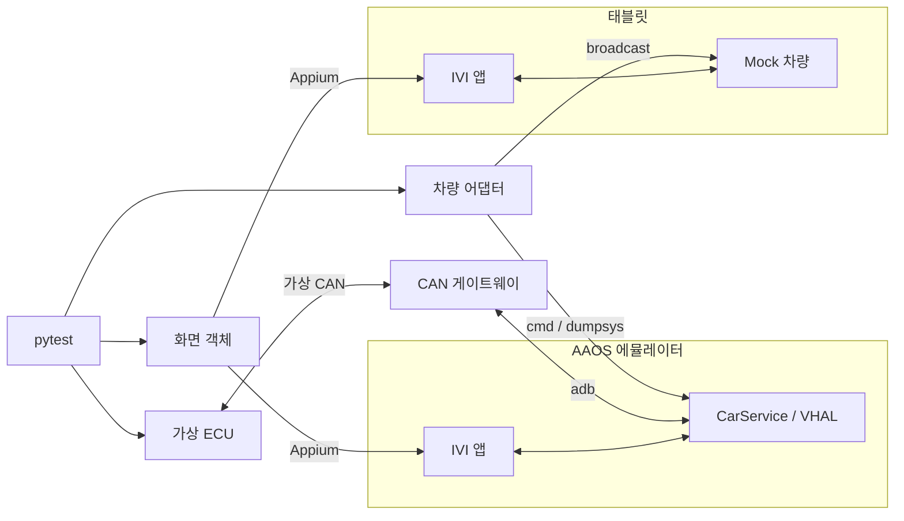

# OpenCabin IVI: AAOS 인포테인먼트 테스트 자동화

게임 QA 약 8년 차가 AAOS 테스트 자동화로 옮겨 가며 혼자 만든 포트폴리오입니다(2026-11-13 ~).
화면 조작과 차량 신호(CarProperty/VHAL)를 함께 판정하는 pytest + Appium E2E 프레임워크와, 그 결과를 믿어도 되는지 가르는 게이트를 만들었습니다.
테스트 대상은 직접 만든 가상 IVI 앱이고, 같은 테스트 129개를 AAOS 에뮬레이터(CarService와 에뮬레이터 VHAL)와 화웨이 태블릿(앱 안 Mock 차량)에서 돌립니다.
실제 차량, HIL, CAN 장비는 쓰지 않았습니다. CAN과 원격 전원은 PC 안의 모의 환경입니다.

| | |
|---|---|
| 경력 | 게임 QA 약 8년. Playwright와 pytest로 웹 BVT를 만든 경험이 있고, 모바일과 AAOS 자동화는 이 프로젝트가 처음입니다 |
| 제 역할 | 혼자 진행했습니다. 코드는 거의 전부 AI 코딩 도구(Claude Code)가 작성했습니다. 저는 Test Bench(PC, AAOS 에뮬레이터, 태블릿)에서 E2E를 직접 돌려 결과와 실패 자료를 확인했고, 외부 검토를 받아 반영할 항목을 골랐고, PR마다 변경 내용과 실행 결과를 보고 병합했습니다 |
| 판단의 근거 | 기기 구성, 신호 주입 방식, 판정과 재시도 규칙에서 무엇을 고르고 버렸는지와 근거 측정값: [결정 기록](docs/decisions.md) |

## 테스트 엔지니어로서 한 일

1. **화면만 보고 통과시키지 않습니다.** 화면 표시와 차량 값(VHAL)을 따로 읽어 판정합니다. A/C를 끄면 전 좌석 area의 값을 모두 읽습니다. 운전석에만 써도 화면은 정상으로 보이기 때문입니다. '바뀌지 않아야 함'은 한 번이 아니라 1.5초 동안 계속 봅니다. [양방향 검증](docs/portfolio.md#5-1-양방향-검증과-area-단위-판정)
2. **경계값으로 앱 결함을 찾았습니다.** 차량 온도가 22.3°C(0.5°C 단위가 아님)일 때 + 버튼이 22.8°C를 차량에 썼습니다. 실패 당시 자료(화면, UI 계층, 차량 값, logcat)를 그대로 남기고 고쳤습니다. 조건이 여럿인 요구사항은 조건 23개로 나눠 어느 확인이 어느 조건을 보는지 적었고, 테스트가 없는 조건 1개도 그대로 밝혔습니다. [실패 자료](docs/samples/off-grid-temperature-aaos/) · [원인 분석](docs/portfolio.md#3-결함과-원인-분석) · [조건별 확인](docs/requirements.md#복합-요구사항-조건마다-확인하는-곳)
3. **원인은 측정으로 좁혔습니다.** 태블릿에서 탭 한 번에 10초가 걸려, 누르는 방법 네 가지를 재서 UiAutomator 터치 자체가 원인임을 확인하고 누르기만 adb로 바꿨습니다(10,377 ms → 117 ms). 21번째 테스트마다 앱이 사라지던 것은 logcat의 `iAwareF[CrashClean]`에서 OS가 반복 재시작을 크래시로 본 것을 찾아, 프로세스 종료를 세션당 한 번으로 바꿨습니다. [결정 기록 2번](docs/decisions.md#2-화웨이-태블릿에서는-누르기만-adb로) · [6번](docs/decisions.md#6-앱-프로세스-종료는-세션-시작-때-한-번만)
4. **'실패 0'과 '정한 검증을 끝까지 했다'를 나눠 봅니다.** [Release 게이트](docs/portfolio.md#4-1-게이트-단계와-기준)는 failed, error, flaky가 0인지보다 먼저 두 기기 모두 지금 코드의 테스트 129개를 끝까지 돌렸는지(종료 코드 0, 같은 커밋, 기기 전용이 아닌 건너뜀 없음)를 봅니다. 알려진 결함은 그 증상일 때만 xfail로 받고, 버튼을 못 찾은 오류는 실패로 남깁니다. Appium 세션이 끊기면 그 시도는 제한 시간을 쓰지 않고 바로 실패로 남기고, 다음 테스트를 시작할 때 세션을 다시 붙여 그 사실을 기록합니다. 2026-11-19에 실제로 겪은 장애에서 나온 개선입니다. 조건마다 막는 사례를 단위 테스트로 확인했습니다.
5. **흔들리는 테스트를 숨기지 않습니다.** 재시도로 통과한 것은 passed가 아니라 flaky로 따로 셉니다. 두 기기에서 전체를 5회 돌린 1,250건에서 flaky 0, 실패 0이었습니다. 하루, 같은 PC에서 잰 값이라 기간 추세는 아닙니다. [반복 실행 통계와 원자료](docs/flaky-report.md)


화면 + → VHAL 22.0→22.5, VHAL에 25.0 주입 → 화면 25.0 (AAOS 에뮬레이터)

> [!TIP]
> **공고 항목별 근거는 [소개 사이트](https://bugspeaker.github.io/opencabin-ivi/)에서 한눈에 볼 수 있습니다.**
>
> 공고의 주요 업무, 자격요건, 우대사항마다 이 프로젝트에서 한 일을 적었고, 항목을 누르면 근거가 되는 테스트 결과와 판정 직후 화면으로 바로 이동합니다.
> 문서로는 [공고 항목별 대응표](docs/portfolio.md#1-공고-요구사항과-한-일)에 같은 내용이 있습니다.

## 결과 자료와 검증 시점

결과마다 어느 코드로 돈 것인지, 그 뒤에 바꾼 코드는 무엇으로 확인했는지 적었습니다. 2026-11-20부터는 결과 파일에 커밋이 남고, Release 게이트(`--commit`)가 모든 결과가 그 커밋에서 돌았는지 확인합니다.

| 자료 | 실행 | 테스트 코드 | 범위와 결과 |
|---|---|---|---|
| [테스트 결과](docs/test-results.md)의 판정과 화면, [반복 실행 통계](docs/flaky-report.md) | 2026-11-18 19:55~20:46, 5회 | 실행 뒤 결과와 함께 커밋한 `daba411` | 두 기기 전체 129개 × 5회, 1,250건, flaky 0, 실패 0. 마지막 회차: AAOS 127 통과, 1 건너뜀, 1 알려진 결함 / 태블릿 122 통과, 7 건너뜀 |
| [전체 재실행 원자료](docs/evidence/2026-11-19-after-review/README.md) | 2026-11-19 10:46, 1회 | `9870972` (대기 47곳을 `wait_value`로, 범위 밖 온도 기대값을 기기마다 하나로) | 두 기기 전체 129개. 위와 같은 판정 수, 재시도 0 |
| smoke | 2026-11-19 | `fa344c4` (smoke의 공조 테스트를 화면↔차량 왕복으로) | 두 기기 smoke 13개 통과. 결과 파일은 남기지 않았습니다([9단계 기록](docs/phase9-bench.md)) |
| 이번 변경 (게이트, 대기, 픽스처, 알려진 결함 xfail) | 기기에서 아직 돌리지 않음 | `de733dd` 이후 | 프레임워크 단위 테스트 129개 통과. 위 두 원자료(결과 파일 12개)에 새 Release 게이트를 다시 돌려 여섯 조건 통과 |

결과 페이지의 판정과 화면은 2026-11-18 실행 그대로입니다. 그 뒤 바꾼 테스트(smoke 공조 왕복, 범위 밖 온도 기대값)는 설명이 지금 코드 기준이고, 화면은 바꾸기 전 실행의 것입니다.

## 게이트와 CI

PR smoke 13 / main push +sanity 25 / Nightly 전체 / Release는 전체를 반복한 뒤 [Release 게이트](docs/portfolio.md#4-1-게이트-단계와-기준) 여섯 조건을 봅니다.
GitHub Actions가 PR마다 앱 빌드, 앱 단위 테스트 22개, 프레임워크 단위 테스트(기기 없음) 129개를 돌리고, 요구사항 26개 ↔ 테스트 함수 101개(매개변수 조합까지 E2E 129개) 추적이 빠지면 실패합니다.
E2E job은 self-hosted Bench용으로 작성했고 아직 GitHub에서 돌리지 않았습니다. 위 E2E 결과는 같은 명령을 작업 PC에서 돌린 것입니다.

## 구조



```
ivi-app/              IVI 앱 (Kotlin, Compose). privileged/ 는 priv-app 설치 스크립트
ivi-tests/
  ivi/                adb, 대기, 차량 어댑터, 기기, 화면 객체, 결과 기록, 격리 목록, Test Bench API, 전원 제어, CAN 게이트웨이
  dbc/                가상 CAN 버스의 프레임 정의 (opencabin.dbc)
  tests/              기기 E2E 테스트와 conftest.py
  unit/               프레임워크 단위 테스트 (기기 없이 돎)
  tools/              병렬 실행, flaky 통계, 앱 설치, 에뮬레이터 기본값, 주행 영상 올리기, 결과 사이트, 추적표, API 서버
.github/workflows/    ivi-ci.yml (build, unit, e2e), pages.yml (소개 사이트)
docs/                 포트폴리오, 단계별 기록, 요구사항과 추적표, 결정 기록, 반복 실행 통계
site/                 소개 사이트
```

## 실행

에뮬레이터를 `-writable-system`으로 켜고 Appium 서버를 띄운 뒤, `ivi-tests`에서 `pytest -m smoke` 또는 두 기기 병렬 실행 `tools\run_bench.py`를 돌립니다.
테스트마다 판정과 판정 직후 화면은 [docs/test-results.md](docs/test-results.md)에서 볼 수 있습니다.
자세한 방법과 환경 변수는 [docs/run.md](docs/run.md)에 있습니다.

## 찾은 결함과 알려진 결함

앱 결함, 실기기 문제, 플랫폼 결함, 테스트 코드의 경쟁 조건까지 찾은 결함의 증상, 원인, 조치는 [포트폴리오 3장](docs/portfolio.md#3-결함과-원인-분석)의 표(9개 항목)에 있습니다.

알려진 결함 1건은 AAOS 에뮬레이터 기본 SystemUI(1024×768, `automotive_1024p_landscape`)에서 운전석 온도 ▲ 버튼이 홈 버튼과 72×76px 겹쳐 눌리지 않는 문제입니다. 플랫폼 쪽 문제라 `xfail(strict=True, raises=DefectReproduced)`로 걸어 두었습니다. 두 버튼이 겹치는 증상일 때만 '알려진 결함'이 되고, 버튼을 못 찾는 등 다른 이유의 실패는 그대로 실패입니다. Release 게이트가 [알려진 결함 목록](ivi-tests/known_defects.txt)과 맞춰 봅니다.

건너뛴 테스트는 그 기기에 해당하지 않는 테스트입니다(태블릿: AAOS 전용 7개, AAOS: 태블릿 전용 시계 1개). 사유는 결과에 남고, Release 게이트는 이 밖의 건너뜀(예: 기기에 주행 영상이 없어 건너뛴 영상 테스트)을 막습니다.

<details>
<summary>단계별 진행 (1~9단계)</summary>

| 단계 | 한 일 | 기록 |
|---|---|---|
| 1. 기술 검증 | AAOS 에뮬레이터에서 VHAL 값을 넣고 읽어 보고, Appium을 붙여 신호와 화면이 이어지는지 확인했습니다. | [phase1-spike.md](docs/phase1-spike.md) |
| 2. IVI 앱 | Kotlin과 Compose로 홈, 공조, 미디어, 영상 화면을 만들었습니다. 차량 데이터는 CarPropertyManager와 Mock 두 가지로 구현했습니다. | [phase2-app.md](docs/phase2-app.md) |
| 3. 테스트 프레임워크 | 기기 어댑터와 화면 객체를 만들고 테스트 31개를 smoke, sanity, regression으로 나눴습니다. 실패하면 자료를 자동으로 모읍니다. | [phase3-framework.md](docs/phase3-framework.md) |
| 4. 운영 | 재시도와 flaky 판정, 격리, 통계를 만들고 두 기기 병렬 실행과 GitHub Actions를 붙였습니다. | [phase4-operations.md](docs/phase4-operations.md) |
| 5. 재점검과 디자인 | 1~4단계를 다시 점검하고, 양산 IVI 화면 구조를 참고해 디자인을 바꿨습니다. 회귀 테스트에서 찾은 결함 3건을 고쳤습니다. | [phase5-design.md](docs/phase5-design.md) |
| 6. 기능 확장 | 내비게이션, 라디오, 전화, 설정, 후방 카메라, 음성 명령을 더했습니다. 테스트가 64개가 됐습니다. | [phase6-features.md](docs/phase6-features.md) |
| 7. 화면 구조 개편 | 양산 IVI 공개 자료의 3영역 구조를 참고해 화면을 세 영역으로 나누고 분할 화면, 아래 공조 바, AI 어시스턴트, 빠른 제어, 알림 센터를 넣었습니다. 테스트가 84개가 됐습니다. | [phase7-layout.md](docs/phase7-layout.md) |
| 8. 차량 신호 확장 | 화면 안에서만 바뀌던 공조와 도어 잠금을 VHAL 신호에 연결하고, 주행 가능 거리와 배터리, 외기 온도를 주행 정보에 보여 줍니다. 양방향 테스트를 더했고, 영상 화면은 직접 찍은 블랙박스 영상을 재생합니다. | [phase8-signals.md](docs/phase8-signals.md) |
| 9. Test Bench 확장 | Test Bench REST API와 원격 전원 제어, 가상 CAN 버스와 VHAL 게이트웨이, 요구사항 추적표, 후방 카메라 2초 시험을 더했습니다(모의 환경). 검토를 반영해 경계값 테스트로 결함 1건을 찾아 고치고, 두 기기에서 전체를 5회 반복했습니다. E2E는 129개입니다. | [phase9-bench.md](docs/phase9-bench.md) |

| 시점 | AAOS 에뮬레이터 | 화웨이 태블릿 (Mock) |
|---|---|---|
| 9단계 (2026-11-18, 129개, 5회 반복의 마지막 회차) | 127개 통과, 1개 건너뜀, 1개 알려진 결함 (9분 45초) | 122개 통과, AAOS 전용 7개 건너뜀 (10분 15초) |
| 9단계 (2026-11-18 낮, 123개) | 121개 통과, 1개 건너뜀, 1개 알려진 결함 (10분 11초) | 116개 통과, 7개 건너뜀 (9분 44초) |
| 8단계 끝 (2026-11-18 아침, 115개) | 113개 통과, 1개 건너뜀, 1개 알려진 결함 (9분 35초) | 109개 통과, 6개 건너뜀 (9분 11초) |
| 8단계 중간 (2026-11-16, 108개) | 106개 통과, 1개 건너뜀, 1개 알려진 결함 (6분 40초) | 102개 통과, 6개 건너뜀 (7분 6초) |
| 7단계 (2026-11-14, 84개) | 82개 통과, 1개 건너뜀, 1개 알려진 결함 (5분 47초) | 78개 통과, 6개 건너뜀 (5분 46초) |
| 5단계 (2026-11-13, 31개) | 30개 통과, 1개 알려진 결함 (약 2분 30초) | 25개 통과, 6개 건너뜀 (약 1분 22초) |

</details>
