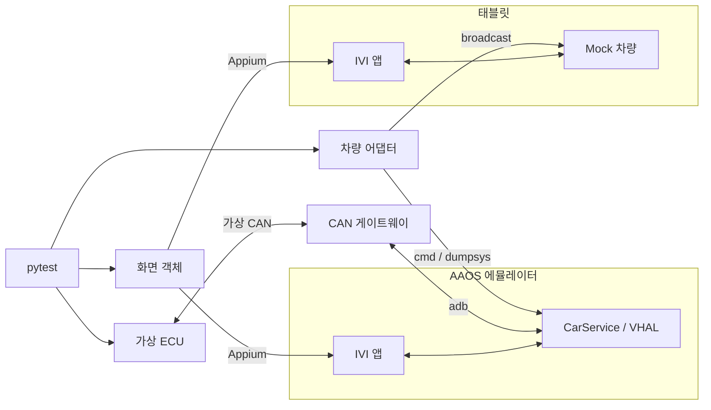

# OpenCabin IVI: AAOS 인포테인먼트 테스트 자동화

화면을 누르면 CarProperty/VHAL 값이 바뀌는지, 차량 신호가 바뀌면 화면이 따라오는지를 E2E로 확인하는 pytest 프레임워크입니다.
테스트 대상은 직접 만든 가상 IVI 앱입니다. 같은 테스트를 AAOS 에뮬레이터(CarService와 에뮬레이터 VHAL)와 화웨이 태블릿(앱 안 Mock 차량)에서 돌립니다.
실제 차량, HIL, CAN 장비는 쓰지 않았습니다. CAN과 원격 전원은 PC 안의 모의 환경입니다.

> [!TIP]
> **공고 항목별 근거는 [소개 사이트](https://bugspeaker.github.io/opencabin-ivi/)에서 한눈에 볼 수 있습니다.**
>
> 공고의 주요 업무, 자격요건, 우대사항마다 이 프로젝트에서 한 일을 적었고, 항목을 누르면 근거가 되는 테스트 결과와 테스트가 끝난 화면으로 바로 이동합니다.
> 문서로 보려면 [포트폴리오 1장](docs/portfolio.md#1-공고-요구사항과-한-일), 판단의 이유와 측정값은 [결정 기록](docs/decisions.md)에 있습니다.

| | 결과 (2026-11-18) |
|---|---|
| E2E | 129개. AAOS 127 통과, 1 건너뜀, 1 알려진 결함 / 태블릿 122 통과, 7 건너뜀. 두 기기에서 5회 반복해 테스트 1,250건, flaky 0건, 실패 0건 ([통계](docs/flaky-report.md)) |
| 게이트 | PR smoke 13 / main push +sanity 25 / Nightly 전체 / Release 전체 반복 ([기준과 시간](docs/portfolio.md#4-1-게이트-단계와-기준)) |
| CI | PR마다 앱 빌드, 앱 단위 테스트 22개, 프레임워크 단위 테스트 71개 (GitHub Actions). E2E job은 self-hosted Bench용으로 작성했고 아직 GitHub에서 돌리지 않았습니다 |
| 추적 | 요구사항 26개 ↔ 테스트 함수 101개. 빠진 곳이 있으면 unit job이 실패합니다 |




## 구조

```
ivi-app/              IVI 앱 (Kotlin, Compose). privileged/ 는 priv-app 설치 스크립트
ivi-tests/
  ivi/                adb, 대기, 차량 어댑터, 기기, 화면 객체, 결과 기록, 격리 목록, Test Bench API, 전원 제어, CAN 게이트웨이
  dbc/                가상 CAN 버스의 프레임 정의 (opencabin.dbc)
  tests/              기기 E2E 테스트와 conftest.py
  unit/               프레임워크 단위 테스트 (기기 없이 돎)
  tools/              병렬 실행, flaky 통계, 앱 설치, 에뮬레이터 기본값, 주행 영상 올리기, 결과 사이트, 추적표, API 서버
.github/workflows/    ivi-ci.yml (build, unit, e2e), pages.yml (소개 사이트)
docs/                 포트폴리오, 단계별 기록, 요구사항과 추적표, 결정 기록, 반복 실행 통계
site/                 소개 사이트
```

## 실행

에뮬레이터를 `-writable-system`으로 켜고 Appium 서버를 띄운 뒤, `ivi-tests`에서 `pytest -m smoke` 또는 두 기기 병렬 실행 `tools\run_bench.py`를 돌립니다.
테스트마다 끝난 화면과 판정은 [docs/test-results.md](docs/test-results.md)에서 볼 수 있습니다.
자세한 방법과 환경 변수는 [docs/run.md](docs/run.md)에 있습니다.

## 알려진 결함과 건너뛴 테스트

알려진 결함 1건은 AAOS 에뮬레이터 기본 SystemUI(1024×768, `automotive_1024p_landscape`)에서 운전석 온도 ▲ 버튼이 홈 버튼과 72×76px 겹쳐 눌리지 않는 문제입니다. 플랫폼 쪽 문제라 `xfail(strict=True)`로 걸어 두었습니다. 건너뛴 테스트는 AAOS에서만 의미가 있는 테스트입니다.

<details>
<summary>단계별 진행 (1~9단계)</summary>

| 단계 | 한 일 | 기록 |
|---|---|---|
| 1. 기술 검증 | AAOS 에뮬레이터에서 VHAL 값을 넣고 읽어 보고, Appium을 붙여 신호와 화면이 이어지는지 확인했습니다. | [phase1-spike.md](docs/phase1-spike.md) |
| 2. IVI 앱 | Kotlin과 Compose로 홈, 공조, 미디어, 영상 화면을 만들었습니다. 차량 데이터는 CarPropertyManager와 Mock 두 가지로 구현했습니다. | [phase2-app.md](docs/phase2-app.md) |
| 3. 테스트 프레임워크 | 기기 어댑터와 화면 객체를 만들고 테스트 31개를 smoke, sanity, regression으로 나눴습니다. 실패하면 자료를 자동으로 모읍니다. | [phase3-framework.md](docs/phase3-framework.md) |
| 4. 운영 | 재시도와 flaky 판정, 격리, 통계를 만들고 두 기기 병렬 실행과 GitHub Actions를 붙였습니다. | [phase4-operations.md](docs/phase4-operations.md) |
| 5. 재점검과 디자인 | 1~4단계를 다시 점검하고, 양산 IVI 화면 구조를 참고해 디자인을 바꿨습니다. 회귀 테스트에서 찾은 결함 3건을 고쳤습니다. | [phase5-design.md](docs/phase5-design.md) |
| 6. 기능 확장 | 내비게이션, 라디오, 전화, 설정, 후방 카메라, 음성 명령을 더했습니다. 테스트가 64개가 됐습니다. | [phase6-features.md](docs/phase6-features.md) |
| 7. 화면 구조 개편 | 양산 IVI 공개 자료의 3영역 구조를 참고해 화면을 세 영역으로 나누고 분할 화면, 아래 공조 바, AI 어시스턴트, 빠른 제어, 알림 센터를 넣었습니다. 테스트가 84개가 됐습니다. | [phase7-layout.md](docs/phase7-layout.md) |
| 8. 차량 신호 확장 | 화면 안에서만 바뀌던 공조와 도어 잠금을 VHAL 신호에 연결하고, 주행 가능 거리와 배터리, 외기 온도를 주행 정보에 보여 줍니다. 양방향 테스트를 더했고, 영상 화면은 직접 찍은 블랙박스 영상을 재생합니다. | [phase8-signals.md](docs/phase8-signals.md) |
| 9. Test Bench 확장 | Test Bench REST API와 원격 전원 제어, 가상 CAN 버스와 VHAL 게이트웨이, 요구사항 추적표, 후방 카메라 2초 시험을 더했습니다(모의 환경). 검토를 반영해 경계값 테스트로 결함 1건을 찾아 고치고, 두 기기에서 전체를 5회 반복했습니다. E2E는 129개입니다. | [phase9-bench.md](docs/phase9-bench.md) |

| 시점 | AAOS 에뮬레이터 | 화웨이 태블릿 (Mock) |
|---|---|---|
| 9단계 (2026-11-18, 129개, 5회 반복의 마지막 회차) | 127개 통과, 1개 건너뜀, 1개 알려진 결함 (9분 45초) | 122개 통과, AAOS 전용 7개 건너뜀 (10분 15초) |
| 9단계 (2026-11-18 낮, 123개) | 121개 통과, 1개 건너뜀, 1개 알려진 결함 (10분 11초) | 116개 통과, 7개 건너뜀 (9분 44초) |
| 8단계 (2026-11-16, 108개) | 106개 통과, 1개 건너뜀, 1개 알려진 결함 (6분 40초) | 102개 통과, 6개 건너뜀 (7분 6초) |
| 7단계 (2026-11-14, 84개) | 82개 통과, 1개 건너뜀, 1개 알려진 결함 (5분 47초) | 78개 통과, 6개 건너뜀 (5분 46초) |
| 5단계 (2026-11-13, 31개) | 30개 통과, 1개 알려진 결함 (약 2분 30초) | 25개 통과, 6개 건너뜀 (약 1분 22초) |

</details>

코드는 AI 코딩 도구(Claude Code)와 함께 작성했습니다. 기기 구성, 신호 주입 방식, 판정과 재시도 규칙, 결함 원인 분석에서 무엇을 고르고 무엇을 버렸는지, 그 근거가 된 측정값은 [결정 기록](docs/decisions.md)에 적었습니다.
