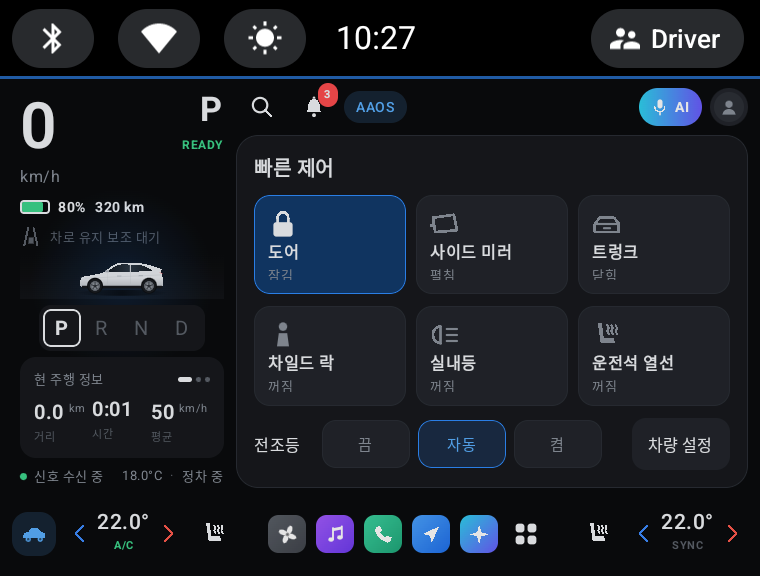

# 테스트 범위 점검과 보강 (2026-11-23)

테스트 129개가 충분한지 다시 점검하고, 빈 곳에 E2E 11개를 더해 140개로 만들었습니다. 더한 테스트는 세 기기에서 먼저 확인했고, 그 뒤 커밋 `55419f7`(커밋하지 않은 변경 없음)로 두 기기 × 3회를 다시 돌렸습니다. 앱이 지원하는 가장 작은 화면(760×500dp)에서도 처음으로 전체를 돌렸습니다.

## 1. 점검

| 본 것 | 기준 | 찾은 빈 곳 |
|---|---|---|
| 요구사항 조건 | [요구사항](../../requirements.md)의 조건 27개 | 테스트가 없는 조건 2개: SYS-01.4(권한 없는 신호를 '값 없음'으로), HVAC-04.5(온도를 직접 바꾸면 최대 냉방 해제). DRIVE-03은 조건이 여럿(막는 것 + 허용하는 것)인데 조건 표에 없었습니다. |
| 화면 요소 | 앱의 testTag 186개와 테스트·화면 객체가 쓰는 태그 | 약 30개를 누르거나 읽는 테스트가 없었습니다. 내비 분류(충전소·주차)·미리 보기 취소·도착 확인, 키패드 지우기·`*`·`#`, 알림 모두 지우기·빈 상태, '주행 가능 거리 정보 없음' 표시 등입니다. |
| 주행 중 제한의 반대쪽 | 앱 코드의 허용 규칙 | 접어 둔 사이드 미러를 주행 중에 펴는 것, 주행 중 분류 버튼으로 목적지를 고르는 것을 확인하는 테스트가 없었습니다. 막는 쪽만 보고 있었습니다. |
| 경계값 | 앱 코드의 한계값 | 키패드 13자리, 라디오가 대역 끝에서 반대쪽으로 넘어가는 것, FM/AM 주파수를 따로 기억하는 것 |
| 기기·화면 | 실행 기록 | 앱이 지원하는 가장 작은 앱 영역 760×500dp에서는 돌린 적이 없었습니다. |
| 단위 테스트 | `coverage run --branch` (기기 없이 `pytest unit`) | 프레임워크 181개, ivi·tools 분기 포함 64%. 추적표 도구 `trace_report.py`가 46%로 낮았고, 이 도구는 결과 페이지에 폴드 칸이 생긴 뒤로 `KeyError: 'fold'`로 멈춰 있었습니다. 추적표를 다시 만들어 보는 검사가 없어 CI는 통과했습니다. |
| 문서 숫자 | 코드 | 단위 테스트 '168개'(실제 181개), 앱 단위 '22개'(실제 26개) |

우선순위는 위험, 면접에서 설명할 근거로서의 가치, 작업량으로 정했습니다. 요구사항 문서에 '확인하지 않음'으로 남은 두 조건과 760×500dp 실행을 먼저 했습니다. 앱의 `CabinController` 규칙(오디오 하나만, 라디오 순환)을 JVM 단위 테스트로 옮기는 것은 `SettingsStore`가 Android `Context`를 받아 앱 코드를 고쳐야 해서 이번에는 하지 않았습니다.

## 2. 더한 것

| 테스트 | 요구사항 | 보는 것 |
|---|---|---|
| `test_manual_temperature_releases_max_ac` | HVAC-04.5 | FULL 중 운전석 +를 누르면 최대 냉방이 풀리고 운전석만 16.5°C. 풍량 7과 조수석 16.0°C를 켜기 전 값으로 되돌리지 않는지 1.5초 동안 봅니다. |
| `test_turning_auto_on_releases_max_ac` | HVAC-04.7 (새 조건) | FULL 중 AUTO를 켜면 전 좌석 `HVAC_MAX_AC_ON`이 꺼집니다. |
| `test_signal_without_permission_shows_no_value` | SYS-01.4 (AAOS 전용) | `pm revoke`로 CAR_ENERGY를 빼고(user-fixed로 권한 창 없이) 앱을 새로 띄우면 '주행 가능 거리 정보 없음'. 권한이 있는 외기 온도와 속도는 그대로, 거리 12 km를 넣어도 경고가 뜨지 않습니다. 끝나면 권한을 돌려주고 앱을 끕니다. |
| `test_folded_mirror_can_be_unfolded_while_driving` | DRIVE-03.5 | 주행 중에도 접힌 미러는 펼 수 있고, 편 뒤에는 접을 수 없습니다. |
| `test_category_shortcut_works_while_driving` (2) | DRIVE-03.1, NAV-01 | 주행 중 검색은 막혀도 충전소·주차 분류는 가까운 순 두 곳을 보여 주고 안내를 시작합니다. |
| `test_cancel_preview_returns_to_search` | NAV-01 | 미리 보기에서 취소하면 안내 없이 찾기 화면으로, 주행 정보에 경로가 생기지 않습니다. |
| `test_keypad_limits_length_and_edits` | MEDIA-02 | `*`, `#`, ⌫, 다 지우면 ⌫·통화 버튼이 꺼짐, 13자리 다음 누름은 버립니다. |
| `test_seek_wraps_around_band_ends` | MEDIA-02 | 89.1 MHz에서 이전 방송은 107.7 MHz, 거기서 다음은 89.1 MHz입니다. |
| `test_each_band_keeps_its_own_frequency` | MEDIA-02 | AM 720 kHz → FM → AM으로 돌아오면 720 kHz 그대로입니다. |
| `test_clearing_notifications_leaves_empty_panel` | UI-01 | 모두 지우기 뒤 '새 알림이 없습니다', 다시 열어도 비어 있습니다. |
| `test_arrival`에 확인 단계 | NAV-01 | 도착 화면의 '확인'으로 찾기 화면으로 돌아가고 경로 표시가 사라집니다(테스트 수는 그대로). |

- 요구사항 조건 표: 조건 27개 → 33개(HVAC-04.7, DRIVE-03.1~5를 더함), 테스트가 없는 조건 2개 → 0개.
- 마커: smoke 13 / sanity 25 그대로, regression 85 → 96, 전체 129 → 140개.
- 추적표 도구: 결과 칸 이름을 결과 페이지와 맞추고, 결과가 아직 없는 테스트를 '결과 없는 테스트'로 따로 셉니다(빼고 세면 '5/5 통과'처럼 보였습니다). 두 도구의 칸 이름이 다르거나 `docs/traceability.md`가 코드와 다르면 unit job이 실패합니다. 단위 테스트 181 → 185개.

## 3. 더한 테스트의 첫 확인 (세 기기)

커밋 전 작업 트리에서 돌렸습니다(결과 파일의 `commit`은 `89177b5`, `dirty` = true). E2E 코드(`ivi-tests/tests`, `ivi-tests/ivi`)는 `55419f7`과 같습니다. 앱은 0.4.1 (5)입니다. [runs-new-tests](runs-new-tests/)

| 기기 | 결과 |
|---|---|
| AAOS 에뮬레이터 (`20261123-new-aaos`) | 12개 중 11개 통과. 실패 1개는 첫 테스트 도중 UiAutomator2 계측 프로세스가 죽은 것입니다(세션 재연결 1번). 막 켠 에뮬레이터에서 원인 미확인으로 남은 그 현상입니다. 그 테스트만 다시 돌려 통과했습니다(`20261123-new-aaos-mirror`). |
| 화웨이 태블릿 (`20261123-new-tablet`) | 11개 통과, AAOS 전용 1개 건너뜀 (77초) |
| 갤럭시 폴드 (`20261123-new-fold`) | 11개 통과, AAOS 전용 1개 건너뜀 (80초). 첫 시도는 폰이 잠금 화면이라 멈췄고, 사용자가 잠금을 푼 뒤 돌렸습니다. |

## 4. 가장 작은 지원 화면 760×500dp

AAOS 에뮬레이터(1024×768, 160dpi)를 `adb shell wm size 760x576`으로 줄였습니다. 위 시스템 바 76px를 빼면 앱 영역이 760×500dp로, 앱이 지원한다고 정한 가장 작은 화면입니다. 끝난 뒤 `wm size reset`으로 되돌렸습니다. [runs-min760](runs-min760/)



| 실행 | 결과 |
|---|---|
| `20261123-min760` (140개, `--reruns 1`, 11분 31초) | 138 통과, 태블릿 전용 1 건너뜀, 실패 1. 앱을 대상으로 한 테스트는 모두 통과했습니다. |

- 실패 1개는 AAOS 기본 SystemUI를 보는 1단계 spike 테스트 `test_driver_temp_up_is_not_covered_by_home`입니다. 1024×768에서 운전석 온도 ▲가 홈 버튼에 72×76px 가려지는 플랫폼 결함([#21](https://github.com/bugspeaker/opencabin-ivi/issues/21))을 strict xfail로 걸어 두었는데, 760×576에서는 SystemUI 배치가 달라져 두 버튼이 겹치지 않아 XPASS(strict)가 됐습니다. 그 결함이 1024×768 배치에서만 생긴다는 확인이고, 이 앱의 결함은 아닙니다.
- 이 실행도 커밋 전 작업 트리(`89177b5`, dirty)이고 E2E 코드는 `55419f7`과 같습니다. 반복하지 않았습니다.

## 5. 지금 코드로 두 기기 × 3회

더한 테스트를 커밋(`55419f7`)한 뒤, 커밋하지 않은 변경 없이 두 기기 전체를 3회 반복했습니다. 폴드는 Release 게이트가 한 회차에 같은 종류(Mock) 기기 둘을 받지 않아 반복에 넣지 않고, 같은 커밋으로 따로 한 번 돌렸습니다.

```powershell
.venv\Scripts\python tools\run_bench.py --devices emulator-5554,W3VBB22125209573 --repeat 3 --reruns 1 --shots
.venv\Scripts\python -m pytest --serial R38M309YKQY --reruns 1 --shots --run-id 20261123-fold-140
```

| 회차 (run id) | AAOS 에뮬레이터 | 태블릿 (Mock) | 병렬 실행 |
|---|---|---|---|
| `20261123-194550-r1` | 138 통과, 1 건너뜀, 1 알려진 결함 (683초) | 132 통과, 8 건너뜀 (719초) | 721초 |
| `20261123-195750-r2` | 138 통과, 1 건너뜀, 1 알려진 결함 (703초) | 132 통과, 8 건너뜀 (719초) | 720초 |
| `20261123-200950-r3` | 138 통과, 1 건너뜀, 1 알려진 결함 (698초) | 132 통과, 8 건너뜀 (717초) | 718초 |
| `20261123-fold-140` (폴드, 따로 1회) | | 갤럭시 폴드: 132 통과, 8 건너뜀 (719초) | |

- 실행한 테스트 813건(AAOS 417건, 태블릿 396건. 기기 전용이라 건너뛴 것은 빼고, 알려진 결함으로 xfail된 3건은 넣은 수), 재시도 0번, flaky 0건, 실패 0건, 세션 재연결 0번.
- 결과 파일 6개 모두 `commit` = `55419f7…`, `dirty` = false, 앱 0.4.1 (5) APK sha256 `ccd0001f020a…`, `exitstatus` = 0, 수집 140개입니다([runs](runs/)). 폴드 결과 파일도 같은 커밋, 같은 APK입니다([runs-fold](runs-fold/)).
- Release 게이트 여섯 조건을 `--commit HEAD`(= `55419f7`)로 확인해 모두 통과했습니다([release-gate.txt](release-gate.txt)). 폴드 1회도 따로 확인해 통과했습니다([release-gate-fold.txt](release-gate-fold.txt), `--kinds mock --expect 1`).
- 기기당 시간이 11-21보다 1분쯤 늘었습니다(AAOS 약 10분 5초 → 11분 40초, 태블릿 약 10분 50초 → 12분). 테스트가 11개 늘었고, 권한 테스트는 앱을 새로 띄우고 키패드 테스트는 버튼을 18번 누릅니다.
- [결과 페이지](../../test-results.md)의 판정과 화면은 3회차와 폴드 1회입니다. 영상 화면 세 장(세 기기의 `test_video_resumes_where_it_stopped`)은 앞차 번호판을 흐리게 해서 올렸습니다.
- 반복 중에는 저장소의 추적 파일을 고치지 않았습니다. 결과 파일의 `dirty`는 실행을 시작할 때 저장소 전체에서 보므로, 문서를 고치면 다음 회차가 '커밋하지 않은 변경'으로 남습니다. 문서 수정은 반복이 끝난 뒤 했습니다.

다시 세는 방법 (`ivi-tests`에서):

```powershell
.venv\Scripts\python tools\flaky_report.py --runs-dir ..\docs\evidence\2026-11-23-coverage\runs
.venv\Scripts\python tools\release_gate.py --runs-dir ..\docs\evidence\2026-11-23-coverage\runs --expect 3 --commit 55419f7
```

## 이 실행 뒤에 바뀐 것

이 실행 뒤의 커밋은 문서, 소개 사이트, 결과 자료입니다. E2E 테스트 코드(`ivi-tests/tests`, `ivi-tests/ivi`)와 앱(`ivi-app`)은 `55419f7`과 같습니다.

```powershell
git diff --stat 55419f7 HEAD -- ivi-tests/tests ivi-tests/ivi ivi-app
```
