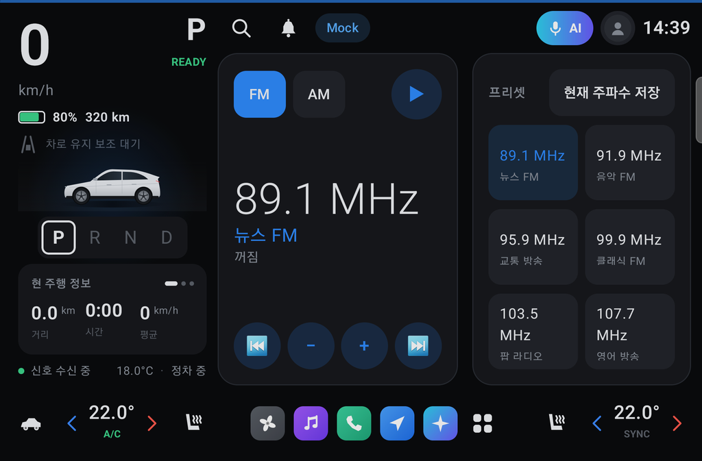
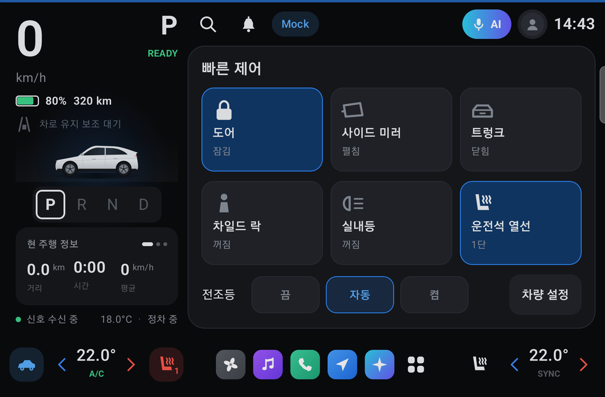
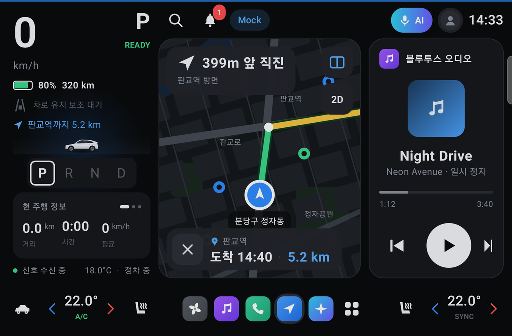
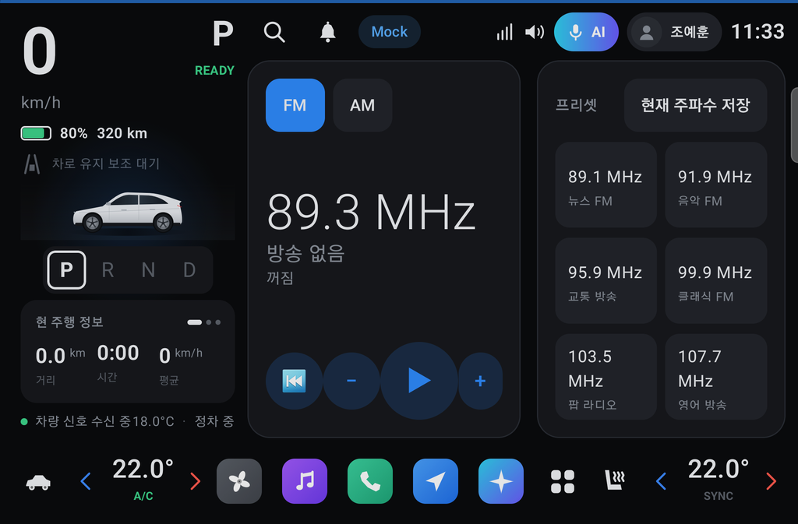
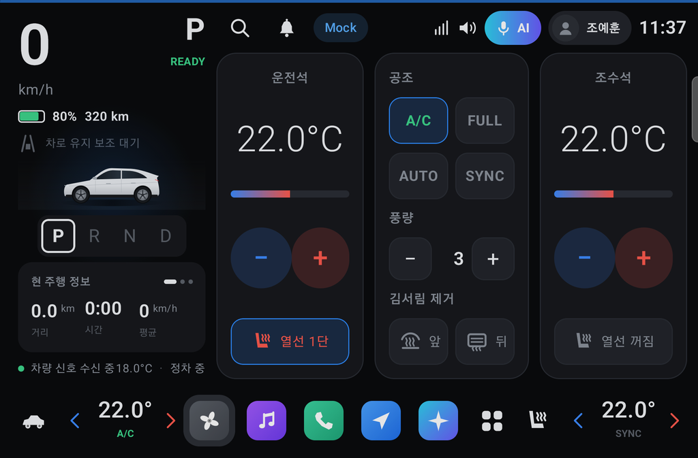
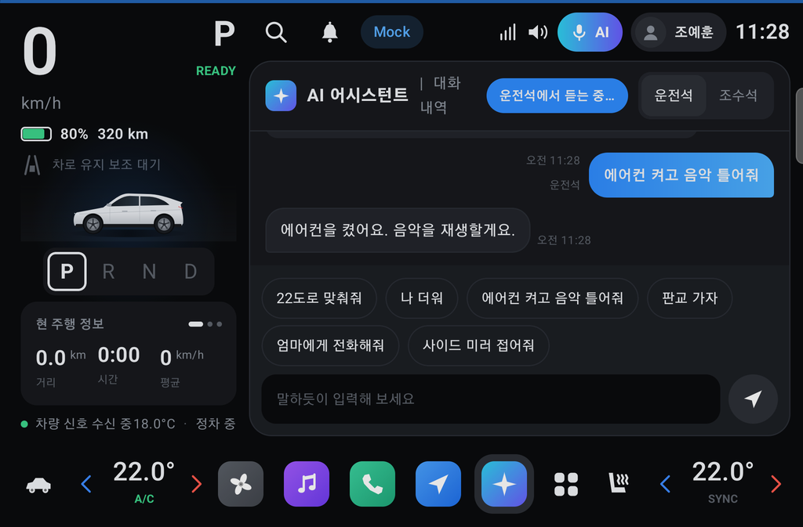
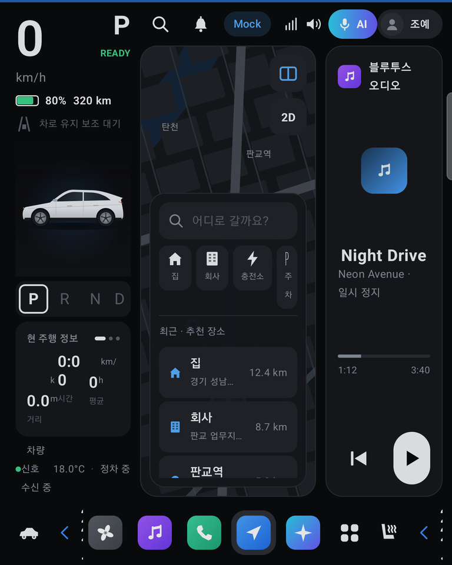

# 갤럭시 폴드에서 전체 E2E (2026-11-23)

AAOS 에뮬레이터와 화웨이 태블릿에 이어, 세 번째 기기로 갤럭시 폴드(1세대)를 USB로 연결해 같은 테스트 코드를 돌렸습니다. 폴드는 CarService가 없는 일반 기기라 태블릿과 같은 Mock 기기로 자동 판별됐고, 기기 설정 코드는 바꾸지 않았습니다.

| 시점 | 결과 |
|---|---|
| 배치 수정 전 (`c112673`, 앱 0.4.0) | sanity 25개 모두 통과. 전체 129개는 115 통과, 5 실패, 9 건너뜀, flaky 0. 실패 5개는 모두 화면이 좁거나 낮을 때 앱 배치가 넘친 데서 나왔습니다. |
| 배치 수정 후 (`7aaab6f`, 앱 0.4.1) | 폴드를 가로로 눕힌 실행과 세워 둔 실행 모두 122 통과, 7 건너뜀(AAOS 전용), 재시도 0. 같은 APK로 태블릿과 에뮬레이터도 2026-11-21과 같은 수가 나왔고, 세 실행 모두 Release 게이트를 통과했습니다. |

## 기기

| 항목 | 내용 |
|---|---|
| 모델 | SM-F900F (1세대 갤럭시 폴드), Android 12, One UI 4.1.1 |
| 펼친 화면 | 1536×2152, 420dpi. 앱 영역은 세로 약 585×732dp, 가로 약 780×513dp |
| 접힌 화면 (커버) | 720×1680, 420dpi (약 274×640dp) |
| 판별 | `mock:SM-F900F`, 사용자 0, 누르는 방법은 Appium click |
| 가로에서 앱이 못 쓰는 자리 | 왼쪽 104px은 카메라 컷아웃, 아래 126px은 삼성 작업 표시줄입니다. UiAutomator가 보는 화면은 2048×1410입니다. |
| 기존 기기 | AAOS 에뮬레이터 1024×768, 화웨이 태블릿 2560×1600. 둘 다 가로이고 앱 영역 폭이 1024dp입니다. |

## 배치 수정 전

`ivi-tests`에서 돌렸습니다.

```powershell
.venv\Scripts\python tools\install_app.py ..\ivi-app\app\build\outputs\apk\debug\app-debug.apk --devices R38M309YKQY
.venv\Scripts\python -m pytest --serial R38M309YKQY -m sanity --reruns 1 --run-id 20261123-fold-sanity-portrait -p no:randomly
.venv\Scripts\python -m pytest --serial R38M309YKQY --reruns 1 --run-id 20261123-fold-full-portrait
```

| 실행 (run id) | 화면 방향 | 결과 | 시간 |
|---|---|---|---|
| `20261123-fold-sanity-portrait` | 세로로 시작, 11:26:06부터 가로 | 25 통과, 재시도 0 | 129초 |
| `20261123-fold-full-portrait` | 가로 | 115 통과, 5 실패, 9 건너뜀<br>재시도 5번 모두 다시 실패 (flaky 0) | 668초 |

- 두 결과 파일 모두 `commit` = `c112673…`, `dirty` = false, 앱 0.4.0 (4) APK sha256 `7109e4bd03c8…`입니다. 2026-11-21 두 기기 반복 실행과 같은 APK입니다([runs](runs/)).
- run id의 `portrait`는 실행 전에 붙인 이름입니다. 자동 회전이 켜져 있어 sanity 도중 11:26:06에 화면이 가로로 돌았고(기기 로그 `Computed rotation=ROTATION_90`), 전체 실행은 처음부터 끝까지 가로였습니다.
- 건너뛴 9개는 AAOS 전용 7개와 영상 테스트 2개입니다. 폴드에 주행 영상을 올리지 않아 영상 테스트 2개가 건너뛰어졌습니다.
- Release 게이트는 조건 1(영상 테스트 건너뜀)과 조건 2(실패 5개)로 막았습니다([release-gate.txt](release-gate.txt)).
- 같은 테스트 코드와 APK로 화웨이 태블릿은 122 통과, 7 건너뜀(649초)이었습니다(2026-11-21 3회차, `d54741b`. `c112673`까지 E2E 테스트 코드와 앱 소스는 바뀌지 않았습니다).

### 실패 5개

| 테스트 | 원인 | 무엇이 일어났나 |
|---|---|---|
| `test_radio.py::`<br>`test_tune_and_seek`<br>`test_preset_save_and_recall`<br>`test_preset_and_frequency_survive_app_restart` | 앱 배치 결함 | 라디오 버튼 줄(`ivi-app/.../ui/Radio.kt`)은 56dp 버튼 4개와 76dp 전원 버튼을 한 줄에 놓아 300dp가 필요합니다. 가로 폴드에서 줄 폭은 약 235dp입니다. ⏭(`radio_seek_up`)가 패널 밖으로 밀리고 그 자리에 +가 그려져, ⏭를 누르면 0.1 MHz만 올라갔습니다(91.9 대신 89.3 MHz). |
| `test_vehicle_signals.py::`<br>`test_seat_heat_signal_is_shown_everywhere` | 앱 배치 결함 | 아래 바가 넘쳐 운전석 열선 버튼 폭이 126px에서 63px로 줄었고, 운전석 온도 ▲ 버튼 영역 안에 겹쳤습니다. 열선 단계 표시(`bar_seat_heat_driver_level`)는 화면 구조에서 빠졌습니다. |
| `test_assistant.py::`<br>`test_ambiguous_destination_offers_candidates` | 화면 높이(기기 특성)와 테스트 코드 | '판교 가자'로 후보 3곳까지는 나왔습니다. 앱 높이가 약 513dp라 세 번째 후보 카드가 대화 목록 아래에 10px만 보였고, Appium이 그 가운데를 누르자 바로 아래 추천 칩 '에어컨 켜고 음악 틀어줘'가 눌렸습니다. 테스트의 누르기(`Screen.tap`)는 거의 가려진 요소도 그대로 누릅니다. |

- 후보 카드 문제는 7단계에 AAOS 1024×768에서 같은 종류를 겪고 줄여 둔 곳입니다([7단계 6-2](../../phase7-layout.md#6-2-후보-카드가-대답을-화면-밖으로-밀어냄-낮은-화면에서만)). 폴드 가로는 그보다 더 낮습니다.
- 실패마다 실패 순간의 요소 위치와, 찾은 요소·클릭·터치 순서를 [artifacts](artifacts/)에 남겼습니다. logcat과 화면 구조 전체에서 이 앱과 관련된 줄만 뽑았습니다.

### 세로 화면과 접기

테스트로는 확인하지 못했고, 화면과 화면 구조로만 본 것입니다.

| 상태 | 본 것 |
|---|---|
| 펼친 세로 (585dp) | 아래 바의 운전석 온도 글자 폭이 9px로 줄고, 온도 ▲가 열선·공조 버튼과 겹칩니다. 상단 바 끝의 시계는 그려지지 않습니다(`ui/Shell.kt`의 `TopBar`에 넘칠 때의 처리가 없습니다). 주행 정보 위젯의 글자도 겹칩니다. 수정 후 앱은 가로 전용이라 이 배치는 더 이상 쓰이지 않습니다. |
| 접힘 (커버 화면) | `adb shell cmd device_state state 0`으로 접힌 상태를 흉내 냈습니다. 화면이 커버 패널로 바뀌고 앱 대신 잠금 화면이 떴습니다. 삼성 기본 설정에서는 접으면 앱이 커버 화면으로 이어지지 않아, 커버 화면에서는 테스트하지 못했습니다. 접고 펴는 동안 앱 프로세스는 그대로였고(pid 같음) crash·ANR 기록은 없었습니다. `state reset`으로 되돌렸습니다. |

## 배치 수정 후

배치 수정은 커밋 `7aaab6f`([#40](https://github.com/bugspeaker/opencabin-ivi/pull/40))입니다. 바뀐 것은 아래와 같습니다.

- 앱을 가로 전용(`sensorLandscape`)으로 바꾸고, 지원하는 최소 앱 영역을 760×500dp로 정했습니다.
- 앱 영역 폭이 1000dp 미만이거나 높이가 600dp 미만일 때만 좁은 배치를 씁니다. 폭 1024dp인 에뮬레이터와 태블릿은 원래 배치 그대로입니다.
- 라디오는 전원 버튼을 대역 버튼 줄로 옮겨 아래 줄에 버튼 네 개만 둡니다. 아래 바는 버튼을 줄이고, 상단 바는 신호·음량 기호와 프로필 이름을 뺍니다. 낮은 화면에서는 어시스턴트의 목적지 후보를 가로 카드 세 장으로 놓습니다.
- 테스트의 `Screen.tap`은 보이는 부분이 16dp보다 작은 요소를 스크롤해서 보이게 하고, 그래도 안 보이면 누르지 않고 `HiddenElement`로 실패합니다. 화면 가장자리에서 잘린 요소는 그대로 누릅니다.
- 앱 버전을 0.4.0 (4)에서 0.4.1 (5)로 올렸습니다.

| 실행 (run id) | 기기 | 화면 방향 | 결과 | 시간 |
|---|---|---|---|---|
| `20261123-fold-after-landscape` | 폴드 | 가로로 눕힘. 실행 내내 화면 가로 | 122 통과, 7 건너뜀, 재시도 0 | 711초 |
| `20261123-fold-after-portrait` | 폴드 | 세로로 세움. 센서는 세로였고 앱 화면은 실행 내내 가로 | 122 통과, 7 건너뜀, 재시도 0 | 702초 |
| `20261123-after-wide` | 화웨이 태블릿 | 가로 | 122 통과, 7 건너뜀, 재시도 0 | 666초 |
| `20261123-after-wide` | AAOS 에뮬레이터 | 가로 | 127 통과, 1 건너뜀, 1 알려진 결함, 재시도 0 | 655초 |

- 결과 파일 4개 모두 `commit` = `7aaab6f…`, `dirty` = false, 앱 0.4.1 (5) APK sha256 `ccd0001f020a…`입니다. 세 기기가 같은 APK이고, 모두 `--reruns 1 --shots`로 돌았습니다([runs-after](runs-after/)).
- 폴드에서 건너뛴 7개는 모두 AAOS 전용입니다. 이번에는 주행 영상을 올려서 영상 테스트 2개도 돌았습니다. 수정 전에 실패한 5개는 모두 통과했습니다.
- 태블릿과 에뮬레이터의 수는 2026-11-21 반복 실행과 같습니다.
- Release 게이트 여섯 조건을 `--commit 7aaab6f`로 확인해 세 실행 모두 통과했습니다([release-gate-after.txt](release-gate-after.txt)).
- 폴드 두 실행의 화면 방향은 실행 전, 중, 후에 `dumpsys window`로 기록했습니다([logs](logs/)).
- 정확히 760×500dp인 화면에서는 돌려 보지 않았습니다. 돌려 본 가장 작은 화면은 폴드 가로(약 780×513dp)입니다.

| 라디오: ⏭까지 네 버튼이 한 줄에 | 공조: 아래 바 양쪽에 열선 버튼 |
|---|---|
|  |  |

| 어시스턴트: 판교역을 골라 안내 시작 | 수정 전 라디오 (비교) |
|---|---|
|  |  |

| 수정 전 공조 (비교) | 수정 전 어시스턴트: 후보 대신 추천 칩이 눌린 뒤 |
|---|---|
|  |  |



화면은 상태 표시줄과 삼성 작업 표시줄을 잘라 내고 절반 크기로 줄였습니다. 수정 후 화면은 폴드 가로 실행에서 판정 직후 남긴 것입니다.

## 폴드를 붙이며 확인한 것

- 앱 설치와 Appium 보조 앱 설치에 기기 승인 창이 뜨지 않았습니다. 설치마다 승인이 필요한 화웨이와 다릅니다.
- Appium click 352번이 평균 0.57초였습니다. 화웨이(약 10초)와 달리 adb tap으로 바꿀 필요가 없어 기본값(appium)을 그대로 썼습니다.
- 화면 꺼짐 시간(30초)과 개발자 옵션은 바꾸지 않았습니다. 수정 전 실행에서는 화면이 꺼지면 다시 켜는 스크립트를 함께 돌렸고, 두 실행 동안에는 한 번도 동작하지 않았습니다.

다시 세는 방법 (`ivi-tests`에서):

```powershell
.venv\Scripts\python tools\flaky_report.py --runs-dir ..\docs\evidence\2026-11-23-fold\runs
.venv\Scripts\python tools\release_gate.py --runs-dir ..\docs\evidence\2026-11-23-fold\runs --runs 20261123-fold-full-portrait --kinds mock --commit c112673
.venv\Scripts\python tools\release_gate.py --runs-dir ..\docs\evidence\2026-11-23-fold\runs-after --runs 20261123-fold-after-landscape --kinds mock --commit 7aaab6f
.venv\Scripts\python tools\release_gate.py --runs-dir ..\docs\evidence\2026-11-23-fold\runs-after --runs 20261123-after-wide --commit 7aaab6f
```

`7aaab6f`는 #40이 합쳐지기 전에는 `claude/focused-jones-e54084` 브랜치에만 있습니다. 게이트를 다시 돌리기 전에 그 브랜치를 가져와야 합니다.
