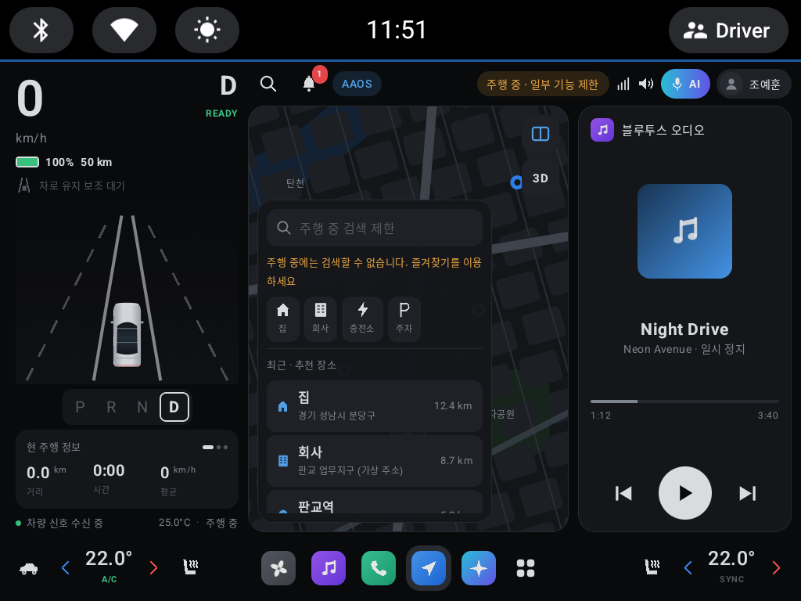
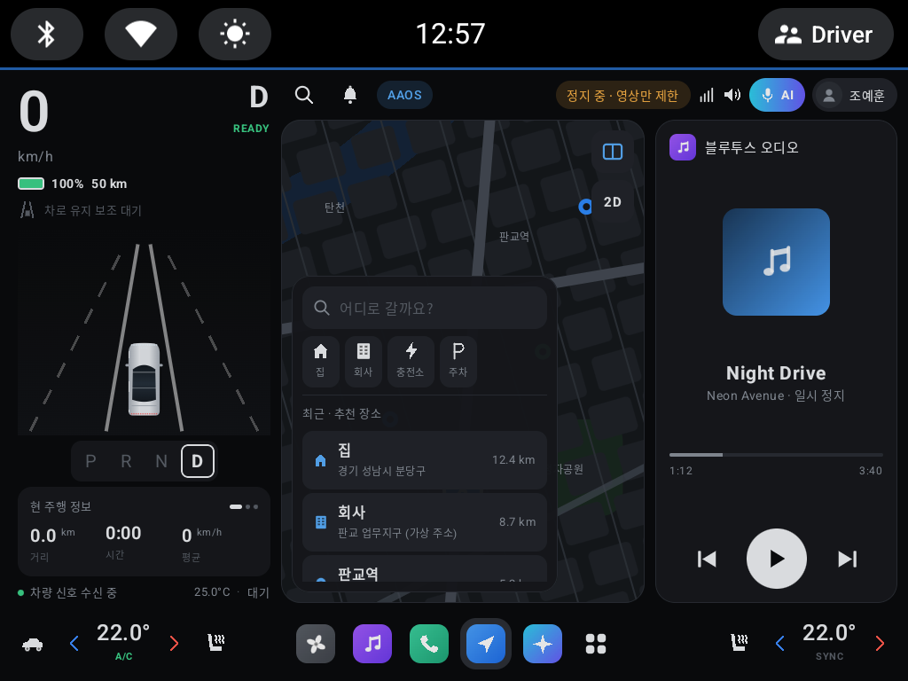

# P가 아닌 채 멈춘 상태의 주행 제한 (2026-11-23, [#47](https://github.com/bugspeaker/opencabin-ivi/issues/47))

AAOS 테스트 자료(AOSP의 주행 중 UX 제한 문서, 차량 앱 품질 기준)를 찾아본 뒤 AAOS 에뮬레이터의 UX 제한 설정을 직접 읽다가 찾은 결함입니다.

## 플랫폼 설정

`adb shell dumpsys car_service --services CarUxRestrictionsManagerService`로 읽은 에뮬레이터(sdk_gcar_x86_64, API 34) 설정입니다. 원문은 [uxr-config.txt](uxr-config.txt)에 있습니다.

| 주행 상태 | 정의 (AOSP) | 제한 |
|---|---|---|
| parked | 기어 P | 없음 (`0x0`) |
| idling | P가 아니고 속도 0 | 영상만 (`0x10`, NO_VIDEO) |
| moving | P가 아니고 속도 > 0 | 전부 (`0xff`), 0~5 km/h와 5 km/h~ 두 구간이 같은 값 |

## 수정 전 (앱 0.4.1)

D 기어, 0 km/h(VHAL에 기어 8, 속도 0을 넣음)에서 AAOS 앱은 상단에 '주행 중 · 일부 기능 제한'을 띄우고 내비 검색을 막았습니다. 플랫폼은 영상만 막고 있었습니다(display 0 `DO: true UxR: 16`).



태블릿과 폴드의 Mock 차량은 `기어 != P && 속도 > 0`일 때만 제한해서, 같은 상태에서 영상 화면이 재생됐습니다(`MockVehicleDataSource`의 수정 전 코드).

## 수정

- 앱 상태가 플랫폼의 제한 종류(`uxRestrictions`)를 들고, 화면마다 자기에게 해당하는 종류만 봅니다: 영상 NO_VIDEO, 내비 검색·어시스턴트 입력 NO_KEYBOARD, 키패드 NO_DIALPAD, 연락처 목록 LIMIT_CONTENT.
- AAOS는 `CarUxRestrictions.getActiveRestrictions()`를 그대로 쓰고, Mock은 위 표를 `UxRules.forDriving()`으로 계산합니다.
- 사이드 미러 접기와 트렁크는 UX 제한에 없는 앱 규칙이라, 차가 실제로 움직일 때(P가 아니고 속도 > 0)만 막습니다.
- 상단 배지는 글자 입력까지 막히면 '주행 중 · 일부 기능 제한', 영상만 막히면 '정지 중 · 영상만 제한'입니다.
- 앱 0.4.2 (6).

## 더한 테스트

| 테스트 | 보는 것 |
|---|---|
| `test_stopped_in_gear_blocks_only_video[D]`, `[N]` | 플랫폼 쪽 UX 제한이 `0x10`이고, 화면에서는 영상 버튼만 꺼지며 검색·키패드·미러·트렁크는 그대로입니다. P로 바꾸면 영상 버튼이 켜집니다. |
| `test_video_screen_is_blocked_while_stopped_in_drive` | D 기어로 멈춘 채 영상 화면을 바로 열어도 막히고(AAOS는 OS가, Mock은 앱이), P에서 재생 화면이 나옵니다. |
| `test_restrictions_follow_stop_and_go_timeline` | 시간에 따라 속도를 바꾸는 신호 대기 시나리오입니다. P → D 정지(3초) → 3 km/h(2초) → 정지(3초) → 60 km/h(3초) → N 정지(2초) → P. 단계마다 UX 제한, 검색 입력, 배지가 바로 바뀌는지 보고, 머무는 동안 `stays`로 흔들리지 않는지 봅니다. 신호를 넣고 화면이 따라오기까지 걸린 시간을 결과(`restriction_seconds`)에 남깁니다. |

앱 JVM 테스트 `UxRulesTest` 6개와 `CabinAssistantTest`의 정지 상태 1개, 어댑터 단위 테스트 10개(`ux_restrictions()` 읽기, 기어 지정)도 더했습니다.

## 수정 후 (앱 0.4.2)

같은 상태(D 기어, 0 km/h)에서 상단 배지는 '정지 중 · 영상만 제한'이고, 내비 검색('어디로 갈까요?')을 쓸 수 있습니다.



## 기기 실행

### 첫 확인 (AAOS 에뮬레이터)

커밋 전 작업 트리에서 주행 제한과 관련된 기존 테스트 17개와 새 테스트 4개를 돌렸습니다(`20261123-ux-aaos`, [runs-first](runs-first/)). 21개 모두 통과했고, 1개(`test_driving_locks_typing_and_refuses_mirror_fold`)는 막 켠 에뮬레이터에서 UiAutomator2 계측 프로세스가 죽어 세션을 다시 붙인 뒤 재시도에서 통과했습니다.

### 두 기기 × 3회와 폴드 1회

커밋 `de9d062`(커밋하지 않은 변경 없음, 앱 0.4.2 (6) APK sha256 `c977c9069411…`)에서 돌렸습니다. 태블릿은 설치할 때 기기 화면의 보안 확인을 사용자가 눌렀습니다.

```powershell
.venv\Scripts\python tools\run_bench.py --devices emulator-5554,W3VBB22125209573 --repeat 3 --reruns 1 --shots
.venv\Scripts\python -m pytest --serial R38M309YKQY --reruns 1 --shots --run-id 20261123-fold-144
```

| 회차 (run id) | AAOS 에뮬레이터 | 태블릿 (Mock) | 병렬 실행 |
|---|---|---|---|
| `20261123-211828-r1` | 142 통과, 1 건너뜀, 1 알려진 결함 (738초) | 136 통과, 8 건너뜀 (769초) | 770초 |
| `20261123-213119-r2` | 142 통과, 1 건너뜀, 1 알려진 결함 (739초) | 136 통과, 8 건너뜀 (769초) | 770초 |
| `20261123-214409-r3` | 142 통과, 1 건너뜀, 1 알려진 결함 (730초) | 136 통과, 8 건너뜀 (761초) | 763초 |
| `20261123-fold-144` (폴드, 따로 1회) | | 갤럭시 폴드: 136 통과, 8 건너뜀 (763초) | |

- 실행한 테스트 837건(AAOS 429건, 태블릿 408건), 재시도 0번, flaky 0건, 실패 0건, 세션 재연결 0번입니다([runs](runs/), [runs-fold](runs-fold/)).
- Release 게이트 여섯 조건을 `--commit de9d062`로 확인해 모두 통과했습니다([release-gate.txt](release-gate.txt)). 폴드 1회도 따로 확인해 통과했습니다([release-gate-fold.txt](release-gate-fold.txt)).
- 신호 대기 시나리오에서 신호를 넣고 화면이 따라오기까지 걸린 시간(3회차, 단계 순서대로)입니다. 세 기기 모두 단계마다 1초 안이었습니다.

| 기기 | P | D 정지 | 3 km/h | 정지 | 60 km/h | N 정지 | P |
|---|---|---|---|---|---|---|---|
| AAOS 에뮬레이터 | 0.2초 | 0.6초 | 0.6초 | 0.2초 | 0.2초 | 0.7초 | 0.6초 |
| 태블릿 | 0.3초 | 0.4초 | 0.3초 | 0.4초 | 0.4초 | 0.4초 | 0.4초 |
| 갤럭시 폴드 | 0.4초 | 0.4초 | 0.9초 | 0.4초 | 0.4초 | 0.4초 | 0.5초 |

- [결과 페이지](../../test-results.md)의 판정과 화면은 3회차와 폴드 1회입니다. 영상 화면 세 장(`test_video_resumes_where_it_stopped`)은 앞차 번호판을 흐리게 해서 올렸습니다.

다시 세는 방법 (`ivi-tests`에서):

```powershell
.venv\Scripts\python tools\flaky_report.py --runs-dir ..\docs\evidence\2026-11-23-idling\runs
.venv\Scripts\python tools\release_gate.py --runs-dir ..\docs\evidence\2026-11-23-idling\runs --expect 3 --commit de9d062
```

## 이 실행 뒤에 바뀐 것

이 실행 뒤의 커밋은 문서, 소개 사이트, 결과 자료입니다. E2E 테스트 코드(`ivi-tests/tests`, `ivi-tests/ivi`)와 앱(`ivi-app`)은 `de9d062`와 같습니다.

```powershell
git diff --stat de9d062 HEAD -- ivi-tests/tests ivi-tests/ivi ivi-app
```
