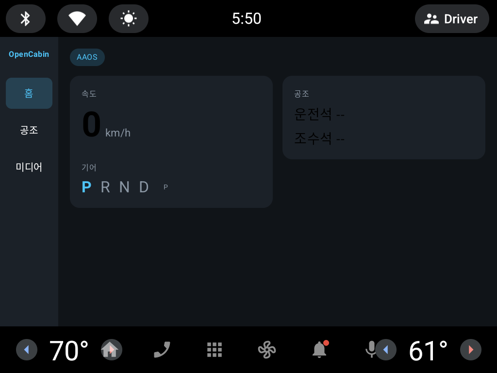
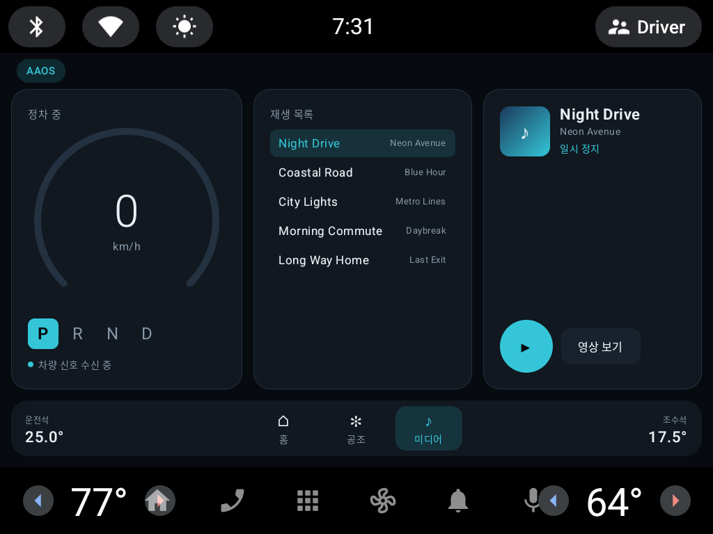

# 5단계 재점검과 디자인 개편

작성 2026-11-13. 1~4단계를 차례로 다시 점검하고, 앱 화면을 양산 차량 IVI 구조에 가깝게 바꿨다. 바꾼 뒤 전체 회귀로 확인했다.

## 1. 재점검 (디자인을 바꾸기 전)

| 단계 | 확인 | 결과 |
|---|---|---|
| 환경 | 기기 2대 연결, Appium, 에뮬레이터 root·운전자 사용자 10, priv-app·공조 권한 | 정상 |
| 1단계 | spike 테스트 | 5 passed, 1 xfailed (알려진 SystemUI 결함) |
| 2단계 | clean build + Android Lint | 빌드 성공, Lint 0 errors / 5 warnings, Kotlin deprecated 경고 5건 |
| 2단계 | priv-app 위에 `adb install -r` 로 덮어쓴 뒤 권한 | `/data` 에 새 버전, `/system/priv-app` 원본 유지, `CONTROL_CAR_CLIMATE` 유지 (문서 내용을 실제로 확인) |
| 3·4단계 | 단위 테스트 / 두 기기 병렬 전체 | 22 passed / AAOS 30 passed + 1 xfailed, 태블릿 25 passed, flaky 0 |

재점검에서 같이 본 것
- `CAR_SPEED: granted=false` 로 보였던 것은 시스템 사용자 0 의 값이었다. 화면을 쓰는 운전자 사용자 10 은 `granted=true` 로 정상.
- clean build 는 APK 바이트가 달라져 `install_app.py` 가 두 기기에 다시 설치했다. 화웨이는 기기 승인이 필요하다 → **설치 전에 미리 알리기로 했다.**

## 2. 참고한 것

| 출처 | 가져온 구조 |
|---|---|
| Pleos Connect 보도자료 (Hyundai, 2026-04-30) — 42dot 이 AAOS 기반으로 개발한 차세대 인포테인먼트 | 넓은 중앙 화면에서 **왼쪽은 주행 정보(속도·기어), 오른쪽은 앱 화면**. **아래 바**에서 최근·고정 앱을 한 번에 연다. 단일/분할 화면, 복잡한 그래픽 대신 단순한 아이콘 |
| 현대차그룹 UX 기사 (2020, 이전 세대 AVNT) | 아쿠아 블루 계열 색, 홈은 브랜드 정체성·기능 화면은 가독성 우선, **주행 중에는 터치 영역·글자를 키우고 애니메이션을 줄인다** |
| ccNC 사용자 설명서 | 위젯(카드)으로 된 홈, 분할 화면 |

- 원칙: **화면 구조와 디자인 방향만 따르고, 제조사 로고·제품명·전용 글꼴·아이콘은 쓰지 않는다.** 앱 이름(OpenCabin)과 아이콘은 자체 제작.
- 출처: https://www.hyundai.news/eu/articles/press-releases/pleos-connect-infotainment-system.html ,
  https://www.motor1.com/news/755270/hyundai-next-generation-infotainment-ploes-connect/ ,
  https://www.hyundaimotorgroup.com/story/CONT0000000000003395 ,
  https://ownersmanual.hyundai.com/ivi/ccNC_Lite/AV/EUR/English/Systemoverview_home.html

## 3. 바뀐 화면

| 전 | 후 (주행 중) |
|---|---|
|  |  |

| 공조 | 미디어 |
|---|---|
|  |  |

| 영역 | 전 | 후 |
|---|---|---|
| 배치 | 왼쪽 세로 탭 + 카드 | **왼쪽 주행 정보 패널(항상 보임) + 오른쪽 앱 영역 + 아래 앱 바** |
| 주행 정보 | 홈 카드 안의 숫자 | 속도 게이지(0~200 km/h 호), 기어 선택 표시(지금 기어만 강조), 차량 신호 수신 상태 |
| 앱 바 | - | 홈·공조·미디어 버튼(64dp), 양 끝에 좌석 온도 표시 |
| 홈 | 속도·공조 카드 | 미디어(앨범·재생 위치), 공조 요약, 차량 연결 카드 |
| 공조 | 버튼 + 숫자 | 큰 온도, 16~28°C 막대(파랑→주황), 원형 −/+ 76dp |
| 미디어 | 텍스트 목록 | 곡·가수 목록, 앨범 아트, 원형 재생 버튼, 영상 버튼 |
| 영상 | 글자만 | 상단 제목·닫기, 영상 자리, 재생 바. 차단 화면도 같은 톤 |
| 상태 줄 | 배지만 | AAOS 는 시스템 바와 겹치지 않게 시계·프로필을 빼고, 태블릿에서만 표시 |
| 색 | 단색 강조 | 거의 검정 바탕 + 아쿠아 블루 강조, 주의는 주황 |
| 앱 아이콘 | 없음 (Lint 경고) | 자체 벡터 아이콘 (계기판 호) |

같이 고친 코드
- 권한 요청: deprecated `onRequestPermissionsResult` → Activity Result API
- Car API: `registerCallback` 등은 API 35 에서 deprecated 지만 대상이 API 34 라 대체 API 를 쓸 수 없다 → 이유를 적고 `@Suppress`
- 영상 화면의 임시 `Int.dp()` 확장 함수 제거
- 결과: **Kotlin 경고 5 → 0, Lint 경고 5 → 4** (남은 것: 의도한 targetSdk 34, 라이브러리 새 버전 안내 3)

## 4. 회귀에서 잡은 것

### 4-1) 디자인이 바뀌어 미디어 테스트 4건 실패 (테스트 계약 수정)
- 증상: `now_playing_title` 이 `''` 가 되기를 기다리다 실패. 실패 자료의 화면에서는 앱이 정상으로 곡을 바꾸고 있었다.
- 원인: 목록 한 줄(`track_N`)이 '제목 + 가수' 두 글자를 담는 줄로 바뀌어 **줄 자체의 글자가 빈 값**이 됐다. 테스트가 줄의 글자를 곡 제목으로 읽고 있었다.
- 해결: 제목 글자에 `track_N_title` 태그를 따로 붙이고, 화면 객체 `Media.select_track()` 만 고쳤다. **테스트 코드는 그대로** — 화면 객체가 변경을 흡수했다.
- 같은 이유로 기어 표시는 따로 있던 작은 글자(`gear_value`) 대신 **지금 기어 칸 자체**에 태그를 붙였다.

### 4-2) VHAL 값 주입이 한 번 실패 (도구 쪽 일시 오류)
- 증상: flaky 1건. 정리 단계에서 정차로 되돌리는 `dumpsys VHAL --set`(속도 0) 이 `failed to set property` 로 한 번 실패. 누적 200여 회 중 1회.
- 실패 자료가 없었다 → 실패 자료를 setup/call 실패에만 남기고 있었다. **정리(teardown) 실패도 남기도록** 고쳤다 (`…__teardown` 폴더).
- 해결: 신호를 넣는 도구 쪽 일시 오류라 `AaosVehicle.force()` 에서 0.3초 뒤 한 번 더 시도한다. 두 번 다 실패하면 그대로 실패.
  다시 시도한 사실은 JUnit property `vhal_retry` → 결과 기록 `infra_retries` → flaky 리포트 '신호 재시도' 열로 남겨 숨기지 않는다. 단위 테스트 3건 추가.

### 4-3) 화웨이에서 '맨 위 액티비티' 를 못 읽음
- `dumpsys activity activities` 형식이 다르다: AAOS(API 34)는 `topResumedActivity=…`, 화웨이(Android 12 기반)는 `mResumedActivity: …` 만 나온다.
- 영향: 태블릿 실패 자료의 `activities.txt` 와 앱 재실행 기록의 '맨 위' 가 비어 있었다 (판정에는 영향 없음 — 태블릿 영상 차단은 화면 요소로 판정).
- 해결: `Adb.resumed_activities()` 가 두 형식을 모두 읽는다.

## 5. 결과

| 항목 | 결과 |
|---|---|
| 단위 테스트 | 25 passed (0.3초) |
| 두 기기 병렬 전체 × 3회 (`--reruns 1`) | 3회 모두 게이트 통과. AAOS 30 passed + 1 xfailed, 태블릿 25 passed + 6 skipped. flaky 0, 앱 재실행 0, 실패 자료 0 |
| 병렬 시간 | 2분 10초 ~ 2분 22초 (차례로 돌리면 약 3분 40초, 1.6배) |

flaky 리포트 읽는 법 (이번 기록 기준)
- '격리 후보' 에 5건이 올라왔다 (불안정 11%, 9회 중 1회). 미디어 4건은 4-1 의 디자인 개편 중 실패, 1건은 4-2 의 VHAL 일시 오류다. 둘 다 원인을 고쳤고 이후 3회 연속 통과라 **격리하지 않았다.**
- 리포트는 '흔들림' 과 '한 번 깨졌다가 고친 것' 을 구분하지 못한다. 후보는 사람이 원인을 보고 정한다 — 숫자는 판단의 시작점이다.
