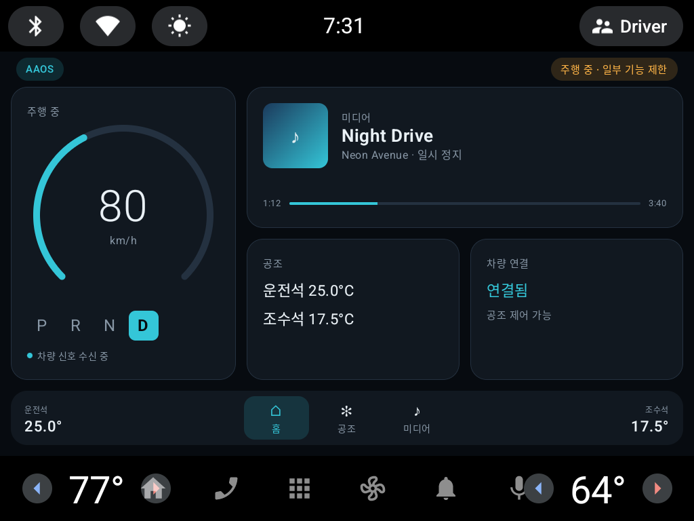
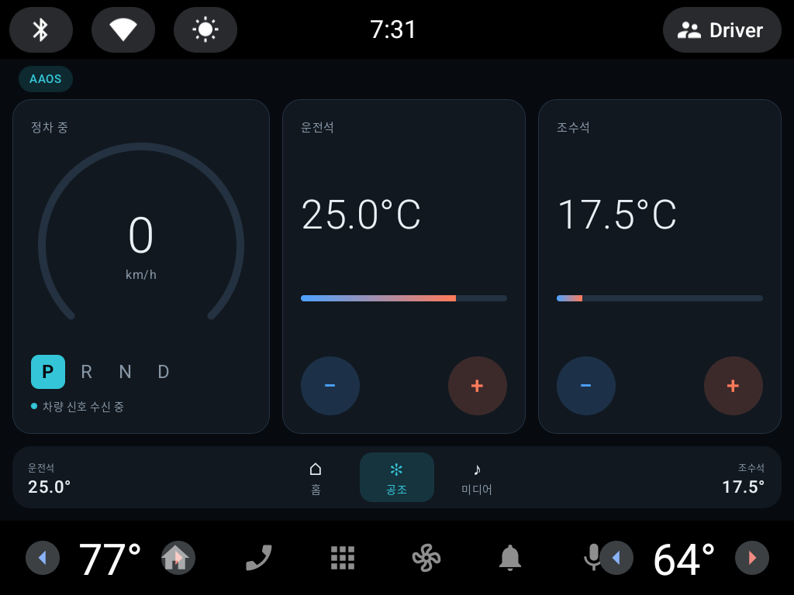

# 5단계 재점검과 디자인 개편

2026-11-13에 정리했습니다. 1~4단계를 차례로 다시 점검한 뒤, 앱 화면을 양산 차량의 IVI 구조에 가깝게 바꿨습니다. 바꾼 뒤에는 전체 회귀 테스트로 확인했습니다.

## 1. 디자인을 바꾸기 전 재점검

| 단계 | 확인한 것 | 결과 |
|---|---|---|
| 환경 | 기기 두 대 연결, Appium, 에뮬레이터 root와 운전자 사용자 10, priv-app과 공조 권한 | 모두 정상 |
| 1단계 | spike 테스트 | 5개 통과, 1개 알려진 결함(SystemUI) |
| 2단계 | clean build와 Android Lint | 빌드 성공. Lint 오류 0개, 경고 5개, Kotlin deprecated 경고 5개 |
| 2단계 | priv-app 위에 `adb install -r`로 덮어쓴 뒤의 권한 | 새 버전은 `/data`에, 원본은 `/system/priv-app`에 그대로 있고 `CONTROL_CAR_CLIMATE`도 유지됐습니다. 문서에 적은 내용을 실제로 확인했습니다. |
| 3, 4단계 | 단위 테스트와 두 기기 병렬 전체 실행 | 단위 22개 통과. AAOS 30개 통과와 1개 알려진 결함, 태블릿 25개 통과, flaky 0 |

점검하면서 함께 본 것이 두 가지 있습니다.

- `CAR_SPEED: granted=false`로 보였던 것은 시스템 사용자 0의 값이었습니다. 화면을 쓰는 운전자 사용자 10은 `granted=true`로 정상이었습니다.
- clean build를 하면 APK 바이트가 달라져서 `install_app.py`가 두 기기에 다시 설치합니다. 화웨이는 기기에서 승인해야 해서, 설치하기 전에 미리 알리기로 했습니다.

## 2. 참고한 것

| 출처 | 가져온 구조 |
|---|---|
| Pleos Connect 보도자료 (Hyundai, 2026-04-30). 42dot이 AAOS를 바탕으로 개발한 차세대 인포테인먼트입니다. | 넓은 중앙 화면에서 왼쪽은 속도와 기어 같은 주행 정보, 오른쪽은 앱 화면입니다. 아래 바에서 최근 앱과 고정 앱을 바로 열고, 단일 화면과 분할 화면을 오갑니다. 복잡한 그래픽 대신 단순한 아이콘을 씁니다. |
| 현대차그룹 UX 기사 (2020, 이전 세대 AVNT) | 아쿠아 블루 계열 색을 쓰고, 홈은 브랜드 느낌을, 기능 화면은 읽기 쉬움을 우선합니다. 주행 중에는 터치 영역과 글자를 키우고 애니메이션을 줄입니다. |
| ccNC 사용자 설명서 | 위젯(카드)으로 된 홈과 분할 화면 |

화면 구조와 디자인 방향만 참고했고, 제조사 로고나 제품명, 전용 글꼴, 아이콘은 쓰지 않았습니다. 앱 이름(OpenCabin)과 아이콘은 직접 만들었습니다.

출처는 다음과 같습니다.

- https://www.hyundai.news/eu/articles/press-releases/pleos-connect-infotainment-system.html
- https://www.motor1.com/news/755270/hyundai-next-generation-infotainment-ploes-connect/
- https://www.hyundaimotorgroup.com/story/CONT0000000000003395
- https://ownersmanual.hyundai.com/ivi/ccNC_Lite/AV/EUR/English/Systemoverview_home.html

## 3. 바뀐 화면

| 바꾸기 전 | 바꾼 뒤 (주행 중) |
|---|---|
|  |  |

| 공조 | 미디어 |
|---|---|
|  |  |

| 부분 | 바꾸기 전 | 바꾼 뒤 |
|---|---|---|
| 배치 | 왼쪽 세로 탭과 카드 | 왼쪽에 늘 보이는 주행 정보, 오른쪽 앱 영역, 아래 앱 바 |
| 주행 정보 | 홈 카드 안의 숫자 | 0~200 km/h 속도 게이지, 현재 기어만 강조한 기어 표시, 차량 신호 수신 상태 |
| 앱 바 | 없음 | 홈, 공조, 미디어 버튼(64dp)과 양 끝의 좌석 온도 |
| 홈 | 속도 카드와 공조 카드 | 미디어(앨범과 재생 위치), 공조 요약, 차량 연결 카드 |
| 공조 | 버튼과 숫자 | 큰 온도 숫자, 파랑에서 주황으로 바뀌는 16~28°C 막대, 76dp 둥근 −, + 버튼 |
| 미디어 | 글자 목록 | 곡과 가수 목록, 앨범 아트, 둥근 재생 버튼, 영상 버튼 |
| 영상 | 글자만 있었습니다. | 위쪽 제목과 닫기, 영상 자리, 재생 바. 차단 화면도 같은 톤으로 |
| 상태 줄 | 배지만 있었습니다. | AAOS에서는 시스템 바와 겹치지 않게 시계와 프로필을 빼고, 태블릿에서만 보여 줍니다. |
| 색 | 한 가지 강조색 | 거의 검은 바탕에 아쿠아 블루 강조, 주의는 주황 |
| 앱 아이콘 | 없음 (Lint 경고) | 계기판 호 모양의 벡터 아이콘을 직접 만듦 |

코드도 함께 고쳤습니다.

- 권한 요청을 deprecated된 `onRequestPermissionsResult` 대신 Activity Result API로 바꿨습니다.
- `registerCallback` 같은 Car API는 API 35에서 deprecated됐지만, 대상이 API 34라 대체 API를 쓸 수 없습니다. 이유를 주석으로 적고 `@Suppress`했습니다.
- 영상 화면에 임시로 만들었던 `Int.dp()` 확장 함수를 지웠습니다.

그 결과 Kotlin 경고는 5개에서 0개로, Lint 경고는 5개에서 4개로 줄었습니다. 남은 경고는 일부러 정한 targetSdk 34와 라이브러리 새 버전 안내 세 개입니다.

## 4. 회귀 테스트에서 잡은 것

### 4-1) 디자인이 바뀌어 미디어 테스트 4개가 실패했습니다

테스트가 `now_playing_title`이 `''`가 되기를 기다리다 실패했습니다. 그런데 실패 자료의 화면을 보면 앱은 곡을 정상으로 바꾸고 있었습니다.

목록 한 줄(`track_N`)이 제목과 가수 두 글자를 담는 줄로 바뀌면서, 줄 자체의 글자가 빈 값이 된 것이 원인이었습니다. 테스트는 줄의 글자를 곡 제목으로 읽고 있었습니다.

제목 글자에 `track_N_title` 태그를 따로 붙이고 화면 객체의 `Media.select_track()`만 고쳤습니다. 테스트 코드는 손대지 않았습니다. 같은 이유로 기어 표시도 따로 있던 작은 글자(`gear_value`) 대신 현재 기어 칸 자체에 태그를 붙였습니다.

### 4-2) VHAL 값 주입이 한 번 실패했습니다

flaky가 1건 나왔습니다. 정리 단계에서 정차로 되돌리려고 `dumpsys VHAL --set`으로 속도 0을 넣는데, `failed to set property`로 한 번 실패했습니다. 누적 200여 회 중 1회였습니다.

이때 실패 자료가 남지 않았습니다. 준비(setup)와 본 실행(call) 실패에만 자료를 남기고 있었기 때문입니다. 정리(teardown) 실패도 `…__teardown` 폴더에 남기도록 고쳤습니다.

신호를 넣는 도구 쪽의 일시 오류라서, `AaosVehicle.force()`가 0.3초 뒤 한 번 더 시도하게 했습니다. 두 번 다 실패하면 그대로 실패입니다. 다시 시도한 사실은 JUnit property `vhal_retry`로 남고, 결과 기록의 `infra_retries`를 거쳐 flaky 리포트의 '신호 재시도' 열에 나옵니다. 이 동작을 확인하는 단위 테스트 3개를 더했습니다.

### 4-3) 화웨이에서 '맨 위 액티비티'를 읽지 못했습니다

`dumpsys activity activities`의 출력 형식이 기기마다 달랐습니다. AAOS(API 34)는 `topResumedActivity=…`가 나오고, 화웨이(Android 12 기반)는 `mResumedActivity: …`만 나옵니다.

그래서 태블릿 실패 자료의 `activities.txt`와 앱 재실행 기록의 '맨 위' 항목이 비어 있었습니다. 태블릿의 영상 차단은 화면 요소로 판정하기 때문에 판정에는 영향이 없었습니다. `Adb.resumed_activities()`가 두 형식을 모두 읽도록 고쳤습니다.

## 5. 결과

| 항목 | 결과 |
|---|---|
| 단위 테스트 | 25개 통과 (0.3초) |
| 두 기기 병렬 전체 실행 세 번 (`--reruns 1`) | 세 번 모두 게이트 통과. AAOS 30개 통과와 1개 알려진 결함, 태블릿 25개 통과와 6개 건너뜀. flaky, 앱 재실행, 실패 자료 모두 0 |
| 병렬 실행 시간 | 2분 10초 ~ 2분 22초. 차례로 돌리면 약 3분 40초라 1.6배 빠릅니다. |

이번 flaky 리포트에서는 '격리 후보'에 5건이 올라왔습니다(불안정률 11%, 9회 중 1회). 미디어 4건은 4-1의 디자인 개편 중에 실패한 것이고, 1건은 4-2의 VHAL 일시 오류입니다. 둘 다 원인을 고쳤고 이후 세 번 연속 통과해서 격리하지 않았습니다.

리포트만으로는 계속 흔들리는 테스트와 한 번 깨졌다가 고친 테스트를 구분할 수 없습니다. 그래서 후보가 올라와도 바로 격리하지 않고, 원인을 확인한 뒤에 정합니다.
