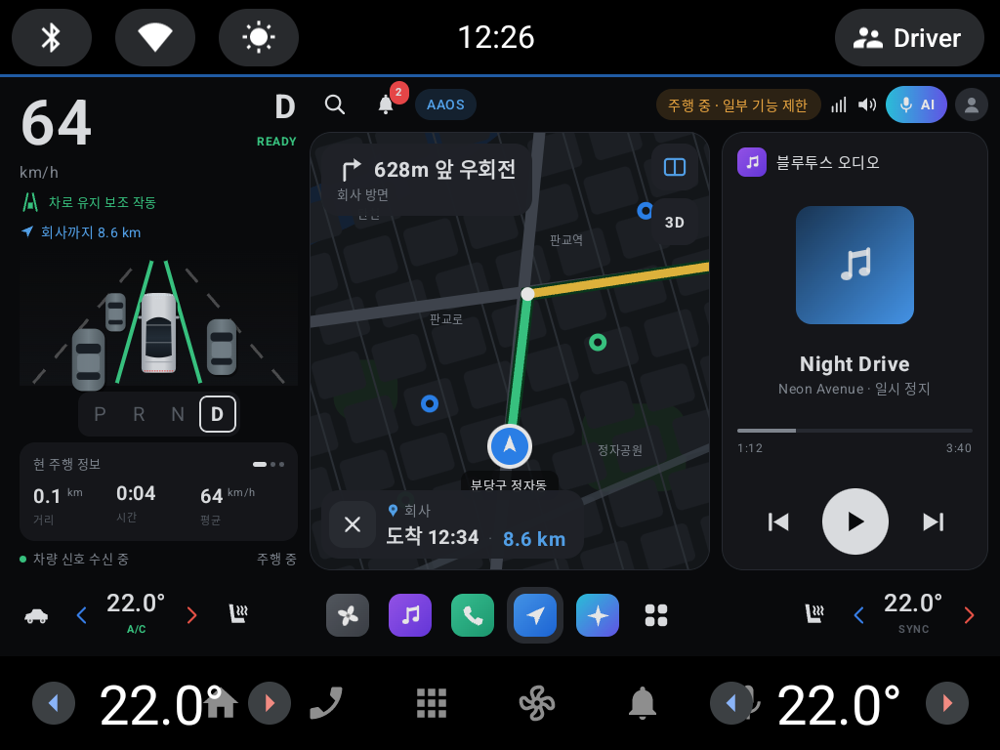
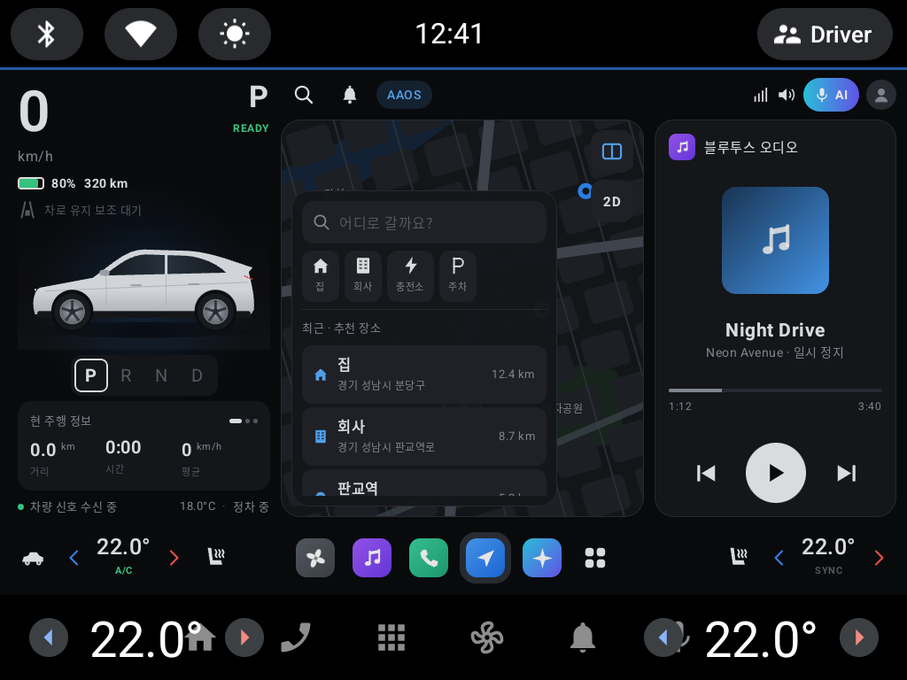
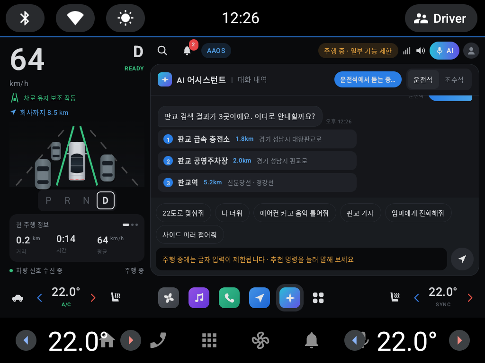
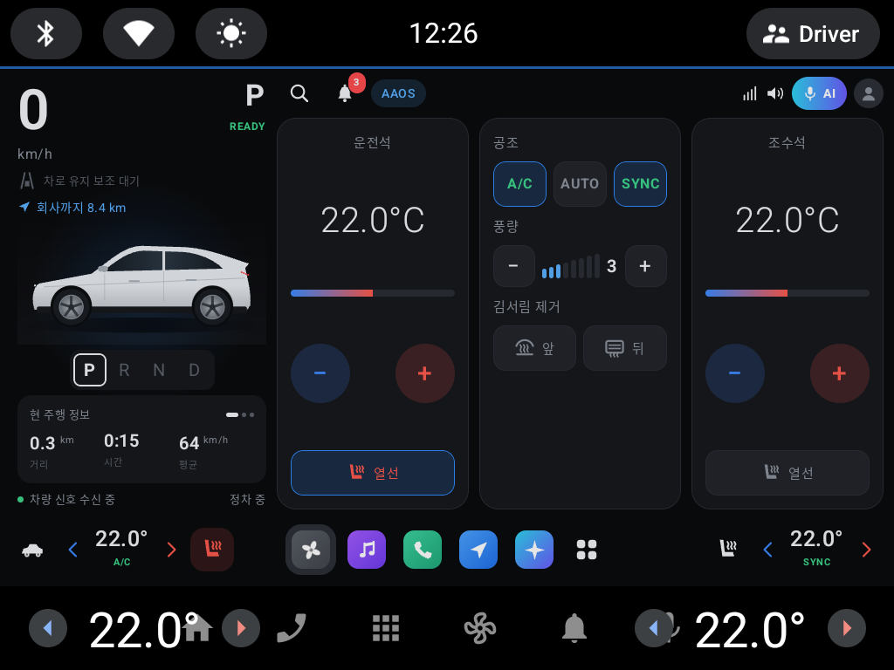
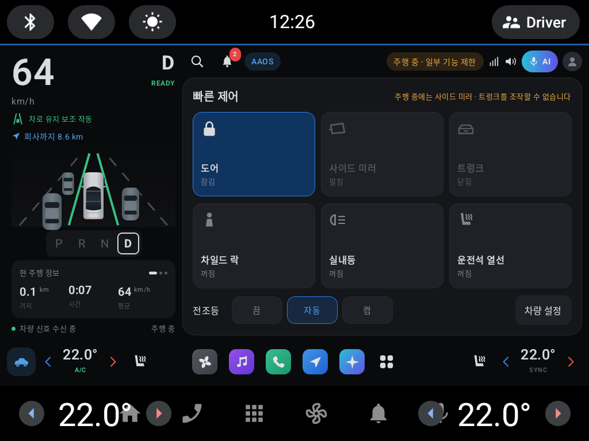
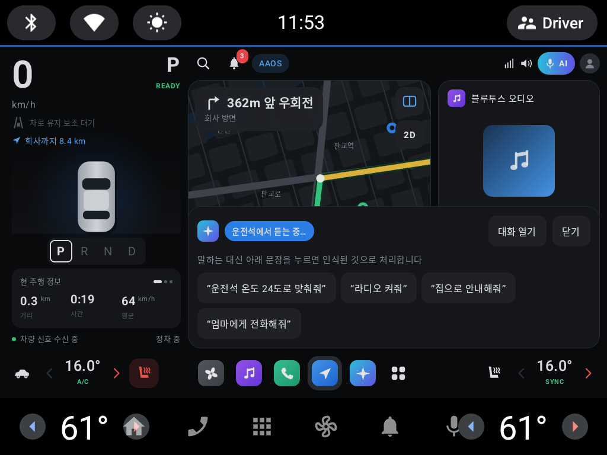
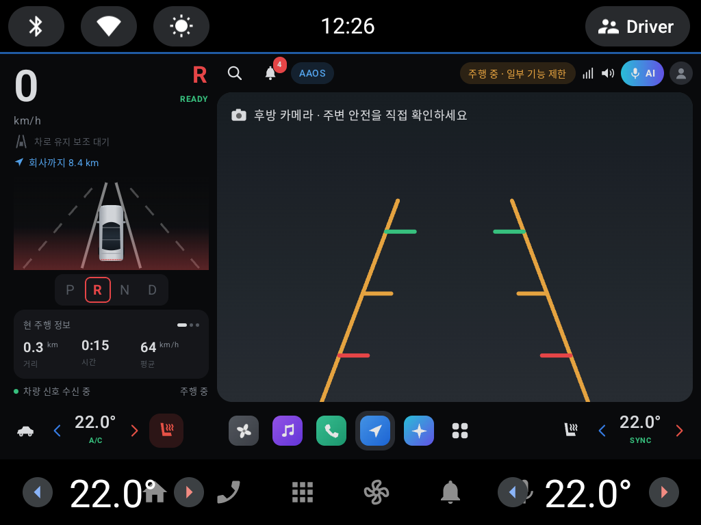
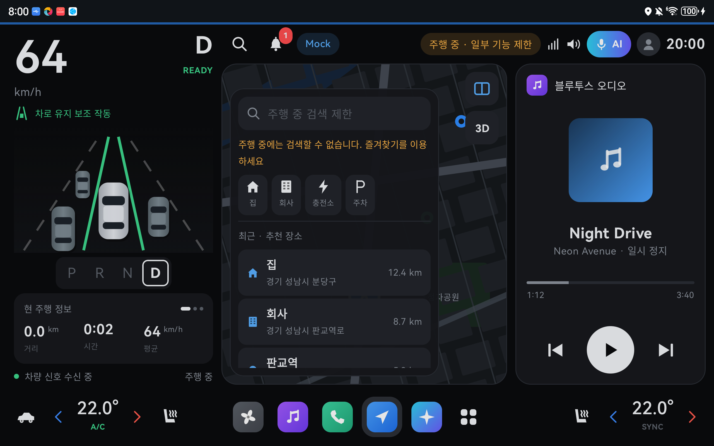

# 7단계 3영역 화면으로 개편: 주행 정보와 앱 영역, AI 어시스턴트, 아래 공조 바

2026-11-14에 정리했습니다. 양산 IVI(AAOS 기반)의 공개 화면과 기능을 참고해서(출처는 1장), 6단계 앱(내비게이션, 라디오, 전화, 설정, 후방 카메라, 음성)을 그 구조로 다시 짰습니다. 6단계의 기능과 테스트가 기대하는 동작은 그대로 살렸습니다.

5단계와 같은 기준을 지켰습니다. 화면 구조와 기능 방향만 참고하고, 제조사 로고, 제품명, 서비스명, 전용 글꼴, 아이콘 파일, 실제 지도 데이터는 쓰지 않았습니다. 아이콘은 Canvas로 직접 그린 단순한 기호(`ui/Glyphs.kt`)이고, 앱 이름은 OpenCabin, 비서 이름은 'AI 어시스턴트'로 했습니다.

## 1. 참고한 것

| 출처 | 확인한 내용 |
|---|---|
| 직접 모은 화면 사진 11장 (실차 화면, 보도 사진, SDK 구조도) | 왼쪽 주행 정보에는 속도, rpm, 기어, 주행 가능 거리, 3D 주행 뷰, ECO, 외기 온도가 있고, 오른쪽은 지도와 블루투스 오디오를 나눈 앱 화면입니다. 아래 바에는 차량, 온도와 A/C, 김서림, 열선, 앱 타일, 앱 목록, 이전 앱, 풍량 AUTO, 조수석 온도와 SYNC가 있고, 상단 바에는 검색, 알림, LTE, 볼륨, 블루투스, 프로필, 시계가 있습니다. 음성 비서는 '운전석에서 듣는 중…'을 띄우고 목적지 후보를 번호 카드로 보여 줍니다. R 기어에서는 주행 뷰가 붉어집니다. |
| [현대차그룹 보도자료 (2026-04-30)](https://www.hyundaimotorgroup.com/ko/story/pleos-connect-next-generation-infotainment-system) | 주행 정보, 앱, 아래 바의 세 영역. 단일 화면과 분할 화면. 앱이 주행 정보 영역을 침범하지 않음. 아래에서 쓸어 올리면 전 좌석 공조. LLM 기반 음성 비서는 여러 명령을 한 번에 처리하고, 좌석 위치를 알아듣고, "더운데?" 같은 간접 표현을 이해하며, 주행 상황에 따라 기능을 제한합니다. |
| [오너스 매뉴얼, 화면 구성](https://ownersmanual.hyundai.com/full_webhelp/CN8/2027/ko_KR/cluster-cluster_disp_info.html) | 용어. 주행 정보 화면, 3D 주행 뷰, 유틸리티 위젯(현 주행 정보, 타이어 공기압 등), 상단 바(상태 표시 영역), 하단 바(차량 설정, 공조, 즐겨찾기, 내비, 앱 라이브러리, 이전 실행 앱) |
| [Hyundai newsroom (영문)](https://www.hyundai.com/worldwide/en/newsroom/detail/0000001168) | 하단 바에서 최근 앱과 고정 앱을 바로 열고, 앱 마켓이 열려 있습니다. |

## 2. 무엇이 바뀌었나

| 부분 | 6단계 | 7단계 |
|---|---|---|
| 배치 | 상태 줄, 왼쪽 속도 게이지 카드, 오른쪽 앱, 아래 탭 7개 | 왼쪽은 위아래 전체를 쓰는 주행 정보, 오른쪽 위는 상단 바, 오른쪽은 앱 화면, 맨 아래는 하단 바 |
| 주행 정보 | 둥근 속도 게이지와 기어 칸 | 큰 속도 숫자와 단위(km/h, mph), 기어, READY, 운전자 보조 표시, 경로 한 줄(다른 앱을 봐도 보임), 원근 주행 뷰, P R N D, 유틸리티 위젯. 주행 뷰는 D에서 차선과 주변 차를, R에서 붉은 빛을, P에서 내 차를 크게 보여 줍니다. 위젯은 누를 때마다 현 주행 정보, 경로, 타이어 공기압으로 넘어갑니다. |
| 상단 바 | 시계, 배지, 음성 버튼 | 검색, 알림(배지와 알림 센터), 데이터 소스, 상태, 음성 결과, 신호와 볼륨, AI 버튼, 프로필, 시계(태블릿만) |
| 하단 바 | 탭 7개와 읽기만 하는 온도 | 왼쪽부터 차량, 운전석 온도(A/C), 열선, 그다음 공조, 미디어, 전화, 내비, AI, 앱 목록, 이전 실행 앱, 열선, 조수석 온도(SYNC). 온도는 어느 화면에서든 차량 신호(AAOS에서는 에뮬레이터 VHAL 값)를 바꿉니다. |
| 홈 | 카드 4장 (내비, 오디오, 공조, 전화) | 내비와 오디오(블루투스 음악이나 라디오)를 나눈 분할 화면. 지도 위 버튼으로 단일 화면과 오갑니다. |
| 내비 | 목록 화면과 단순한 격자 지도 | 강과 공원, 블록, 큰길이 있는 가짜 도시 지도. 지도 위 검색 카드(집, 회사, 충전소, 주차), 다음 안내 카드, 아래 경로 바(종료, 도착 시각, 남은 거리), 원활은 초록, 서행은 노랑으로 경로 색을 칠합니다. |
| 공조 | 좌석 두 곳 | 전 좌석 공조 패널. 좌석 온도, A/C, AUTO, SYNC, 풍량 1~8, 앞뒤 김서림, 좌석 열선 |
| 음성 | 정해진 문장 네 개가 정해진 동작으로 이어짐 | 규칙으로 동작하는 AI 어시스턴트(3절). 상단 AI 버튼은 '운전석에서 듣는 중…' 팝업을, 하단 AI는 대화 화면을 엽니다. |
| 차량 | 없음 | 빠른 제어. 도어 잠금, 사이드 미러, 트렁크, 차일드 락, 실내등, 운전석 열선, 전조등(끔, 자동, 켬). 주행 중에는 미러 접기와 트렁크가 잠깁니다. |
| 앱 목록 | 없음 | 앱 10개. 라디오와 설정은 여기서 엽니다. 영상은 주행 중에 잠기고, 앱 마켓은 '준비 중'입니다. |
| 후방 카메라 | 화면 전체를 덮음 | 앱 화면 위에만 뜹니다. 주행 정보는 R 기어 뷰로 계속 보이고, 앱이 주행 정보 영역을 가리지 않습니다. |
| 색 | 아쿠아 블루 | 거의 검은 바탕에 회색 카드와 파랑. 공조 화살표는 파랑과 빨강, 상태 글자는 초록, 앱 타일은 앱마다 다른 색 |



| 정차 중 분할 화면 | AI 어시스턴트 (목적지 후보) |
|---|---|
|  |  |

| 전 좌석 공조 | 빠른 제어 (주행 중 잠금) |
|---|---|
|  |  |

| 음성 팝업 | 후진 (R) |
|---|---|
|  |  |

이 단계의 화면이라 상단 바 프로필에 이름이 없고 FULL 버튼도 아직 없습니다. 지금 화면은 [테스트 결과](test-results.md)에서 볼 수 있습니다.

### 내 차 그림 (공개된 소형 전기 해치백 참고)

주행 정보에 나오는 내 차는 공개된 소형 전기 해치백의 제원과 디자인을 참고해 Canvas로 직접 그렸습니다(`ui/CarArt.kt`, 출처는 아래). 제조사 사진이나 이미지 파일은 쓰지 않았습니다.

| 참고한 공개 자료 | 그림에 반영한 것 |
|---|---|
| 길이 4,155, 폭 1,800, 높이 1,505, 휠베이스 2,680 mm, 19인치 225/45 R19 | 모든 좌표를 차 길이에 대한 비율로 계산했습니다 (차축 위치 0.177, 바퀴 지름 0.165). |
| '에어로 해치'. 지붕선이 곧게 가다가 리어 스포일러에서 떨어집니다 (Cd 0.263). | 옆모습의 지붕선과 스포일러 끝 |
| 픽셀 조명과, 엠블럼 대신 모스 부호 'H'를 뜻하는 점 4개 | 앞뒤 픽셀 줄과 앞 가운데 점 4개 |

정차(P)에서는 옆모습을 크게 보여 주고, 주행(D)과 후진(R)에서는 위에서 본 모습을 보여 줍니다. R이면 뒤쪽 픽셀 조명이 밝아집니다. 주변 차는 회색 일반 차로 그렸습니다.

출처: [Hyundai newsroom, IONIQ 3](https://www.hyundai.com/content/hyundai/worldwide/en/newsroom/detail/hyundai-motor-introduces-ioniq-3-aero-hatch-elevates-ev-technology-for-simple%252C-spacious-and-intuitive-mobility-0000001159.html), [Electrifying, Morse 'H'](https://www.electrifying.com/blog/article/inspect-the-morse-new-hyundai-ioniq-3-sends-coded-message)

### 에뮬레이터 공조 값을 태블릿과 같게

에뮬레이터 VHAL은 켤 때마다 기본값으로 시작합니다. SystemUI는 화씨 61°를 보여 주고 좌석 온도는 16~17°C입니다. 태블릿(Mock)은 22.0°C, 섭씨로 시작합니다. `python tools/emulator_defaults.py`를 돌리면 운전석과 조수석을 22.0°C로, 표시 단위를 섭씨(`HVAC_TEMPERATURE_DISPLAY_UNITS` = 0x30)로 맞춥니다.

이렇게 바꾸자 1단계 spike 테스트 네 개가 실패했습니다. SystemUI 표시를 화씨로 가정하고 `'77°'`, `'68°'`를 기다리고 있었기 때문입니다. 표시 단위를 VHAL에서 읽어 기대 글자를 계산하도록 고쳤고(섭씨 `'25.0°'`, 화씨 `'77°'`), 두 단위 모두에서 5개 통과, 1개 알려진 결함을 확인했습니다.

섭씨 글자(`22.0°`)가 더 길어서 시스템 바의 운전석 온도가 홈 버튼과 더 많이 겹칩니다. 1단계에서 찾은 SystemUI 결함은 그대로 알려진 결함으로 둡니다.

**재부팅해도 유지 (2026-11-16 추가).** 위 도구는 지금 값만 바꾸기 때문에, 에뮬레이터를 다시 켜면 시스템 바에 다시 `63°`(17°C를 화씨로)가 나왔습니다. 지금은 `python tools/emulator_defaults.py --persist`를 한 번 돌리면 VHAL 초기값을 덮어써서(`ivi-app/privileged/vhaloverride/opencabin.json`을 `/vendor/etc/automotive/vhaloverride/`로) 처음부터 22.0°C, 섭씨로 시작합니다.

처음에는 켜는 스위치인 `persist.vendor.vhal_init_value_override`를 `setprop`으로 넣었는데 적용되지 않았습니다. persist 속성은 `/data`가 올라온 뒤에 읽히는데, VHAL은 그보다 먼저 떠서 스위치가 꺼진 것으로 봅니다. logcat에 `loading properties from .../vhaloverride/`가 찍히지 않은 것으로 확인했습니다. 부팅 초기에 읽히는 `/vendor/build.prop`에 넣어 해결했습니다.

**시스템 바 숨김 (2026-11-16 추가).** 앱이 하단 줄(공조와 앱 아이콘)을 직접 그리기 때문에, AAOS에서는 OpenCabin이 떠 있는 동안 아래쪽 CarSystemUI 내비게이션 바를 숨깁니다(`SystemBars.kt`, 위 상태 바는 그대로 둡니다). 그래서 온도가 두 번 나오지 않고, 홈과 마이크 아이콘에 겹치던 바도 보이지 않습니다. 아래 가장자리에서 밀어 올리면 바가 잠깐 나옵니다.

spike 테스트는 기본 SystemUI 바를 대상으로 하기 때문에, 시작할 때 홈(런처)으로 나가서 바를 다시 띄웁니다. 버튼이 겹치는 결함은 시스템 바 자체의 문제라 그대로 남겨 둡니다.

## 3. AI 어시스턴트 (`assistant/CabinAssistant.kt`)

LLM 대신 규칙으로, 공개된 동작 방식을 흉내 냈습니다. 화면(Compose)과 분리한 순수 Kotlin 코드라 JVM 단위 테스트로 검증합니다.

```
말 ──split──▶ 절 여러 개 ──parse(절, 말한 좌석)──▶ Action ──run──▶ CabinControls ──▶ 차량 신호 / 앱 상태
"에어컨 켜고 음악 틀어줘"   ["에어컨 켜", "음악 틀어줘"]   SetAc(on) · Play          Shell 이 구현 (VHAL · 6단계 CabinController)
```

| 기능 | 예 | 결과 |
|---|---|---|
| 여러 명령 | "에어컨 켜고 음악 틀어줘 그리고 판교역으로 가자" | 세 동작을 차례로 하고 대답을 이어 붙입니다. |
| 좌석 인식 | 조수석에서 "나 더워" | 조수석만 1°C 내립니다. 좌석을 말하면 그 좌석, "모두"라고 하면 전 좌석입니다. |
| 간접 표현 | "추운데", "더워" | 1.0°C 올리거나 내립니다. |
| 숫자와 범위 | "35도로 맞춰줘" | 28.0°C로 맞추고 범위를 알려 줍니다. 0.5°C 단위로 맞춥니다. |
| 목적지 후보 | "판교 가자" | 가까운 순서로 세 곳을 번호 카드로 보여 주고, 누르면 안내를 시작합니다. |
| 말 바꾸기 | "거기 말고 서울에 있는 데로 가자" | 서울역으로 바꿉니다. |
| 주행 중 제한 | 주행 중 "영상 틀어줘", "사이드 미러 접어줘" | 이유를 말하고 거절합니다. 미러 펴기는 됩니다. |
| 6단계 음성 문장 네 개 | 온도 24도, 라디오, 집 안내, 엄마에게 전화 | 같은 엔진으로 처리합니다. 6단계 E2E 다섯 개가 그대로 통과했습니다. |

음성 인식은 하지 않습니다. 대화 화면의 추천 명령(칩)을 누르거나 글자로 입력합니다. 말한 사람의 좌석은 머리글의 '운전석', '조수석'으로 고릅니다.

주행 중에는 글자 입력(키보드)을 막습니다. 음성을 대신하는 칩은 계속 쓸 수 있습니다. 음성 팝업과 대화 화면은 같은 대화 내역을 씁니다.

## 4. 구조

```
ivi-app/app/src/main/java/dev/opencabin/ivi/
  assistant/CabinAssistant.kt  말을 동작으로 (Places 장소 목록, IntentParser, CabinAssistant, CabinControls)
  state/CabinController.kt     6단계 그대로 (오디오 하나, 내비 진행, 전화). 목적지는 Places에서, 음성 결과는 글자만 둠
  ui/Shell.kt                  3영역 틀, 상단 바, 하단 바, 음성 팝업, 통화, 알림, 후방 카메라, AI와 차량 연결
  ui/CockpitState.kt           화면 틀 상태: 탭, 이전 앱, 분할, 공조 부가 기능, 빠른 제어, 현 주행 정보, 알림, 대화
  ui/Cluster.kt                주행 정보 (속도, 주행 뷰, 기어, 위젯)
  ui/Home.kt Navigation.kt     분할 화면, 지도와 내비 흐름
  ui/Climate.kt                전 좌석 공조, 빠른 제어, 앱 목록
  ui/Assistant.kt Media.kt     대화 화면, 미디어
  ui/Theme.kt Glyphs.kt        색과 공통 부품, 직접 그린 기호
ivi-app/app/src/test/          CabinAssistantTest (JVM, 17개)
```

이 단계에서 공조의 A/C, 풍량, 열선, 김서림과 빠른 제어는 에뮬레이터 VHAL에 연결하지 않은 화면 상태(`CockpitState`)였습니다. 8단계에서 공조 부가 기능과 도어 잠금을 차량 신호로 바꿨고([phase8-signals.md](phase8-signals.md)), 지금은 미러, 트렁크, 차일드 락, 실내등, 전조등만 화면 상태로 남아 있습니다.

SYNC는 이 단계부터 실제 신호를 씁니다. 운전석 값을 조수석 HVAC_TEMPERATURE_SET에도 쓰고, 조수석을 직접 바꾸면 동기화가 풀립니다.

운전자 보조 표시와 주변 차량은 화면 연출입니다. D에서 30 km/h 이상이면 '작동'으로 보일 뿐, 실제 ADAS 신호가 아닙니다.

현 주행 정보(거리, 시간, 평균 속도)는 속도 신호를 1초마다 더해서 계산합니다. 정차 중에는 화면을 바꾸지 않아서 UiAutomator가 화면이 멈추길 기다리는 데 방해가 되지 않습니다.

## 5. 테스트

화면 객체(`ivi/screens.py`)가 바뀐 화면을 받아 준 덕분에, 6단계 테스트 64개 중 고친 것은 1개뿐입니다.

| 바뀐 것 | 테스트 쪽 대응 |
|---|---|
| 아래 바에서 라디오, 설정, 내비 탭이 빠졌습니다. | `IviApp.radio()`, `settings()`는 앱 목록으로, `navigation()`은 내비(홈)로 엽니다. 테스트 코드는 그대로입니다. |
| 홈 카드의 온도 요약이 없어졌습니다. | `Home.summary_temperature()`가 아래 바의 온도(`'22.5°'`)를 읽습니다. `parse_celsius`가 `°`도 받도록 하고 단위 테스트를 하나 더했습니다. |
| 홈의 내비 요약 카드가 없어졌습니다. | `test_stop_guidance_…home_widget`을 `…clears_cluster_route`로 바꿨습니다. 다른 앱을 보고 있어도 주행 정보에 경로가 보이고, 안내를 끝내면 사라지는지 봅니다. 이것이 고친 테스트 1개입니다. |
| 음성 결과 글자가 "운전석 온도를 24.0°C로 맞췄어요."로 바뀌었습니다. | 테스트는 '24.0'이 들어 있는지만 보므로 그대로 통과합니다. |

새로 만든 테스트는 E2E 20개와 앱 단위 테스트 17개입니다.

| 파일 | 내용 |
|---|---|
| `test_assistant.py` (6개) | 좌석 인식이 차량 신호까지 가는지(조수석만 21.0), 글자 입력으로 VHAL이 25.5가 되는지, 한 문장의 명령 두 개, 목적지 후보 고르기, 주행 중 입력 잠금과 미러 접기 거절, 음성 팝업과 대화 내역 공유 |
| `test_cockpit.py` (12개) | 아래 바 온도와 VHAL(좌석 두 곳), SYNC로 조수석 VHAL이 바뀌는지, 조수석을 직접 바꾸면 동기화가 풀리는지, 현 주행 정보가 속도 신호로 늘고 정차하면 멈추는지, 운전자 보조 표시, 위젯 넘김, 분할 화면과 단일 화면, 주행 중 빠른 제어 잠금, 알림 센터, 이전 실행 앱 |
| `test_smoke.py` | 탭 열기에 AI, 빠른 제어, 앱 목록 세 개를 더했습니다. |
| `ivi-app/src/test/CabinAssistantTest.kt` (17개) | 말 나누기, 좌석 인식, 간접 표현, 범위, 후보, 말 바꾸기, 주행 중 제한, 6단계 문장 네 개, 없는 연락처, 공조를 쓸 수 없을 때 |

CI의 build 작업에 `./gradlew testDebugUnitTest`를 넣었습니다.

## 6. 회귀 테스트에서 잡은 것

### 6-1) 안내 바의 목적지 글자 앞에 공백이 들어감 (제가 만든 결함)

`test_ambiguous_destination_offers_candidates`가 `nav_dest_name`이 '판교역'이 되기를 기다리다 실패했습니다. 실패 화면에서는 판교역으로 정상 안내 중이었습니다.

아이콘 옆 간격을 글자 앞 공백(`" 판교역"`)으로 만든 것이 원인이었습니다. 테스트는 정확히 같은 글자를 기대합니다. 간격을 `padding`으로 바꿨습니다. 같은 태그를 읽는 6단계 음성 테스트(`'집'`)도 같은 이유로 깨질 뻔했습니다.

### 6-2) 후보 카드가 대답을 화면 밖으로 밀어냄 (낮은 화면에서만)

위 테스트를 고친 뒤에도 '판교 가자'에 대한 대답(`assistant_reply`)을 찾지 못했습니다.

새 말이 오면 목록 끝으로 내리도록 바꿨는데, AAOS 에뮬레이터는 1024×768이고 시스템 바를 빼면 앱 높이가 작습니다. 대답과 후보 카드 세 장이 한 화면에 들어가지 않아 대답이 위로 밀려 나갔습니다. UiAutomator는 화면 밖 요소를 찾지 못합니다.

목록을 마지막 말의 시작 위치로 내리고, 후보 카드를 한 줄 높이로 줄여 대답과 함께 보이게 했습니다. 쓰는 사람 입장에서도 질문과 후보가 같이 보이는 편이 낫습니다.

### 6-3) 한글 경로에서 Gradle 단위 테스트 실행기가 죽음 (이 PC 환경 문제)

`./gradlew testDebugUnitTest`가 `Could not write standard input to Gradle Test Executor`로 실패했습니다. 사용자 폴더(Gradle 캐시)가 한글 경로라 테스트 JVM이 클래스 경로를 읽지 못한 것입니다. README에 적은 '영문 경로' 주의와 같은 문제입니다.

이 PC에서는 컴파일된 클래스를 영문 경로로 복사한 jar와 함께 `java org.junit.runner.JUnitCore`로 직접 돌렸습니다(17개 통과). CI(ubuntu)에는 경로 문제가 없어서 Gradle로 돕니다. 근본적으로는 `GRADLE_USER_HOME`을 영문 경로로 옮기면 해결됩니다.

## 7. 결과

| 항목 | 결과 |
|---|---|
| 앱 빌드 | Kotlin 경고 0 |
| 앱 단위 테스트 (`CabinAssistantTest`) | 17개 통과 |
| 프레임워크 단위 테스트 (`pytest unit`) | 26개 통과 |
| AAOS 에뮬레이터 전체 E2E (84개) | 82개 통과, 1개 건너뜀, 1개 알려진 결함. 게이트 통과, 앱 재실행 0, VHAL 재시도 0 (5분 47초) |
| 화웨이 태블릿(Mock) 전체 E2E (84개) | 78개 통과, AAOS 전용 6개 건너뜀. 게이트 통과, 앱 재실행 0 (5분 46초) |

AAOS에서 건너뛴 1개는 12시간 시계 테스트입니다. AAOS는 시스템 바가 시계를 보여 줘서 앱 시계가 없고, 이 테스트는 태블릿에서만 돕니다. 알려진 결함 1개는 1단계에서 찾은 SystemUI 결함입니다.

태블릿은 설치하기 전에 미리 알리고, 기기 화면에서 설치 승인을 받은 뒤 돌렸습니다(4단계에서 정한 운영 규칙). 두 기기 병렬 실행과 반복 안정성 측정은 이 단계에서는 하지 않았고, 기기마다 전체를 한 번씩 돌렸습니다.

태블릿(2560×1600)에서도 같은 배치가 늘어나서 맞습니다.


