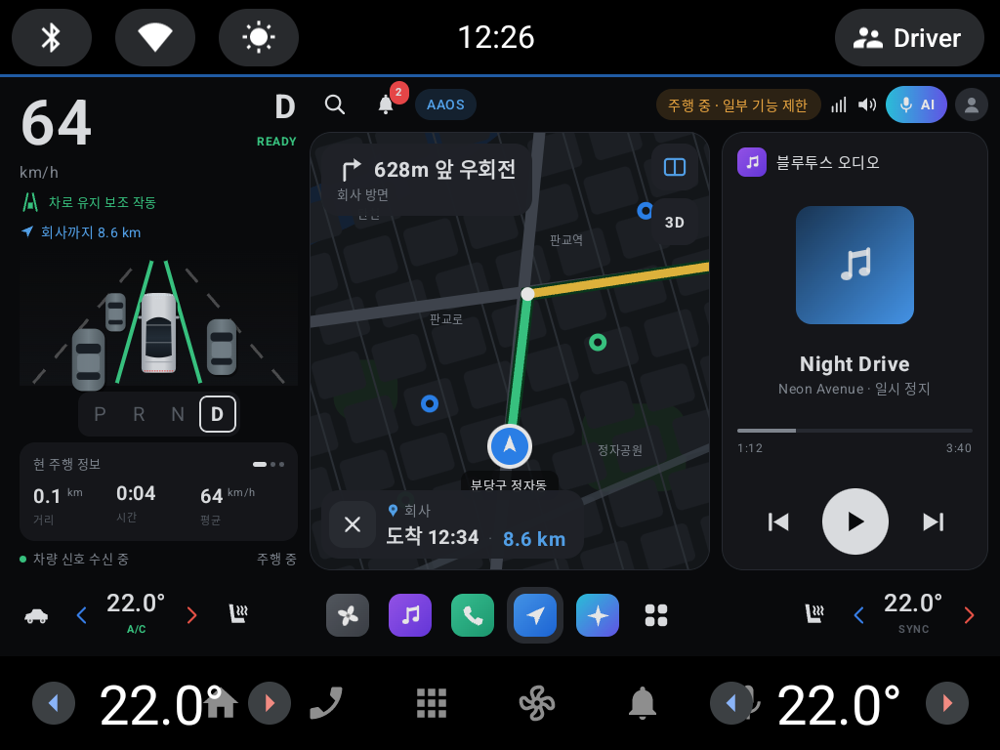
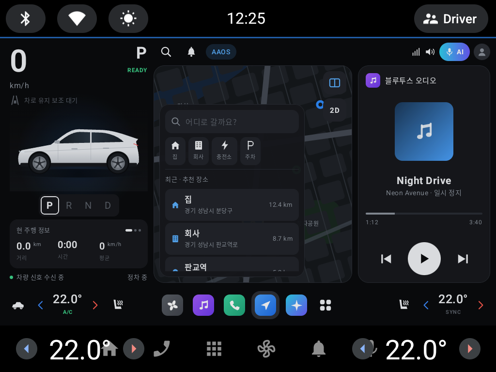
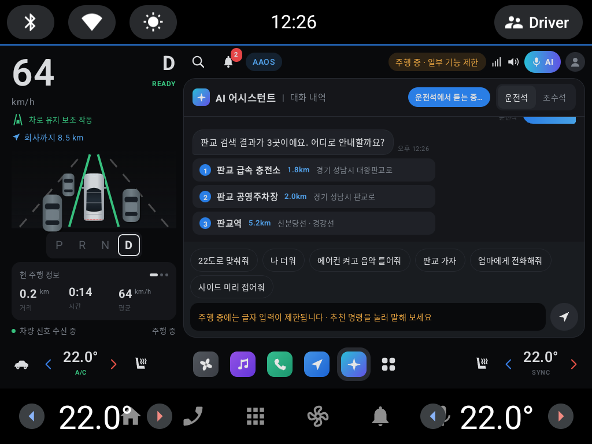
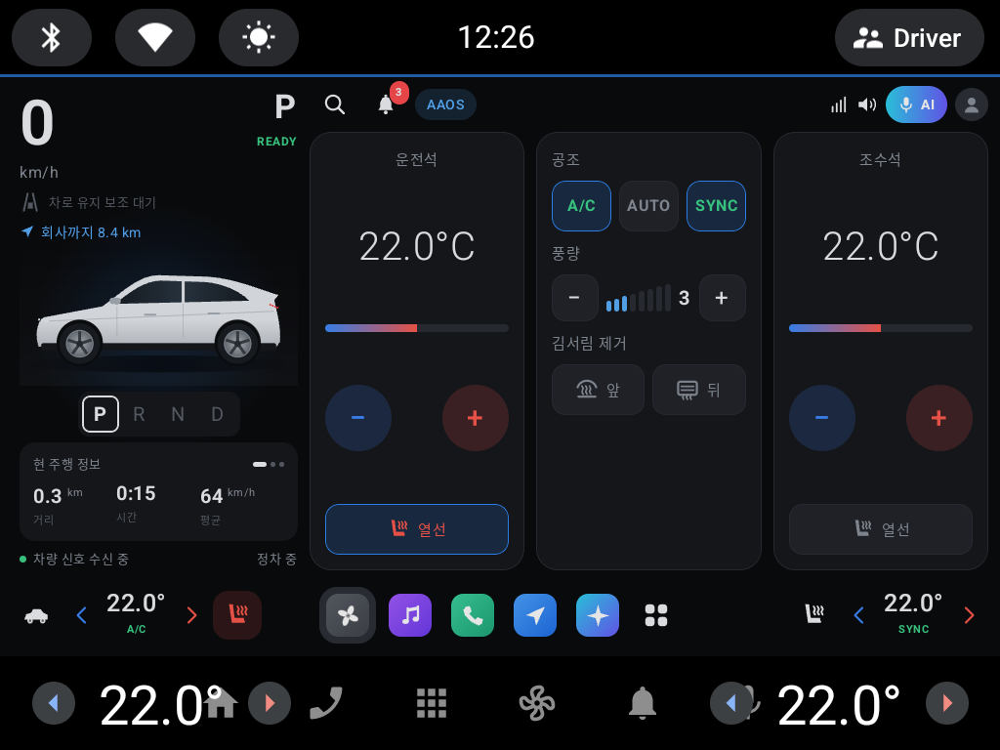
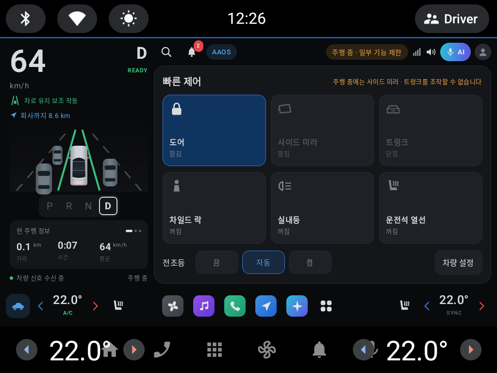
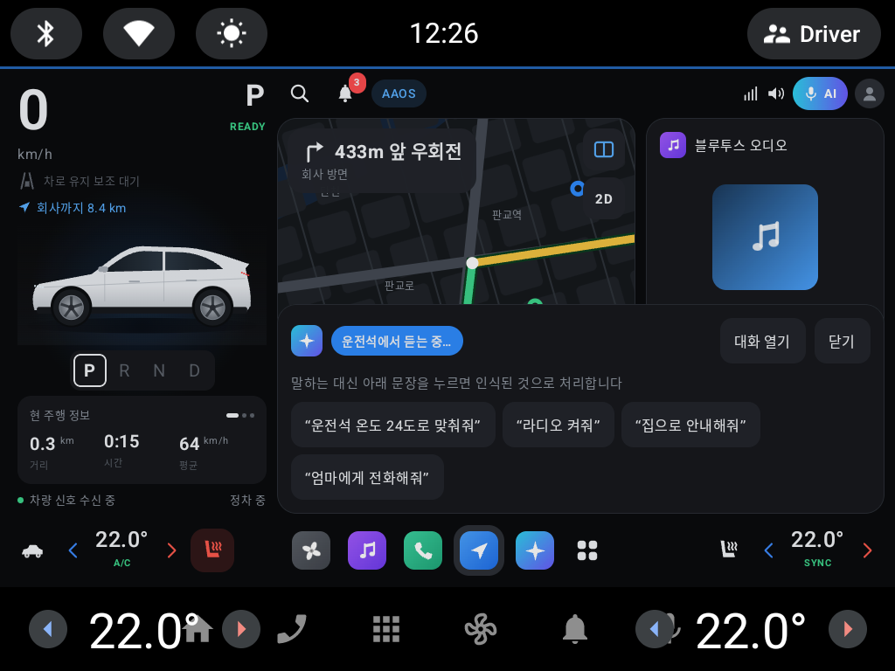
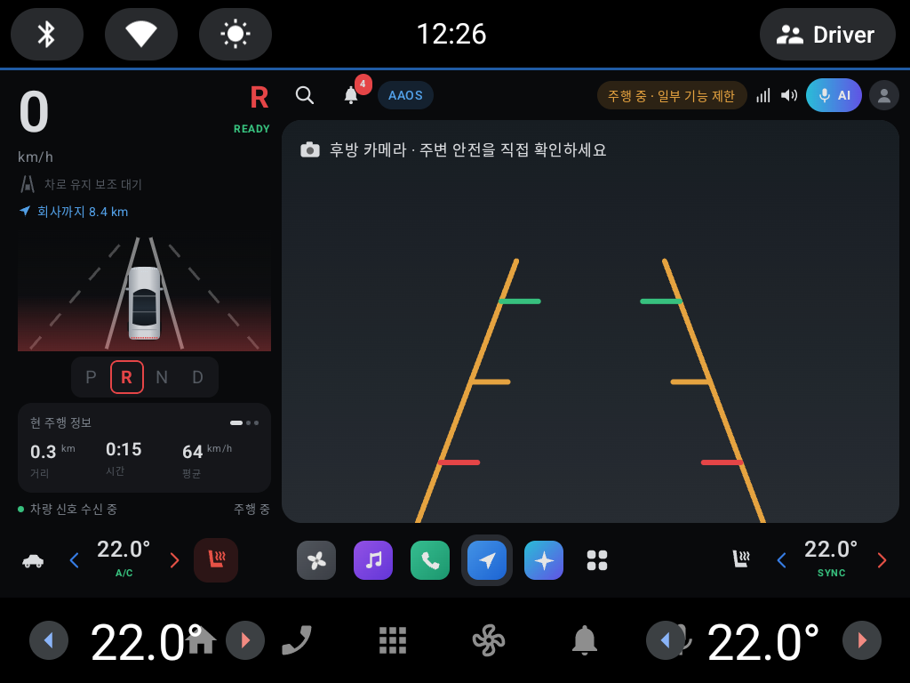
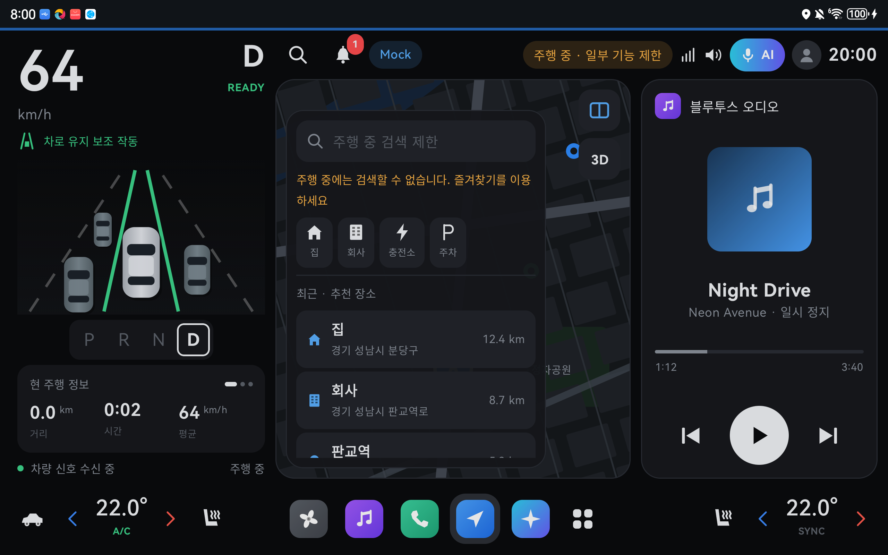

# 7단계 Pleos Connect 구조로 개편: 3영역 화면 · AI 어시스턴트 · 하단 공조 바

작성 2026-11-14. 현대차그룹의 차세대 인포테인먼트 **Pleos Connect**(42dot 개발, AAOS 기반)의 공개 화면과 기능을 참고해,
6단계 앱(내비·라디오·전화·설정·후방 카메라·음성)을 그 구조로 다시 짰다. 6단계 기능과 테스트 계약은 그대로 살렸다.

원칙은 5단계와 같다: **화면 구조와 기능 방향만 따르고, 제조사 로고·제품명·서비스명(글레오 등)·전용 글꼴·아이콘 파일·실제 지도 데이터는 쓰지 않는다.**
아이콘은 Canvas 로 직접 그린 단순한 기호(`ui/Glyphs.kt`), 앱 이름은 OpenCabin, 비서 이름은 'AI 어시스턴트'.

## 1. 참고한 것

| 출처 | 확인한 내용 |
|---|---|
| 사용자 제공 화면 사진 11장 (실차 화면, 보도 사진, SDK 구조도) | 왼쪽 주행 정보(속도·rpm·기어·주행 가능 거리·3D 주행 뷰·ECO·외기 온도), 오른쪽 앱(지도 + 블루투스 오디오 분할), 아래 바(차량 · ‹23.5› A/C · 김서림 · 열선 · 앱 타일 · 앱 목록 · 이전 앱 · 풍량 AUTO · ‹23.5› SYNC), 상단 바(검색 · 알림 · LTE · 볼륨 · BT · 프로필 · 시계), 음성 비서 대화 화면('운전석에서 듣는 중…', 번호 붙은 목적지 후보 카드), R 기어에서 주행 뷰가 붉게 |
| [현대차그룹 보도자료 (2026-04-30)](https://www.hyundaimotorgroup.com/ko/story/pleos-connect-next-generation-infotainment-system) | 주행 정보 화면 / 앱 화면 / 하단 바 3영역, 단일·분할 화면, 앱이 주행 정보 영역을 침범하지 않음, 아래에서 쓸어 올리면 전 좌석 공조, LLM 기반 음성 비서: 여러 명령 한 번에, **좌석 위치 인식**, 간접 표현("더운데?"), 주행 상황에 따른 제한 |
| [오너스 매뉴얼 — 화면 구성](https://ownersmanual.hyundai.com/full_webhelp/CN8/2027/ko_KR/cluster-cluster_disp_info.html) | 용어: 주행 정보 화면 · 3D 주행 뷰 · 유틸리티 위젯(현 주행 정보 · 타이어 공기압 …) · 상단 바(상태 표시 영역) · 하단 바(차량 설정 · 공조 · 즐겨찾기 · 내비 · 앱 라이브러리 · 이전 실행 앱) |
| [Hyundai newsroom (영문)](https://www.hyundai.com/worldwide/en/newsroom/detail/0000001168) | 하단 바는 최근·고정 앱을 한 번에, 개방형 앱 마켓 |

## 2. 무엇이 바뀌었나

| 영역 | 6단계 | 7단계 |
|---|---|---|
| 배치 | 상태 줄 · 왼쪽 속도 게이지 카드 · 오른쪽 앱 · 아래 탭 7개 | **왼쪽 주행 정보(전체 높이) · 오른쪽 위 상단 바 · 오른쪽 앱 화면 · 아래 하단 바** |
| 주행 정보 | 원형 속도 게이지, 기어 칸 | 큰 속도 숫자 + 단위(km/h·mph) · 기어 · READY · **운전자 보조 표시** · **경로 한 줄**(다른 앱을 봐도 보임) · **원근 주행 뷰**(D: 차선·주변 차, R: 붉은 빛, P: 내 차 크게) · P R N D · **유틸리티 위젯**(현 주행 정보 / 경로 / 타이어 공기압, 누를 때마다 넘김) |
| 상단 바 | 시계 · 배지 · 음성 버튼 | 검색 · **알림(배지 + 알림 센터)** · 데이터 소스 · 상태 · 음성 결과 · 신호·볼륨 · **AI 버튼** · 프로필 · 시계(태블릿) |
| 하단 바 | 탭 7개 + 읽기 전용 온도 | 차량 · **‹운전석 온도›(A/C)** · 열선 │ 공조 · 미디어 · 전화 · 내비 · AI · 앱 목록 │ **이전 실행 앱** │ 열선 · **‹조수석 온도›(SYNC)** — 온도는 어느 화면에서든 **실제 VHAL 값**을 바꾼다 |
| 홈 | 카드 4장 (내비·오디오·공조·전화) | **분할 화면: 내비 + 오디오(블루투스 음악 / 라디오)**, 지도 위 버튼으로 단일 ↔ 분할 |
| 내비 | 목록 화면 + 단순 격자 지도 | 가짜 도시 지도(강·공원·블록·큰길), 지도 위 검색 카드(집·회사·충전소·주차), 다음 안내 카드, 아래 경로 바(종료 · 도착 시각 · 남은 거리), 경로 색(원활 초록 / 서행 노랑) |
| 공조 | 좌석 2개 | **전 좌석 공조 패널**: 좌석 온도 · A/C · AUTO · **SYNC** · 풍량 1~8 · 앞/뒤 김서림 · 좌석 열선 |
| 음성 | 고정 문장 4개 → 정해진 동작 | **AI 어시스턴트**: 규칙 기반 대화 엔진(아래 3장). 상단 AI 버튼 → '운전석에서 듣는 중…' 팝업, 하단 AI → 대화 화면 |
| 차량 | 없음 | **빠른 제어**: 도어 잠금 · 사이드 미러 · 트렁크 · 차일드 락 · 실내등 · 운전석 열선 · 전조등(끔/자동/켬), 주행 중 미러 접기·트렁크 잠금 |
| 앱 목록 | 없음 | 앱 라이브러리 10개 (라디오·설정은 여기서), 영상은 주행 중 잠금, 앱 마켓은 '준비 중' |
| 후방 카메라 | 화면 전체를 덮음 | **앱 화면 위에만** (주행 정보는 R 기어 뷰로 계속 보임 — 앱이 주행 정보를 침범하지 않는다는 원칙) |
| 색 | 아쿠아 블루 | 거의 검정 + 회색 카드 + 파랑, 공조 화살표 파랑/빨강, 상태 글자 초록, 앱 타일 색 |



| 정차 · 분할 화면 | AI 어시스턴트 (목적지 후보) |
|---|---|
|  |  |

| 전 좌석 공조 | 빠른 제어 (주행 중 잠금) |
|---|---|
|  |  |

| 음성 팝업 | 후진 (R) |
|---|---|
|  |  |

### 내 차 그림 (아이오닉 3 참고)

주행 정보의 내 차는 **아이오닉 3** 의 공개 제원·디자인을 참고해 Canvas 로 직접 그렸다 (`ui/CarArt.kt`). 제조사 사진·이미지 파일은 쓰지 않는다.

| 근거 (공개 자료) | 그림에 반영 |
|---|---|
| 길이 4,155 · 폭 1,800 · 높이 1,505 · 휠베이스 2,680 mm, 19인치 225/45 R19 | 모든 좌표를 차 길이 비율로 계산 (차축 위치 0.177, 바퀴 지름 0.165) |
| '에어로 해치': 지붕선이 곧게 가다 리어 스포일러로 떨어짐 (Cd 0.263) | 옆모습 지붕선 · 스포일러 끝 |
| 픽셀 조명, 엠블럼 대신 모스 부호 'H' 점 4개 | 앞·뒤 픽셀 줄, 앞 가운데 점 4개 |

- P(정차): 옆모습을 크게. D(주행)·R(후진): 위에서 본 모습 (R 이면 뒤 픽셀 조명이 밝아진다). 주변 차는 회색 일반 차.
- 출처: [Hyundai newsroom — IONIQ 3](https://www.hyundai.com/content/hyundai/worldwide/en/newsroom/detail/hyundai-motor-introduces-ioniq-3-aero-hatch-elevates-ev-technology-for-simple%252C-spacious-and-intuitive-mobility-0000001159.html),
  [Electrifying — Morse 'H'](https://www.electrifying.com/blog/article/inspect-the-morse-new-hyundai-ioniq-3-sends-coded-message)

### 에뮬레이터 공조 값을 태블릿과 같게

에뮬레이터 VHAL 은 켤 때마다 기본값(SystemUI 화씨 표시 61°, 좌석 16~17°C)으로 시작한다. 태블릿(Mock)은 22.0°C 섭씨다.
`python tools/emulator_defaults.py` 가 운전석·조수석 22.0°C, 표시 단위 섭씨(`HVAC_TEMPERATURE_DISPLAY_UNITS` = 0x30)로 맞춘다.

- 이렇게 바꾸자 1단계 spike 테스트 4개가 실패했다: SystemUI 표시를 **화씨로 가정**하고 `'77°'`, `'68°'` 를 기다리고 있었다.
  → 표시 단위를 VHAL 에서 읽어 기대 글자를 계산하게 고쳤다 (섭씨 `'25.0°'`, 화씨 `'77°'`). **두 단위 모두에서 5 passed, 1 xfailed** 확인.
- 섭씨 글자(`22.0°`)가 더 길어 시스템 바 운전석 온도가 홈 버튼과 더 많이 겹친다 — 1단계에서 찾은 SystemUI 결함(xfail)이 그대로 있다.

## 3. AI 어시스턴트 (`assistant/CabinAssistant.kt`)

LLM 대신 규칙으로 공개된 동작 방식을 흉내 냈다. 화면(Compose)과 분리한 순수 Kotlin 이라 **JVM 단위 테스트**로 검증한다.

```
말 ──split──▶ 절 여러 개 ──parse(절, 말한 좌석)──▶ Action ──run──▶ CabinControls ──▶ 차량 신호 / 앱 상태
"에어컨 켜고 음악 틀어줘"   ["에어컨 켜", "음악 틀어줘"]   SetAc(on) · Play          Shell 이 구현 (VHAL · 6단계 CabinController)
```

| 기능 | 예 | 결과 |
|---|---|---|
| 여러 명령 | "에어컨 켜고 음악 틀어줘 그리고 판교역으로 가자" | 세 동작을 차례로, 대답을 이어 붙임 |
| **좌석 인식(Zone)** | 조수석에서 "나 더워" | **조수석만** 1°C 내림 (좌석을 말하면 그 좌석, "모두"면 전 좌석) |
| 간접 표현 | "추운데" / "더워" | ±1.0°C |
| 숫자 · 범위 | "35도로 맞춰줘" | 28.0°C 로 맞추고 범위를 알려 줌 (0.5°C 단위로 맞춤) |
| 목적지 후보 | "판교 가자" | 3곳(가까운 순) → 번호 카드 → 누르면 안내 시작 |
| 말 바꾸기 | "거기 말고 서울에 있는 데로 가자" | 서울역 |
| 주행 상황 제한 | 주행 중 "영상 틀어줘" / "사이드 미러 접어줘" | 거절 + 이유 (펴기는 됨) |
| 6단계 음성 4문장 | 온도 24도 · 라디오 · 집 안내 · 엄마에게 전화 | 같은 엔진으로 처리 (6단계 E2E 5개 그대로 통과) |

- 음성 인식은 하지 않는다. 대화 화면의 **추천 명령(칩)**을 누르거나 **글자로 입력**한다. 말한 좌석은 머리글의 '운전석/조수석'으로 고른다.
- 주행 중에는 **글자 입력(키보드)을 막는다**. 칩(음성 대신)은 계속 쓸 수 있다.
- 음성 팝업과 대화 화면은 같은 대화 내역을 쓴다.

## 4. 구조

```
ivi-app/app/src/main/java/dev/opencabin/ivi/
  assistant/CabinAssistant.kt  말 → 동작 (Places 장소 목록 · IntentParser · CabinAssistant · CabinControls 경계)
  state/CabinController.kt     6단계 그대로 (오디오 하나 · 내비 진행 · 전화). 목적지 = Places, 음성 결과 글자만 둠
  ui/Shell.kt                  3영역 틀, 상단 바, 하단 바, 음성 팝업, 통화, 알림, 후방 카메라, AI ↔ 차량 연결
  ui/CockpitState.kt           화면 틀 상태: 탭 · 이전 앱 · 분할 · 공조 부가 · 빠른 제어 · 현 주행 정보 · 알림 · 대화
  ui/Cluster.kt                주행 정보 (속도 · 주행 뷰 · 기어 · 위젯)
  ui/Home.kt Navigation.kt     분할 화면, 지도·내비 흐름
  ui/Climate.kt                전 좌석 공조 + 빠른 제어 + 앱 목록
  ui/Assistant.kt Media.kt     대화 화면, 미디어
  ui/Theme.kt Glyphs.kt        색 · 공통 부품, 직접 그린 기호
ivi-app/app/src/test/          CabinAssistantTest (JVM, 17개)
```

- 공조의 A/C·풍량·열선·김서림, 빠른 제어는 에뮬레이터 VHAL 에 연결하지 않은 **화면 상태**다 (`CockpitState`).
  **SYNC 만 실제 신호**를 쓴다: 운전석 값을 조수석 HVAC_TEMPERATURE_SET 에도 쓰고, 조수석을 직접 바꾸면 동기화가 풀린다.
- 운전자 보조 표시와 주변 차량은 **연출**이다 (D 에서 30 km/h 이상이면 '작동'). 실제 ADAS 신호가 아니다.
- 현 주행 정보(거리·시간·평균 속도)는 속도 신호를 1초마다 더한다. 정차 중에는 화면을 바꾸지 않는다 (UiAutomator 대기에 영향 없게).

## 5. 테스트

화면 객체(`ivi/screens.py`)가 바뀐 화면을 흡수했다 — 6단계 테스트 64개는 **1개만** 고쳤다.

| 바뀐 것 | 테스트 쪽 대응 |
|---|---|
| 아래 바에서 라디오·설정·내비 탭이 빠짐 | `IviApp.radio()/settings()` 는 앱 목록으로, `navigation()` 은 내비(=홈)로 연다. 테스트 코드는 그대로 |
| 홈 카드의 온도 요약이 없어짐 | `Home.summary_temperature()` 가 아래 바 온도(`'22.5°'`)를 읽는다. `parse_celsius` 가 `°` 도 받는다 (단위 테스트 1개 추가) |
| 홈의 내비 요약 카드가 없어짐 | `test_stop_guidance_…home_widget` → `…clears_cluster_route` : 다른 앱을 보고 있어도 **주행 정보에 경로**가 보이고 안내를 끝내면 사라진다 |
| 음성 결과 글자 | "운전석 온도를 24.0°C로 맞췄어요." — 테스트는 '24.0' 포함만 보므로 그대로 통과 |

새 테스트 (E2E 20개, 앱 단위 17개)

| 파일 | 내용 |
|---|---|
| `test_assistant.py` (6) | **좌석 인식 → 차량 신호**(조수석만 21.0), 글자 입력 → VHAL 25.5, 한 문장 두 명령, 목적지 후보 고르기, **주행 중 입력 잠금 · 미러 접기 거절**, 음성 팝업과 대화 내역 공유 |
| `test_cockpit.py` (12) | **아래 바 온도 ↔ VHAL** (좌석 2), **SYNC → 조수석 VHAL**, 조수석 조작 시 동기화 해제, **현 주행 정보가 속도 신호로 증가·정차 시 멈춤**, 운전자 보조 표시, 위젯 넘김, 분할 ↔ 단일, **빠른 제어 주행 중 잠금**, 알림 센터, 이전 실행 앱 |
| `test_smoke.py` | 탭 열기에 AI · 빠른 제어 · 앱 목록 추가 (+3) |
| `ivi-app/src/test/CabinAssistantTest.kt` (17) | 말 나누기, 좌석 인식, 간접 표현, 범위, 후보, 말 바꾸기, 주행 제한, 6단계 4문장, 없는 연락처, 공조 불가 |

CI: build 작업에 `./gradlew testDebugUnitTest` 를 넣었다.

## 6. 회귀에서 잡은 것

### 6-1) 안내 바의 목적지 글자에 앞 공백 (내가 만든 결함)
- 증상: `test_ambiguous_destination_offers_candidates` 에서 `nav_dest_name = '판교역'` 대기 실패. 실패 화면에서는 판교역으로 정상 안내 중.
- 원인: 아이콘 옆 간격을 글자 앞 공백(`" 판교역"`)으로 만들었다. 6단계 계약은 **정확히 같은 글자**.
- 해결: 간격은 `padding` 으로. 같은 태그를 읽는 6단계 음성 테스트(`'집'`)도 같은 이유로 깨질 뻔했다.

### 6-2) 후보 카드가 대답을 화면 밖으로 밀어냄 (낮은 화면에서만)
- 증상: 위 테스트를 고친 뒤 '판교 가자' 대답(`assistant_reply`)을 못 찾음.
- 원인: 새 말이 오면 목록 **끝**으로 내리도록 바꿨는데, AAOS 에뮬레이터(1024×768, 시스템 바 제외 앱 높이가 작다)에서는 대답 + 후보 3장이 한 화면에 안 들어가
  대답 글이 위로 밀려 나갔다. 화면 밖 요소는 UiAutomator 가 찾지 못한다.
- 해결: 마지막 말의 **시작**으로 내리고, 후보 카드를 한 줄 높이로 줄여 대답과 같이 보이게 했다. 사용자에게도 '무엇을 고르는지' 질문이 보이는 쪽이 맞다.

### 6-3) 한글 경로에서 Gradle 단위 테스트 실행기가 죽음 (이 PC 환경)
- `./gradlew testDebugUnitTest` 가 `Could not write standard input to Gradle Test Executor` 로 실패. 사용자 폴더(Gradle 캐시)가 한글 경로라
  테스트 JVM 이 클래스 경로를 읽지 못한다 (README 의 '영문 경로' 주의와 같은 문제).
- 이 PC 에서는 컴파일된 클래스를 영문 경로로 복사한 jar 와 함께 `java org.junit.runner.JUnitCore` 로 직접 돌렸다 (17 passed).
  CI(ubuntu)는 경로 문제가 없어 Gradle 로 돈다. 근본 해결은 `GRADLE_USER_HOME` 을 영문 경로로 옮기는 것.

## 7. 결과

| 항목 | 결과 |
|---|---|
| 앱 빌드 | 경고 0 (Kotlin) |
| 앱 단위 테스트 (`CabinAssistantTest`) | 17 passed |
| 프레임워크 단위 테스트 (`pytest unit`) | 26 passed |
| AAOS 에뮬레이터 전체 E2E (84개) | **82 passed, 1 skipped, 1 xfailed**, gate pass, 앱 재실행 0, VHAL 재시도 0 (5분 47초) |
| 화웨이 태블릿 (Mock) 전체 E2E (84개) | **78 passed, 6 skipped** (AAOS 전용), gate pass, 앱 재실행 0 (5분 46초) |

- skipped 1: 12시간 시계 (AAOS 는 시스템 바가 시계를 보여 줘서 앱 시계가 없다, 태블릿 전용). xfailed 1: 1단계에서 찾은 SystemUI 결함.
- 태블릿은 설치 전에 알리고 기기 화면에서 설치를 승인받은 뒤 돌렸다 (4단계 운영 규칙).
- 두 기기 병렬(`run_bench.py`)·반복 안정성 측정은 아직 하지 않았다 (각 기기 1회씩 전체 실행).

태블릿(2560×1600)에서도 같은 배치가 늘어나 맞는다:


