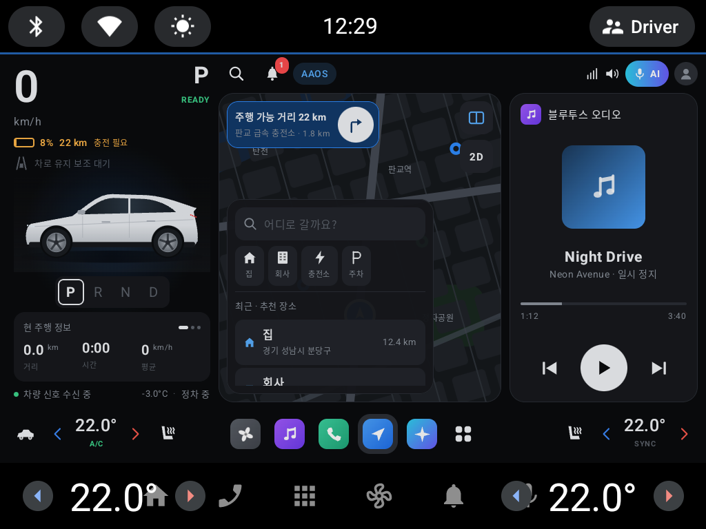

# 8단계 화면 상태를 차량 신호로: 공조 · 도어 · 주행 가능 거리 E2E

작성 2026-11-16. 7단계 검토에서 나온 가장 큰 빈틈을 메웠다: **새로 넣은 차량 기능 대부분이 화면 안에서만 바뀌고 차량 신호에 닿지 않았다.**
이 프로젝트의 핵심은 "UI 조작부터 차량 신호(CarProperty/VHAL)까지 E2E" 이므로, 화면 상태였던 것을 신호로 바꾸고 양방향 테스트를 붙였다.

여기서 '차량 신호' 는 **AAOS 에뮬레이터의 CarService·VHAL** 이다. 실제 차량에 연결한 것이 아니다.
앱은 양산 앱과 같은 API(`CarPropertyManager`)로 읽고 쓰고, 테스트는 adb 로 VHAL 에 값을 넣고(Property Injection) CarService 로 읽는다.

## 1. 연결한 신호

| 기능 | VHAL property | area | 앱 | 필요한 권한 |
|---|---|---|---|---|
| A/C | `HVAC_AC_ON` | 좌석 5개 | 읽기 + 쓰기 (전 좌석) | `CONTROL_CAR_CLIMATE` (priv-app) |
| AUTO | `HVAC_AUTO_ON` | 좌석 5개 | 읽기 + 쓰기 (전 좌석) | 〃 |
| 풍량 1~7 | `HVAC_FAN_SPEED` | 좌석 5개 | 읽기 + 쓰기 (전 좌석) | 〃 |
| 김서림 제거 앞/뒤 | `HVAC_DEFROSTER` | 창 2개 | 읽기 + 쓰기 (그 유리만) | 〃 |
| 좌석 열선 0~2단 | `HVAC_SEAT_TEMPERATURE` | 좌석별 | 읽기 + 쓰기 (그 좌석만) | 〃 |
| 도어 잠금 | `DOOR_LOCK` | 문 4개 | 읽기 + 쓰기 (전 도어) | `CONTROL_CAR_DOORS` (priv-app) — **새로 추가** |
| 주행 가능 거리 | `RANGE_REMAINING` (m) | 전역 | 읽기 | `CAR_ENERGY` (dangerous) — 새로 추가 |
| 배터리 잔량 | `EV_BATTERY_LEVEL` ÷ `INFO_EV_BATTERY_CAPACITY` (Wh → %) | 전역 | 읽기 | `CAR_ENERGY`, `CAR_INFO` |
| 외기 온도 | `ENV_OUTSIDE_TEMPERATURE` (°C) | 전역 | 읽기 | `CAR_EXTERIOR_ENVIRONMENT` |

- 7단계까지 연결돼 있던 것: 속도, 기어, 좌석 온도, 주행 중 UX 제한.
- **아직 화면 상태로 남은 것**: 사이드 미러 접기, 트렁크, 차일드 락, 실내등, 전조등. 에뮬레이터 VHAL 에 맞는 property 가 없거나(미러 접기·트렁크)
  이번 범위에서 뺐다. 운전자 보조 표시와 주변 차량은 여전히 연출이다.
- area 구성은 차마다 다르므로 앱은 하드코딩하지 않고 `CarPropertyConfig.areaIds` 에서 읽어 쓴다.
- 권한이 없는 신호는 구독이 실패하고 화면에 '값 없음' 으로 남는다 (도어 '제어 불가', '주행 가능 거리 정보 없음'). 앱은 죽지 않는다.

## 2. 화면에서 달라진 것

| 주행 가능 거리 부족 (신호: 22 km · 8 % · -3 °C) | 전 좌석 공조 (화면 → 신호) |
|---|---|
|  |  |

- **주행 정보**: 배터리 잔량 · 주행 가능 거리 줄, 아래 줄에 외기 온도. 속도 단위가 mph 면 거리는 마일로.
- **주행 가능 거리 부족** (30 km 이하): 주행 정보가 주황색 + '충전 필요', 내비 지도 위에 **가까운 충전소 안내 카드**, 알림 센터에 기록.
  카드를 누르면 바로 안내를 시작한다. 주행 중(글자 검색 잠김)에도 한 번 눌러 쓸 수 있다.
- **공조**: A/C · AUTO · 풍량(1~7, 에뮬레이터 config 범위) · 김서림이 신호. 풍량을 직접 바꾸면 AUTO 가 풀린다(앱 규칙).
- **좌석 열선**: 누를 때마다 꺼짐 → 2단 → 1단 → 꺼짐. 공조 화면 · 아래 바 · 빠른 제어 세 곳이 같은 신호를 본다.
- **도어 잠금**: 빠른 제어의 도어 버튼이 전 도어 `DOOR_LOCK` 을 쓴다.
- **AI 어시스턴트**: "에어컨 켜줘", "열선 켜줘" 가 이제 차량 신호까지 간다 (말한 좌석의 열선만).

## 3. 테스트 설계

### 3-1) 어댑터: `car.set_signal()` / `car.signal()`

테스트는 신호 이름과 **화면 단위**(km, %, °C, 단계)만 쓴다. 기기 차이와 단위 변환은 어댑터(`ivi/vehicle.py`)가 맡는다.

| | AAOS (`AaosVehicle`) | 태블릿 (`MockVehicle`) |
|---|---|---|
| 넣기 | VHAL 에 직접: `dumpsys <VHAL> --set <prop> -i/-f <값> -a <area>` | `am broadcast … mock.SET --ez/--ei/--ef` |
| 읽기 | CarService: `cmd car_service get-property-value` | `am broadcast … mock.GET` |
| 변환 | km → m, % → Wh(용량 대비), bool → 0/1 | 없음 |
| area | '전 좌석' 신호는 5개, 도어는 4개 area 모두 | 값 하나 |

- `car.signal_all(이름)` 은 area 별 값을 돌려준다 → "A/C 를 끄면 **전 좌석**이 꺼진다", "도어 버튼이 **4개 문 모두**를 잠근다" 를 확인한다.
  운전석 area 만 쓰는 구현은 화면만 봐서는 통과하지만 이 확인에서 걸린다.

### 3-2) 테스트마다 기준 값으로 (테스트 격리)

차량 신호는 앱을 다시 띄워도 남는다. 앞 테스트가 문을 열어 두면 다음 테스트의 "누르면 열림" 이 거꾸로 된다.
→ `app` 픽스처의 `prepare()` 가 테스트마다 신호 11개를 기준 값(`CABIN_DEFAULTS`)으로 되돌린다.

- AAOS 에서 이 초기화는 `--set` 26번(11개 신호 × area)이다. 하나씩 보내면 테스트마다 adb 왕복 26번 →
  **adb shell 한 번에 묶어 보낸다** (`set_signals`). 26개가 모두 들어갔는지 세고, 모자라면 통째로 한 번 더 시도하고 기록한다(4단계의 VHAL 재시도 규칙과 같다).
- 결과: 테스트 수가 84 → 108개로 늘었는데 전체 시간은 5분 47초 → 6분 40초 (테스트당 4.1초 → 3.7초).

### 3-3) 토글 상태를 색이 아니라 `checked` 로

A/C · AUTO · 김서림 토글은 글자가 바뀌지 않고 색만 바뀐다. 색은 자동화가 읽기 어렵다.
→ 앱에서 `Modifier.toggleable(role = Switch)` 로 켜짐/꺼짐을 접근성 정보로 내보내고, 화면 객체는 `checked` 속성을 읽는다 (설정 화면 스위치와 같은 방식).
접근성(TalkBack)에도 같은 정보가 간다.

### 3-4) 테스트 목록 (`tests/test_vehicle_signals.py`, 24개)

| 분류 | 테스트 | 방향 |
|---|---|---|
| sanity | A/C 를 끄면 전 좌석 area 가 꺼진다 | 화면 → 신호 |
| sanity | 차량이 A/C 를 끄고 켜면 토글이 따라간다 | 신호 → 화면 |
| sanity | 풍량 +/- 한 번에 신호가 한 단계 (2건) | 화면 → 신호 |
| regression | 풍량 경계 값 1 · 7 에서 버튼 비활성, 신호가 범위를 안 벗어남 (2건) | 양방향 |
| regression | AUTO 중 풍량을 바꾸면 `HVAC_AUTO_ON` 이 꺼진다 | 화면 → 신호 2개 |
| sanity | 앞/뒤 김서림은 그 유리의 신호만 켠다 (2건) | 양방향, area 혼동 방지 |
| sanity | 열선 꺼짐 → 2 → 1 → 꺼짐, 다른 좌석은 그대로 (좌석 2건) | 화면 → 신호 |
| sanity | 열선 신호가 공조 화면 · 아래 바 · 빠른 제어에 같은 값으로 | 신호 → 화면 3곳 |
| regression | 아래 바 열선은 다른 앱을 보고 있어도 신호를 바꾼다 | 화면 → 신호 |
| regression | 조수석에서 "열선 켜줘" → 조수석 신호만 | 말 → 신호 |
| sanity | 도어 버튼이 전 도어를 잠그고 푼다 | 화면 → 신호 (4개 area) |
| sanity | 차량에서 문이 열리면 표시가 바뀐다 | 신호 → 화면 |
| sanity | 주행 가능 거리 · 배터리 · 외기 온도가 주행 정보에 (단위 변환 포함) | 신호 → 화면 |
| sanity | 경계 값 31 / 30 / 29 km 에서 경고와 카드 (3건) | 신호 → 화면 |
| sanity | 주행 중 거리 부족 → 카드 → 가까운 충전소 안내 시작 | 신호 → 화면 → 동작 |
| regression | 거리 부족이 알림 센터에 남는다 | 신호 → 화면 |
| regression | 충전하면 경고와 카드가 사라진다 | 신호 → 화면 |
| regression | 속도 단위 mph 면 거리도 마일 (320 km = 199 mi) | 설정 × 신호 |

프레임워크 단위 테스트 7개 추가 (기기 없이): area 5개에 한 번의 shell 호출, km·% ↔ m·Wh 변환, 묶음 재시도와 실패 메시지, Mock 의 타입별 extra, 기준 값 초기화가 11개를 모두 넣는지.

## 4. 진행 중 잡은 것

### 4-1) 도어 잠금은 권한 목록까지 바꿔야 한다
- `CONTROL_CAR_DOORS` 는 `signature|privileged` 권한이다. 매니페스트에 적는 것만으로는 안 되고,
  `/system/etc/permissions` 의 priv-app 허용 목록(`privapp-permissions-dev.opencabin.ivi.xml`)에 있어야 한다.
- 그래서 이번에는 `adb install -r` 이 아니라 `privileged/install_priv_app.py` 로 다시 넣고 재부팅했다. 설치 후 `dumpsys package` 로 확인:
  `CONTROL_CAR_DOORS: granted=true`, `CAR_ENERGY: granted=true`(운전자 사용자 10).
- `CAR_ENERGY` 는 dangerous 권한이라 권한 창이 뜬다. 창이 뜨면 테스트가 앱 화면을 못 보므로 설치 스크립트가 `pm grant` 로 미리 준다.

### 4-2) 테스트 쪽 경쟁 조건 1건 (내가 만든 것)
- 증상: 전체 실행에서 `test_range_recovers_after_charging` 이 `battery_percent() == 75` 에서 실패. 혼자 돌리면 통과.
- 원인: 주행 가능 거리와 배터리는 **서로 다른 신호**라 따로 도착한다. 거리(카드 사라짐)를 기다린 뒤 배터리를 바로 `assert` 했다.
- 해결: 배터리도 조건 대기(`wait_until`)로. 같은 모양이던 외기 온도 확인도 고쳤다. 고정 `sleep` 은 쓰지 않았다.

## 5. 결과

| 항목 | 결과 |
|---|---|
| 앱 빌드 | Kotlin 경고 0 |
| 앱 단위 테스트 (`CabinAssistantTest`) | 17 passed |
| 프레임워크 단위 테스트 (`pytest unit`) | 33 passed (26 → 33) |
| AAOS 에뮬레이터 전체 E2E (108개) | **106 passed, 1 skipped, 1 xfailed**, gate pass, 앱 재실행 0, VHAL 재시도 0 (6분 40초) |
| 화웨이 태블릿 (Mock) 전체 E2E (108개) | **102 passed, 6 skipped** (AAOS 전용), gate pass, 앱 재실행 0 (7분 6초) |
| 두 기기 병렬 (`run_bench.py --reruns 1`) | 두 기기 모두 gate pass, **flaky 0**, 재실행 0, VHAL 재시도 0. 7분 20초 (차례로 돌리면 약 14분 28초, 2.0배) |

- E2E 84 → 108개. 새 24개는 모두 화면과 신호를 양쪽에서 보고, **같은 테스트가 AAOS(VHAL)와 태블릿(Mock) 양쪽에서 통과**한다.
- 태블릿은 이 날 처음에 adb `unauthorized` 였다 (adb 서버를 다시 켠 뒤 기기에서 USB 디버깅 승인이 필요). 승인 → 설치 승인 → 실행 순서로 진행했다.
- 반복 안정성(같은 묶음 여러 번)은 이번에 1회만 봤다. 7단계의 2회 반복에서 한 번 흔들린 `test_video_blocked_screen_follows_parking` 은 이번 3회(에뮬레이터 단독 2 + 병렬 1)에서는 재현되지 않았다.

## 6. 공고 업무와의 대응 (42dot Test Automation Engineer, IVI System)

| 공고 | 이 단계에서 보여 주는 것 |
|---|---|
| AAOS IVI 주요 서비스(HVAC, 차량 설정, 클러스터 연동, 미디어) 검증 | HVAC 6종 신호, 도어, 클러스터(주행 정보)에 차량 신호 3종 |
| UI 상호작용과 CarProperty/VHAL 을 아우르는 E2E 설계 | 24개 모두 양방향. area 단위 판정(전 좌석 · 전 도어 · 그 유리만) |
| ADB · shell · CarPropertyManager 로 Property Injection | `dumpsys VHAL --set` 묶음 주입, CarService 로 읽기, 앱은 CarPropertyManager |
| Flaky 최소화, 피드백 루프 단축 | 테스트마다 기준 값 초기화(격리), 주입 26번을 왕복 1번으로, 경쟁 조건은 조건 대기로 |
| Smoke / Sanity / Regression 범위 | 새 테스트 24개를 sanity 16 · regression 8 로 나눔 (parametrize 포함) |
