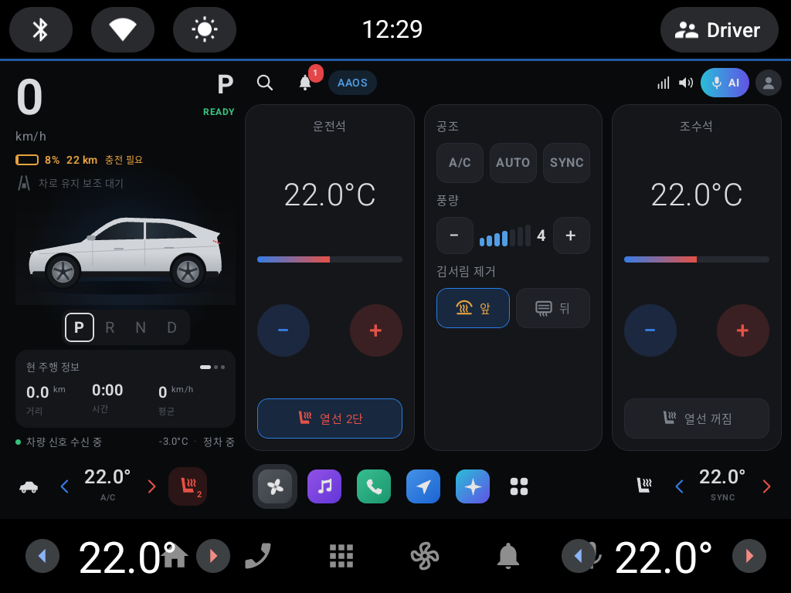
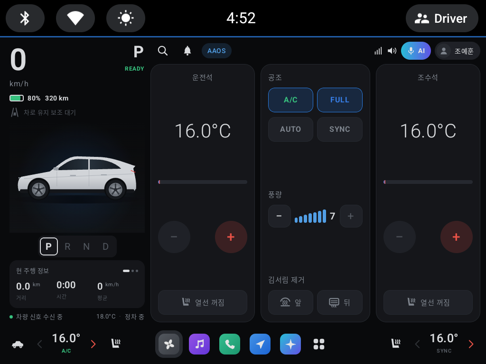

# 8단계 화면 상태를 차량 신호로: 공조, 도어, 주행 가능 거리 E2E

2026-11-16에 정리했습니다. 7단계를 검토해 보니 새로 넣은 차량 기능 대부분이 화면 안에서만 바뀌고 차량 신호까지 가지 않았습니다. 이 프로젝트의 목적은 UI 조작부터 차량 신호(CarProperty/VHAL)까지 확인하는 것이라, 화면 상태였던 것을 신호로 바꾸고 양방향 테스트를 붙였습니다.

여기서 '차량 신호'는 AAOS 에뮬레이터의 CarService와 VHAL을 말합니다. 실제 차량에 연결한 것은 아닙니다. 앱은 양산 앱과 같은 API(`CarPropertyManager`)로 값을 읽고 쓰고, 테스트는 adb로 VHAL에 값을 넣은 뒤(Property Injection) CarService로 읽습니다.

## 1. 연결한 신호

| 기능 | VHAL property | area | 앱이 하는 일 | 필요한 권한 |
|---|---|---|---|---|
| A/C | `HVAC_AC_ON` | 좌석 5개 | 읽고 씀 (전 좌석) | `CONTROL_CAR_CLIMATE` (priv-app) |
| AUTO | `HVAC_AUTO_ON` | 좌석 5개 | 읽고 씀 (전 좌석) | 위와 같음 |
| 풍량 1~7 | `HVAC_FAN_SPEED` | 좌석 5개 | 읽고 씀 (전 좌석) | 위와 같음 |
| 앞뒤 김서림 제거 | `HVAC_DEFROSTER` | 유리 2개 | 읽고 씀 (누른 유리만) | 위와 같음 |
| 좌석 열선 0~2단 | `HVAC_SEAT_TEMPERATURE` | 좌석마다 | 읽고 씀 (그 좌석만) | 위와 같음 |
| 도어 잠금 | `DOOR_LOCK` | 문 4개 | 읽고 씀 (모든 문) | `CONTROL_CAR_DOORS` (priv-app), 이번에 추가 |
| 주행 가능 거리 | `RANGE_REMAINING` (m) | 전역 | 읽기 | `CAR_ENERGY` (dangerous), 이번에 추가 |
| 배터리 잔량 | `EV_BATTERY_LEVEL`을 `INFO_EV_BATTERY_CAPACITY`로 나눔 (Wh를 %로) | 전역 | 읽기 | `CAR_ENERGY`, `CAR_INFO` |
| 외기 온도 | `ENV_OUTSIDE_TEMPERATURE` (°C) | 전역 | 읽기 | `CAR_EXTERIOR_ENVIRONMENT` |

7단계까지 연결돼 있던 신호는 속도, 기어, 좌석 온도, 주행 중 UX 제한입니다.

사이드 미러 접기, 트렁크, 차일드 락, 실내등, 전조등은 아직 화면 상태로 남아 있습니다. 미러 접기와 트렁크는 에뮬레이터 VHAL에 맞는 property가 없었고, 나머지는 이번 범위에서 뺐습니다. 운전자 보조 표시와 주변 차량도 여전히 화면 연출입니다.

area 구성은 차마다 다르기 때문에, 앱은 area를 코드에 박아 두지 않고 `CarPropertyConfig.areaIds`에서 읽어 씁니다.

권한이 없는 신호는 구독이 실패하고, 화면에 '값 없음'으로 남습니다. 도어는 '제어 불가', 주행 가능 거리는 '주행 가능 거리 정보 없음'으로 나옵니다. 앱이 죽지는 않습니다.

## 2. 화면에서 달라진 것

| 주행 가능 거리 부족 (신호: 22 km, 8 %, -3 °C) | 전 좌석 공조 (화면에서 신호로) |
|---|---|
|  |  |

- 주행 정보에 배터리 잔량과 주행 가능 거리 줄이 생기고, 아래 줄에 외기 온도가 나옵니다. 속도 단위가 mph면 거리도 마일로 보여 줍니다.
- 주행 가능 거리가 30 km 이하로 떨어지면 주행 정보가 주황색으로 바뀌고 '충전 필요'가 뜹니다. 내비 지도 위에는 가까운 충전소 안내 카드가 나오고, 알림 센터에도 기록이 남습니다. 카드를 누르면 바로 안내를 시작하고, 글자 검색이 막힌 주행 중에도 한 번 눌러 쓸 수 있습니다.
- 공조의 A/C, AUTO, 풍량(1~7, 에뮬레이터 config의 범위), 김서림이 신호로 움직입니다. 풍량을 직접 바꾸면 AUTO가 풀리는데, 이것은 앱이 정한 규칙입니다.
- 좌석 열선은 누를 때마다 꺼짐, 2단, 1단, 꺼짐 순서로 바뀝니다. 공조 화면, 아래 바, 빠른 제어 세 곳이 같은 신호를 봅니다.
- 빠른 제어의 도어 버튼은 모든 문의 `DOOR_LOCK`을 씁니다.
- AI 어시스턴트에 "에어컨 켜줘", "열선 켜줘"라고 하면 이제 차량 신호까지 바뀝니다. 열선은 말한 사람의 좌석만 켭니다.

## 3. 테스트 설계

### 3-1) 어댑터: `car.set_signal()`과 `car.signal()`

테스트에는 신호 이름과 화면에 보이는 단위(km, %, °C, 단계)만 씁니다. 기기 차이와 단위 변환은 어댑터(`ivi/vehicle.py`)가 맡습니다.

| | AAOS (`AaosVehicle`) | 태블릿 (`MockVehicle`) |
|---|---|---|
| 넣기 | VHAL에 바로: `dumpsys <VHAL> --set <prop> -i/-f <값> -a <area>` | `am broadcast … mock.SET --ez/--ei/--ef` |
| 읽기 | CarService로: `cmd car_service get-property-value` | `am broadcast … mock.GET` |
| 변환 | km를 m로, %를 용량 대비 Wh로, bool을 0과 1로 | 없음 |
| area | '전 좌석' 신호는 5개, 도어는 4개 area에 모두 | 값 하나 |

`car.signal_all(이름)`은 area마다 값을 돌려줍니다. 이것으로 "A/C를 끄면 모든 좌석이 꺼진다", "도어 버튼이 문 네 개를 모두 잠근다"를 확인합니다. 운전석 area에만 값을 쓰는 잘못된 구현은 화면만 보면 통과하지만 이 확인에서는 걸립니다.

### 3-2) 테스트마다 기준 값으로 되돌리기 (테스트 격리)

차량 신호는 앱을 다시 띄워도 남습니다. 앞 테스트가 문을 열어 둔 채 끝나면, 다음 테스트의 "누르면 열린다"는 확인이 거꾸로 됩니다. 그래서 `app` 픽스처의 `prepare()`가 테스트마다 신호 11개를 기준 값(`CABIN_DEFAULTS`)으로 되돌립니다.

AAOS에서 이 초기화는 신호 11개에 area를 곱해 `--set` 26번입니다. 하나씩 보내면 테스트마다 adb 왕복이 26번 생기므로, adb shell 한 번에 묶어서 보냅니다(`set_signals`). 26개가 모두 들어갔는지 세어 보고, 모자라면 통째로 한 번 더 보낸 뒤 그 사실을 기록합니다. 4단계에서 정한 VHAL 재시도 규칙과 같습니다.

그 결과 테스트가 84개에서 108개로 늘었는데, 전체 시간은 5분 47초에서 6분 40초로 조금만 늘었습니다. 테스트 하나당 시간은 4.1초에서 3.7초로 오히려 줄었습니다.

### 3-3) 토글 상태를 색이 아니라 `checked`로

A/C, AUTO, 김서림 토글은 글자는 그대로이고 색만 바뀝니다. 색은 자동화가 읽기 어렵습니다. 앱에서 `Modifier.toggleable(role = Switch)`로 켜짐과 꺼짐을 접근성 정보로 내보내고, 화면 객체는 `checked` 속성을 읽습니다. 설정 화면의 스위치와 같은 방식이고, TalkBack에도 같은 정보가 갑니다.

### 3-4) 테스트 목록 (`tests/test_vehicle_signals.py`, 24개)

설명을 누르면 기기별 결과와 테스트가 끝난 화면을 볼 수 있습니다([테스트 결과](test-results.md)).

| 분류 | 테스트 | 확인하는 방향 |
|---|---|---|
| sanity | [A/C를 끄면 모든 좌석 area가 꺼진다](test-results.md#test_ac_toggle_reaches_every_seat) | 화면에서 신호로 |
| sanity | [차량이 A/C를 끄고 켜면 토글이 따라온다](test-results.md#test_ac_signal_is_shown_on_climate_and_bottom_bar) | 신호에서 화면으로 |
| sanity | [풍량 +, -를 한 번 누르면 신호가 한 단계 바뀐다 (2건)](test-results.md#test_fan_button_changes_signal_by_one) | 화면에서 신호로 |
| regression | [풍량 1과 7에서 버튼이 꺼지고 신호가 범위를 벗어나지 않는다 (2건)](test-results.md#test_fan_buttons_disabled_at_limits) | 양쪽 |
| regression | [AUTO 중에 풍량을 바꾸면 `HVAC_AUTO_ON`이 꺼진다](test-results.md#test_manual_fan_releases_auto) | 화면에서 신호 두 개로 |
| sanity | [앞뒤 김서림 제거는 누른 유리의 신호만 켠다 (2건)](test-results.md#test_defrost_changes_only_its_window) | 양쪽, area 혼동 방지 |
| sanity | [열선이 꺼짐, 2단, 1단, 꺼짐 순서로 바뀌고 다른 좌석은 그대로다 (좌석 2건)](test-results.md#test_seat_heat_cycles_levels_on_vehicle) | 화면에서 신호로 |
| sanity | [열선 신호가 공조 화면, 아래 바, 빠른 제어에 같은 값으로 보인다](test-results.md#test_seat_heat_signal_is_shown_everywhere) | 신호에서 화면 세 곳으로 |
| regression | [아래 바 열선은 다른 앱을 보고 있어도 신호를 바꾼다](test-results.md#test_bottom_bar_seat_heat_works_from_any_screen) | 화면에서 신호로 |
| regression | [조수석에서 "열선 켜줘"라고 하면 조수석 신호만 바뀐다](test-results.md#test_assistant_seat_heat_follows_speaker_zone) | 말에서 신호로 |
| sanity | [도어 버튼이 모든 문을 잠그고 푼다](test-results.md#test_door_lock_button_drives_every_door) | 화면에서 신호로 (area 4개) |
| sanity | [차량에서 문이 열리면 표시가 바뀐다](test-results.md#test_door_lock_signal_is_shown) | 신호에서 화면으로 |
| sanity | [주행 가능 거리, 배터리, 외기 온도가 단위를 바꿔 주행 정보에 보인다](test-results.md#test_energy_signals_are_shown_on_cluster) | 신호에서 화면으로 |
| sanity | [31, 30, 29 km에서 경고와 카드가 맞게 뜬다 (3건)](test-results.md#test_low_range_threshold) | 신호에서 화면으로 |
| sanity | [주행 중 거리가 부족해지면 카드가 뜨고, 누르면 가장 가까운 충전소로 안내한다](test-results.md#test_low_range_card_starts_guidance_to_nearest_charger) | 신호에서 화면, 동작까지 |
| regression | [거리 부족이 알림 센터에 남는다](test-results.md#test_low_range_is_recorded_in_notifications) | 신호에서 화면으로 |
| regression | [충전하면 경고와 카드가 사라진다](test-results.md#test_range_recovers_after_charging) | 신호에서 화면으로 |
| regression | [속도 단위가 mph면 거리도 마일로 보인다 (320 km = 199 mi)](test-results.md#test_range_follows_speed_unit_setting) | 설정과 신호 |

기기 없이 도는 프레임워크 단위 테스트도 7개 더했습니다. area 5개를 shell 한 번으로 보내는지, km와 %를 m와 Wh로 바꾸는 계산, 묶음 재시도와 실패 메시지, Mock의 타입별 extra, 기준 값 초기화가 신호 11개를 모두 넣는지를 봅니다.

## 4. 진행하면서 잡은 것

### 4-1) 도어 잠금은 권한 목록까지 바꿔야 했음

`CONTROL_CAR_DOORS`는 `signature|privileged` 권한입니다. 매니페스트에 적는 것만으로는 부족하고, `/system/etc/permissions`의 priv-app 허용 목록(`privapp-permissions-dev.opencabin.ivi.xml`)에도 있어야 합니다.

그래서 이번에는 `adb install -r`이 아니라 `privileged/install_priv_app.py`로 다시 넣고 재부팅했습니다. 설치한 뒤 `dumpsys package`에서 운전자 사용자 10의 `CONTROL_CAR_DOORS: granted=true`, `CAR_ENERGY: granted=true`를 확인했습니다.

`CAR_ENERGY`는 dangerous 권한이라 권한 창이 뜹니다. 창이 뜨면 테스트가 앱 화면을 보지 못하기 때문에, 설치 스크립트가 `pm grant`로 미리 권한을 줍니다.

### 4-2) 테스트 쪽 경쟁 조건 1건 (제가 만든 것)

전체 실행에서 `test_range_recovers_after_charging`이 `battery_percent() == 75`에서 실패했습니다. 혼자 돌리면 통과했습니다.

주행 가능 거리와 배터리는 서로 다른 신호라 따로 도착합니다. 그런데 테스트는 거리(카드가 사라지는 것)만 기다린 뒤 배터리를 바로 `assert`하고 있었습니다. 배터리도 조건 대기(`wait_until`)로 바꾸고, 같은 모양이던 외기 온도 확인도 고쳤습니다. 고정 `sleep`은 쓰지 않았습니다.

## 5. 결과

| 항목 | 결과 |
|---|---|
| 앱 빌드 | Kotlin 경고 0 |
| 앱 단위 테스트 (`CabinAssistantTest`) | 17개 통과 |
| 프레임워크 단위 테스트 (`pytest unit`) | 26개에서 33개로 늘었고 모두 통과 |
| AAOS 에뮬레이터 전체 E2E (108개) | 106개 통과, 1개 건너뜀, 1개 알려진 결함. 게이트 통과, 앱 재실행 0, VHAL 재시도 0 (6분 40초) |
| 화웨이 태블릿(Mock) 전체 E2E (108개) | 102개 통과, AAOS 전용 6개 건너뜀. 게이트 통과, 앱 재실행 0 (7분 6초) |
| 두 기기 병렬 (`run_bench.py --reruns 1`) | 두 기기 모두 게이트 통과, flaky 0, 앱 재실행 0, VHAL 재시도 0. 7분 20초로, 차례로 돌린 약 14분 28초보다 2.0배 빠름 |

E2E는 84개에서 108개가 됐습니다. 새로 만든 24개는 모두 화면과 신호를 양쪽에서 보고, 같은 테스트가 AAOS(VHAL)와 태블릿(Mock)에서 모두 통과합니다.

이날 태블릿은 처음에 adb `unauthorized` 상태였습니다. adb 서버를 다시 켠 뒤라 기기에서 USB 디버깅을 다시 승인해야 했습니다. USB 디버깅 승인, 설치 승인, 실행 순서로 진행했습니다.

같은 묶음을 여러 번 돌리는 반복 안정성은 이번에 한 번만 봤습니다. 7단계의 두 번 반복에서 한 번 흔들렸던 `test_video_blocked_screen_follows_parking`은 이번 에뮬레이터 전체 실행 두 번(단독 한 번, 병렬 한 번)에서는 재현되지 않았습니다. 원인은 아직 확인하지 못했습니다.

## 6. 42dot Test Automation Engineer, IVI System

| 요구 역량 | 이 단계에서 보여 주는 것 |
|---|---|
| AAOS IVI 주요 서비스(HVAC, 차량 설정, 클러스터 연동, 미디어) 검증 | HVAC 신호 여섯 가지와 도어를 연결하고, 클러스터 역할을 하는 주행 정보에 차량 신호 세 가지를 보여 줍니다. |
| UI 상호작용과 CarProperty/VHAL을 아우르는 E2E 설계 | 새 테스트 24개가 모두 양방향이고, 모든 좌석, 모든 문, 누른 유리만처럼 area 단위로 판정합니다. |
| ADB, shell, CarPropertyManager로 Property Injection | `dumpsys VHAL --set`으로 묶어서 넣고 CarService로 읽습니다. 앱은 CarPropertyManager를 씁니다. |
| Flaky 최소화, 피드백 루프 단축 | 테스트마다 기준 값으로 되돌려 격리하고, 주입 26번을 adb 왕복 한 번으로 줄였습니다. 경쟁 조건은 조건 대기로 고쳤습니다. |
| Smoke / Sanity / Regression 범위 | 새 테스트 24개를 sanity 16개, regression 8개로 나눴습니다 (parametrize 포함). |

## 7. 8단계 이후에 더한 것 (2026-11-16)

### 7-1) 최대 냉방 (화면의 FULL 버튼)

공조 화면 A/C 옆에 FULL 버튼을 넣었습니다. 차량 신호는 `HVAC_MAX_AC_ON`이고, 에뮬레이터 VHAL에는 좌석 area 5개로 들어 있습니다(`cmd car_service get-carpropertyconfig 0x15200506`으로 확인).

| 동작 | 결과 |
|---|---|
| FULL을 켬 | 모든 좌석의 `HVAC_MAX_AC_ON`과 A/C가 켜지고, 온도는 16.0°C, 풍량은 7이 되며 AUTO는 꺼집니다. |
| FULL을 버튼으로 끔 | 켜기 전의 온도, 풍량, A/C, AUTO 값으로 되돌립니다. |
| FULL 중에 온도나 풍량을 직접 바꾸거나, A/C를 끄거나, AUTO를 켬 | 최대 냉방만 꺼집니다. 값은 되돌리지 않고 방금 바꾼 값을 따릅니다. |
| 차량 쪽에서 신호가 바뀜 | FULL 토글이 따라 바뀝니다. |

켜기 전 값은 화면 틀 상태(`CockpitState.beforeMaxAc`)에 둡니다. 앱을 다시 띄우면 사라지기 때문에, 그 뒤에 FULL을 끄면 신호만 꺼지고 값은 그대로입니다.

테스트 다섯 개를 `test_vehicle_signals.py`에 더했습니다. [켜면 모든 좌석 신호와 온도, 풍량, AUTO가 바뀌는지](test-results.md#test_max_ac_sets_signal_and_coldest_settings), [끄면 되돌아가는지](test-results.md#test_max_ac_off_restores_previous_settings), [신호가 바뀌면 토글이 따라오는지](test-results.md#test_max_ac_signal_is_shown_on_toggle), [풍량을 내리면 풀리는지](test-results.md#test_manual_fan_releases_max_ac), [A/C를 끄면 풀리는지](test-results.md#test_turning_ac_off_releases_max_ac)를 봅니다.

기준 값 초기화에도 `max_ac`를 넣었습니다. 신호가 11개에서 12개로, AAOS의 `--set`이 26번에서 31번으로 늘었지만 adb 왕복은 여전히 한 번입니다.

### 7-2) 화면과 문구

- 상단 바 프로필에 로그인한 운전자 이름(조예훈)을 보여 줍니다. 설정 화면의 시스템 항목에도 계정 줄을 넣었습니다.
- 내비게이션 '회사'의 주소를 42dot 근무지 주소(성남시 수정구 창업로40번길 20)로 바꿨습니다. 이름과 거리(8.7 km)는 테스트가 보고 있어서 그대로 뒀습니다.
- 에뮬레이터에서 화면을 하나씩 찍어 보며 어색한 곳을 고쳤습니다. 앱 목록의 위아래 줄이 어긋나던 것은 칸 너비를 같게 맞췄고, 줄글이던 설정의 시스템 정보는 이름과 값 줄로 나눴고, 공조 가운데 패널 아래가 비던 것은 묶음 간격을 고르게 했습니다.
- AI 어시스턴트 대답에 쓰던 '(으)로', '을(를)' 같은 괄호 표기를 받침에 맞는 조사로 바꿨습니다(`CabinAssistant.josa`, 단위 테스트 2개 추가). 알림 문구도 '합니다' 말투로 맞췄습니다.

### 7-3) 결과

| 항목 | 결과 |
|---|---|
| AAOS 에뮬레이터 전체 E2E (113개, `--reruns 1`) | 111개 통과, 1개 건너뜀, 1개 알려진 결함. 게이트 통과, 재시도 0 (7분 27초) |
| 프레임워크 단위 테스트 | 33개 통과 |
| 앱 단위 테스트 | 컴파일만 확인했습니다. 이 PC에서는 Gradle 테스트 실행기가 죽어서 CI에서 돌립니다. |

태블릿과 두 기기 병렬 실행은 이때 다시 돌리지 않았습니다. 태블릿은 새 APK를 설치할 때 기기 화면 승인이 필요합니다.

### 7-4) 테스트별 결과 화면 (2026-11-18)

`pytest --shots`로 돌리면 테스트마다 판정이 난 직후, 정리 단계 전에 화면을 한 장 남깁니다. 재시도가 있었다면 마지막 시도의 화면입니다. `tools/publish_results.py`가 실행 기록과 화면을 `site/results/`(가로 960px WebP)와 [테스트 결과](test-results.md)로 옮깁니다. 테스트 설명과 마커는 테스트 코드의 docstring과 `@pytest.mark`에서 읽기 때문에 따로 적지 않습니다.

| 기기 | 결과 | 화면 |
|---|---|---|
| AAOS 에뮬레이터 | 115개 중 113개 통과, 1개 건너뜀, 1개 알려진 결함, 재시도 0 (9분 35초) | 115장 |
| 화웨이 태블릿 (Mock) | 115개 중 109개 통과, AAOS 전용 6개 건너뜀, 재시도 0 (9분 11초) | 109장 |

준비 단계에서 건너뛴 테스트는 화면이 없습니다. 주행 중 영상 차단은 AAOS에서는 OS의 차단 화면이 스크린샷에 검게 찍히고, 태블릿에서는 앱이 그린 차단 화면이 찍힙니다.

### 7-5) 영상 화면에 실제 주행 영상 (2026-11-18)

영상 화면은 그동안 그라데이션 위에 재생 시간만 흐르는 가짜였습니다. 직접 찍은 블랙박스 영상을 기기에 올려 실제로 재생하게 바꿨고, 결과 화면에도 그 영상이 보입니다. 다듬는 방법과 저장 위치는 [2단계 문서](phase2-app.md#주행-영상-블랙박스-2026-11-16-추가)에 적었습니다.

영상과 함께 테스트 두 개를 더했습니다. [주행 때문에 멈춘 영상이 차를 세우면 멈춘 자리부터 이어지는지](test-results.md#test_video_resumes_where_it_stopped), [다음 버튼으로 두 번째 영상으로 넘어가는지](test-results.md#test_video_next_clip)를 봅니다. 영상 파일이 없는 기기에서는 이 두 테스트를 건너뜁니다.

영상에는 다른 차 번호판이 찍혀 있습니다. 결과 화면 중 번호판이 읽히는 두 장(두 기기의 `test_video_resumes_where_it_stopped`)은 `publish_results.py --blur`로 그 부분을 흐리게 해서 올렸습니다.
