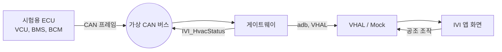

# 9단계 Test Bench 확장: REST API, 원격 전원, 가상 CAN, 요구사항 추적

2026-11-18에 정리했습니다. 벤치를 사람 없이 돌리려면 다른 도구가 HTTP로 기기와 신호를 다루고, 전원을 껐다 켜고, 차량 네트워크 신호를 받을 수 있어야 합니다. 이 세 가지를 PC 안의 모의 환경으로 만들고, 요구사항과 테스트를 잇는 추적표를 더했습니다.

실제 ECU나 CAN 장비, 전원 공급기, 기능 안전 인증 경험은 없습니다. 이번 단계는 PC 안의 모의 환경과, 개념을 이 프로젝트에 적용해 본 결과입니다. 그래서 첫 화면 목차에서도 'CAN만 모의', '모의 장비', '개념 적용'으로 따로 표시했습니다.

## 1. Test Bench REST API (`ivi/bench_api.py`)

벤치에 붙은 기기를 HTTP로 다루는 API입니다. 다른 팀의 도구나 CI가 adb 명령을 몰라도 기기 상태를 보고, 차량 신호를 넣고, 전원을 껐다 켜고, 테스트를 돌리고, 결과를 가져갈 수 있게 하려고 만들었습니다. 의존성을 늘리지 않으려고 표준 라이브러리(`http.server`)만 썼습니다.

| 경로 | 하는 일 |
|---|---|
| `GET /api/devices` | 벤치에 붙은 기기 목록 |
| `GET /api/devices/{serial}/signals` | 차량 신호 12종, 좌석 온도, 주행 중 제한 여부 |
| `POST /api/devices/{serial}/signals` | 신호 넣기. 예: `{"gear": "D", "speed_kmh": 50, "range_km": 25}` |
| `GET`, `POST /api/devices/{serial}/power` | 전원 상태 보기, 끄기, 켜기, 껐다 켜기 |
| `GET /api/runs`, `GET /api/runs/{name}` | 최근 실행 요약과 실행 하나의 전체 결과 |
| `POST /api/jobs`, `GET /api/jobs/{id}` | 기기와 마커를 골라 테스트 실행을 시작하고 상태를 봅니다. |

넣는 값은 먼저 검사합니다. 모르는 신호 이름, 범위를 벗어난 값(풍량 9, 온도 35°C), 0.5 단위가 아닌 온도, D가 아닌 기어에서의 속도는 400으로 거절하고 차량에는 넣지 않습니다. 없는 기기는 404, 전원 제어가 없는 기기는 501, 기기 쪽 오류는 502로 돌려줍니다.

벤치 PC 안에서만 쓰도록 기본 주소를 127.0.0.1로 두었습니다. 인증이 없어서 밖으로 열면 안 됩니다.

```powershell
.venv\Scripts\python tools\bench_api.py
curl http://127.0.0.1:8770/api/devices
curl -X POST http://127.0.0.1:8770/api/devices/emulator-5554/signals -d "{\"gear\": \"D\", \"speed_kmh\": 50}"
```

## 2. 원격 전원 제어 (`ivi/power.py`)

실제 벤치에서는 헤드 유닛 전원을 프로그래머블 전원 공급기나 스마트 릴레이로 끊고 다시 넣습니다. 그런 장비가 없어서 같은 인터페이스(`PowerController`) 아래에 구현을 세 가지 두었습니다.

| 구현 | 하는 일 | 확인 방법 |
|---|---|---|
| `EmulatorPower` | AAOS 에뮬레이터 프로세스를 끄고(`adb emu kill`) 같은 AVD, 같은 포트, `-writable-system`으로 다시 켭니다. | 실제 에뮬레이터로 E2E |
| `AdbRebootPower` | 실기기를 adb로 재부팅합니다. 끄기만 되고 원격으로 켜지는 못합니다. | 단위 테스트 |
| `HttpRelayPower` | HTTP로 켜고 끄는 스마트 릴레이(Tasmota 형식)입니다. 실제 벤치에 붙일 자리입니다. | 가짜 릴레이 서버로 단위 테스트 |

`test_power_cycle_brings_back_app_and_cabin_defaults`는 에뮬레이터 전원을 껐다 켠 뒤 세 가지를 봅니다. 3분 안에 부팅이 끝나는지, 앱이 다시 CarService에 붙는지, 공조가 기본값 22.0°C로 시작하는지입니다. 마지막 것은 7단계에서 넣은 VHAL 초기값 덮어쓰기가 재부팅 뒤에도 살아 있는지를 확인하는 것입니다. 부팅에 걸린 시간은 단독으로 돌렸을 때 24.3초, 전체 실행의 마지막에 돌렸을 때 32.2초였습니다.

전원을 껐다 켜면 Appium 세션이 끊깁니다. 그래서 conftest가 이 테스트를 실행 순서의 맨 끝으로 보내고, 테스트 안에서 새 세션을 만들어 화면을 확인합니다.

## 3. 가상 CAN 버스와 게이트웨이 (`ivi/can_gateway.py`)

실제 차에서는 VCU, BMS, BCM 같은 ECU가 CAN으로 신호를 보내고, 차량 쪽 서비스가 그 값을 VHAL property로 올려 줍니다. 이 자리를 PC 안의 가상 ECU와 가상 CAN 버스로 채웠습니다.



- 프레임과 신호는 DBC 파일(`ivi-tests/dbc/opencabin.dbc`)에 정의했고, cantools로 인코딩하고 풉니다. 속도는 0.01 km/h 단위, 외기 온도는 0.5°C 단위에 -40 오프셋처럼 실제 DBC와 같은 방식으로 적었습니다.
- 버스는 python-can의 virtual 인터페이스입니다. 같은 프로세스 안의 여러 노드가 같은 채널을 씁니다.
- 받는 쪽: VCU의 속도와 기어, BMS의 배터리와 주행 가능 거리, BCM의 도어와 외기 온도를 풀어서 차량 어댑터에 넣습니다. ECU는 같은 값을 100~500 ms마다 계속 보내기 때문에, 값이 바뀐 프레임만 넣어 adb 왕복을 줄였습니다.
- 보내는 쪽: 공조 상태(좌석 온도, A/C, 최대 냉방, AUTO, 풍량)를 읽어 `IVI_HvacStatus` 프레임을 1초마다 보냅니다.

| 테스트 | 확인하는 것 |
|---|---|
| `test_can_drive_frames_reach_screen` | VCU 프레임으로 D, 50 km/h를 보내면 화면 속도와 주행 제한 배지가 바뀌고, P로 바꾸면 돌아옵니다. 같은 프레임이 계속 와도 VHAL에는 한 번만 넣습니다. |
| `test_can_battery_and_door_frames_reach_screen` | BMS의 주행 가능 거리 25 km에 '충전 필요'가 뜨고, BCM의 문 열림에 도어 표시가 '열림'이 됩니다. |
| `test_climate_button_goes_out_on_can` | 화면에서 운전석 온도를 올리면 버스에 나가는 `IVI_HvacStatus`의 운전석 온도가 22.5°C가 됩니다. |

게이트웨이는 차량 어댑터를 거치기 때문에 같은 테스트가 AAOS(VHAL)와 태블릿(Mock)에서 모두 돕니다.

다루지 못한 것도 분명합니다. 실제 ECU, CAN 트랜시버, 버스 부하와 오류 프레임, 타이밍은 보지 않았습니다. Ethernet, DDS, SOME/IP도 해 보지 않았습니다.

## 4. 요구사항 추적표와 후방 카메라 2초

### 요구사항과 테스트를 양쪽으로 잇기

[요구사항](requirements.md) 26개에 ID를 붙이고, 모든 테스트 함수에 `@pytest.mark.req("ID")`를 달았습니다. `tools/trace_report.py`가 둘을 이어 [요구사항 추적표](traceability.md)를 만듭니다. 요구사항마다 확인하는 테스트와 기기별 최신 결과가 나오고, 반대로 테스트 파일마다 어떤 요구사항을 확인하는지도 나옵니다.

프레임워크 단위 테스트 `test_every_requirement_has_a_test_and_every_test_a_requirement`가 CI에서 세 가지를 막습니다. 테스트가 없는 요구사항, 요구사항이 없는 테스트, 없는 ID를 가리키는 테스트입니다. A-SPICE가 요구하는 요구사항–시험 양방향 추적을 개인 프로젝트 규모로 적용해 본 것이고, 표준 심사를 받은 것은 아닙니다.

### 후방 카메라가 2초 안에 뜨는지

미국 기준 FMVSS 111은 후진을 시작하고 2.0초 안에 후방 영상을 보여 주라고 정해 두었습니다. `test_rear_camera_appears_within_two_seconds`는 기어를 R로 바꾼 순간부터 카메라 화면이 보일 때까지를 다섯 번 재고, 가장 느린 값으로 판정합니다. 신호를 넣는 adb 시간까지 포함한 값이라 실제보다 느리게 잡힙니다. 법규의 2초 기준을 빌려 온 시험이고, 재는 것은 앱의 후방 카메라 화면 요소가 나타날 때까지입니다. 실제 카메라 영상이나 실차에서 잰 값은 아닙니다.

| 기기 | 다섯 번 잰 값 (초) |
|---|---|
| AAOS 에뮬레이터 | 0.66, 0.66, 0.66, 0.67, 0.65 |
| 화웨이 태블릿 (Mock) | 0.36, 0.28, 0.29, 0.31, 0.22 |

## 5. 결과

| 항목 | 결과 |
|---|---|
| AAOS 에뮬레이터 전체 E2E (123개) | 121개 통과, 1개 건너뜀, 1개 알려진 결함, 재시도 0 (10분 11초) |
| 화웨이 태블릿 (Mock) 전체 E2E (123개) | 116개 통과, AAOS 전용 7개 건너뜀, 재시도 0 (9분 44초) |
| 프레임워크 단위 테스트 | 61개 통과. API 18개, CAN 게이트웨이 5개, 추적 검사 1개를 더했습니다. |
| 두 기기 병렬 | 같은 시각(15:16:58)에 시작해 끝까지 10분 11초. 차례로 돌렸다면 약 19분 55초 |

새 E2E는 8개입니다. REST API 3개, CAN 3개, 후방 카메라 2초 1개, 전원 1개이고, 전원 테스트는 에뮬레이터에서만 돕니다. 결과 화면은 239장이고, 영상 화면 중 다른 차 번호판이 읽히는 두 장은 이번에도 흐리게 처리했습니다.

## 6. 검토 뒤 보강 (2026-11-18 저녁)

포트폴리오를 공고 기준으로 다시 검토하고, 그 결과를 테스트와 문서에 반영했습니다.

| 한 일 | 결과 |
|---|---|
| 경계값 테스트 6개 추가 (`test_climate.py`) | 16.5→16.0°C, 27.5→28.0°C로 끝에 닿는 경로와 꺼진 버튼, 범위 밖 차량 값(15.5, 28.5°C), 0.5°C 단위가 아닌 차량 값(22.3°C). 고치기 전 앱에서 0.5°C 단위 결함을 찾았습니다([포트폴리오 3장 8번](portfolio.md#3-결함과-원인-분석)). |
| 앱 수정 | 온도 버튼이 0.5°C 단위에 맞춘 다음 값을 씁니다. Mock 차량이 받은 값의 이름을 돌려줍니다. 앱 단위 테스트 3개를 더해 22개 |
| '바뀌지 않음' 확인 | 운전석을 바꾼 뒤 조수석 신호와 화면을 1.5초 동안 봅니다(`stays`). |
| 게이트 단계 다시 정의 | sanity를 서비스별 대표 경로로 줄였습니다(55개 → 25개). Release 게이트를 정했습니다([포트폴리오 4-1](portfolio.md#4-1-게이트-단계와-기준)). |
| 대기와 실패 자료 | 다시 볼 예외만 기다리고 코드 오류는 바로 올립니다. 대기 안의 화면 객체는 따로 기다리지 않습니다. 실패 자료를 실행과 기기별 폴더에 나눕니다. 프레임워크 단위 테스트 10개를 더해 71개 |
| 결과 페이지 | AAOS에서 테스트 중 마지막으로 읽은 VHAL 값(예: `HVAC_TEMPERATURE_SET[0x1]=22.5`, 최대 3개)을 화면과 함께 보여 줍니다. |
| 반복 실행 | 전체 129개를 두 기기에서 5회 반복했습니다. 테스트 1,250건, flaky 0건, 실패 0건([반복 실행 통계](flaky-report.md)) |

| 항목 | 결과 (5회 반복의 마지막 회차) |
|---|---|
| AAOS 에뮬레이터 전체 E2E (129개) | 127개 통과, 1개 건너뜀, 1개 알려진 결함, 재시도 0 (9분 45초) |
| 화웨이 태블릿 (Mock) 전체 E2E (129개) | 122개 통과, AAOS 전용 7개 건너뜀, 재시도 0 (10분 15초) |
| 두 기기 병렬 | 끝까지 10분 16초. 차례로 돌렸다면 약 20분 0초 |

## 7. 외부 검토 반영 (2026-11-19)

공고 기준 외부 검토에서 '문서에는 있는데 코드에는 없는 것'을 짚어 받았습니다. 그 가운데 코드로 고칠 수 있는 것을 고쳤습니다.

| 지적 | 고친 것 |
|---|---|
| Release 게이트 다섯 조건 가운데 2, 3, 5는 검사하는 코드가 없었음 | `tools/release_gate.py`가 실행 결과 파일로 다섯 조건을 모두 확인하고, 어기면 종료 코드 1. 격리 목록은 사유, 등록일, 해제 조건 칸이 빠진 줄을 거절. 알려진 결함 목록 `known_defects.txt`. ivi-ci.yml의 Release 후보 실행 뒤에 붙임. 단위 테스트는 게이트 16개, 격리 목록 형식 5개 |
| '고정 sleep은 쓰지 않습니다'라고 썼는데 3곳에 있었고, `wait_value`는 2곳에만 적용 | sleep 3곳을 `stays`(정한 시간 동안 계속 읽어 한 번이라도 바뀌면 실패)로, 값 대기 47곳을 `wait_value`로 |
| 테스트마다 `logcat -c`로 버퍼를 지움 (같은 기기를 쓰는 다른 도구의 로그까지 지움) | 테스트 시작 시각을 찍어 두고 실패 때 `logcat -T`로 그 뒤만 모음 |
| 반복 실행 원자료가 저장소에 없음. `--repeat`이면 JUnit 파일이 회차마다 덮어써짐 | 5회 × 2기기 결과 파일 10개를 [evidence](evidence/2026-11-18-repeat5/README.md)에 남김. JUnit 이름에 run id. 다시 세 보니 [반복 실행 통계](flaky-report.md)의 flaky_report 출력 절이 r5 뒤의 다른 실행을 섞어 센 것이었음(1,250건, flaky 0, 실패 0은 그대로) → 원자료 기준으로 다시 만듦 |
| 범위 밖 온도 테스트가 '값 A 또는 끝값'처럼 넓게 판정 | 기기마다 기대값 하나(AAOS 15.5 → 16.0, Mock 16.0 → 16.5) |
| 태블릿 숫자가 VHAL 경로까지 증명하는 것처럼 읽힘 | 숫자 옆에 '차량 값은 앱 안 Mock'과 기기별 건수(AAOS 640, 태블릿 610) |

프레임워크 단위 테스트는 71개에서 94개가 됐습니다.

바꾼 테스트 코드로 두 기기 전체를 1회 다시 돌렸습니다([원자료](evidence/2026-11-19-after-review/README.md)). 위 6절의 결과 표와 반복 실행 5회는 바꾸기 전 코드 기준입니다.

| 항목 | 결과 (2026-11-19, `20261119-104613`) |
|---|---|
| AAOS 에뮬레이터 | 127개 통과, 1개 건너뜀, 1개 알려진 결함, 재시도 0 (11분 43초) |
| 화웨이 태블릿 (Mock) | 122개 통과, AAOS 전용 7개 건너뜀, 재시도 0 (8분 48초) |
| 범위 밖 온도 (AAOS) | 마지막 VHAL 값 16.0, 28.0 (새 기대값과 같음) |
| Release 게이트 (1회분) | 다섯 조건 통과 |

이 실행 전에 한 번은 AAOS 쪽이 모두 오류였습니다. 막 켠 에뮬레이터에서 UiAutomator2 서버의 화면 캡처가 계속 실패하다 계측 프로세스가 죽었고(`UiAutomation returned null`, `instrumentation process is not running`), Appium 세션이 실행 전체에서 하나라 그 뒤 테스트가 모두 준비 단계 오류가 됐습니다. 검토에서 짚은 '세션이 끊기면 전체 실패로 번짐'이 실제로 일어난 것입니다. smoke로 안정된 것을 확인하고 다시 돌렸습니다. 세션 복구는 2026-11-20에 넣었습니다(아래 3차 반영).

### 2차 반영 (같은 날)

| 지적 | 고친 것 |
|---|---|
| PR smoke에 화면↔VHAL 왕복이 없어 핵심 경로가 깨져도 머지 전 게이트를 통과함 | `test_hvac_is_controllable`이 화면 + 한 번(차량 22.0 → 22.5°C)과 차량 쪽 25.0°C(화면 25.0°C)를 확인. 테스트 수는 그대로 129개. 두 기기 smoke 13개 통과(AAOS 42초, 태블릿 45초) |
| 소개 사이트 첫 화면에 큰 제목이 두 번 나오고, 화면↔VHAL 데모가 없음 | 첫 화면 오른쪽에 데모 GIF, h1 56 → 44px, 목차 제목 48 → 28px, 숫자 카드는 목차 아래로. 반복 실행 카드에 조건(날짜, 같은 PC)과 '재시도 0 / 1,250건'. 1440×900에서 GIF 전체와 목차 01이 스크롤 없이 보임 |
| 목차 01(서비스별 전략), 02(게이팅)가 테스트 목록으로만 이어짐 | 포트폴리오 4-2, 4-1 표로 바로 가고, 테스트 목록은 결과 페이지 `?req=`로 그대로 볼 수 있음 |
| 결과 페이지 칩이 게이트 순서와 반대, 좁은 화면에서 테스트 이름이 글자 중간에서 끊김 | smoke → sanity → regression → spike → AAOS 전용 순서, 이름은 `_` 뒤에서 줄바꿈 |
| 같은 대상을 다른 숫자로 적음, 손으로 적은 Actions 횟수가 PR마다 낡음 | 8단계 108 → 115개를 구분해 적고, '테스트 함수 101개(매개변수 조합까지 129개)', Actions 횟수는 실행 기록 링크로 |
| 업계 용어를 피한 표현 | '주요 위험', '판정 직후 화면', 'A-SPICE가 요구하는 요구사항–시험 양방향 추적을 개인 프로젝트 규모로 적용', '가상 ECU' |
| 테스트 어댑터의 좌석 area 고정 | 앱과 출처가 다른 기대값으로 일부러 고정했다는 이유와, 다른 차종에서 `get-property-config`로 먼저 맞춰 볼 것을 코드와 포트폴리오 9장에 적음 |

### 3차 반영: Appium 세션 복구 (2026-11-20)

2차까지 보류했던 검토 F12입니다. 11-19 재실행에서 실제로 세션 끊김이 전체 실패로 번졌기 때문에 고쳤습니다([결정 기록 13번](decisions.md#13-appium-세션이-끊기면-다음-테스트-시작-때-다시-붙이고-기록)).

| 한 일 | 결과 |
|---|---|
| `ivi/session.py`의 `SessionHolder`: 테스트 시작 때 세션 확인, 끊겼으면 다시 붙임(서버가 다시 뜨는 중이면 3초 간격 3번) | 단위 테스트 12개 (계측 프로세스 죽음, 세션 없음, 서버에 닿지 않음, 다시 붙이기 실패, 코드 오류는 재연결로 보지 않음 등) |
| 결과 기록과 통계에 `session_restarts` | 터미널 요약, `run_bench.py` 출력, flaky 통계의 실행 요약과 불안정 테스트 표에 '세션 재연결' |
| AAOS에서 실행 중 UiAutomator2 서버 강제 종료 2번 | smoke와 sanity 38개 모두 통과(재시도로 통과 3), 세션 재연결 3번. 1번은 끊기 전에 계측 프로세스가 스스로 죽음 |
| 태블릿에서 실행 중 Appium 서버 재시작 | 38개 모두 통과(재시도로 통과 1), 세션 재연결 1번 |
| 끊지 않고 두 기기 전체 (`20261120-202159`) | AAOS 127 통과, 1 건너뜀, 1 알려진 결함 / 태블릿 122 통과, 7 건너뜀. 재시도 0, 세션 재연결 0 |

원자료: [evidence/2026-11-20-session-recovery](evidence/2026-11-20-session-recovery/README.md). 프레임워크 단위 테스트는 94개에서 106개가 됐습니다.

## 8. 외부 검토 반영 (2026-11-20): 게이트가 보증하는 범위

세 번째 외부 검토의 결론은 '기능을 더하기보다 이미 만든 자동화가 무엇을 보증하는지를 닫으라'였습니다. 코드를 다시 읽어 보니 게이트와 실행기가 '실패한 테스트가 없다'만 보고 '정한 검증을 끝까지 했다'는 보지 않는 경로가 있었습니다. 기기에서 돌려 확인하지는 못했고, 막는 사례마다 단위 테스트를 만들어 확인했습니다.

| 지적 | 고친 것 |
|---|---|
| Release 게이트가 기기 목록을 결과 파일에서 유추함. 태블릿이 처음부터 연결되지 않았거나 `-m smoke`로 일부만 돌려도 failed가 0이면 통과 | 조건 1 '실행 완전성'을 더해 여섯 조건으로. 회차마다 필수 기기 종류(aaos, mock), 지금 코드에서 수집한 테스트 129개 전부, 종료 코드 0, 기기 전용 마커로 정한 건너뜀만, CI에서는 같은 커밋. 테스트 목록은 `tools/collect_tests.py`가 기기 없이 모음 |
| 같은 회차·기기의 결과가 둘이거나 같은 테스트가 두 번 있어도 통과. 정책 파일(격리 목록, 알려진 결함 목록)이 없으면 빈 목록으로 대체. 알려진 결함은 회차를 합쳐 한 번만 보면 됨 | 중복을 막고, 정책 파일이 없으면 막고, 알려진 결함은 회차·기기마다 따로 확인 |
| 실행기(`run_bench.py`)가 결과 파일이 있으면 pytest 종료 코드를 보지 않음. 중간에 멈춘 실행도 그때까지 통과면 통과 | 종료 코드와 결과 파일을 함께 판정(`judge`). 결과 파일에 종료 코드, 고른 테스트 수, 커밋을 남기고, 테스트가 0개여도 파일을 씀 |
| `--repeat 0`이면 아무것도 돌리지 않고 종료 코드 0. 결과 파일이 이번 실행·기기의 것인지 보지 않음 | `--repeat`는 1 이상만, 결과 파일의 실행 ID와 기기를 대조 |
| 알려진 결함의 `xfail`에 `raises`가 없어 버튼을 못 찾은 오류나 세션 끊김까지 '알려진 결함'으로 통과 | `raises=DefectReproduced`. 겹침을 확인한 자리에서만 이 예외를 냄. pytest를 따로 띄워 증상 → XFAIL, 요소 없음 → FAILED, 고쳐짐 → XPASS(strict) 실패를 확인하는 단위 테스트 |
| 준비 단계가 중간에 실패하면 차량 정리가 돌지 않아 다음 테스트가 앞 테스트의 상태로 시작 | 정리를 준비보다 먼저 등록(`addfinalizer`). 실패 자료는 정리 전에 `__setup` 폴더로. 정리 실패가 준비 단계의 원래 오류 메시지를 덮어쓰지 않게 함. 진짜 conftest 픽스처에 가짜 기기를 붙여 pytest를 따로 띄워 '준비 실패 → 실패 자료 → 정리 → 재시도 기록', 정리 실패 뒤에도 다음 테스트가 처음 상태로 시작하는 것을 확인 |
| 테스트 도중 Appium 세션이 끊겨도 대기가 제한 시간을 다 쓰며 다시 봄 (2026-11-19 실제로 겪음) | 세션 끊김 응답(`instrumentation process is not running` 등)은 `SessionLost`로 바로 올려 그 시도를 실패로 남기고, 실패 자료 폴더에 `session_lost.txt`를 둠. 다음 시도를 시작할 때 3차 반영의 `SessionHolder`가 다시 붙임. 처음에는 실행을 멈추게 했다가, 3차 반영(세션 복구)과 합치면서 멈춤은 뺌 |
| `wait_value`가 값을 한 번 읽은 뒤 생긴 읽기 오류(adb 끊김)를 메시지에서 지움 | 마지막 값과 그 뒤 읽기 오류를 함께 남기고, 원래 예외를 원인으로 이음 |
| 추적표에 테스트 이름이 붙었다고 복합 요구사항의 모든 조건을 확인한 것은 아님 | SYS-01, HVAC-02, HVAC-04, DRIVE-02, ENERGY-02를 조건 27개로 나눠 조건마다 그 조건을 보는 확인을 적음([요구사항](requirements.md#복합-요구사항-조건마다-확인하는-곳)). 테스트가 없는 조건 2개(온도를 직접 바꿨을 때 FULL 해제, 권한이 없을 때 '값 없음')를 밝힘. 추적표 수치 옆에 '연결 누락 0은 검증 충분성이 아님'을 적음. 표의 테스트 이름과 요구사항 표시가 코드와 다르면 unit job이 실패 |
| 결과 자료(2026-11-18 실행)와 그 뒤 바뀐 코드의 관계가 한눈에 보이지 않음 | README에 '결과 자료와 검증 시점' 표(실행 ID, 테스트 코드, APK, 명령, 범위). 확인할 수 없는 값은 '미기록'. 결과 파일에 커밋, APK sha256과 버전, 실행 명령을 남기고 게이트가 회차·기기마다 같은 APK인지 확인. 결과 페이지 설명이 지금 테스트 코드와 어긋나 있던 것도 `publish_results.py --refresh-docs`로 다시 읽어 맞춤(결과 수치는 그대로) |
| 첫 화면에서 경력과 본인 역할이 늦게 보임 | README, 포트폴리오 도입부, 사이트 첫 화면에 경력과 역할. README에 '테스트 엔지니어로서 한 일' 다섯 가지와 서비스별 주요 위험, smoke가 실패했을 때의 결정, 1,250건의 집계 단위 |
| 소개 사이트의 주 버튼에 마우스를 올리면 흰 글씨 대비 2.9:1, 결과 페이지의 필터와 이동 버튼이 휴대폰에서 32px | 마우스를 올린 바탕을 더 어둡게(6.2:1), 820px 이하에서 44px. 첫 화면 소개 문단 38rem. 390, 768, 1440px에서 페이지 넘침, 키보드 포커스, 목차 → 근거 → 복귀를 브라우저로 확인([확인 화면](evidence/2026-11-20-site-check/README.md)) |

프레임워크 단위 테스트는 3차 반영의 106개에서 156개가 됐습니다. 2026-11-18 반복 5회, 2026-11-19 재실행, 2026-11-20 전체 실행 원자료(결과 파일 14개)에 새 게이트를 돌리면 여섯 조건 모두 통과합니다. 세 원자료에는 종료 코드, 커밋, APK가 없어 조건 1은 테스트 목록 대조로만 보고, 그 사실을 '참고'로 출력합니다.

이번 변경(conftest, 대기, 차량 어댑터, 알려진 결함 테스트, 태블릿 전용 마커)은 아직 기기에서 돌리지 않았습니다. 다음 Bench 실행에서 두 기기 전체를 반복하고 `release_gate.py --commit HEAD`로 확인하려고 합니다.

