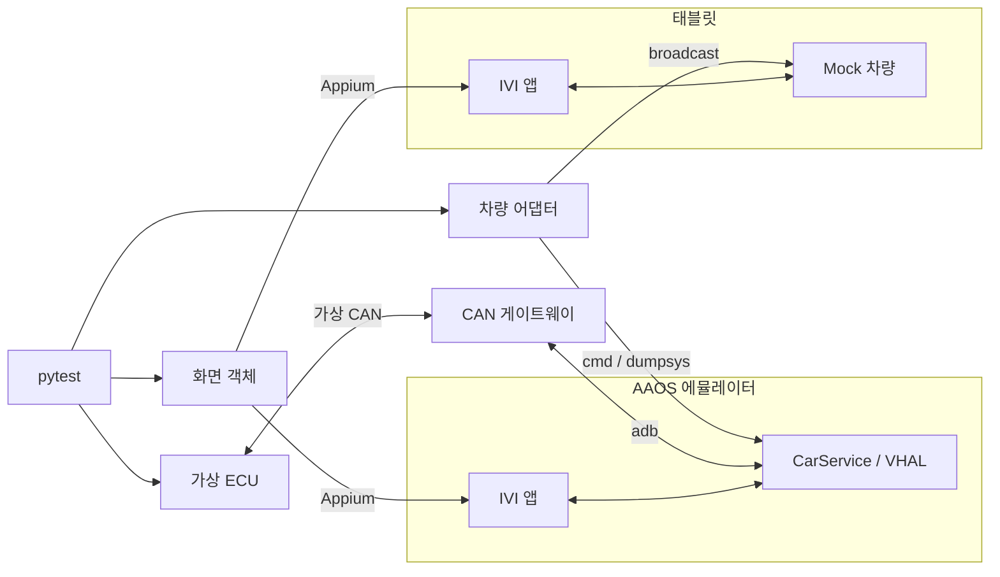
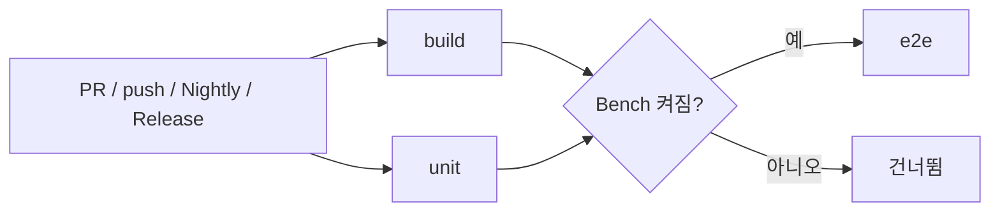
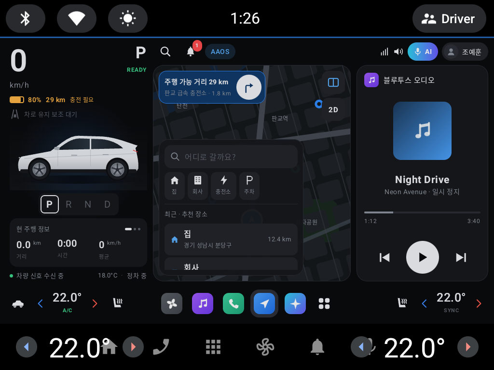

# OpenCabin IVI: AAOS IVI 테스트 자동화 포트폴리오

지원 직무: 42dot Test Automation Engineer (IVI System)  
결과 기준: 2026-11-18 실행. 그 뒤 바꾼 코드와 확인 방법은 [README의 '결과 자료와 검증 시점'](../README.md#결과-자료와-검증-시점)에 있습니다.


화면을 누르면 CarProperty/VHAL 값이 바뀌는지, 차량 신호가 바뀌면 화면이 따라오는지를 E2E로 확인하는 pytest 프레임워크입니다. 테스트 대상은 이 프로젝트에서 만든 가상 IVI 앱이고, 같은 테스트 129개를 AAOS 에뮬레이터와 화웨이 태블릿에서 돌립니다. 에뮬레이터에서는 CarService와 에뮬레이터의 VHAL(가상 차량 값)을 거치고, 태블릿에서는 앱 안에 둔 Mock 차량 서비스를 씁니다. 실제 차량, HIL, CAN 장비는 쓰지 않았습니다.

차량 신호는 12종을 연결했습니다. 화면에서 바꾼 값이 신호로 나가는지, 신호가 바뀌면 화면이 따라오는지를 둘 다 봅니다. 좌석이나 문처럼 area가 여러 개인 신호는 area마다 값을 확인합니다.

| 항목 | 결과 |
|---|---|
| AAOS 에뮬레이터 | 127개 통과, 1개 건너뜀, 1개 알려진 결함, 재시도 0 (9분 45초) |
| 화웨이 태블릿 (Mock) | 122개 통과, AAOS 전용 7개 건너뜀, 재시도 0 (10분 15초). 차량 값은 앱 안 Mock이라 화면 동작과 실기기 문제(터치 지연, 백그라운드 강제 종료)를 보는 기기이고, VHAL 경로는 AAOS에서만 확인합니다 |
| 두 기기 병렬 | 같은 시각에 시작해 끝까지 10분 16초. 차례로 돌렸다면 약 20분 0초 |
| 반복 실행 | 전체를 두 기기에서 5회씩, 테스트 1,250건(AAOS 640, 태블릿 610) 실행. 재시도로 통과한 것(flaky) 0건, 실패 0건. 2026-11-20에 실행 완전성 조건을 더한 Release 게이트로 원자료를 다시 판정해 여섯 조건 통과 ([반복 실행 통계와 원자료](flaky-report.md)) |
| 단위 테스트 | 프레임워크 129개, 앱 22개 모두 통과 |
| 테스트별 결과 | 기기마다 판정, 판정 직후 화면, AAOS는 테스트 중 마지막으로 읽은 차량 값까지: [테스트 결과](test-results.md) |
| 요구사항 추적 | 요구사항 26개 ↔ 테스트 함수 101개(매개변수 조합까지 129개). 빠진 곳이 있으면 CI의 unit job이 실패합니다: [추적표](traceability.md) |
| GitHub Actions | build와 unit job은 PR, main push, Nightly마다 GitHub에서 돕니다([실행 기록](https://github.com/bugspeaker/opencabin-ivi/actions/workflows/ivi-ci.yml)). GitHub에서 돈 것은 build와 unit job뿐이고, e2e job은 아직 GitHub에서 돌리지 않았습니다. 위 E2E 수치는 같은 명령을 작업 PC에서 돌린 결과입니다 ([8-3](#8-3-github-실행-기록)) |

알려진 결함 1건은 AAOS 에뮬레이터 기본 SystemUI(1024×768, `automotive_1024p_landscape`)에서 운전석 온도 ▲ 버튼이 홈 버튼과 72×76px 겹쳐 눌리지 않는 문제입니다. 플랫폼(SystemUI) 쪽 문제라 앱에서 고칠 수 없어 `xfail(strict=True, raises=DefectReproduced)`로 걸어 두었습니다. 두 버튼이 겹치는 증상일 때만 xfailed가 되고, 버튼을 못 찾는 등 다른 이유의 실패는 그대로 실패입니다. 고쳐지면 이 테스트가 실패로 바뀌어 바로 알 수 있습니다. 건너뛴 테스트는 그 기기에 해당하지 않는 테스트입니다(태블릿: AAOS 전용 7개, AAOS: 태블릿 전용 시계 1개). Release 게이트는 이 밖의 건너뜀을 막습니다.

2026-11-18 저녁에 경계값 테스트를 더하다가 앱 결함 1건을 찾아 고쳤습니다. 차량 쪽 온도가 22.3°C처럼 0.5°C 단위가 아니면, 온도 버튼이 22.8°C나 21.8°C를 그대로 차량에 썼습니다([3장 8번](#3-결함과-원인-분석)).

위 결과는 2026-11-18에 두 기기를 병렬로 5회 반복한 실행의 마지막 회차입니다. 테스트가 끝날 때마다 화면을 남겼고, [테스트 결과](test-results.md)에서 테스트별로 볼 수 있습니다. 영상 화면에는 직접 찍은 블랙박스 영상이 나오고, 다른 차 번호판이 읽히는 화면은 흐리게 처리했습니다.

**만든 사람과 만든 방식**

- 기간: 2026-11-13 ~ 2026-11-18, 혼자 진행했습니다.
- 배경: 게임 QA 약 8년. 웹 BVT를 Playwright와 pytest로 만든 경험이 있고, 모바일과 AAOS 테스트 자동화는 이 프로젝트가 처음입니다.
- 역할: 코드는 거의 전부 AI 코딩 도구(Claude Code)가 작성했습니다. 저는 Test Bench(PC, AAOS 에뮬레이터, 태블릿)에서 E2E를 직접 돌려 결과와 실패 자료를 확인했고, 외부 검토를 받아 반영할 항목을 골랐고, PR마다 변경 내용과 실행 결과를 보고 병합했습니다.
- 기기 구성, 신호 주입 방식, 판정과 재시도 규칙, 결함 원인 분석에서 무엇을 고르고 무엇을 버렸는지와 그 근거가 된 측정값은 [결정 기록](decisions.md)에 있습니다.

## 목차

1. [공고 요구사항과 한 일](#1-공고-요구사항과-한-일)
2. [테스트 환경 구조](#2-테스트-환경-구조)
3. [결함과 원인 분석](#3-결함과-원인-분석)
4. [검증 전략](#4-검증-전략)
5. [E2E 테스트 설계](#5-e2e-테스트-설계)
6. [테스트하기 쉽게 앱을 바꾼 점](#6-테스트하기-쉽게-앱을-바꾼-점)
7. [기술 스택](#7-기술-스택)
8. [운영과 CI](#8-운영과-ci)
9. [한계와 다음 단계](#9-한계와-다음-단계)
10. [저장소 안내](#10-저장소-안내)

---

## 1. 공고 요구사항과 한 일

### 주요 업무

| 공고의 주요 업무 | 이 프로젝트에서 한 일 | 자세히 |
|---|---|---|
| IVI 서비스별 검증 전략 | HVAC, 차량 설정(도어), 주행 정보 패널, 미디어를 나누고, 서비스마다 주요 위험과 확인 방향(화면→신호, 신호→화면)을 정해 테스트를 배치했습니다. | [4-2](#4-2-서비스별-검증) |
| Smoke / Sanity / Regression 게이팅 | 단계마다 고르는 기준, 시간, 통과 조건을 정하고 PR, main, Nightly, Release에 돌리는 범위를 나눴습니다. | [4-1](#4-1-게이트-단계와-기준) |
| UI와 CarProperty/VHAL을 잇는 E2E | 화면과 신호를 양쪽에서 확인하고, 좌석과 문은 area마다 봅니다. | [5-1](#5-1-양방향-검증과-area-단위-판정) |
| 터치부터 하위 연동까지 통합 | AAOS 에뮬레이터에서 화면의 운전석 온도를 한 칸 올리면, 앱 → CarService → VHAL로 바뀐 값을 게이트웨이가 adb로 읽어 CAN 프레임(`IVI_HvacStatus`)으로 내보내고, 그 값이 22.5°C인지 확인합니다. 반대로 가상 ECU가 보낸 CAN 프레임이 VHAL을 거쳐 화면에 보이는지도 봅니다. CAN 쪽은 PC 안의 가상 버스(python-can, DBC)입니다. 거리 부족 신호가 경고, 충전소 카드, 경로 안내로 이어지는 흐름도 확인합니다. | [test_can_gateway.py](../ivi-tests/tests/test_can_gateway.py), [결과](test-results.md#test_climate_button_goes_out_on_can) |
| 프레임워크와 스크립트 유지보수 | 7단계에서 아래 바 구성이 바뀌었을 때 화면 객체(`screens.py`)의 여는 경로만 고쳤고, 화면 개편 때문에 바꾼 테스트는 기존 64개 가운데 1개입니다. 앱도 이 프로젝트에서 만들어 testTag를 유지할 수 있었다는 점은 실제 팀 환경과 다릅니다. | [screens.py](../ivi-tests/ivi/screens.py) |
| ADB, CarPropertyManager로 Property Injection | 앱과 같은 경로가 필요한 설정 온도는 `cmd car_service`로, 차량(ECU) 쪽에서 바뀐 값은 `dumpsys VHAL --set`으로 넣습니다. | [5-4](#5-4-신호-주입-명령) |
| Flaky 최소화, 병렬 실행 | 재시도 기록, 격리 목록, 통계를 만들고, 두 기기를 병렬로 5회 반복해 안정성을 쟀습니다. | [8-1](#8-1-flaky-관리), [반복 실행 통계](flaky-report.md) |

### 자격요건

| 공고의 자격요건 | 이 프로젝트에서 한 일 |
|---|---|
| Android/AAOS 자동화 구축과 운영 | AAOS 에뮬레이터와 실제 태블릿에서 E2E 129개를 돌리고, 결과를 누적해서 기록합니다. 테스트마다 판정 직후 화면도 남깁니다. |
| Python 테스트 프레임워크 (Pytest) | 훅, 픽스처, 마커와 결과 기록용 플러그인을 만들었습니다. 프레임워크 단위 테스트가 129개 있습니다. |
| Appium 등 UI 자동화 도구 | Appium(UiAutomator2)을 썼고, AAOS의 다중 사용자 환경(user 10)에 맞춰 설정했습니다. |
| ADB, Logcat, Shell | adb 어댑터를 만들고, 실패하면 logcat을 자동으로 저장합니다. 앱이 강제로 꺼진 원인도 logcat에서 찾았습니다. |
| Git, CI/CD | PR 단위로 작업했고, GitHub Actions가 PR마다 앱 빌드, 앱 단위 테스트, 프레임워크 단위 테스트를 돌립니다. e2e job은 self-hosted Bench용으로 작성했고 아직 GitHub에서 돌리지 않았습니다 ([8-3](#8-3-github-실행-기록)). |

### 우대사항

| 공고의 우대사항 | 지금 상태 |
|---|---|
| VHAL, CarService, CarPropertyManager | 신호 12종을 연결하면서 area 구성, 권한 등급, priv-app 허용 목록을 다뤘습니다. |
| 차량 네트워크 (Ethernet, DDS, SOME/IP, CAN) | CAN만 모의 환경에서 해 봤습니다. PC 안의 가상 CAN 버스와 DBC로 가상 ECU를 두고, 게이트웨이가 VHAL에 넣은 값이 화면까지 오는지와 화면의 공조 값이 CAN으로 나가는지 확인합니다([9단계](phase9-bench.md)). 실제 CAN 장비와 Ethernet, DDS, SOME/IP는 경험이 없습니다. |
| REST API 자동화, 원격 전원 제어 | 모의 장비로 해 봤습니다. Test Bench REST API로 기기, 신호, 전원, 실행 결과를 다루고 API 테스트를 붙였습니다. 에뮬레이터 전원을 원격으로 껐다 켜서 부팅과 기본값 복귀를 확인합니다. 실제 전원 공급기나 릴레이는 쓰지 않았습니다. |
| ISO 26262, A-SPICE | 개념만 적용해 봤습니다. 요구사항 26개와 테스트를 양방향으로 잇는 [추적표](traceability.md)를 만들고, 빠진 곳이 있으면 CI의 unit job이 실패하게 했습니다. 인증이나 심사 경험은 없고 더 공부해야 합니다. |

---

## 2. 테스트 환경 구조



테스트 코드에는 확인할 내용만 적습니다. 화면에서 요소를 찾고 누르는 일은 화면 객체(`screens.py`)가, 신호를 넣고 읽는 일은 차량 어댑터(`vehicle.py`)가 합니다. 가상 ECU와 CAN 게이트웨이는 PC 안의 모의 환경입니다.

기기 종류는 `automotive` feature로 자동 판별합니다. 값을 넣고 되돌리는 방법, 주행 제한을 판정하는 방법, 화면을 누르는 방법은 기기마다 다른데, 이 차이는 어댑터와 `Device` 클래스 안에서 처리하고 테스트에는 드러나지 않게 했습니다. 앱 쪽도 같은 식으로 `VehicleDataSource` 인터페이스 아래에 CarPropertyManager 구현과 Mock 구현을 따로 두었습니다.

기기를 두 종류로 잡은 이유는 각각 볼 수 있는 것이 달라서입니다. 에뮬레이터로는 CarService와 에뮬레이터 VHAL을 거치는 경로를 검증할 수 있고, 태블릿에서는 터치 지연, 백그라운드 강제 종료, 설치 승인 같은 실기기 문제가 나옵니다. 실제로 원인을 찾는 데 가장 오래 걸린 두 건(3장의 1번, 2번)이 모두 태블릿에서 나왔습니다.

---

## 3. 결함과 원인 분석

| 번호 | 증상 | 원인 | 조치와 결과 |
|---|---|---|---|
| 1 | 태블릿에서 탭 한 번에 10초가 걸림 | 이 기기에서는 UiAutomator 터치 자체가 느림 | 누르는 동작만 adb로 바꿔 전체 시간이 7분 22초에서 1분 32초로 줄었음 |
| 2 | 실행할 때마다 21번째 테스트에서 앱이 사라짐 | 화웨이 OS(iAware)가 반복 재시작을 크래시로 판단 | 프로세스는 그대로 두고 화면만 초기화. 3회 연속 재실행 0회 |
| 3 | AAOS 에뮬레이터 기본 SystemUI(1024×768)에서 운전석 온도 ▲가 눌리지 않음 | 홈 버튼과 72×76 px 겹침 | 플랫폼 쪽 문제라 `xfail(strict=True)`로 걸어 둠 |
| 4 | 전체 실행에서만 실패 | 테스트 코드의 경쟁 조건 (제 실수) | 조건 대기로 고침 |
| 5 | 표시 단위를 섭씨로 바꾸자 실패 | 테스트가 화씨 표시를 가정함 | 표시 단위 신호를 읽어 기대 값을 계산 |
| 6 | 회귀 테스트에서 앱 결함 3건 | 패널 겹침, 낮은 화면, 공백 한 칸 | 앱을 고치고 회귀 테스트를 더함 |
| 7 | 영상 차단 테스트가 한 번 흔들림 | 재현되지 않음 | 반복 실행 5회 × 2기기(10번)에서 재현 0. 격리하지 않고 계속 기록 |
| 8 | 차량 온도가 0.5°C 단위가 아니면 온도 버튼이 어긋난 값을 차량에 씀 | 버튼이 '지금 값 ± 0.5'로 계산 | 0.5 단위에 맞춘 다음 값으로 계산하게 고침. 경계값 E2E 6개가 두 기기에서 통과 |
| 9 | 막 켠 AAOS 에뮬레이터에서 실행하면 테스트 129개가 모두 준비 단계 오류 | UiAutomator2 계측 프로세스가 죽었는데, Appium 세션 하나에 모든 테스트가 묶여 있음. 계측 프로세스가 죽는 원인은 확인하지 못함 | 테스트를 시작할 때 세션을 확인하고 끊겼으면 다시 붙임(`session_restart`로 기록). 일부러 끊은 시험 두 번에서 38개씩 모두 통과([확인 기록](evidence/2026-11-20-session-recovery/README.md)) |

<details>
<summary>1번. 탭 한 번에 10초</summary>

| 누르는 방법 | 화웨이 | AAOS 에뮬레이터 |
|---|---|---|
| `element.click()` | 10,377 ms | 577 ms |
| `mobile: clickGesture` | 10,099 ms | 501 ms |
| W3C actions | 10,430 ms | - |
| `adb shell input tap` | 117 ms | - |

테스트별 시간을 보니 클릭이 많은 테스트일수록 느렸습니다. 먼저 adb 왕복 시간을 쟀는데 65 ms라 원인이 아니었습니다. Appium 대기 설정(`waitForIdleTimeout`, `actionAcknowledgmentTimeout`)을 0으로 해도 그대로였고, 클릭 방식을 세 가지로 바꿔 봐도 모두 10초였습니다.

결국 이 기기에서는 UiAutomator가 넣는 터치 자체가 느리다고 보고, 요소는 Appium으로 찾되 누르는 것만 `adb shell input tap`으로 바꿨습니다. 화면 객체와 테스트 코드는 손대지 않았고, 환경 변수 `IVI_TAP`으로 방식을 바꿀 수 있습니다.

</details>

<details>
<summary>2번. 21번째 테스트에서 앱이 사라짐</summary>

실패 자료로 저장된 logcat에 `Force stopping dev.opencabin.ivi … iAwareF[CrashClean]`이 찍혀 있었습니다. 테스트마다 `am start -S`로 프로세스를 죽였다 살렸는데, 화웨이 OS가 이것을 반복 크래시로 보고 앱을 강제 종료한 것입니다.

3단계에서는 앱이 안 뜨면 한 번 더 띄우고 그 사실을 `app_relaunch`로 기록하는 데까지만 했습니다. 4단계에서 프로세스 종료를 세션 시작 때 한 번만 하고, 테스트마다는 `--activity-clear-task`로 화면만 초기화하도록 바꿔서 원인을 없앴습니다.

</details>

<details>
<summary>3번부터 7번까지</summary>

**3번. SystemUI 버튼 겹침.** AAOS 에뮬레이터 기본 SystemUI(1024×768, `automotive_1024p_landscape`)에서 운전석 온도 ▲ `[192,682][268,758]`와 홈 버튼 `[188,682][264,758]`이 겹치고, 홈이 위에 있어서 탭을 가져갑니다. 다른 해상도나 다른 AAOS 이미지에서도 나오는지는 확인하지 않았습니다. `strict=True`로 걸어 두었기 때문에 결함이 고쳐지면 XPASS가 실패로 바뀌어 알 수 있습니다. `raises=DefectReproduced`도 주어, 겹침을 확인한 자리에서 낸 예외일 때만 xfailed가 됩니다. 처음에는 `raises`가 없어서 버튼을 못 찾은 오류나 Appium 세션 끊김까지 '알려진 결함'으로 통과했습니다(2026-11-20 검토에서 고침).

**4번. 테스트 코드의 경쟁 조건.** `test_range_recovers_after_charging`이 전체 실행에서만 실패하고 혼자 돌리면 통과했습니다. 주행 가능 거리와 배터리는 서로 다른 신호라 따로 도착하는데, 거리만 기다린 뒤 배터리 값을 바로 assert한 것이 원인이었습니다. 배터리도 `wait_until`로 기다리게 고쳤고, 같은 모양이던 외기 온도 확인도 함께 고쳤습니다. 고정 sleep은 쓰지 않습니다.

**5번. 표시 단위 가정.** 1단계에 쓴 테스트가 SystemUI 온도를 화씨로 가정하고 있었습니다. `HVAC_TEMPERATURE_DISPLAY_UNITS`를 읽어 기대 글자를 계산하도록 바꿨고, 섭씨와 화씨 양쪽에서 통과하는 것을 확인했습니다.

**6번. 회귀 테스트로 찾은 앱 결함.**
- 음성 패널이 명령을 처리한 뒤에도 남아 안내 화면을 가렸습니다.
- 낮은 화면(1024×768)에서 후보 카드가 대답을 화면 밖으로 밀어내 요소를 찾지 못했습니다. UiAutomator는 화면 밖 요소를 찾지 못합니다.
- 목적지 글자 앞에 간격용으로 넣은 공백 한 칸 때문에 글자가 정확히 일치하지 않았습니다. 간격은 padding으로 바꿨습니다.

**7번. 한 번 흔들린 영상 차단 테스트.** `test_video_blocked_screen_follows_parking`이 7단계 반복 실행 중 한 번 흔들렸습니다. 정차한 뒤 차단 해제가 10초 안에 확인되지 않았습니다. 8단계 실행 2회에서는 재현되지 않았고, 2026-11-18 저녁에 두 기기에서 전체를 5회 반복(이 테스트 10번)했을 때도 10번 모두 한 번에 통과했습니다([반복 실행 통계](flaky-report.md)). 원인은 확인하지 못했습니다. 다시 흔들리면 재시도 기록과 첫 실패 자료로 원인을 볼 수 있게 두었습니다.

</details>

<details>
<summary>8번. 0.5°C 단위가 아닌 차량 값에서 온도 버튼</summary>

경계값을 보강하면서, 차량 쪽(VHAL)에서 범위 밖 값(15.5°C, 28.5°C)이나 0.5°C 단위가 아닌 값(22.3°C)이 들어오는 경우를 테스트로 만들었습니다. 먼저 에뮬레이터에서 확인한 것은 이렇습니다.

| 경로 | 15.5°C | 22.3°C |
|---|---|---|
| `cmd car_service set-property-value` (앱과 같은 경로) | 거절 (`IllegalArgumentException`) | 받음 |
| `dumpsys VHAL --set` (차량 쪽 값) | 받음 | 받음 |

16.0~28.0°C 범위는 플랫폼이 정한 값이 아닙니다. 이 프로젝트가 에뮬레이터 VHAL 설정 덮어쓰기([`opencabin.json`](../ivi-app/privileged/vhaloverride/opencabin.json))에 좌석 area마다 `minFloatValue` 16.0, `maxFloatValue` 28.0으로 정했습니다. 같은 파일의 `HVAC_TEMPERATURE_SET` `configArray`에는 0.5°C 증분(`[160, 280, 5, …]`, 섭씨 × 10)도 적었지만, 위 표처럼 `set-property-value`가 거절한 것은 범위 밖 값뿐이고 단위가 어긋난 22.3°C는 받았습니다.

새 테스트를 고치기 전 앱으로 두 기기에서 돌렸더니, 22.3°C에서 +를 누르면 22.8°C, -를 누르면 21.8°C가 차량에 그대로 써졌습니다. 버튼이 '지금 값 ± 0.5'로 계산했기 때문입니다. CarService는 범위만 보고 단위는 보지 않아 이 값을 받았습니다.

앱의 버튼 계산을 '0.5 단위에 맞춘 바로 위(아래) 값'으로 바꿨습니다(`HvacSpec.stepUp`, `stepDown`, 앱 단위 테스트 3개). 22.3°C에서 +는 22.5°C, -는 22.0°C입니다. 같은 E2E가 두 기기에서 통과합니다.

실패했을 때 저장된 자료 한 묶음을 그대로 남겼습니다: [화면, UI 계층, 차량 상태, 맨 위 액티비티, logcat](samples/off-grid-temperature-aaos/). `vehicle.txt`의 `temp_driver=22.8`이 결함이 차량 값까지 갔다는 근거입니다.

</details>

---

## 4. 검증 전략

### 4-1. 게이트 단계와 기준

| 단계 | 고르는 기준 | 개수 | 기기당 시간 (실측 합) | 언제 | 통과 조건 |
|---|---|---|---|---|---|
| unit | 테스트 도구 자체가 맞는지 (기기 없음) | 129 | 약 12초 | 모든 PR, push | 실패 0 |
| smoke | 이 빌드를 올려도 되는지: 앱 실행, 데이터 소스, 탭 이동, 공조의 화면↔차량 왕복(화면 + 한 번이 차량 22.5°C로, 차량 쪽 25.0°C가 화면으로) | 13 | 약 45초 | PR | failed, error 0 |
| sanity | 서비스마다 '화면→신호', '신호→화면' 대표 경로 하나씩, 주행 중 제한 대표 | 25 | 약 1분 45초 | main push (smoke와 함께) | failed, error 0. 재시도로 통과한 것은 flaky로 기록 |
| regression | 경계값, 조합, 예전 결함 재발 확인, 대표가 아닌 경로 | 85 | 약 6분 30초~7분 | Nightly | 위와 같음 |
| spike | AAOS 기본 SystemUI (1단계 기술 검증) | 6 | 약 15초 (AAOS만) | Nightly | 알려진 결함은 strict xfail 유지 |
| Release | 전체를 반복 실행 | 129 | 약 8분 45초~9분 15초 × 반복 | 릴리스 후보 | 아래 여섯 가지 |

Release 후보는 `workflow_dispatch`로 markers를 비우고 repeat 3으로 돌립니다. 반복이 끝나면 [`tools/release_gate.py`](../ivi-tests/tools/release_gate.py)가 이번 실행의 결과 파일(`reports/runs/*.json`)을 읽어 아래 여섯 조건을 확인하고, 하나라도 어기면 이유를 출력하고 실패합니다([ivi-ci.yml](../.github/workflows/ivi-ci.yml)의 'Release 게이트' 단계). 조건마다 통과 사례와 막는 사례를 단위 테스트로 확인했습니다([`unit/test_release_gate.py`](../ivi-tests/unit/test_release_gate.py)).

| 조건 | 검사하는 곳 |
|---|---|
| 1. 실행 완전성. 회차마다 필수 기기(AAOS, 태블릿)의 결과가 모두 있고, 각 결과에 지금 코드에서 수집한 테스트 129개가 빠짐없이 판정과 함께 있으며, pytest 종료 코드가 0. 건너뜀은 기기 전용 마커(`aaos`, `tablet`)로 정한 것만. CI에서는 모든 결과가 이번 커밋에서, 커밋하지 않은 변경 없이 돈 것이어야 함 | `release_gate.py`가 [`tools/collect_tests.py`](../ivi-tests/tools/collect_tests.py)로 테스트 목록을 기기 없이 다시 모아 결과와 맞춤. 결과 파일의 목록만 보면 `-m smoke`로 일부만 돌렸거나 중간에 멈춘 실행을 알 수 없음 |
| 2. 모든 회차, 두 기기 모두 failed, error, xpassed 0 | `release_gate.py` |
| 3. 이번 Release 반복 안에서 flaky 0. 직전 실행과 비교하지 않고, 반복 중 재시도로 통과한 테스트가 하나라도 있으면 막음 | `release_gate.py` |
| 4. 격리 목록의 모든 줄에 사유, 등록일, 해제 조건이 있고 2개 이하. 격리된 테스트도 결과는 따로 남김 | 칸이 빠진 줄은 목록을 읽을 때 실패([`ivi/quarantine.py`](../ivi-tests/ivi/quarantine.py)), 개수는 `release_gate.py` |
| 5. 요구사항 추적 누락 0 | PR마다 unit job([`unit/test_operations.py`](../ivi-tests/unit/test_operations.py)), Release에서 `release_gate.py`가 한 번 더 |
| 6. xfailed가 된 테스트가 알려진 결함 목록([`known_defects.txt`](../ivi-tests/known_defects.txt))과 같음. 목록에 없는 xfail, 목록에 있는데 xfailed가 아니거나 돌지 않은 테스트가 있으면 막음 | `release_gate.py`. 목록과 코드의 `xfail(strict=True)`가 같은지, 모든 xfail에 `raises`가 있는지는 unit job이 확인 |

조건 1은 2026-11-20 검토에서 더했습니다. 그전 게이트는 기기 목록을 결과 파일에서 유추해서, 태블릿이 처음부터 연결되지 않았거나 일부 테스트만 돌린 결과도 failed가 0이면 통과시킬 수 있었습니다. '실패한 테스트가 없다'와 '정한 검증을 끝까지 했다'는 다른 말이라 따로 봅니다. 실행기(`run_bench.py`)도 결과 파일의 판정만 믿지 않고 pytest 종료 코드를 함께 봅니다.

2026-11-18 저녁의 5회 반복 결과와 2026-11-19 재실행 결과에 지금 게이트를 돌리면 여섯 조건 모두 통과합니다([원자료와 다시 세는 명령](evidence/2026-11-18-repeat5/README.md)). 두 원자료는 결과 파일에 종료 코드와 커밋을 남기기 전 형식이라, 조건 1은 테스트 목록 대조로 끝까지 돌았는지만 보고 그 사실을 '참고'로 출력합니다. e2e job은 아직 GitHub에서 돌리지 않았기 때문에, CI에서 이 단계가 실제로 Release 후보를 막은 기록은 없습니다.

sanity는 처음에 55개(전체의 45%)까지 늘어 regression과 크기가 비슷해졌습니다. 위 기준으로 다시 보고, 같은 경로를 다른 화면에서 다시 확인하는 것, 조합, 경계값은 regression으로 내렸습니다. 서비스마다 남긴 대표 경로는 4-2 표에 있습니다.

### 4-2. 서비스별 검증

| 서비스 | 주요 위험 | 확인 방향 | 요구사항 | 테스트 (smoke / sanity / regression) | 이 프로젝트에서 보지 못하는 것 |
|---|---|---|---|---|---|
| HVAC | 다른 좌석 area에 쓰기, 범위 밖이나 단위가 어긋난 값 쓰기, 화면과 신호 불일치 | 화면→신호: 버튼, 아래 바, 음성이 `HVAC_TEMPERATURE_SET`과 A/C 전 좌석 area를 바꾸는지. 신호→화면: VHAL 값이 공조 화면, 홈, 아래 바에 같은 값으로 보이는지 | HVAC-01~06 | 1 / 11 / 31 | 실제 공조 ECU의 응답 지연과 거절, 실차의 area 구성 |
| 차량 설정 | 일부 문만 잠김, 설정이 재시작 뒤 사라짐 | 화면→신호: 도어 버튼이 모든 문 area의 `DOOR_LOCK`을 바꾸는지. 신호→화면: 차량 쪽 문 열림이 화면에 보이는지. 속도 단위 설정이 차량 정보 표시에 반영되는지 | BODY-01, SET-01 | 0 / 3 / 7 | 실제 BCM. 사이드 미러, 트렁크 같은 항목은 신호에 연결하지 않은 화면 상태 |
| 주행 정보 패널 (앱 왼쪽, 계기판 역할) | 잘못된 속도와 기어 표시, 거리 부족 경고 누락 | 신호→화면: 속도, 기어, 주행 가능 거리, 배터리, 외기 온도. 거리 30, 29 km에서 경고와 충전소 안내 | DRIVE-01, ENERGY-01, ENERGY-02 | 1 / 6 / 11 | AAOS 클러스터 디스플레이(보조 화면)와의 연동, 실제 계기판 |
| 미디어 | 주행 중 영상 재생(운전자 주의 분산), 소리 겹침 | 신호→화면: 주행 중 영상 차단, 정차하면 이어 보기. 앱 안: 음악, 라디오, 통화가 한 번에 하나만 소리 냄 | MEDIA-01, MEDIA-02, DRIVE-02 | 0 / 4 / 15 | 실제 스피커 출력, 블루투스 기기, 차량 오디오 시스템 |

테스트 수는 요구사항 표시(`@pytest.mark.req`)로 센 parametrize 케이스 수입니다. 한 테스트가 두 서비스에 걸치면 양쪽에 셉니다. 내비게이션, 후방 카메라, 음성, CAN, Test Bench는 [추적표](traceability.md)에 있습니다.

### 4-3. 판정 기준

| 판정 | 뜻 | PR, main, Nightly 게이트 | Release 게이트 |
|---|---|---|---|
| passed | 한 번에 통과 | 통과 | 통과 |
| flaky | 실패했다가 재시도에서 통과 | 통과, 통계에 남김 | 이번 반복 안에서 하나라도 있으면 막음 |
| failed / error | 재시도까지 실패했거나 준비, 정리 단계에서 실패 | 실패 | 실패 |
| xfailed | 알려진 결함의 증상(`DefectReproduced`)으로 실패 | 통과 | `known_defects.txt`에 있는 것만 통과 |
| quarantined | 사유를 적고 격리 목록에 올린 테스트 | 통과 | 사유, 등록일, 해제 조건이 있고 2개 이하일 때만 |
| skipped | 기기 전용 테스트를 다른 기기에서 돌린 경우(`aaos`, `tablet` 마커) | 통과 | 기기 전용 마커로 건너뛴 것만 통과. 그 밖의 건너뜀(예: 기기에 주행 영상이 없음)은 막음 |
| 판정 없음, 중단 | 테스트가 판정 없이 끝났거나, 실행이 끝까지 가지 않음(종료 코드 0이 아님) | 실패 | 막음 |

재시도해서 통과한 테스트를 passed로 치면 흔들리는 테스트가 통계에서 사라집니다. 그래서 flaky로 따로 기록합니다. 앱을 다시 띄운 횟수와 신호 주입을 다시 시도한 횟수도 JUnit 결과와 누적 기록(`results.jsonl`)에 같이 남깁니다.

---

## 5. E2E 테스트 설계

### 5-1. 양방향 검증과 area 단위 판정

```python
@pytest.mark.sanity
def test_ac_toggle_reaches_every_seat(app, car):
    """A/C를 끄면 전 좌석 area의 HVAC_AC_ON이 꺼진다 (운전석만 꺼지면 결함)."""
    climate = app.climate()
    climate.wait_checked("ac", True)

    climate.toggle("ac")
    wait_until(lambda: not any(car.signal_all(Signal.AC)), what="전 좌석 A/C 꺼짐")
    climate.wait_checked("ac", False)
```

A/C는 전 좌석에 적용되는 기능인데, 구현이 운전석 area에만 값을 써도 화면은 정상으로 보입니다. 화면만 보는 테스트로는 이 결함을 잡을 수 없어서, `signal_all`로 area별 값을 전부 읽어 확인합니다. 김서림 제거는 반대로 누른 유리의 신호만 켜지는지 봅니다.

차량 쪽에서 값이 바뀌었을 때 화면이 따라오는지 보는 반대 방향 테스트는 기능마다 따로 있습니다. 결과 페이지에는 AAOS에서 테스트 중 마지막으로 읽은 차량 값(예: `HVAC_TEMPERATURE_SET[0x1]=22.5`, 최대 3개)을 화면과 함께 보여 줍니다.

### 5-2. 설계 기법

| 기법 | 적용한 곳 |
|---|---|
| 경계값 | 온도 16.5→16.0°C와 27.5→28.0°C로 끝에 닿는 경로, 끝에서 꺼진 버튼, 범위 밖 차량 값(15.5, 28.5°C), 0.5°C 단위가 아닌 차량 값(22.3°C). 풍량 1과 7, 주행 가능 거리 31, 30, 29 km |
| 상태 전이 | 좌석 열선이 꺼짐, 2단, 1단, 꺼짐으로 도는 순서. 정차와 주행 사이의 전환 |
| 조합 | 좌석 두 곳과 올림, 내림 버튼. 앞 유리와 뒤 유리. km/mph 설정과 신호 |
| 규칙 충돌 | AUTO 중에 풍량을 직접 바꾸면 AUTO가 꺼지는지 |
| 일관성 | 같은 열선 신호가 화면 세 곳에 같은 값으로 보이는지 |
| 바뀌지 않음 | 운전석을 바꾼 뒤 조수석 신호와 화면이 1.5초 동안 그대로인지(`stays`). 한 번만 보면 늦게 도착하는 잘못된 쓰기를 놓칩니다 |
| 주행 안전 | 주행 중 영상 차단, 검색과 키패드 잠금 |

### 5-3. 테스트 격리

차량 신호는 앱을 다시 띄워도 남습니다. 앞 테스트가 문을 열어 둔 채 끝나면 다음 테스트의 "누르면 열림" 확인이 거꾸로 됩니다. 그래서 테스트마다 차량 신호 12종을 기준 값으로 되돌립니다.

AAOS에서는 신호에 area를 곱하면 `--set`이 31번입니다. 하나씩 보내면 테스트마다 adb 왕복이 31번이라, adb shell 한 번에 묶어 보내고 성공 응답 31개를 세어 다 들어갔는지 확인합니다. 8단계 기준(당시 신호 11개, 26번)으로 테스트가 84개에서 108개로 늘었는데 테스트당 시간은 4.1초에서 3.7초로 줄었습니다.

<details>
<summary>코드 (AaosVehicle.set_signals 요약)</summary>

```python
commands = [f"dumpsys {VHAL} --set {prop} {kind} {raw} -a {area}" for ... in areas]
out = self.adb.shell("; ".join(commands))
if out.count("Set property") == len(commands):   # 31개가 모두 들어갔는지 센다
    return                                        # 모자라면 한 번 더, 재시도 사실은 기록
```

</details>

태블릿의 Mock 차량은 값을 받으면 받은 이름 목록(`applied=...`)을 돌려줍니다. 앱이 꺼져 있어 브로드캐스트가 전달되지 않으면(화웨이) 그 자리에서 실패하므로, 주입이 빠진 채 뒤의 대기에서 엉뚱하게 실패하지 않습니다.

### 5-4. 신호 주입 명령

1단계에서 세 가지 명령을 비교했고, 두 가지만 씁니다.

| 명령 | 경로 | 쓰는 곳 |
|---|---|---|
| `cmd car_service set-property-value` | CarService를 거쳐 VHAL로 (앱과 같은 경로) | 운전석, 조수석 설정 온도. 앱이 쓰는 값을 같은 권한 경로로 바꿀 때 |
| `dumpsys <VHAL> --set` (root) | VHAL에 바로 | 차량(ECU) 쪽에서 값이 바뀐 상황을 만들 때. 속도, 기어 같은 읽기 전용 값과, A/C, 풍량, 도어처럼 쓰기 가능한 값의 '차량 쪽 변화' 모두 |
| `cmd car_service inject-vhal-event` | 이벤트만 보냄 | 쓰지 않습니다. 저장된 값이 바뀌지 않아 `get`으로 판정할 수 없습니다. |

둘을 나눈 기준은 '그 값을 누가 바꾸는가'입니다. 앱이 바꾸는 값을 테스트가 준비할 때는 앱과 같은 CarService 경로를 써야 권한과 범위 검사까지 같은 조건이 됩니다. 차량이 바꾸는 값은 CarService가 범위 밖 값을 거절하기 때문에(3장 8번) VHAL에 바로 넣어야 이상한 값이 올라오는 상황까지 만들 수 있습니다. 읽기는 모두 `cmd car_service get-property-value`로 합니다.

---

## 6. 테스트하기 쉽게 앱을 바꾼 점

| 문제 | 바꾼 것 |
|---|---|
| 토글이 켜졌는지를 색으로만 보여 줘서 자동화가 읽지 못했습니다. | 켜짐 상태를 접근성 `checked` 값으로 내보냈습니다. TalkBack 사용자도 같은 정보를 듣습니다. |
| 저장된 설정이 다음 테스트까지 남았습니다. | debug 빌드에만 있는 테스트 훅으로 설정을 초기화합니다. |
| 차마다 area 구성이 다릅니다. | area를 코드에 박아 두지 않고 `CarPropertyConfig`에서 읽습니다. |
| 권한이 없으면 신호를 읽을 수 없습니다. | 앱이 죽지 않고 '값 없음'으로 보여 줘서, 권한이 빠진 것을 화면에서 바로 알 수 있습니다. |
| Mock 주입이 들어갔는지 테스트가 알 수 없었습니다. | Mock 수신기가 받은 값의 이름을 돌려줍니다(debug 빌드). |

---

## 7. 기술 스택

| 분류 | 사용한 것 |
|---|---|
| 테스트 | Python, pytest, Appium (UiAutomator2) |
| 기기 제어 | ADB, shell, logcat, `dumpsys`, `cmd car_service` |
| 대상 앱 | Kotlin, Jetpack Compose, CarPropertyManager, Media3 |
| 차량 네트워크 (모의) | python-can (virtual 버스), cantools (DBC) |
| Test Bench | 표준 라이브러리 `http.server`로 만든 REST API, 원격 전원 제어 인터페이스 |
| 실행 환경 | AAOS 에뮬레이터 API 34, 화웨이 태블릿 (Android 12) |
| CI | GitHub Actions |

---

## 8. 운영과 CI

### 8-1. flaky 관리

| 장치 | 하는 일 |
|---|---|
| 실패 자료 | 테스트가 실패하면 정리 단계 전에 화면, UI 계층, 차량 상태, 맨 위 액티비티, logcat을 실행과 기기별 폴더(`reports/artifacts/<실행>-<기기>/`)에 저장합니다. 준비 단계 실패는 `__setup`, 정리 단계 실패는 `__teardown` 폴더로 나눕니다. 차량 정리는 준비보다 먼저 등록해 두어, 준비가 중간에 실패해도 다음 테스트가 앞 테스트의 차량 상태로 시작하지 않습니다. logcat은 버퍼를 지우지 않고 테스트 시작 시각부터 모읍니다(`logcat -T`). 같은 기기를 쓰는 다른 도구의 로그를 지우지 않기 위해서입니다. [실제 실패 자료 한 묶음](samples/off-grid-temperature-aaos/) |
| flaky 통계 | 테스트마다 불안정률과 p95 시간을 내고, 격리 후보와 해제 후보, 느린 테스트 다섯 개를 뽑습니다. [반복 실행 통계](flaky-report.md) |
| 격리 목록 | 사유, 등록일, 해제 조건 가운데 하나라도 빠진 줄은 받지 않습니다. 격리한 테스트도 계속 돌려서 데이터를 모읍니다. |
| Appium 세션 | 실행 전체에서 세션 하나를 쓰고, 테스트를 시작할 때마다 UiAutomator2 서버까지 가는 가벼운 요청으로 확인합니다. 끊겼으면 닫고 다시 붙이며(서버가 다시 뜨는 중이면 3초 간격으로 3번까지), 그 일을 `session_restart`로 기록해 flaky 통계에 '세션 재연결'로 보여 줍니다. 테스트 도중에 끊긴 시도는 실패로 남고 재시도에서 다시 붙습니다([확인 기록](evidence/2026-11-20-session-recovery/README.md)). |
| 병렬 실행 | 기기마다 pytest 프로세스를 따로 띄웁니다. Appium 서버는 하나만 두고 UiAutomator2 `systemPort`만 기기별로 다르게 줍니다. |
| 대기 | 고정 sleep은 쓰지 않습니다. 바뀌기를 기다릴 때는 조건 대기(`wait_until`, 값이 같아지기를 기다릴 때는 `wait_value`), '바뀌지 않아야 함'은 정한 시간 동안 계속 읽어 한 번이라도 바뀌면 실패하는 `stays`를 씁니다. 요소가 아직 없음, adb 실패, 숫자로 아직 못 바꾸는 글자처럼 다시 볼 예외만 '아직 아님'으로 보고, 오타 같은 코드 오류는 기다리지 않고 바로 올립니다. 대기 안에서 부른 화면 객체는 따로 기다리지 않아 제한 시간이 겹치지 않습니다. Appium 세션이 끊긴 응답(`instrumentation process is not running` 등)은 다시 봐도 살아나지 않으므로 기다리지 않고 바로 실패로 올립니다. 세션은 다음 시도를 시작할 때 다시 붙습니다(아래 'Appium 세션' 행). 시간을 넘기면 마지막으로 읽은 값과 마지막 오류를 함께 남깁니다. |

격리 후보는 불안정률이 10% 이상이고 5회 이상 실행된 테스트, 해제 후보는 격리 중에 20회 연속 통과한 테스트입니다. 후보가 올라와도 자동으로 격리하지는 않고 원인을 확인한 뒤 정합니다.

2026-11-18에 반복 실행을 하면서 두 가지를 고쳤습니다. 두 기기를 병렬로 돌리면 같은 테스트의 실패 자료가 같은 폴더에 덮어써지던 것을 실행과 기기별 폴더로 나눴고, 실패 메시지에 마지막으로 읽은 값이 남지 않던 것(`마지막 값: False`)을 실제 값이 남도록(`wait_value`) 바꿨습니다. 처음에는 경계값 테스트에만 적용했고, 2026-11-19에 값이 같아지기를 기다리는 대기 47곳을 모두 `wait_value`로, 고정 sleep 3곳을 `stays`로 바꿨습니다.

### 8-2. CI 파이프라인



| job | 실행 위치 | 내용 |
|---|---|---|
| build | GitHub 호스트 | 앱을 빌드하고 앱 단위 테스트를 돌린 뒤 APK를 보관합니다. |
| unit | GitHub 호스트 | 기기 없이 프레임워크 단위 테스트를 돌립니다. 요구사항 추적 누락도 여기서 막습니다. |
| e2e | self-hosted Test Bench | 두 기기에서 병렬로 돌리고 flaky 리포트를 냅니다. 저장소 변수 `IVI_BENCH=online`일 때만 돕니다. |

| 이벤트 | e2e 범위 |
|---|---|
| PR | smoke |
| main push | smoke + sanity |
| Nightly (매일 03:00 KST) | 전체 |
| Release 후보 (`workflow_dispatch`) | 전체, repeat 3 |

워크플로를 짜면서 정한 것들입니다.

- e2e는 Bench에서 APK를 다시 빌드합니다. AAOS에 priv-app으로 넣어 둔 앱과 서명 키가 같아야 덮어쓸 수 있는데, GitHub 호스트에서 만든 APK는 키가 다릅니다.
- 기기에 있는 APK와 해시가 같으면 설치를 건너뜁니다. 화웨이는 adb 설치마다 기기 화면에서 승인해야 해서, 매번 설치하면 무인 실행이 멈춥니다.
- Bench가 한 대라 e2e job은 한 번에 하나만 돌게 했습니다. build와 unit에는 이 제한을 걸지 않았습니다.
- checkout 때 누적 기록 폴더를 지우지 않습니다. flaky 통계가 실행을 넘어 쌓여야 하기 때문입니다.
- 공개 저장소라 포크에서 온 PR은 e2e를 돌리지 않습니다(build와 unit만). `workflow_dispatch` 입력은 스크립트에 바로 넣지 않고 환경 변수로 넘깁니다.

### 8-3. GitHub 실행 기록

ivi-ci 워크플로의 build와 unit job은 PR, main push, Nightly(매일 03:00 KST)마다 GitHub에서 돕니다. e2e job은 Test Bench(self-hosted 러너)를 켜 두지 않아서 건너뜁니다. 실행 횟수와 결과는 [Actions 실행 기록](https://github.com/bugspeaker/opencabin-ivi/actions/workflows/ivi-ci.yml)에 있습니다. 횟수를 문서에 적으면 PR마다 낡아서 링크로 둡니다.

| 이벤트 | build | unit | e2e |
|---|---|---|---|
| PR 생성, 갱신 | 앱 빌드와 앱 단위 테스트 (4~5분) | 프레임워크 단위 테스트 (15~30초) | 건너뜀 |
| main push (병합) | 같음 | 같음 | 건너뜀 |
| Nightly | 같음 | 같음 | 건너뜀 |

소개 사이트는 pages 워크플로가 `site/`나 `docs/images/`가 바뀐 main push마다 올립니다.

취소한 1회는 첫 실행입니다. self-hosted 러너가 등록돼 있지 않으면 e2e job이 러너를 계속 기다리는데, 이 상태로는 Bench가 꺼져 있는 동안 PR 결과가 나오지 않습니다. 실행을 취소하고, e2e를 저장소 변수로 켜고 끌 수 있게 워크플로를 고쳤습니다. 두 번째 실행부터는 그 수정이 들어간 실행입니다.

앱 단위 테스트는 CI에서 처음으로 Gradle로 돌았습니다. 작업 PC는 사용자 폴더가 한글 경로라 Gradle 테스트 실행기가 죽어서, 그동안은 `java`로 직접 돌려 확인했습니다.


---

## 9. 한계와 다음 단계

### 한계

- 테스트 대상은 AAOS 에뮬레이터의 CarService와 VHAL(가상 차량 값)입니다. 실제 차량이나 HIL, 실물 Test Bench에서 해 본 것이 아닙니다.
- CAN 게이트웨이와 원격 전원 제어는 PC 안의 모의 환경입니다. 실제 ECU, CAN 장비, 전원 공급기에서 확인한 것이 아닙니다.
- AAOS 클러스터 디스플레이(보조 화면)와의 연동은 검증하지 않았습니다. 이 문서의 '주행 정보 패널'은 앱 왼쪽의 화면입니다.
- 앱은 가상 IVI입니다. 지도, 라디오, 통화는 가상 데이터이고, AI 어시스턴트는 LLM이 아니라 규칙 기반입니다. 운전자 보조 표시와 주변 차량은 연출입니다. 화면 구조는 공개 자료를 참고했고 타사 로고, 이미지, 코드는 쓰지 않았습니다.
- 앱도 이 프로젝트에서 만들어서 테스트에 필요한 testTag와 테스트 훅을 마음대로 넣을 수 있었습니다. 다른 팀이 만든 앱을 테스트하는 실제 환경과 다릅니다.
- CI에서 e2e는 아직 GitHub로 돌리지 않았습니다. build와 unit만 GitHub에서 통과했고, e2e는 같은 명령(`run_bench.py`)을 작업 PC에서 실행해 확인했습니다. 공개 저장소라 개인 PC를 self-hosted 러너로 붙이지 않기로 했습니다.
- `test_out_of_range_signal_is_shown_safely`는 기기마다 기대값이 다릅니다. AAOS는 VHAL에 범위 밖 값을 바로 넣어 화면이 15.5°C를 그대로 보여 주는지, ▲ 한 번에 차량 값이 16.0°C가 되는지 봅니다. 태블릿의 Mock 차량은 받은 값을 16.0~28.0°C로 잘라 두므로 15.5°C는 16.0°C가 되고, ▲ 한 번에 16.5°C가 되는지만 봅니다. 범위 밖 값 표시는 AAOS에서만 확인한 것입니다.
- 테스트 쪽 차량 어댑터는 좌석 area를 에뮬레이터 값으로 고정했습니다(`SEAT_AREAS`, [`ivi/vehicle.py`](../ivi-tests/ivi/vehicle.py)). 앱이 `CarPropertyConfig`에서 읽은 area와 출처가 다른 기대값으로 두어, 설정이 틀렸을 때 앱과 테스트가 같이 틀리지 않게 하려는 것입니다. 다른 차종에서는 `cmd car_service get-property-config`로 읽은 area와 이 목록을 먼저 맞춰 봐야 합니다.
- 앱의 온도 범위(16.0~28.0°C)와 0.5°C 증분은 앱 코드(`HvacSpec`)에 고정했습니다. 좌석 area는 `CarPropertyConfig`에서 읽지만 범위와 증분은 읽지 않습니다. 차종마다 다르면 area별 최소·최대 값과 `HVAC_TEMPERATURE_SET`의 `configArray`에서 읽어야 합니다.
- 반복 실행은 하루(2026-11-18) 5회입니다. 기간에 걸친 flaky 추세는 아직 없습니다.
- 위 E2E 결과와 반복 실행 5회는 2026-11-18 코드로 돌린 것입니다. 2026-11-19 대기 방식 변경 뒤에는 두 기기 전체를 1회, smoke 공조 왕복 변경 뒤에는 smoke만 다시 돌렸습니다. 2026-11-20에는 세션 복구를 넣고 두 기기 전체를 1회 더 돌렸습니다. 같은 날의 게이트·대기·픽스처 변경은 아직 기기에서 돌리지 않았습니다(단위 테스트로만 확인). 자료별 시점은 [README의 표](../README.md#결과-자료와-검증-시점)에 있습니다. 반복 실행은 아직 다시 하지 않았습니다.
- 막 켠 AAOS 에뮬레이터에서 UiAutomator2 계측 프로세스가 스스로 죽는 원인은 확인하지 못했습니다(2026-11-19, 11-20 두 번). 세션을 다시 붙여 그 뒤 테스트는 이어지지만, 그때 돌던 테스트는 재시도에서야 통과합니다.
- 사이드 미러, 트렁크, 차일드 락, 실내등, 전조등은 차량 신호에 연결하지 않은 화면 상태입니다.

### 다음 단계

1. Bench 전용 PC나 비공개 저장소의 self-hosted 러너로 e2e까지 GitHub에서 돌리고, Nightly 기록을 남기려고 합니다.
2. 반복 실행을 Nightly로 쌓아 기간별 flaky 추세를 보려고 합니다.
3. 차량 네트워크는 SOME/IP와 DDS도 같은 방식의 모의 환경으로 해 보고, 실제 CAN 인터페이스가 생기면 게이트웨이를 그대로 붙여 보려고 합니다. ISO 26262와 A-SPICE는 계속 공부하려고 합니다.

---

## 10. 저장소 안내

| 경로 | 내용 |
|---|---|
| [ivi-tests/ivi/vehicle.py](../ivi-tests/ivi/vehicle.py) | 차량 어댑터, 신호 정의, 여러 신호를 한 번에 넣는 코드 |
| [ivi-tests/ivi/device.py](../ivi-tests/ivi/device.py) | 기기 판별, Appium 설정, 화면을 누르는 방법 |
| [ivi-tests/ivi/screens.py](../ivi-tests/ivi/screens.py) | 화면 객체 |
| [ivi-tests/ivi/waits.py](../ivi-tests/ivi/waits.py) | 조건 대기, 값 대기, 유지 확인 |
| [ivi-tests/ivi/results.py](../ivi-tests/ivi/results.py) | 판정을 나누고 기록하는 pytest 플러그인 |
| [ivi-tests/tests/conftest.py](../ivi-tests/tests/conftest.py) | 픽스처, 마커, 실패 자료 저장 |
| [ivi-tests/tests/test_vehicle_signals.py](../ivi-tests/tests/test_vehicle_signals.py) | 차량 신호 양방향 E2E |
| [ivi-tests/ivi/bench_api.py](../ivi-tests/ivi/bench_api.py), [power.py](../ivi-tests/ivi/power.py) | Test Bench REST API와 원격 전원 제어 |
| [ivi-tests/ivi/can_gateway.py](../ivi-tests/ivi/can_gateway.py), [dbc/opencabin.dbc](../ivi-tests/dbc/opencabin.dbc) | 가상 CAN 버스와 VHAL 게이트웨이, 프레임 정의 |
| [docs/requirements.md](requirements.md), [traceability.md](traceability.md) | 요구사항과 추적표 |
| [docs/decisions.md](decisions.md) | 결정 기록: 고른 것, 버린 것, 근거가 된 측정값 |
| [docs/flaky-report.md](flaky-report.md) | 반복 실행 통계 |
| [docs/run.md](run.md) | 실행 방법 |
| [ivi-tests/tools/](../ivi-tests/tools/) | 병렬 실행, flaky 통계, 설치, 결과 사이트, 추적표 만들기, API 서버 |
| [.github/workflows/ivi-ci.yml](../.github/workflows/ivi-ci.yml) | CI 워크플로 |
| [docs/phase1 ~ phase9](phase1-spike.md) | 단계별 설계와 검증 기록 |

| 홈 | 공조 (FULL 켬) | 주행 가능 거리 부족 |
|---|---|---|
|  |  |  |
