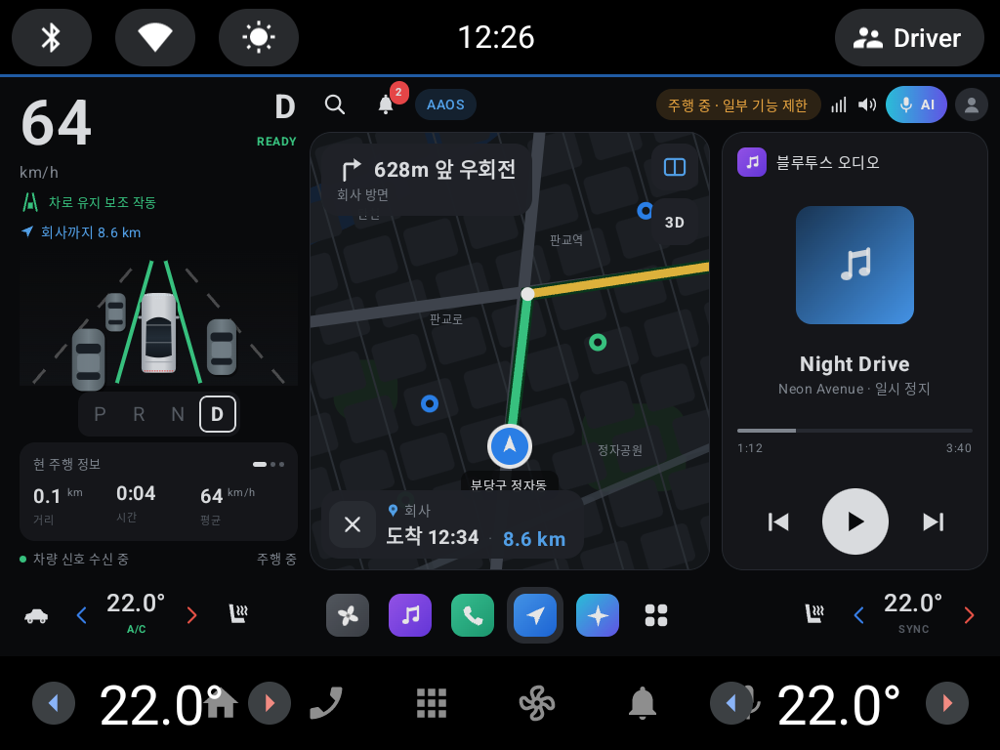
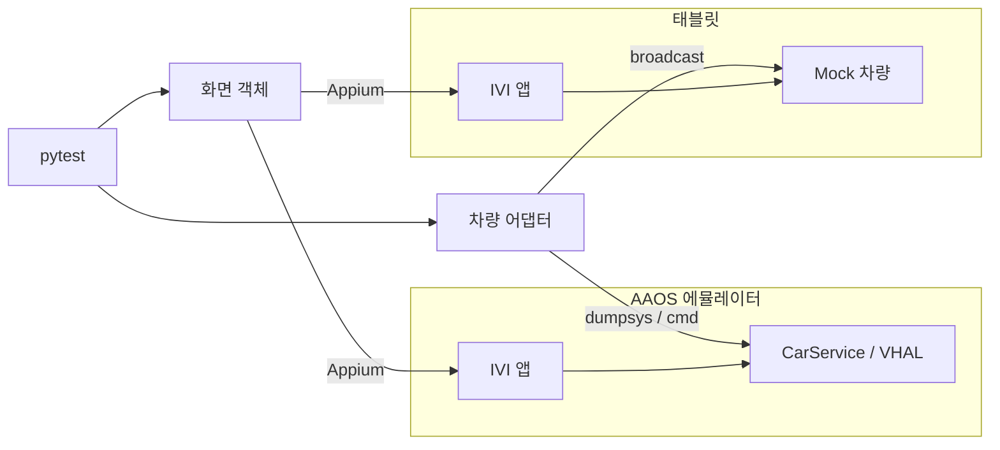
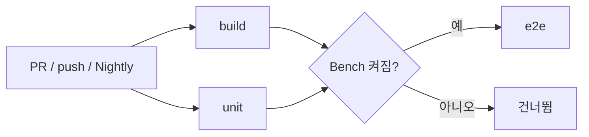

# OpenCabin IVI: AAOS IVI 테스트 자동화 포트폴리오

지원 직무: 42dot Test Automation Engineer (IVI System)  
기준일: 2026-11-16 (8단계)



가상 IVI 앱을 직접 만들고, 화면 조작이 차량 신호(CarProperty/VHAL)까지 이어지는지 확인하는 E2E 테스트 108개를 붙인 프로젝트입니다. 같은 테스트 코드가 AAOS 에뮬레이터와 화웨이 태블릿 양쪽에서 돕니다. 에뮬레이터에서는 실제 CarService와 VHAL을 거치고, 태블릿에서는 앱 안에 둔 Mock 차량 서비스를 씁니다.

차량 신호는 12종을 연결했습니다. 화면에서 바꾼 값이 신호로 나가는지와 신호가 바뀌면 화면이 따라오는지를 둘 다 보고, 좌석이나 도어처럼 area가 여러 개인 신호는 area마다 값을 확인합니다.

| 항목 | 결과 |
|---|---|
| AAOS 에뮬레이터 | 106 passed, 1 skipped, 1 xfailed (6분 40초) |
| 화웨이 태블릿 (Mock) | 102 passed, 6 skipped (7분 6초) |
| 두 기기 병렬 | gate pass, flaky 0, 7분 20초 (차례로 돌리면 14분 28초) |
| 단위 테스트 | 프레임워크 33 passed, 앱 17 passed |
| GitHub Actions | 4회 실행, 3회 success. 나머지 1회는 [8-3](#8-3-github-실행-기록-2026-11-16) 참고 |

xfailed 1건은 1단계에서 찾은 SystemUI 결함을 일부러 남겨 둔 것이고, skipped는 AAOS에서만 의미가 있는 테스트입니다.

## 목차

1. [공고 요구사항과 근거](#1-공고-요구사항과-근거)
2. [테스트 환경 구조](#2-테스트-환경-구조)
3. [검증 전략](#3-검증-전략)
4. [E2E 테스트 설계](#4-e2e-테스트-설계)
5. [결함과 원인 분석](#5-결함과-원인-분석)
6. [테스트하기 쉽게 앱을 바꾼 점](#6-테스트하기-쉽게-앱을-바꾼-점)
7. [기술 스택](#7-기술-스택)
8. [운영과 CI](#8-운영과-ci)
9. [한계와 다음 단계](#9-한계와-다음-단계)
10. [저장소 안내](#10-저장소-안내)

---

## 1. 공고 요구사항과 근거

### 주요 업무

| 공고 업무 | 이 프로젝트에서 한 것 | 근거 |
|---|---|---|
| IVI 서비스별 검증 전략 | HVAC, 차량 설정, 클러스터, 미디어를 단계별로 검증 | [phase1](phase1-spike.md), [phase8](phase8-signals.md) |
| Smoke / Sanity / Regression 게이팅 | 마커 3종, 이벤트(PR, main, Nightly)별 실행 범위 | [phase4](phase4-operations.md) |
| UI와 CarProperty/VHAL을 잇는 E2E | 양방향 검증, area 단위 판정 | [4-1](#4-1-양방향-검증과-area-단위-판정) |
| 터치부터 하위 연동까지 통합 | 거리 부족 신호, 경고, 충전소 카드, 경로 안내로 이어지는 흐름 | [phase8](phase8-signals.md) |
| 프레임워크와 스크립트 유지보수 | 화면 객체 패턴. 7단계 화면 개편 때 테스트 64개 중 1개 수정 | [screens.py](../ivi-tests/ivi/screens.py) |
| ADB, CarPropertyManager로 Property Injection | 신호 성격에 따라 주입 명령을 골라 씀 | [4-4](#4-4-신호-주입-명령) |
| Flaky 최소화, 병렬 실행 | 재시도 기록, 격리 목록, 통계, 두 기기 병렬 | [8장](#8-운영과-ci) |

### 자격요건

| 공고 자격요건 | 근거 |
|---|---|
| Android/AAOS 자동화 구축과 운영 | AAOS 에뮬레이터와 실기기 태블릿에서 E2E 108개 실행, 결과 누적 기록 |
| Python 테스트 프레임워크 (Pytest) | 훅, 픽스처, 마커, 결과 기록용 플러그인 작성 |
| Appium 등 UI 자동화 도구 | Appium(UiAutomator2). AAOS 다중 사용자(user 10) 설정 포함 |
| ADB, Logcat, Shell | adb 어댑터, 실패 시 logcat 자동 저장, logcat으로 강제 종료 원인 확인 |
| Git, CI/CD | PR 단위 작업, GitHub Actions에서 build와 unit 실행 ([8-3](#8-3-github-실행-기록-2026-11-16)) |

### 우대사항

| 공고 우대사항 | 상태 |
|---|---|
| VHAL, CarService, CarPropertyManager | 해 봄. 신호 12종, area 구성, 권한 등급, priv-app 허용 목록 |
| 차량 네트워크 (Ethernet, DDS, SOME/IP, CAN) | 경험 없음. VHAL 아래 계층이라 이 프로젝트 범위 밖 |
| REST API 자동화, 원격 전원 제어 | 아직 없음 |
| ISO 26262, A-SPICE | 공부가 필요함 |

---

## 2. 테스트 환경 구조



테스트 코드에는 확인할 내용만 적습니다. 화면에서 요소를 찾고 누르는 일은 화면 객체(`screens.py`)가, 신호를 넣고 읽는 일은 차량 어댑터(`vehicle.py`)가 합니다.

기기 종류는 `automotive` feature로 자동 판별합니다. 값을 넣고 되돌리는 방법, 주행 제한을 판정하는 방법, 화면을 누르는 방법은 기기마다 다른데, 이 차이는 어댑터와 `Device` 클래스 안에서 처리하고 테스트에는 드러나지 않게 했습니다. 앱 쪽도 같은 식으로 `VehicleDataSource` 인터페이스 아래에 CarPropertyManager 구현과 Mock 구현을 따로 두었습니다.

기기를 두 종류로 잡은 이유는 각각 볼 수 있는 것이 달라서입니다. 에뮬레이터로는 실제 CarService와 VHAL 경로를 검증할 수 있고, 태블릿에서는 터치 지연, 백그라운드 강제 종료, 설치 승인 같은 실기기 문제가 나옵니다. 실제로 원인을 찾는 데 가장 오래 걸린 두 건(5장의 1번, 2번)이 모두 태블릿에서 나왔습니다.

---

## 3. 검증 전략

### 3-1. 계층과 실행 시점

| 계층 | 확인하는 것 | 예 | 실행 시점 |
|---|---|---|---|
| unit | 테스트 도구 자체가 맞는지 | VHAL 출력 해석, flaky 판정 분류 | 모든 push |
| smoke | 빌드를 받아도 되는지 | 앱 실행, 공조 제어 권한 | PR |
| sanity | 핵심 기능이 신호까지 이어지는지 | A/C 전 좌석, 주행 중 영상 차단 | main push |
| regression | 경계, 조합, 과거 결함 | 풍량 1/7, 거리 31/30/29 km | Nightly |
| spike | AAOS 기본 SystemUI | SystemUI 공조 바 | Nightly |

### 3-2. 판정 기준

| 판정 | 뜻 | 게이트 |
|---|---|---|
| passed | 한 번에 통과 | 통과 |
| flaky | 실패 후 재시도에서 통과 | 통과, 통계에 남김 |
| failed / error | 재시도까지 실패, 또는 준비나 정리 단계 실패 | 실패 |
| xfailed | 알려진 결함 | 통과 |
| quarantined | 격리 목록에 있음 (사유 필수) | 통과 |
| skipped | AAOS 전용 테스트를 태블릿에서 실행 | 통과 |

재시도해서 통과한 테스트를 passed로 치면 흔들리는 테스트가 통계에서 사라집니다. 그래서 flaky로 따로 기록합니다. 앱을 다시 띄운 횟수와 신호 주입을 다시 시도한 횟수도 JUnit 결과와 누적 기록(`results.jsonl`)에 같이 남깁니다.

---

## 4. E2E 테스트 설계

### 4-1. 양방향 검증과 area 단위 판정

```python
@pytest.mark.sanity
def test_ac_toggle_reaches_every_seat(app, car):
    """A/C를 끄면 전 좌석 area의 HVAC_AC_ON이 꺼진다 (운전석만 꺼지면 결함)."""
    climate = app.climate()
    climate.wait_checked("ac", True)

    climate.toggle("ac")
    wait_until(lambda: not any(car.signal_all(Signal.AC)), what="전 좌석 A/C 꺼짐")
    climate.wait_checked("ac", False)
```

A/C는 전 좌석에 적용되는 기능인데, 구현이 운전석 area에만 값을 써도 화면은 정상으로 보입니다. 화면만 보는 테스트로는 이 결함을 잡을 수 없어서, `signal_all`로 area별 값을 전부 읽어 확인합니다. 김서림 제거는 반대로 누른 유리의 신호만 켜지는지 봅니다.

차량 쪽에서 값이 바뀌었을 때 화면이 따라오는지 보는 반대 방향 테스트는 기능마다 따로 있습니다.

### 4-2. 설계 기법

| 기법 | 적용 예 |
|---|---|
| 경계 값 | 온도 16/28°C, 풍량 1/7, 주행 가능 거리 31/30/29 km |
| 상태 전이 | 좌석 열선 꺼짐, 2단, 1단, 다시 꺼짐. 정차와 주행 전환 |
| 조합 | 좌석 2 × 방향 2, 앞/뒤 유리, km/mph 설정 × 신호 |
| 규칙 충돌 | AUTO 중 풍량을 직접 바꾸면 AUTO가 꺼짐 |
| 일관성 | 같은 열선 신호가 화면 세 곳에 같은 값으로 표시 |
| 주행 안전 | 주행 중 영상 차단, 검색과 키패드 잠금 |

### 4-3. 테스트 격리

차량 신호는 앱을 다시 띄워도 남습니다. 앞 테스트가 문을 열어 둔 채 끝나면 다음 테스트의 "누르면 열림" 확인이 거꾸로 됩니다. 그래서 테스트마다 신호 11개를 기준 값으로 되돌립니다.

AAOS에서는 신호와 area를 곱하면 주입이 26번입니다. 하나씩 보내면 테스트마다 adb 왕복이 26번이라, adb shell 한 번에 묶어 보내고 성공 응답 개수를 세어 26개가 다 들어갔는지 확인합니다. 테스트가 84개에서 108개로 늘었는데 테스트당 시간은 4.1초에서 3.7초로 줄었습니다.

<details>
<summary>코드 (AaosVehicle.set_signals 요약)</summary>

```python
commands = [f"dumpsys {VHAL} --set {prop} {kind} {raw} -a {area}" for ... in areas]
out = self.adb.shell("; ".join(commands))
if out.count("Set property") == len(commands):   # 26개가 모두 들어갔는지 센다
    return                                        # 모자라면 한 번 더, 재시도 사실은 기록
```

</details>

### 4-4. 신호 주입 명령

1단계에서 세 가지 명령을 비교했고, 두 가지만 씁니다.

| 명령 | 경로 | 쓰는 곳 |
|---|---|---|
| `cmd car_service set-property-value` | CarService를 거쳐 VHAL | 쓰기 가능한 값(HVAC). 앱과 같은 경로 |
| `dumpsys <VHAL> --set` (root) | VHAL 직접 | 읽기 전용 센서(속도, 기어, 거리). 주행 상태까지 실제로 바뀜 |
| `cmd car_service inject-vhal-event` | 이벤트만 발생 | 안 씀. 저장 값이 그대로라 `get`으로 판정할 수 없음 |

---

## 5. 결함과 원인 분석

| 번호 | 증상 | 원인 | 조치와 결과 |
|---|---|---|---|
| 1 | 태블릿에서 탭 한 번에 10초 | 이 기기에서 UiAutomator 터치가 느림 | 누르기만 adb로 바꿈. 전체 7분 22초에서 1분 32초로 |
| 2 | 매 실행 21번째 테스트에서 앱이 사라짐 | OS(iAware)가 반복 재시작을 크래시로 판단 | 프로세스는 두고 화면만 초기화. 재실행 0회 (3회 연속) |
| 3 | SystemUI 온도 ▲ 버튼이 안 눌림 | 홈 버튼과 72×76 px 겹침 | `xfail(strict=True)`로 남김 |
| 4 | 전체 실행에서만 실패 | 테스트 코드의 경쟁 조건 (제 실수) | 조건 대기로 수정 |
| 5 | 표시 단위를 섭씨로 바꾸자 실패 | 테스트가 화씨 표시를 가정 | 표시 단위 신호를 읽어 기대 값을 계산 |
| 6 | 회귀 테스트에서 앱 결함 3건 | 패널 겹침, 낮은 화면, 공백 한 칸 | 앱 수정, 회귀 테스트 추가 |
| 7 | 영상 차단 테스트가 한 번 흔들림 | 아직 모름 | 반복 측정 예정 |

<details>
<summary>1번. 탭 한 번에 10초</summary>

| 누르는 방법 | 화웨이 | AAOS 에뮬레이터 |
|---|---|---|
| `element.click()` | 10,377 ms | 577 ms |
| `mobile: clickGesture` | 10,099 ms | 501 ms |
| W3C actions | 10,430 ms | - |
| `adb shell input tap` | 117 ms | - |

테스트별 시간을 보니 클릭이 많은 테스트일수록 느렸습니다. 먼저 adb 왕복 시간을 쟀는데 65 ms라 원인이 아니었습니다. Appium 대기 설정(`waitForIdleTimeout`, `actionAcknowledgmentTimeout`)을 0으로 해도 그대로였고, 클릭 방식을 세 가지로 바꿔 봐도 모두 10초였습니다.

결국 이 기기에서는 UiAutomator가 넣는 터치 자체가 느리다고 보고, 요소는 Appium으로 찾되 누르는 것만 `adb shell input tap`으로 바꿨습니다. 화면 객체와 테스트 코드는 손대지 않았고, 환경 변수 `IVI_TAP`으로 방식을 바꿀 수 있습니다.

</details>

<details>
<summary>2번. 21번째 테스트에서 앱이 사라짐</summary>

실패 자료로 저장된 logcat에 `Force stopping dev.opencabin.ivi … iAwareF[CrashClean]`이 찍혀 있었습니다. 테스트마다 `am start -S`로 프로세스를 죽였다 살렸는데, 화웨이 OS가 이것을 반복 크래시로 보고 앱을 강제 종료한 것입니다.

3단계에서는 앱이 안 뜨면 한 번 더 띄우고 그 사실을 `app_relaunch`로 기록하는 데까지만 했습니다. 4단계에서 프로세스 종료를 세션 시작 때 한 번만 하고, 테스트마다는 `--activity-clear-task`로 화면만 초기화하도록 바꿔서 원인을 없앴습니다.

</details>

<details>
<summary>3번부터 7번까지</summary>

**3번. SystemUI 버튼 겹침.** 운전석 온도 ▲ `[192,682][268,758]`와 홈 버튼 `[188,682][264,758]`이 겹치고, 홈이 위에 있어서 탭을 가져갑니다. `strict=True`로 걸어 두었기 때문에 결함이 고쳐지면 XPASS가 실패로 바뀌어 알 수 있습니다.

**4번. 테스트 코드의 경쟁 조건.** `test_range_recovers_after_charging`이 전체 실행에서만 실패하고 혼자 돌리면 통과했습니다. 주행 가능 거리와 배터리는 서로 다른 신호라 따로 도착하는데, 거리만 기다린 뒤 배터리 값을 바로 assert한 것이 원인이었습니다. 배터리도 `wait_until`로 기다리게 고쳤고, 같은 모양이던 외기 온도 확인도 함께 고쳤습니다. 고정 sleep은 쓰지 않습니다.

**5번. 표시 단위 가정.** 1단계에 쓴 테스트가 SystemUI 온도를 화씨로 가정하고 있었습니다. `HVAC_TEMPERATURE_DISPLAY_UNITS`를 읽어 기대 글자를 계산하도록 바꿨고, 섭씨와 화씨 양쪽에서 통과하는 것을 확인했습니다.

**6번. 회귀 테스트로 찾은 앱 결함.**
- 음성 패널이 명령을 처리한 뒤에도 남아 안내 화면을 가렸습니다.
- 낮은 화면(1024×768)에서 후보 카드가 대답을 화면 밖으로 밀어내 요소를 찾지 못했습니다. UiAutomator는 화면 밖 요소를 찾지 못합니다.
- 목적지 글자 앞에 간격용으로 넣은 공백 한 칸 때문에 글자가 정확히 일치하지 않았습니다. 간격은 padding으로 바꿨습니다.

**7번. 원인을 모르는 1건.** `test_video_blocked_screen_follows_parking`이 7단계 반복 실행 중 한 번 흔들렸습니다. 정차한 뒤 차단 해제가 10초 안에 확인되지 않았습니다. 8단계 실행 2회에서는 재현되지 않았고, 실패 자료를 보고 추정만 하고 있는 상태입니다. `run_bench.py --repeat 5`로 다시 측정하려고 합니다.

</details>

---

## 6. 테스트하기 쉽게 앱을 바꾼 점

| 문제 | 바꾼 것 |
|---|---|
| 토글 상태를 색으로만 표시해서 자동화가 읽지 못함 | 접근성 `checked` 값으로 내보냄 (TalkBack에도 같은 정보가 감) |
| 저장 설정이 테스트 사이에 남음 | debug 빌드에만 있는 테스트 훅으로 초기화 |
| 차마다 area 구성이 다름 | area를 하드코딩하지 않고 `CarPropertyConfig`에서 읽음 |
| 권한이 없는 신호 | 앱이 죽지 않고 '값 없음'으로 표시. 권한 누락이 화면에서 보임 |

---

## 7. 기술 스택

| 분류 | 사용한 것 |
|---|---|
| 테스트 | Python, pytest, Appium (UiAutomator2) |
| 기기 제어 | ADB, shell, logcat, `dumpsys`, `cmd car_service` |
| 대상 앱 | Kotlin, Jetpack Compose, CarPropertyManager |
| 실행 환경 | AAOS 에뮬레이터 API 34, 화웨이 태블릿 (Android 12) |
| CI | GitHub Actions |

---

## 8. 운영과 CI

### 8-1. flaky 관리

| 장치 | 하는 일 |
|---|---|
| 실패 자료 | 실패하면 정리 단계 전에 화면, UI 계층, 차량 상태, 맨 위 액티비티, logcat을 저장 |
| flaky 통계 | 테스트별 불안정률과 p95, 격리 후보와 해제 후보, 느린 테스트 상위 5개 |
| 격리 목록 | 사유가 없는 줄은 거부. 격리한 테스트도 계속 돌려서 데이터를 모음 |
| 병렬 실행 | 기기마다 pytest 프로세스를 따로 띄움. Appium 서버는 하나, UiAutomator2 `systemPort`만 기기별로 다르게 |

격리 후보는 불안정률이 10% 이상이고 5회 이상 실행된 테스트, 해제 후보는 격리 중에 20회 연속 통과한 테스트입니다. 후보가 올라와도 자동으로 격리하지는 않고 원인을 확인한 뒤 정합니다.

### 8-2. CI 파이프라인



| job | 실행 위치 | 내용 |
|---|---|---|
| build | GitHub 호스트 | 앱 빌드, 앱 단위 테스트, APK 보관 |
| unit | GitHub 호스트 | 프레임워크 단위 테스트 (기기 없음) |
| e2e | self-hosted Test Bench | 두 기기 병렬 실행, flaky 리포트. 저장소 변수 `IVI_BENCH=online`일 때만 |

| 이벤트 | e2e 범위 |
|---|---|
| PR | smoke |
| main push | smoke + sanity |
| Nightly (매일 03:00 KST) | 전체 |

워크플로를 짜면서 정한 것들입니다.

- e2e는 Bench에서 APK를 다시 빌드합니다. AAOS에 priv-app으로 넣어 둔 앱과 서명 키가 같아야 덮어쓸 수 있는데, GitHub 호스트에서 만든 APK는 키가 다릅니다.
- 기기에 있는 APK와 해시가 같으면 설치를 건너뜁니다. 화웨이는 adb 설치마다 기기 화면에서 승인해야 해서, 매번 설치하면 무인 실행이 멈춥니다.
- Bench가 한 대라 e2e job은 한 번에 하나만 돌게 했습니다. build와 unit에는 이 제한을 걸지 않았습니다.
- checkout 때 누적 기록 폴더를 지우지 않습니다. flaky 통계가 실행을 넘어 쌓여야 하기 때문입니다.

### 8-3. GitHub 실행 기록 (2026-11-16)

| 실행 | 이벤트 | build | unit | e2e | 결과 |
|---|---|---|---|---|---|
| #1 | main push (수정 전) | 통과 | 통과 | 러너 대기 | 취소 |
| #2 | PR 생성 | 통과, 약 5분 | 통과, 15초 | 건너뜀 | success |
| #3 | PR 갱신 | 통과 | 통과 | 건너뜀 | success |
| #4 | 병합 후 main push | 통과 | 통과 | 건너뜀 | success |

첫 실행(#1)에서 e2e job이 끝나지 않았습니다. self-hosted 러너가 등록돼 있지 않으면 job이 러너를 계속 기다리는데, 이 상태로는 Bench가 꺼져 있는 동안 PR 결과가 나오지 않습니다. 실행을 취소하고, e2e를 저장소 변수로 켜고 끌 수 있게 워크플로를 고쳤습니다. #2부터는 그 수정이 들어간 실행입니다.

앱 단위 테스트는 CI에서 처음으로 Gradle로 돌았습니다. 작업 PC는 사용자 폴더가 한글 경로라 Gradle 테스트 실행기가 죽어서, 그동안은 `java`로 직접 돌려 확인했습니다.


---

## 9. 한계와 다음 단계

### 한계

- 테스트 대상은 AAOS 에뮬레이터의 CarService와 VHAL입니다. 실제 차량이나 HIL, Test Bench에서 해 본 것이 아닙니다.
- 앱은 가상 IVI입니다. 지도, 라디오, 통화는 가상 데이터이고, AI 어시스턴트는 LLM이 아니라 규칙 기반입니다. 운전자 보조 표시와 주변 차량은 연출입니다. 화면 구조는 공개 자료를 참고했고 타사 로고, 이미지, 코드는 쓰지 않았습니다.
- CI에서 e2e는 아직 GitHub로 돌리지 않았습니다. build와 unit만 GitHub에서 통과했고, e2e는 같은 명령을 작업 PC에서 따로 실행해 확인했습니다.
- 8단계의 두 기기 병렬 실행은 1회만 측정했습니다. 4단계 때는 3회 반복해서 flaky 0이었습니다.
- 사이드 미러, 트렁크, 차일드 락, 실내등, 전조등은 차량 신호에 연결하지 않은 화면 상태입니다.
- AI 코딩 도구를 써서 만들었습니다. 구조와 판정 기준, 결함 분석 내용은 제가 검토했고 직접 설명할 수 있습니다.

### 다음 단계

1. self-hosted 러너를 등록해서 e2e까지 GitHub에서 돌리고 Nightly 기록 남기기
2. `run_bench.py --repeat 5`로 반복 안정성 측정, 5장 7번의 원인 확인
3. 데모 영상 (신호 주입과 화면 반응, 화면 조작과 VHAL 값, 실패 자료, 병렬 실행)
4. 우대 항목 보강: 원격 전원 제어 모사, 결과 보고 REST API, ISO 26262와 A-SPICE 학습

---

## 10. 저장소 안내

| 경로 | 내용 |
|---|---|
| [ivi-tests/ivi/vehicle.py](../ivi-tests/ivi/vehicle.py) | 차량 어댑터, 신호 정의, 묶음 주입 |
| [ivi-tests/ivi/device.py](../ivi-tests/ivi/device.py) | 기기 판별, Appium 설정, 누르는 방법 |
| [ivi-tests/ivi/screens.py](../ivi-tests/ivi/screens.py) | 화면 객체 |
| [ivi-tests/ivi/results.py](../ivi-tests/ivi/results.py) | 판정 분류와 기록 (pytest 플러그인) |
| [ivi-tests/tests/conftest.py](../ivi-tests/tests/conftest.py) | 픽스처, 마커, 실패 자료 저장 |
| [ivi-tests/tests/test_vehicle_signals.py](../ivi-tests/tests/test_vehicle_signals.py) | 차량 신호 양방향 E2E 24개 |
| [ivi-tests/tools/](../ivi-tests/tools/) | 병렬 실행, flaky 통계, 설치 |
| [.github/workflows/ivi-ci.yml](../.github/workflows/ivi-ci.yml) | CI 워크플로 |
| [docs/phase1 ~ phase8](phase1-spike.md) | 단계별 설계와 검증 기록 |

| 홈 | 공조 (전 좌석, 신호 연결) | 주행 가능 거리 부족 |
|---|---|---|
|  |  |  |
