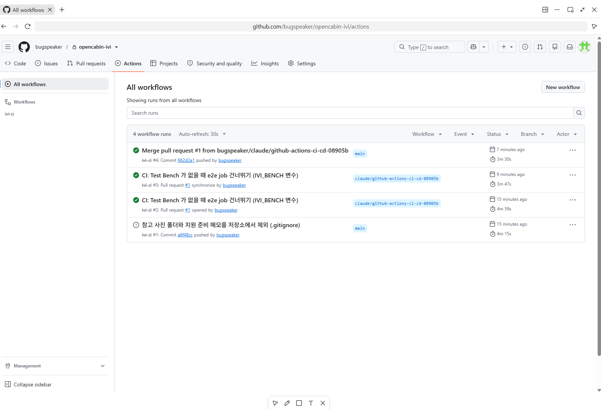
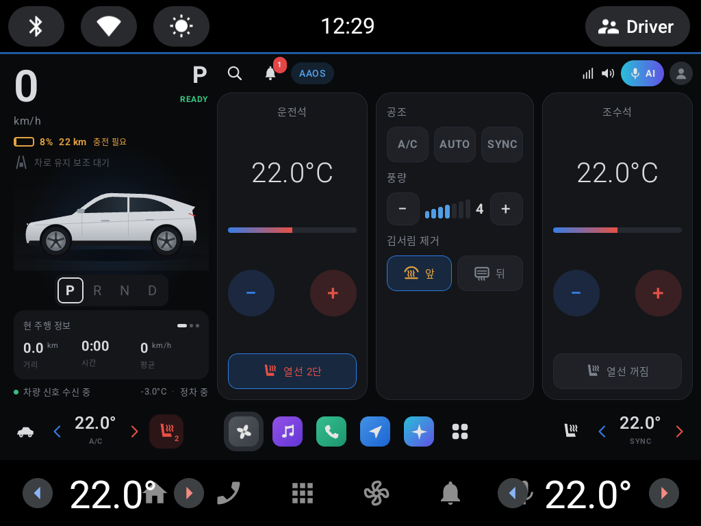
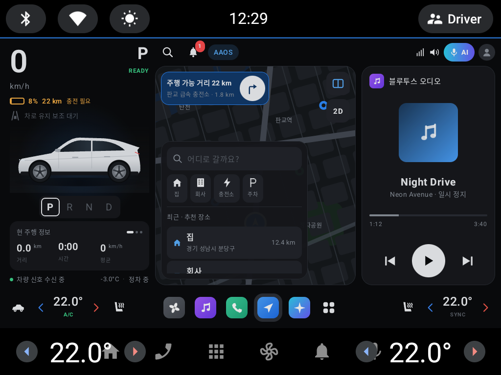

# OpenCabin IVI — AAOS IVI 테스트 자동화 포트폴리오

> **화면 터치부터 차량 신호(CarProperty/VHAL)까지, 같은 테스트를 AAOS 에뮬레이터와 Android 태블릿에서 무인으로 돌리는 E2E 검증 환경**
>
> 지원 직무: Test Automation Engineer (IVI System) · 기준일 2026-11-16 (8단계)

이 문서는 테스트 자동화 엔지니어의 시선으로 정리했습니다. "앱을 만들었다" 보다
**무엇을, 어떤 계층에서, 어떤 기준으로 검증했고, 테스트가 흔들릴 때 어떻게 다뤘는지**를 중심에 둡니다.

---

## 1. 한눈에 보기

| 항목 | 값 |
|---|---|
| 검증 대상 | 직접 만든 가상 IVI 앱 (Kotlin + Compose) — 홈 · 공조 · 미디어 · 내비 · 라디오 · 전화 · 설정 · 후방 카메라 · AI 어시스턴트(규칙 기반) |
| 실행 환경 | ① AAOS 에뮬레이터 API 34 (실제 CarService · VHAL) ② 화웨이 태블릿 (앱 내 Mock 차량 서비스) |
| 기술 | Python · pytest · Appium (UiAutomator2) · ADB/shell · logcat · CarPropertyManager · GitHub Actions |
| CI | GitHub Actions 실행 3회 연속 success (build · unit 통과, e2e 는 Bench 꺼짐으로 skipped) |
| E2E 테스트 | **108개** (smoke / sanity / regression / spike), 그중 차량 신호 양방향 E2E 24개 |
| 연결한 차량 신호 | **12종** — 속도 · 기어 · 좌석 온도 · A/C · AUTO · 풍량 · 김서림 · 좌석 열선 · 도어 잠금 · 주행 가능 거리 · 배터리 · 외기 온도 + 주행 중 UX 제한 |
| AAOS 에뮬레이터 결과 | 106 passed · 1 skipped · 1 xfailed (알려진 결함) · 6분 40초 |
| 태블릿(Mock) 결과 | 102 passed · 6 skipped (AAOS 전용) · 7분 6초 |
| 두 기기 병렬 | 두 기기 gate pass · **flaky 0** · 7분 20초 (차례로 돌리면 약 14분 28초 → **2.0배**) |
| 프레임워크 단위 테스트 | 33 passed (기기 없이 0.3초) · 앱 단위 테스트 17 passed |


---

## 2. 공고 요구사항 ↔ 이 프로젝트의 근거

### 주요 업무

| 공고 | 이 프로젝트에서 한 것 | 근거 |
|---|---|---|
| AAOS IVI 주요 서비스(HVAC · 차량 설정 · 클러스터 연동 · 미디어) 단계별 검증 전략 | HVAC 6종 신호, 도어 잠금 · 단위 · 시계 설정, 클러스터(주행 정보)의 속도 · 기어 · 주행 가능 거리 · 배터리 · 외기 온도, 미디어 소스 · 통화 중 일시 정지. 1단계 spike → 앱 → 프레임워크 → 운영 순서로 위험부터 검증 | [phase1](phase1-spike.md), [phase8](phase8-signals.md) |
| Nightly/Release 게이팅용 Smoke · Sanity · Regression 범위 정의 | 마커 3종 + 이벤트별 범위: PR = smoke, main push = smoke+sanity, Nightly(03:00 KST) = 전체 | [phase4 §6](phase4-operations.md), [ivi-ci.yml](../.github/workflows/ivi-ci.yml) |
| AAOS UI 상호작용 + CarProperty/VHAL E2E 설계 | 화면 → 신호, 신호 → 화면 **양방향**. 판정은 **area 단위**(A/C 전 좌석 5개, 도어 4개, 김서림은 그 유리만) | [test_vehicle_signals.py](../ivi-tests/tests/test_vehicle_signals.py) |
| 터치 이벤트부터 하위 연동까지 통합 조건 | 주행 가능 거리 신호 → 경고 → 충전소 카드 → 경로 안내 시작 / 말한 좌석 인식 → 그 좌석 열선 신호만 / 기어 R → 후방 카메라 | [phase8 §3-4](phase8-signals.md) |
| UI 자동화 프레임워크 + 테스트 러너로 스크립트 개발 · 유지보수 | Appium + pytest, 화면 객체 패턴. 화면을 두 번 크게 바꿨지만 7단계 개편 때 테스트 64개 중 **1개만** 수정 | [screens.py](../ivi-tests/ivi/screens.py) |
| ADB · shell · CarPropertyManager 로 Property Injection 자동화 | `dumpsys <VHAL> --set`(읽기 전용 센서), `cmd car_service set/get-property-value`(CarService 경로), 앱은 CarPropertyManager | [vehicle.py](../ivi-tests/ivi/vehicle.py) |
| Flaky 최소화 · 병렬 실행으로 피드백 단축 | 재시도 + flaky 판정 · 격리 목록 · 통계, 실패 순간 자료 자동 수집, 두 기기 병렬 2.0배, 테스트마다 신호 기준 값 초기화 | [phase4](phase4-operations.md) |

### 자격요건

| 공고 | 근거 |
|---|---|
| Android/AAOS 기반 테스트 자동화 구축 · 운영 | AAOS 에뮬레이터 + 실기기 태블릿에서 E2E 108개 실행, 결과를 실행 기록으로 누적 |
| Python 테스트 프레임워크 (Pytest) | pytest 훅(`pytest_runtest_makereport`, `pytest_collection_modifyitems`), 픽스처, 마커, 자체 플러그인(결과 기록기) |
| Maestro · UI Automator · Appium 등 | Appium(UiAutomator2). AAOS 다중 사용자(user 10) · SystemUI 다중 창 설정까지 해결 |
| ADB · Logcat · Shell 로 디바이스 제어 · 트러블슈팅 | adb 어댑터, 실패 시 logcat 자동 저장, logcat 으로 화웨이 iAware 강제 종료 원인 확인 |
| Git, CI/CD 기본 이해 | Git 단계별 커밋 · PR 로 병합. GitHub Actions 워크플로(호스트 build · unit + self-hosted Bench e2e)를 작성하고 **GitHub 에서 실행**: 첫 실행에서 드러난 문제(러너 없을 때 e2e 무한 대기)를 고친 뒤 3회 연속 success (§8) |

### 우대사항

| 공고 | 상태 |
|---|---|
| VHAL · CarService · CarPropertyManager 이해 · 검증 | ✅ 신호 12종, area 구성, 권한 등급(normal / dangerous / signature\|privileged), priv-app 허용 목록 |
| 차량 네트워크(Ethernet · DDS · SOME/IP · CAN) | ❌ 범위 밖 (VHAL 아래 계층) |
| REST API 자동화 · 원격 전원 제어 | ❌ 아직 없음 |
| ISO 26262 · A-SPICE | ❌ 학습 필요 |

---

## 3. 테스트 환경 구조

```
            ┌──────────────────── 테스트 코드 (pytest) ────────────────────┐
            │  car.drive(50) · car.set_signal(Signal.FAN, 7)               │
            │  climate.toggle("ac") · car.signal_all(Signal.AC)            │  ← "무엇을" 만 쓴다
            └───────────────┬───────────────────────────┬──────────────────┘
                            │                           │
              화면 객체 (screens.py)          차량 어댑터 (vehicle.py)          ← "어떻게" 는 여기서
              Appium 으로 찾기                VehicleController
              click 또는 adb tap               ├ AaosVehicle   dumpsys VHAL --set / cmd car_service
                            │                  └ MockVehicle   am broadcast mock.SET / mock.GET
                            ▼                           ▼
     ┌─────────────── AAOS 에뮬레이터 (SIL) ───────────────┐   ┌──── Android 태블릿 ────┐
     │ IVI 앱 ── CarPropertyManager ── CarService ── VHAL │   │ IVI 앱 ── Mock 차량    │
     └────────────────────────────────────────────────────┘   └────────────────────────┘
```

- 같은 테스트가 두 기기에서 돈다. 기기 종류는 `automotive` feature 로 자동 판별한다.
- 기기 차이(값 넣기, 값 복원, 주행 제한 판정, 영상 차단 판정, Appium 설정, 누르는 방법)는 모두 어댑터 · `Device` 가 흡수한다.
- 앱도 같은 원칙: `VehicleDataSource` 인터페이스 아래에 `CarVehicleDataSource`(CarPropertyManager)와 `MockVehicleDataSource` 를 둔다.

**왜 두 기기인가** — AAOS 에뮬레이터는 실제 CarService · VHAL 경로를 검증하고, 태블릿은 실기기 특유의 문제(터치 지연, 백그라운드 강제 종료, 설치 승인)를 드러낸다. 실제로 가장 시간이 많이 든 결함 분석 두 건은 모두 태블릿에서 나왔다 (§6).

---

## 4. 검증 전략

### 4-1) 계층과 게이팅

| 계층 | 목적 | 예 | 실행 시점 |
|---|---|---|---|
| unit (프레임워크) | 테스트 도구 자체가 맞는지 | VHAL 출력 해석, km ↔ m 변환, flaky 판정 분류, 격리 목록 형식 | 모든 push (GitHub 호스트) |
| smoke | 빌드를 받을 수 있는지 | 앱 실행, 기기에 맞는 데이터 소스, 정차 상태 시작, 공조 제어 권한(priv-app) | PR |
| sanity | 핵심 기능이 신호까지 이어지는지 | A/C 전 좌석, 풍량 한 단계, 주행 중 영상 차단 | main push |
| regression | 경계 · 조합 · 과거 결함 | 풍량 1/7, 거리 31/30/29 km, AUTO 중 풍량 변경, mph 표시 | Nightly |
| spike (AAOS 전용) | 기본 SystemUI 동작 확인 | SystemUI 공조 바 | Nightly |

### 4-2) 판정 기준

| 판정 | 뜻 | 게이트 |
|---|---|---|
| passed | 한 번에 통과 | 통과 |
| flaky | 실패 후 재시도에서 통과 | 통과, **통계에 남김** |
| failed / error | 재시도까지 실패 / 준비 · 정리 실패 | **실패** |
| xfailed | 알려진 결함 (`strict=True`: 고쳐지면 알려 줌) | 통과 |
| quarantined | 격리 목록 (돌리되 게이트 제외, 사유 필수) | 통과 |
| skipped | AAOS 전용 테스트를 태블릿에서 | 통과 |

원칙: **재시도로 통과해도 숨기지 않는다.** 재시도 · 앱 재실행 · VHAL 주입 재시도는 모두 JUnit property 와 누적 기록(`results.jsonl`)에 남는다.

---

## 5. E2E 테스트 설계

### 5-1) 양방향 + area 단위 판정

```python
@pytest.mark.sanity
def test_ac_toggle_reaches_every_seat(app, car):
    """상위 → 하위: A/C 를 끄면 전 좌석 area 의 HVAC_AC_ON 이 꺼진다 (운전석만 꺼지면 결함)."""
    climate = app.climate()
    climate.wait_checked("ac", True)

    climate.toggle("ac")
    wait_until(lambda: not any(car.signal_all(Signal.AC)), what="전 좌석 A/C 꺼짐")
    climate.wait_checked("ac", False)
```

- '전 좌석' 기능을 운전석 area 에만 쓰는 구현은 **화면만 보면 통과**한다. `signal_all` 이 area 별 값을 읽어 이것을 잡는다.
- 반대 방향(차량이 값을 바꾸면 화면이 따라가는지)도 같은 기능마다 따로 둔다.
- 김서림은 반대로 "**그 유리만**" 켜지는지 본다 (area 혼동 방지).

### 5-2) 테스트 설계 기법

| 기법 | 적용 |
|---|---|
| 경계 값 | 온도 16 / 28 °C, 풍량 1 / 7, 주행 가능 거리 31 / 30 / 29 km |
| 상태 전이 | 좌석 열선 꺼짐 → 2단 → 1단 → 꺼짐, 정차 ↔ 주행(UX 제한 적용 · 해제) |
| 동치 분할 / 조합 | 좌석 2 × 방향 2, 앞/뒤 유리, km/mph 설정 × 신호 |
| 규칙 충돌 | AUTO 중 풍량을 직접 바꾸면 `HVAC_AUTO_ON` 이 꺼진다 |
| 일관성 | 같은 열선 신호가 공조 화면 · 하단 바 · 빠른 제어 세 곳에 같은 값 |
| 주행 안전 | 주행 중 영상 차단(AAOS 는 OS `ActivityBlockingActivity`, 태블릿은 앱), 검색 · 키패드 잠금 |

### 5-3) 테스트 격리

차량 신호는 앱을 다시 띄워도 남는다 (앞 테스트가 문을 열어 두면 다음 테스트의 "누르면 열림" 이 거꾸로 된다).
→ 테스트마다 신호 11개를 기준 값으로 되돌린다. AAOS 에서는 `--set` 26번(신호 × area)이 필요한데,
**adb shell 한 번으로 묶고 성공 개수를 세어 검증**한다. 테스트가 84 → 108개로 늘었지만 테스트당 시간은 4.1초 → 3.7초로 줄었다.

```python
# ivi-tests/ivi/vehicle.py — AaosVehicle.set_signals (요약)
commands = [f"dumpsys {VHAL} --set {prop} {kind} {raw} -a {area}" for ... in areas]
out = self.adb.shell("; ".join(commands))
if out.count("Set property") == len(commands):   # 26개가 모두 들어갔는지 센다
    return                                        # 모자라면 한 번 더, 재시도 사실은 기록
```

### 5-4) Property Injection 경로 선택

| 명령 | 경로 | 판단 |
|---|---|---|
| `cmd car_service set-property-value` | CarService → VHAL | 쓰기 가능한 값(HVAC)에 사용. 앱과 같은 경로 |
| `dumpsys <VHAL> --set` (root) | VHAL 직접 | 읽기 전용 센서(속도 · 기어 · 거리)에 사용. 변경 이벤트가 CarService 로 나가 주행 상태까지 실제로 바뀜 |
| `cmd car_service inject-vhal-event` | 이벤트만 | **저장 값이 그대로라 `get` 으로 판정 불가 → 쓰지 않음** |

---

## 6. 결함 · 원인 분석 사례

### ① 화웨이 태블릿에서 탭 한 번에 10초 → 전체 7분 22초에서 1분 32초로

| 누르는 방법 | 화웨이 | AAOS 에뮬레이터 |
|---|---|---|
| `element.click()` | 10,377 ms | 577 ms |
| `mobile: clickGesture` | 10,099 ms | 501 ms |
| W3C actions | 10,430 ms | - |
| `adb shell input tap` | **117 ms** | - |

- 가설을 하나씩 지웠다: adb 왕복 65 ms(원인 아님), `waitForIdleTimeout` · `actionAcknowledgmentTimeout` 0(변화 없음), 클릭 방식 3종(모두 10초).
- 결론: 이 기기에서 UiAutomator 가 넣는 터치 자체가 느리다. **요소 찾기는 Appium, 누르기만 adb** 로 나눠 화면 객체 · 테스트 코드는 그대로 두었다 (`IVI_TAP` 으로 바꿀 수 있음).

### ② 매 실행 21번째 테스트에서 앱이 사라짐 → logcat 으로 원인 확인

- 실패 자료의 logcat: `Force stopping dev.opencabin.ivi … iAwareF[CrashClean]`. 테스트마다 `am start -S` 로 프로세스를 죽였다 살린 것을 OS 가 '반복 크래시' 로 판단.
- 1차(3단계): 다시 띄우고 `app_relaunch` 로 기록 — 통과시키되 숨기지 않음.
- 2차(4단계): 프로세스 종료는 세션 시작 때 1번, 테스트마다는 `--activity-clear-task` 로 화면만 초기화 → **재실행 0회 (3회 연속)**.

### ③ 1단계에서 찾은 SystemUI 결함: 운전석 온도 ▲ 가 홈 버튼에 가려짐

- 영역 겹침 `[192,682][268,758]` vs `[188,682][264,758]` → 72×76 px 겹침, 홈이 위에 있어 탭을 가져간다.
- `xfail(strict=True)` 로 남겨, 고쳐지면 XPASS → 실패로 바뀌어 알려 주게 했다.

### ④ 테스트 쪽 경쟁 조건 (내가 만든 결함)

- 전체 실행에서만 `test_range_recovers_after_charging` 실패, 단독 실행은 통과.
- 원인: 주행 가능 거리와 배터리는 **서로 다른 신호**라 따로 도착하는데, 거리를 기다린 뒤 배터리를 바로 `assert` 했다.
- 해결: 조건 대기(`wait_until`)로 바꾸고 같은 모양의 확인도 함께 고쳤다. 고정 `sleep` 은 쓰지 않는다.

### ⑤ 테스트가 표시 단위를 가정하고 있었음

- 1단계 spike 테스트가 SystemUI 온도를 **화씨로 가정**. 에뮬레이터를 섭씨로 맞추자 실패.
- `HVAC_TEMPERATURE_DISPLAY_UNITS` 를 읽어 기대 글자를 계산하도록 바꿔 섭씨 · 화씨 모두 통과.

### ⑥ 회귀 테스트로 찾은 앱 결함

- 음성 패널이 안내 화면을 가리는 결함 → 앱 수정 + 회귀 테스트 추가.
- 낮은 화면(1024×768)에서 후보 카드가 대답을 화면 밖으로 밀어내 요소를 못 찾음 → "화면 밖 요소는 UiAutomator 가 찾지 못한다" 를 확인하고 레이아웃 수정.
- 안내 바 목적지 글자 앞의 공백 한 칸이 정확히 일치 계약을 깸 → 간격을 padding 으로.

### ⑦ 아직 원인을 모르는 것

- `test_video_blocked_screen_follows_parking` 이 7단계 반복 실행 중 한 번 흔들렸다 (정차 후 차단 해제가 10초 안에 확인되지 않음). 8단계 실행 2회에서는 재현되지 않았다.
- 실패 자료(맨 위 액티비티가 이미 영상 화면)로 추정만 하고 있고, `run_bench.py --repeat 5` 로 다시 측정할 계획이다.

---

## 7. 테스트 가능성(Testability)을 위해 앱을 바꾼 것

| 문제 | 바꾼 것 |
|---|---|
| A/C · AUTO · 김서림 토글이 **색으로만** 상태 표시 → 자동화가 못 읽음 | `Modifier.toggleable(role = Switch)` 로 `checked` 를 접근성 정보로 내보냄 (TalkBack 에도 도움) |
| 저장 설정이 테스트 사이에 남음 | debug 빌드 전용 테스트 훅(`TestHookReceiver`)으로 초기화. release 빌드에는 포함되지 않음 |
| 차마다 area 구성이 다름 | 앱이 area 를 하드코딩하지 않고 `CarPropertyConfig.areaIds` 에서 읽음 |
| 권한 없는 신호 | 앱이 죽지 않고 '값 없음' 으로 표시 → 권한 누락이 화면에서 드러남 |

---

## 8. 운영: flaky · 병렬 · 실패 자료 · CI

- **실패 자료**: 실패하면 정리(teardown) 전에 `screen.png` · `page_source.xml` · `vehicle.txt`(속도 · 기어 · 주행 상태 · 좌석 온도) · `activities.txt`(디스플레이별 맨 위 액티비티) · `logcat.txt` 를 저장. 재시도 것은 `__try2` 로 따로.
- **flaky 통계** (`tools/flaky_report.py`): 기기별 게이트 통과율, 테스트별 불안정률 · p95, 격리 후보(불안정률 10% 이상 & 5회 이상), 격리 해제 후보(20회 연속 통과), 느린 테스트 상위 5.
- **격리** (`quarantine.txt`): 사유 없는 줄은 오류로 거부. 격리된 테스트도 계속 돌려 데이터를 모은다.
- **병렬** (`tools/run_bench.py`): 기기마다 pytest 프로세스, 같은 run id. 한 Appium 서버에서 두 세션을 쓰려면 UiAutomator2 `systemPort` 를 기기마다 다르게.
- **CI** (`.github/workflows/ivi-ci.yml`):

| job | 위치 | 내용 |
|---|---|---|
| build | GitHub 호스트 | `assembleDebug` + 앱 단위 테스트, APK 보관 |
| unit | GitHub 호스트 | `pytest unit` (기기 없음) |
| e2e | self-hosted `ivi-bench` | Bench 점검 → APK 빌드 → 설치(해시가 같으면 건너뜀) → 두 기기 병렬 → flaky 리포트를 Job Summary 로 |

설계 시 고려: priv-app 서명 키가 GitHub 호스트 빌드와 달라 e2e 는 Bench 에서 다시 빌드 / 실기기 설치 승인 창이 무인 실행을 막지 않도록 같은 APK 면 설치 생략 / Bench 가 하나라 e2e job 만 `concurrency` 로 직렬화 / `reports/history` 를 유지해 실행을 넘어 통계 누적 / Bench 가 켜져 있을 때만 e2e 를 돌리는 스위치(저장소 변수 `IVI_BENCH=online`).

**GitHub 실행 기록 (2026-11-16, 비공개 저장소)**

| 실행 | 이벤트 | build | unit | e2e | 결과 |
|---|---|---|---|---|---|
| #1 | main push (수정 전 워크플로) | ✅ | ✅ | 러너 대기 | 취소 |
| #2 | PR 생성 | ✅ 약 5분 | ✅ 15초 | skipped | **success** |
| #3 | PR 갱신 | ✅ | ✅ | skipped | **success** |
| #4 | PR 병합 후 main push | ✅ | ✅ | skipped | **success** |

- build 는 `assembleDebug` 와 앱 단위 테스트(`testDebugUnitTest`)를 함께 돌린다. 이 PC 는 한글 경로 문제로 Gradle 테스트 대신 `java` 로 직접 확인했는데, CI 에서 처음으로 Gradle 경로로 통과를 확인했다.
- unit 은 프레임워크 단위 테스트 33개 (33 passed, 0.36초).
- **첫 실행에서 찾은 문제**: e2e job 이 self-hosted runner 를 무한정 기다려 실행이 끝나지 않았다. Bench 가 꺼져 있으면 PR 결과가 영영 나오지 않는 구조였다. → e2e 를 저장소 변수로 켜고 끄게 하고, 직렬화를 e2e job 으로 좁혀 build · unit 은 막지 않게 고쳤다 (PR #1).



---

## 9. 한계와 다음 단계

솔직하게 적습니다.

| 항목 | 현재 상태 |
|---|---|
| 환경 | AAOS **에뮬레이터**의 CarService · VHAL 입니다. 실제 차량 · HIL · Test Bench 경험이 아닙니다 |
| 앱 | 가상 IVI 입니다. 지도 · 라디오 · 통화는 가상 데이터, AI 어시스턴트는 규칙 기반, 운전자 보조 표시는 연출입니다. 화면 구조는 공개 자료를 참고했고 타사 로고 · 이미지 · 코드는 쓰지 않았습니다 |
| CI | GitHub 호스트 job(build · unit)은 GitHub 에서 실행해 통과했습니다. **e2e(self-hosted Test Bench)는 아직 GitHub 에서 돌리지 않았습니다** — 이 PC 에서 같은 명령으로 따로 실행해 확인했습니다. Nightly(매일 03:00 KST)도 지금은 build · unit 만 돕니다 |
| 반복 안정성 | 8단계 두 기기 병렬은 1회 측정입니다 (4단계는 3회 반복, flaky 0) |
| 미연결 신호 | 사이드 미러 · 트렁크 · 차일드 락 · 실내등 · 전조등은 화면 상태입니다 |
| 개발 방식 | AI 코딩 도구를 활용해 만들었고, 구조 · 판정 기준 · 결함 분석은 직접 검토하고 설명할 수 있도록 정리했습니다 |

다음 단계 (공고 우선순위 순)
1. 이 PC 를 self-hosted runner(`ivi-bench`)로 등록하고 `IVI_BENCH=online` 으로 e2e 까지 GitHub 에서 돌려 Nightly 결과 기록 남기기
2. `run_bench.py --repeat 5` 로 반복 안정성 측정, 영상 차단 테스트 흔들림 원인 확인
3. 데모 영상: 신호 주입 → 화면 반응, 화면 조작 → VHAL 값, 실패 자료, 병렬 실행, flaky 리포트
4. 우대 항목 보강: 원격 전원 제어(스마트 PDU · 릴레이)를 모사한 Bench 제어 인터페이스, 결과 보고 REST API, ISO 26262 · A-SPICE 학습 노트

---

## 10. 저장소 안내

| 경로 | 내용 |
|---|---|
| [ivi-tests/ivi/vehicle.py](../ivi-tests/ivi/vehicle.py) | 차량 어댑터 (`AaosVehicle` / `MockVehicle`), 신호 정의, 묶음 주입 |
| [ivi-tests/ivi/device.py](../ivi-tests/ivi/device.py) | 기기 판별, Appium 설정, 누르는 방법 |
| [ivi-tests/ivi/screens.py](../ivi-tests/ivi/screens.py) | 화면 객체 |
| [ivi-tests/ivi/results.py](../ivi-tests/ivi/results.py) | 판정 분류 · 기록 (pytest 플러그인) |
| [ivi-tests/tests/conftest.py](../ivi-tests/tests/conftest.py) | 픽스처, 마커, 실패 자료 저장 훅 |
| [ivi-tests/tests/test_vehicle_signals.py](../ivi-tests/tests/test_vehicle_signals.py) | 차량 신호 양방향 E2E 24개 |
| [ivi-tests/tools/](../ivi-tests/tools/) | 병렬 실행, flaky 통계, 설치 |
| [.github/workflows/ivi-ci.yml](../.github/workflows/ivi-ci.yml) | CI: 호스트 build · unit + self-hosted Bench e2e |
| [docs/phase1 ~ phase8](phase1-spike.md) | 단계별 설계 · 검증 기록 |

| 홈 | 공조 (전 좌석, 신호 연결) | 주행 가능 거리 부족 |
|---|---|---|
|  |  |  |
