# OpenCabin IVI: AAOS IVI 테스트 자동화 포트폴리오

> [!TIP]
> 짧게 보려면 [포트폴리오 첫 화면](https://bugspeaker.github.io/opencabin-ivi/)을 먼저 보세요. 이 문서는 근거를 모두 적은 상세 문서입니다.

지원 직무: 42dot Test Automation Engineer (IVI System)  
결과 기준: 2026-11-24 실행(커밋 `300b081`, 앱 0.4.2, 테스트 144개, 두 기기 × 3회). 세 번째 기기 갤럭시 폴드는 같은 커밋으로 한 번 돌렸습니다([3장 끝](#세-번째-기기에서-찾은-배치-결함-갤럭시-폴드)). 이전 실행과 그때의 코드 시점은 [README의 '결과 자료와 검증 시점'](../README.md#결과-자료와-검증-시점)에 있습니다.

화면을 누르면 CarProperty/VHAL 값이 바뀌는지, 차량 신호가 바뀌면 화면이 따라오는지를 E2E로 확인하는 pytest 프레임워크입니다. 테스트 대상은 이 프로젝트에서 만든 가상 IVI 앱이고, 같은 테스트 144개를 AAOS 에뮬레이터와 화웨이 태블릿에서 돌리고, 2026-11-23에는 갤럭시 폴드를 세 번째 기기로 붙였습니다. 에뮬레이터에서는 CarService와 에뮬레이터의 VHAL(가상 차량 값)을 거치고, 태블릿에서는 앱 안에 둔 Mock 차량 서비스를 씁니다. 실제 차량, HIL, CAN 장비는 쓰지 않았습니다.

## 만든 사람과 만든 방식

- 경력: 게임 QA 8년차(2017.12부터 약 7년 8개월, 회사 4곳)입니다. 모바일·PC·Steam Deck 멀티플랫폼 호환성 검증, 라이브 서비스 정기 업데이트와 BM 검수, 글로벌 현지화와 마켓 규제 검수, 외부 QA사·퍼블리셔와의 이슈 창구를 맡았고, 지금 회사에서는 AI R&D 조직과 테스트 현황 대시보드를 만들었습니다. ISTQB CTFL을 땄습니다. 개인 포트폴리오로 웹 BVT 도구를 바이브 코딩(코드는 AI가 작성)으로 만들었습니다. 게임 QA에서 쓰던 BVT 문서 양식을 바탕으로 엑셀 BVT 문서를 브랜치·플랫폼별로 관리하는 대시보드에 Playwright·pytest UI 자동화를 붙여, 공개 웹 서비스(타입캐스트)의 BVT 70개 중 47개를 Chrome에서 한 번에 약 6분에 돌리고, 실패하면 화면·녹화·메시지를 남깁니다(2026-11-03 실행). Jira 처리량 캘린더와 Claude로 검수 리포트·이슈 초안을 만드는 TC 관리 도구(Bugspeaker Zone)도 바이브 코딩으로 만들어 업무에 씁니다. 모바일 자동화는 Appium으로 실습해 본 경험이 있고, 이 프로젝트에서 AAOS까지 넓혀 게이트, 반복 실행, CI를 갖춘 업무 수준으로 적용했습니다.
- 기간: 2026-11-13부터, 혼자 진행했습니다.
- 역할: AI 코딩 도구 Claude Code로 앱과 테스트 도구를 만들었습니다. 무엇을 만들지 정하고, E2E 테스트 설계는 Claude와 함께 했습니다. AI가 낸 변경과 외부 검토 항목은 기기 실행 기록과 자동 검사로 확인하여 반영 여부를 결정했고, PR을 병합했습니다.
- 기기 구성, 신호 주입 방식, 판정과 재시도 규칙, 결함 원인 분석에서 무엇을 고르고 무엇을 버렸는지와 그 근거가 된 측정값은 [결정 기록](decisions.md)에 있습니다.

이전에 만든 웹 BVT 도구(바이브 코딩, 개인 포트폴리오)의 실행 모습입니다. BVT 문서에서 자동화를 실행하면 Playwright가 타입캐스트 웹을 돌리며 표에 결과를 채우고(빨리 감기), 끝나면 실패한 No.64의 실패 순간 화면, 녹화, 메시지를 보여 줍니다. 타입캐스트 계정 정보는 흐리게 했습니다.

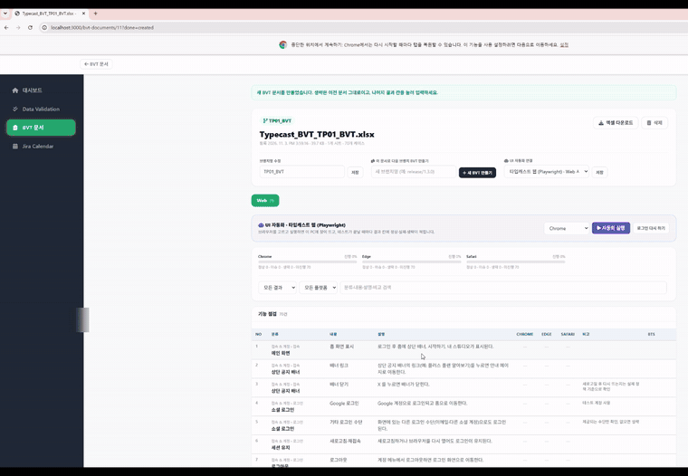

업무에 쓰는 TC 관리 도구 Bugspeaker Zone(바이브 코딩)에는 이 프로젝트의 결과 파일을 읽어 들이는 화면을 붙였습니다. 아래 화면은 2026-11-21 결과를 읽은 것으로, TC 101개(케이스 129개)마다 두 기기의 판정과 판정 직후 화면, 차량 값을 보여 주고, 요구사항 26개와 연결된 테스트, 회차별 flaky 통계를 보여 줍니다. 판정은 실행 원자료의 값을 그대로 씁니다. 연결 코드는 Claude Code가 작성했고, 무엇을 보여 줄지와 반영 여부는 제가 정했습니다. 회사 데이터와 섞이지 않게, OpenCabin 메뉴만 보이는 데모 모드에서 2026-11-21 실행 자료로 찍었습니다. 실행을 거는 화면(Test Bench API)은 아직 없습니다.

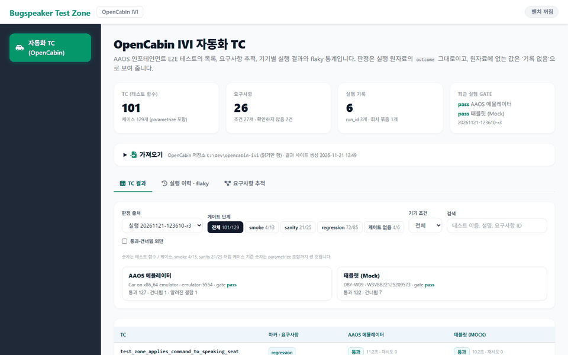

## AI 결과를 어떻게 검증했나

이 프로젝트에서 신경 쓴 것은 AI가 "통과했다", "고쳤다"고 할 때 그 말을 무엇으로 확인하느냐였습니다. 그래서 AI 결과는 AI의 설명이 아니라 기기 실행, 원자료, 자동 검사로 판정하게 했고, 앱은 태블릿과 에뮬레이터에서 직접 써 보며 기능과 사용감을 확인했습니다(아래 '직접 써 보며 준 피드백'). 지적마다 반영할지는 제가 정했고, Claude의 추천과 다르게 정한 경우는 아래 '추천을 따르지 않은 사례'에 있습니다.

### 원칙

1. **'통과'는 기기 실행 결과 파일로만 받아들입니다.** 결과 파일마다 커밋, 커밋하지 않은 변경 여부, APK sha256, 종료 코드가 남고, Release 게이트가 `--commit`으로 그 커밋의 결과인지 확인합니다. 단위 테스트 통과는 기기 실행을 대신하지 않습니다.
2. **'실패 0'과 '정한 범위를 끝까지 돌렸다'를 따로 봅니다.** 범위가 줄었거나 중간에 멈춘 실행이 통과로 보이지 않도록 Release 게이트에 실행 완전성 조건을 두었습니다([4-1](#4-1-게이트-단계와-기준)).
3. **문서의 주장은 코드와 검사로 확인합니다.** 요구사항↔테스트 연결이나 문서·사이트의 내부 링크가 끊기면 CI의 unit job이 실패합니다. 문서에는 코드에서 찾아 확인할 수 있는 문장만 씁니다.
4. **수치는 원자료에서 다시 셉니다.** 실행 결과 파일을 [evidence](evidence/README.md)에 남기고, 다시 세는 명령을 함께 적습니다.

### 검증에서 잡혀 고친 사례

| 무엇이 틀렸나 | 어떻게 드러났나 | 고친 것 |
|---|---|---|
| 문서에는 'Release 게이트 다섯 조건', '고정 sleep은 쓰지 않습니다'라고 썼는데, 조건 셋은 검사하는 코드가 없었고 sleep이 3곳 있었습니다. | 외부 검토가 문서와 코드를 대조했습니다(2026-11-19). | 게이트가 결과 파일로 조건을 모두 확인하게 하고, sleep 3곳을 `stays`로 바꿨습니다. [9단계 기록 7절](phase9-bench.md#7-외부-검토-반영-2026-11-19) · [`9870972`](https://github.com/bugspeaker/opencabin-ivi/commit/9870972) |
| 반복 실행 통계가 5회 원자료가 아니라 누적 기록을 읽어, 따로 돌린 15개짜리 실행이 섞였습니다. | 원자료를 저장소에 남기고 다시 세다가 찾았습니다. | 원자료 10개만 읽게 다시 만들고 정정 기록을 남겼습니다. [반복 실행 통계의 정정](flaky-report.md#읽는-법과-한계) |
| `run_bench.py --repeat 0`이 아무것도 돌리지 않고 종료 코드 0으로 끝났습니다. 게이트는 실패 수만 보고 실행이 끝까지 됐는지는 보지 않았습니다. 알려진 결함의 xfail이 어떤 오류든 '알려진 결함'으로 받았습니다. | 외부 검토(2026-11-20)에서 나왔습니다. | 실행 완전성 조건을 더하고, 반복 횟수는 1 이상만 받게 했습니다. xfail은 `raises=DefectReproduced`로 증상일 때만 받습니다. [9단계 기록 8절](phase9-bench.md#8-외부-검토-반영-2026-11-20-게이트가-보증하는-범위) · [`de733dd`](https://github.com/bugspeaker/opencabin-ivi/commit/de733dd) |
| README에 "'바뀌지 않아야 함'은 1.5초 동안 계속 본다"고 썼지만 10곳은 한 번만 읽었습니다. | 외부 검토가 코드에서 해당 줄을 찾아 대조했습니다(2026-11-21). | 10곳을 `stays`로 바꿨습니다. [`d41337a`](https://github.com/bugspeaker/opencabin-ivi/commit/d41337a) |
| 결과 페이지에 폴드 칸을 더한 뒤 추적표 도구만 그 칸 이름을 몰라 멈췄고, 추적표는 두 기기 칸으로 남았습니다. 표를 다시 만들어 보는 검사가 없어 CI는 통과했습니다. | 테스트 범위를 다시 점검하다 찾았습니다(2026-11-23). | 칸 이름을 맞추고, 두 도구의 칸 이름이 다르거나 추적표가 코드와 다르면 unit job이 실패하게 했습니다. 결과가 아직 없는 테스트는 따로 셉니다. [원자료](evidence/2026-11-23-coverage/README.md) · [`55419f7`](https://github.com/bugspeaker/opencabin-ivi/commit/55419f7) |
| 테스트 도구가 에뮬레이터의 주행 상태를 못 읽으면 '제한 없음'으로 처리해, 정차를 기다리는 단계가 기다리지 않고 지나갔습니다. | 외부 리뷰의 예상 질문(출력을 정규식으로 읽는 방식의 한계)에 답을 정리하며 코드와 대조하다 찾았습니다(2026-11-24). | 못 읽으면 다른 읽기처럼 오류를 내게 고치고 단위 테스트 6개를 더한 뒤, 두 기기 × 3회를 다시 돌렸습니다. [원자료](evidence/2026-11-24-driving-state/README.md) · [`300b081`](https://github.com/bugspeaker/opencabin-ivi/commit/300b081) |
| Test Bench API가 같은 기기의 실행 요청을 동시에 받으면 둘 다 시작했고, 테스트가 도는 기기에도 신호·전원 변경을 받았습니다. 실행 파일이 없으면 작업이 'running'에 남아 그 기기를 다시 쓸 수 없었습니다. CAN 게이트웨이는 차량 쪽이 느리면 프레임이 쌓여 최신 값이 약 1.7초 늦게 들어갔습니다. | 동작이 아니라 예외 상황을 찾아 달라고 따로 요청한 외부 검토가 실행 순서를 맞춘 재현 코드로 보였습니다(2026-11-24). | 기기 점유를 한 잠금 안에서 정하고, 테스트 중 변경은 409로 거절하고, 실패와 시간 초과도 점유를 풀게 했습니다. 게이트웨이는 상태 신호를 최신 값으로 합치고 기어와 도어는 순서대로 넣어, 같은 조건에서 약 50 ms가 됐습니다. 다시 읽어 네 가지를 더 고치고, 음악·안내·통화 중 공조 조작 같은 동시 조작 E2E 6개를 더했습니다. [9단계 기록 9절](phase9-bench.md#9-외부-검토-반영-2026-11-24-예외-경로와-동시-조작) |
| 게이트·대기·픽스처 변경이 단위 테스트로만 확인되고 기기에서는 돈 적이 없었습니다. 지금 코드로 다시 돌리자, 화면이 꺼진 PC에서 전원 테스트가 에뮬레이터를 다시 켜다 멈췄습니다. | 두 기기에서 전체를 다시 돌렸습니다(2026-11-21). | 창 없이 다시 켜게 고치고, 처음부터 3회 돌려 750건이 통과했습니다. [원자료](evidence/2026-11-21-main/README.md) · [`d54741b`](https://github.com/bugspeaker/opencabin-ivi/commit/d54741b) |

### 추천을 따르지 않은 사례

Claude가 보기와 추천을 내면 제가 골랐습니다. 아래는 추천과 다르게 정한 경우이고, 무엇을 골랐는지는 작업 기록과 커밋에 남아 있습니다(날짜는 2026년).

| 언제 | Claude의 추천 | 고른 것과 이유 | 결과 |
|---|---|---|---|
| 11-23 | 앱이 지원할 가장 작은 화면을 폭 580·높이 500dp로 정해 세로 화면까지 지원합니다. | **폭 760·높이 500dp, 가로만.** 차량 IVI 화면은 가로가 기본이라, 세로까지 지원하는 큰 변경보다 가로로 범위를 좁혀 확실히 검증하는 쪽을 골랐습니다. | 앱을 가로 전용으로 정하고 배치를 고쳤습니다. 760×500dp 화면에서 140개를 돌려 앱 테스트가 모두 통과했습니다. [#40](https://github.com/bugspeaker/opencabin-ivi/pull/40) · [4-4](#4-4-테스트-범위-점검) |
| 11-23 | 태블릿 확인은 에뮬레이터로 대신합니다. 화면 폭이 같아 같은 배치를 쓰기 때문입니다. | **태블릿을 연결해 확인.** 폭이 같으니 결과도 같을 것이라는 추정 대신, 실제 기기의 결과 파일로 확인하는 쪽을 골랐습니다. | 같은 APK로 태블릿에서 122개가 통과하고 Release 게이트를 통과했습니다. [폴드 기록](evidence/2026-11-23-fold/README.md) |
| 11-23 | 결과 페이지에는 폴드 칸 없이 사례로만 보여 줍니다. | **폴드 칸 추가.** 사례로만 두면 같은 테스트의 기기별 화면을 나란히 비교할 수 없어서, 도구를 고쳐 칸을 나눴습니다. | 결과 도구가 같은 Mock 기기끼리 서로 덮어쓰던 구조를 모델별 칸으로 나눴습니다. [#41](https://github.com/bugspeaker/opencabin-ivi/pull/41) |
| 11-23 | 테스트가 140개로 늘어도 첫 화면 헤드라인은 11-21 결과로 둡니다. | **140개 × 3회를 다시 돌리기.** 첫 화면 숫자가 지금 코드로 돌린 결과가 아니면 안 된다고 보고, 1시간 넘게 걸려도 다시 돌렸습니다. | 813건 중 실패 0으로 헤드라인을 바꿨습니다. 그 뒤 4개를 더했을 때도 다시 돌렸습니다(837건). [#46](https://github.com/bugspeaker/opencabin-ivi/pull/46) · [#48](https://github.com/bugspeaker/opencabin-ivi/pull/48) |
| 11-21 | Claude가 쓴 역할 문구에 'Test Bench에서 E2E를 직접 돌려 확인'이 들어 있었습니다. | **고르지 않음.** 하지 않은 일을 역할에 적으면 면접에서 사실과 달라지므로 뺐습니다. | README, 포트폴리오, 사이트 세 곳에서 뺐습니다. [`7fe2df3`](https://github.com/bugspeaker/opencabin-ivi/commit/7fe2df3) |

화면으로 보면 이렇습니다.

| 세로 폴드 (세로까지 지원하려던 화면) | 가로 760×500dp (고른 범위) |
|---|---|
| 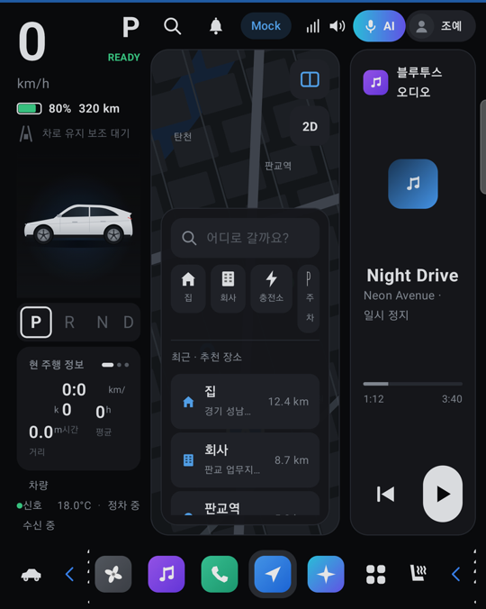 |  |

| 에뮬레이터 (추천: 이것으로 대신) | 태블릿 (직접 연결해 확인) |
|---|---|
| 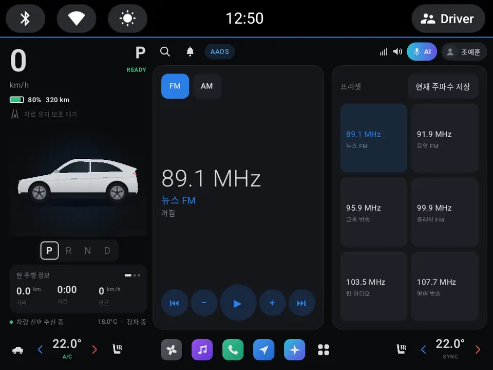 | 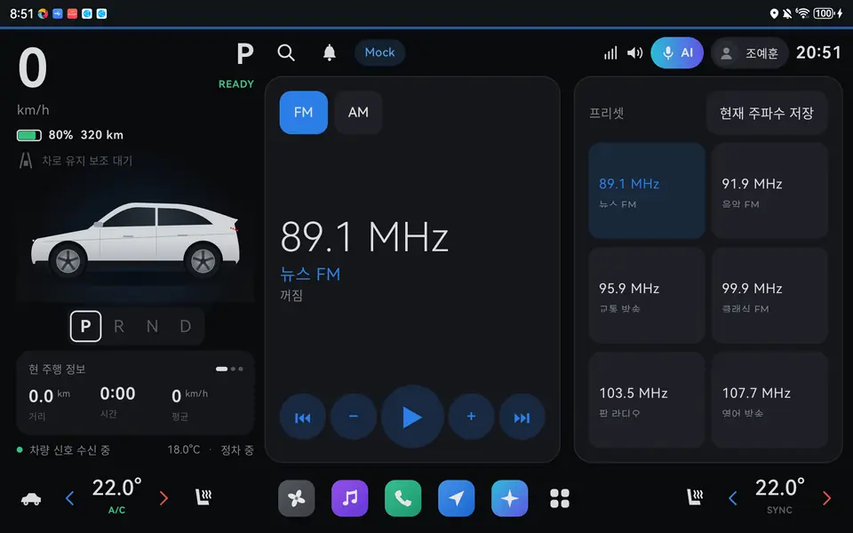 |

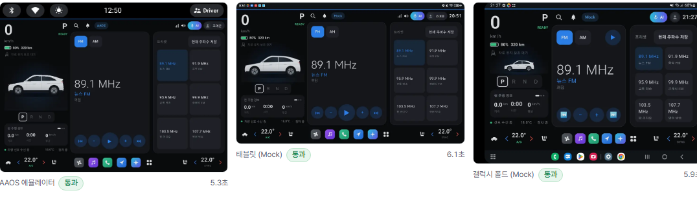

### 직접 써 보며 준 피드백 (FQA)

초기 버전부터 앱을 태블릿과 에뮬레이터에서 직접 써 보며, 새로 필요한 기능과 지금 기능이 제대로 도는지, 사용자로서 어색한 곳이 없는지 보고 고칠 것을 정했습니다. 아래는 작업 기록에 남은 것과 그때의 화면입니다(날짜는 2026년).

**앱 첫 화면이 바뀐 과정** (AAOS 에뮬레이터)

| 11-13 재점검 전 (2~4단계) | 11-13 재점검 뒤 (5단계, 주행 중) | 11-14 3영역 개편 (7단계) | 11-18 지금 (9단계) |
|---|---|---|---|
|  | 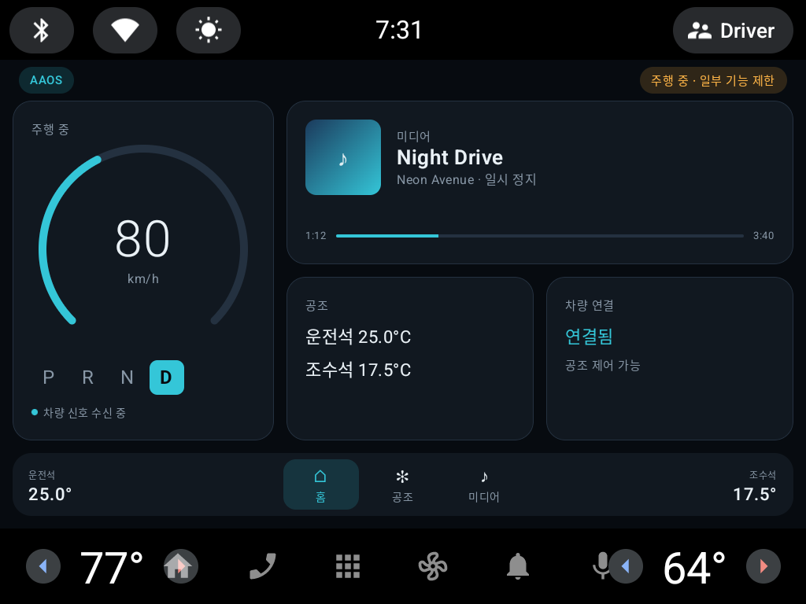 | 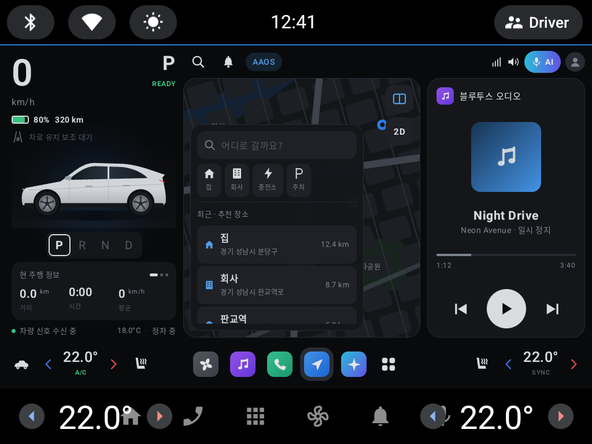 | 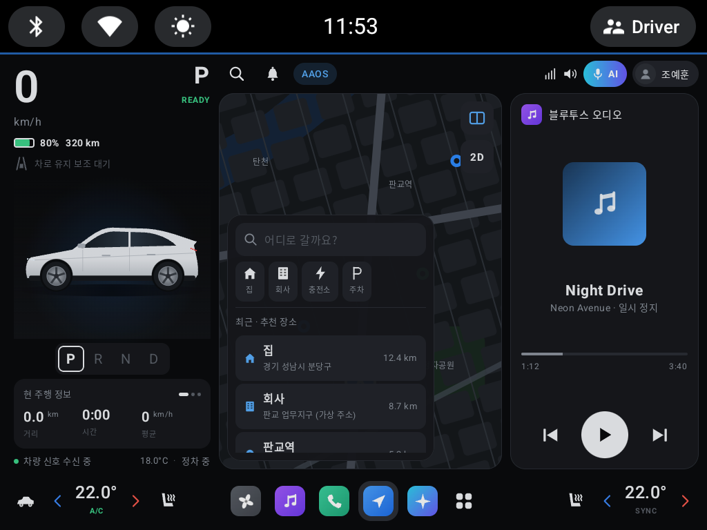 |

#### 11-14 공조 온도가 태블릿과 다르게 보였습니다

에뮬레이터에서는 앱이 16.0°C, 아래 시스템 바가 화씨 61°로 보였습니다. 운전석·조수석을 22.0°C, 섭씨로 맞췄습니다. 이 변경으로 화씨를 가정하던 1단계 테스트 4개가 실패해, 표시 단위를 읽어 기대값을 계산하게 고쳤습니다. [7단계 기록](phase7-layout.md#에뮬레이터-공조-값을-태블릿과-같게) · [`7590d42`](https://github.com/bugspeaker/opencabin-ivi/commit/7590d42)

| 전 | 후 |
|---|---|
| 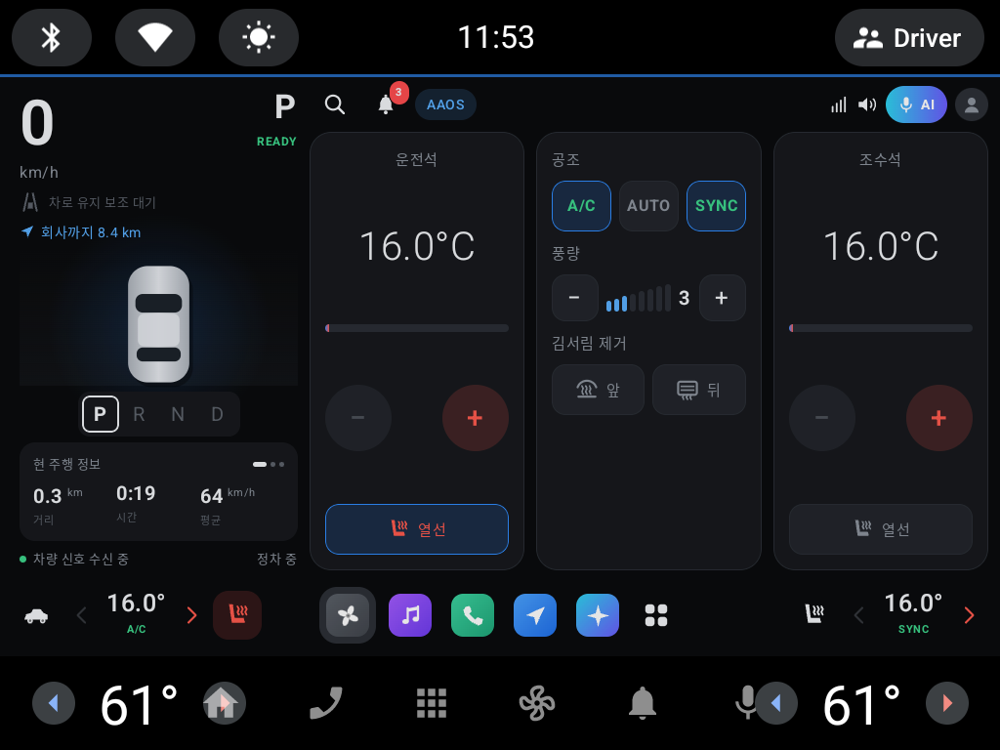 |  |

#### 11-16 고쳤던 온도가 재부팅 뒤 다시 63°로 돌아왔습니다

같은 지적을 다시 했습니다. 지금 값만 바꾸던 방식을 VHAL 초기값 덮어쓰기로 바꿔, 에뮬레이터를 다시 켜도 22.0°C가 유지되게 했습니다. [`5d95212`](https://github.com/bugspeaker/opencabin-ivi/commit/5d95212)

#### 11-16 공조에 최대 냉방(FULL)이 없었습니다

FULL 기능과 E2E 4개(켜기, 끄면 이전 값 복원, 신호→화면, 풍량을 바꾸면 풀림)를 더했습니다. FULL을 켜면 온도는 16.0°C, 풍량은 7이 됩니다. [`3c60f2d`](https://github.com/bugspeaker/opencabin-ivi/commit/3c60f2d)

| 전 | 후 (FULL 켬) |
|---|---|
|  |  |

#### 11-16 영상 화면 아래에 블랙박스 제품 이름이 보였습니다

영상 아래 줄을 잘라 내고 재생하게 했습니다. 영상은 직접 찍은 블랙박스 주행 영상입니다. [`9b36711`](https://github.com/bugspeaker/opencabin-ivi/commit/9b36711)

| 후 |
|---|
| 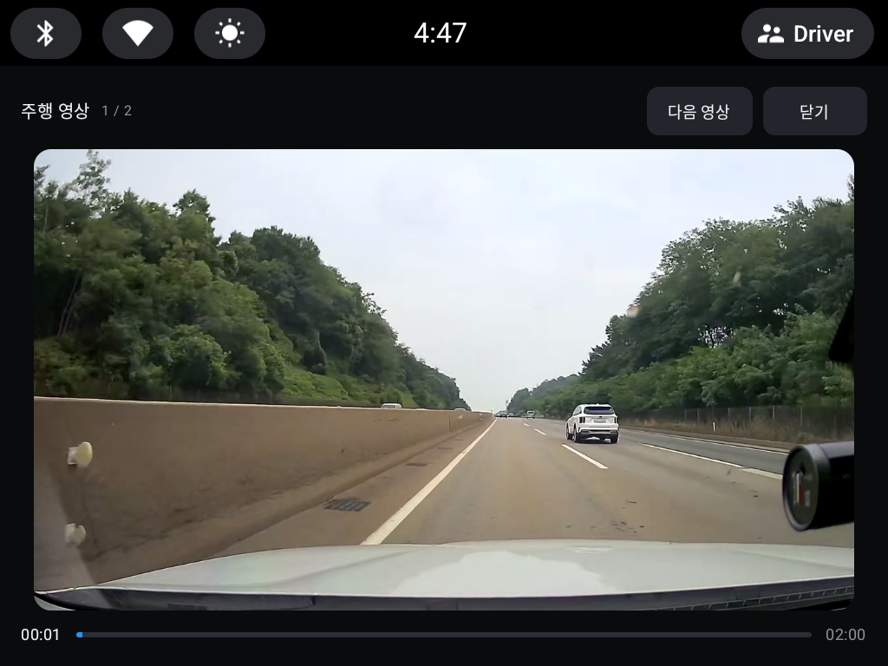 |

#### 11-16, 11-18 테스트 결과를 글자로만 확인할 수 있었습니다

테스트마다 판정 직후 화면을 남기고, 결과 페이지에서 두 기기의 화면을 나란히 보게 했습니다. [`0aa184f`](https://github.com/bugspeaker/opencabin-ivi/commit/0aa184f) · [테스트 결과](test-results.md)

| 후 (지금 결과 페이지) |
|---|
| 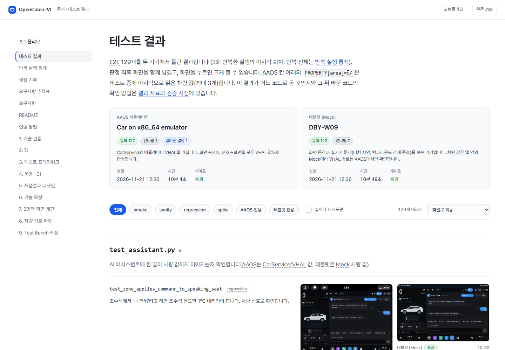 |

#### 11-18 우대사항 3개가 비어 있었습니다

차량 네트워크, REST·원격 전원, 기능 안전 항목이 비어 있어 지금 방법으로는 정말 안 되는지 물었습니다. Test Bench REST API, 원격 전원, 가상 CAN, 요구사항 추적표를 모의 환경으로 만들고 '일부'로 표시했습니다. [9단계 기록](phase9-bench.md) · [`84b63d6`](https://github.com/bugspeaker/opencabin-ivi/commit/84b63d6)

#### 11-23 테스트 범위가 충분한지 다시 봐 달라고 했습니다

요구사항 조건, 앱의 화면 요소(testTag), 주행 중 제한의 허용 쪽, 경계값, 기기·화면, 단위 테스트 커버리지로 다시 대 보게 했습니다. 테스트가 없던 조건 2개와 화면 요소 약 30개를 찾아 E2E 11개를 더했고, 추적표 도구가 폴드 칸 때문에 멈춰 있던 것도 이때 드러나 고쳤습니다. 테스트가 늘었으니 헤드라인도 새 실행으로 바꾸자고 해서, 두 기기 × 3회를 다시 돌리고 이전 반복 자료는 그대로 남겼습니다. [4-4](#4-4-테스트-범위-점검) · [`55419f7`](https://github.com/bugspeaker/opencabin-ivi/commit/55419f7)

#### 11-23 AAOS QA 자료를 찾아 더 볼 곳이 있는지 물었습니다

AOSP의 주행 중 UX 제한 문서와 차량 앱 품질 기준을 찾아보고, 에뮬레이터에서 후보 12가지를 직접 돌려 봤습니다. 그중 UX 제한 설정을 읽다가 D 기어로 멈춰 있을 때(신호 대기) 플랫폼은 영상만 막는데, AAOS 앱은 검색까지 막고 태블릿은 영상을 막지 않는 결함을 찾았습니다. 규칙은 플랫폼을 따르기로 정했고, 앱이 제한 종류를 보고 막게 고쳤습니다(앱 0.4.2). [3장 13번](#플랫폼-설정을-읽다-찾은-정지-상태-결함) · [#47](https://github.com/bugspeaker/opencabin-ivi/issues/47) · [`de9d062`](https://github.com/bugspeaker/opencabin-ivi/commit/de9d062)

| 전 (0.4.1, D 기어 0 km/h) | 후 (0.4.2, D 기어 0 km/h) |
|---|---|
|  |  |

#### 11-23 0 km/h 한 점만 볼 것 같아 시간을 바꿔 가며 보자고 했습니다

속도와 기어를 시간에 따라 바꾸는 신호 대기 시나리오 테스트를 더했습니다. P → D 정지(3초) → 3 km/h(2초) → 정지(3초) → 60 km/h(3초) → N 정지(2초) → P 순서로, 단계마다 UX 제한, 검색 입력, 상단 배지가 바로 바뀌는지 보고 머무는 동안 흔들리지 않는지 봅니다. 신호를 넣고 화면이 따라오기까지 걸린 시간을 결과에 남겨, 마지막 반복에서 세 기기 모두 단계마다 0.2~0.9초였습니다. [`test_restrictions_follow_stop_and_go_timeline`](test-results.md#test_restrictions_follow_stop_and_go_timeline)

지적은 대부분 외부 검토(AI 검토 포함)와 기기 실행에서 나왔습니다. 지적마다 반영할지는 제가 정했고, 반영한 것은 위처럼 코드와 기록으로 남겼습니다. 같은 종류의 실수가 다시 들어오지 않도록 링크 검사, 추적 검사, 게이트 조건을 CI와 게이트에 넣었습니다.

차량 신호는 12종을 연결했습니다. 화면에서 바꾼 값이 신호로 나가는지, 신호가 바뀌면 화면이 따라오는지를 둘 다 봅니다. 좌석이나 문처럼 area가 여러 개인 신호는 area마다 값을 확인합니다.

| 항목 | 결과 |
|---|---|
| AAOS 에뮬레이터 | 142개 통과, 1개 건너뜀, 1개 알려진 결함, 재시도 0 (3회차 12분 10초) |
| 화웨이 태블릿 (Mock) | 132개 통과, AAOS 전용 8개 건너뜀, 재시도 0 (3회차 12분 41초). 차량 값은 앱 안 Mock이라 화면 동작과 실기기 문제(터치 지연, 백그라운드 강제 종료)를 보는 기기이고, VHAL 경로는 AAOS에서만 확인합니다 |
| 두 기기 병렬 | 같은 시각에 시작해 끝까지 12분 43초. 차례로 돌렸다면 약 24분 52초 (3회차) |
| 반복 실행 | 2026-11-24, 주행 상태 읽기를 고친 테스트 코드와 앱 0.4.2, 테스트 144개로 두 기기에서 3회씩, 테스트 837건(AAOS 429, 태블릿 408) 실행. 기기 전용이라 건너뛴 것은 빼고, 알려진 결함으로 xfail된 3건은 넣은 수입니다. 재시도로 통과한 것(flaky) 0건, 실패 0건, Release 게이트 여섯 조건을 `--commit 300b081`로 통과. 같은 커밋으로 갤럭시 폴드도 한 번 돌려 136개 통과(AAOS 전용 8개 건너뜀). 같은 커밋의 첫 시도는 USB 창 때문에 1회차 태블릿이 실패해 남겨 두었습니다. 이전에는 2026-11-23 저녁 144개(`de9d062`)로 3회 837건, 같은 날 오후 140개(앱 0.4.1)로 3회 813건, 2026-11-21에 129개로 3회 750건, 2026-11-18에 그때 코드로 5회 1,250건이 모두 flaky 0, 실패 0이었습니다 ([반복 실행 통계와 원자료](flaky-report.md)) |
| 단위 테스트 | 프레임워크 223개, 앱 33개 모두 통과 |
| 테스트별 결과 | 기기마다 판정, 판정 직후 화면, AAOS는 테스트 중 마지막으로 읽은 차량 값까지: [테스트 결과](test-results.md) |
| 요구사항 추적 | 요구사항 27개 ↔ 테스트 함수 119개(매개변수 조합까지 150개), 조건 42개 모두 확인하는 테스트가 있습니다. 빠진 곳이 있으면 CI의 unit job이 실패합니다: [추적표](traceability.md) |
| GitHub Actions | build, unit, e2e-hosted job이 PR, main push, Nightly마다 GitHub에서 돕니다([실행 기록](https://github.com/bugspeaker/opencabin-ivi/actions/workflows/ivi-ci.yml)). e2e-hosted는 GitHub 호스트 러너에 AAOS 에뮬레이터를 새로 띄워 smoke 13개를 무인으로 돌립니다(2026-11-21부터). 태블릿과 sanity 이상의 E2E는 self-hosted Bench용 e2e job으로 작성했고 GitHub에서는 돌리지 않았습니다. 위 E2E 수치는 같은 명령을 작업 PC에서 돌린 결과입니다 ([8-3](#8-3-github-실행-기록)) |

알려진 결함 1건은 AAOS 에뮬레이터 기본 SystemUI(1024×768, `automotive_1024p_landscape`)에서 운전석 온도 ▲ 버튼이 홈 버튼과 72×76px 겹쳐 눌리지 않는 문제입니다. 플랫폼(SystemUI) 쪽 문제라 앱에서 고칠 수 없어 `xfail(strict=True, raises=DefectReproduced)`로 걸어 두었습니다. 두 버튼이 겹치는 증상일 때만 xfailed가 되고, 버튼을 못 찾는 등 다른 이유의 실패는 그대로 실패입니다. 고쳐지면 이 테스트가 실패로 바뀌어 바로 알 수 있습니다. 건너뛴 테스트는 그 기기에 해당하지 않는 테스트입니다(태블릿: AAOS 전용 8개, AAOS: 태블릿 전용 시계 1개). Release 게이트는 이 밖의 건너뜀을 막습니다.

2026-11-18 저녁에 경계값 테스트를 더하다가 앱 결함 1건을 찾아 고쳤습니다. 차량 쪽 온도가 22.3°C처럼 0.5°C 단위가 아니면, 온도 버튼이 22.8°C나 21.8°C를 그대로 차량에 썼습니다([3장 8번](#3-결함과-원인-분석)).

위 결과는 2026-11-23에 두 기기를 병렬로 3회 반복한 실행의 마지막 회차입니다. 갤럭시 폴드는 같은 커밋으로 한 번 돌렸습니다. 테스트가 끝날 때마다 화면을 남겼고, [테스트 결과](test-results.md)에서 테스트별로 볼 수 있습니다. 영상 화면에는 직접 찍은 블랙박스 영상이 나오고, 다른 차 번호판이 읽히는 화면은 흐리게 처리했습니다.

## 목차

1. [공고 요구사항과 한 일](#1-공고-요구사항과-한-일)
2. [테스트 환경 구조](#2-테스트-환경-구조)
3. [결함과 원인 분석](#3-결함과-원인-분석)
4. [검증 전략](#4-검증-전략)
5. [E2E 테스트 설계](#5-e2e-테스트-설계)
6. [테스트하기 쉽게 앱을 바꾼 점](#6-테스트하기-쉽게-앱을-바꾼-점)
7. [기술 스택](#7-기술-스택)
8. [운영과 CI](#8-운영과-ci)
9. [한계와 다음 단계](#9-한계와-다음-단계)
10. [저장소 안내](#10-저장소-안내)

---

## 1. 공고 요구사항과 한 일

### 주요 업무

| 공고의 주요 업무 | 이 프로젝트에서 한 일 | 자세히 |
|---|---|---|
| IVI 서비스별·단계별 검증 전략 | HVAC, 차량 설정(도어), 주행 정보 패널, 미디어를 나누고, 서비스마다 주요 위험과 확인 방향(화면→신호, 신호→화면)을 정해 테스트를 배치했습니다. 단계는 앱 단위 테스트, 프레임워크 단위 테스트, 에뮬레이터·태블릿 E2E까지입니다. AAOS 클러스터 디스플레이와의 연동, HIL과 실차 단계는 하지 않았습니다. | [4-2](#4-2-서비스별-검증) |
| Smoke / Sanity / Regression 게이팅 | 단계마다 고르는 기준, 시간, 통과 조건을 정하고 PR, main, Nightly, Release에 돌리는 범위를 나눴습니다. | [4-1](#4-1-게이트-단계와-기준) |
| UI와 CarProperty/VHAL을 잇는 E2E | 화면과 신호를 양쪽에서 확인하고, 좌석과 문은 area마다 봅니다. | [5-1](#5-1-양방향-검증과-area-단위-판정) |
| 터치부터 하위 연동까지 통합 | AAOS 에뮬레이터에서 화면의 운전석 온도를 한 칸 올리면, 앱 → CarService → VHAL로 바뀐 값을 게이트웨이가 adb로 읽어 CAN 프레임(`IVI_HvacStatus`)으로 내보내고, 그 값이 22.5°C인지 확인합니다. 반대로 가상 ECU가 보낸 CAN 프레임이 VHAL을 거쳐 화면에 보이는지도 봅니다. CAN 쪽은 PC 안의 가상 버스(python-can, DBC)입니다. 거리 부족 신호가 경고, 충전소 카드, 경로 안내로 이어지는 흐름도 확인합니다. | [test_can_gateway.py](../ivi-tests/tests/test_can_gateway.py), [결과](test-results.md#test_climate_button_goes_out_on_can) |
| 프레임워크와 스크립트 유지보수 | 7단계에서 아래 바 구성이 바뀌었을 때 화면 객체(`screens.py`)의 여는 경로만 고쳤고, 화면 개편 때문에 바꾼 테스트는 기존 64개 가운데 1개입니다. 앱도 이 프로젝트에서 만들어 testTag를 유지할 수 있었다는 점은 실제 팀 환경과 다릅니다. | [screens.py](../ivi-tests/ivi/screens.py) |
| ADB, CarPropertyManager로 Property Injection과 이벤트 검증 | 앱과 같은 경로가 필요한 설정 온도는 `cmd car_service`로, 차량(ECU) 쪽에서 바뀐 값은 `dumpsys VHAL --set`으로 넣습니다. 이벤트는 값을 넣은 뒤 앱 화면이 바뀌는 것으로 확인합니다(앱이 `onChangeEvent`로 받은 값). 이벤트 횟수, 순서, 시각, `onErrorEvent`는 따로 판정하지 않습니다. | [5-4](#5-4-신호-주입-명령) |
| Flaky 최소화, 병렬 실행 | 재시도 기록, 격리 목록, 통계를 만들고, 두 기기를 병렬로 5회 반복해 안정성을 쟀습니다. | [8-1](#8-1-flaky-관리), [반복 실행 통계](flaky-report.md) |

### 자격요건

| 공고의 자격요건 | 이 프로젝트에서 한 일 |
|---|---|
| 테스트 자동화나 QA 3년 이상 | 게임 QA 8년차(2017.12부터 약 7년 8개월, 회사 4곳). 멀티플랫폼 호환성, 라이브 업데이트와 BM, 글로벌 현지화 검수, 외부 QA사·퍼블리셔 협업, AI R&D 연계 테스트 대시보드 구축. ISTQB CTFL. 자동화는 바이브 코딩으로 만든 웹 BVT 도구(개인 포트폴리오, 엑셀 BVT 대시보드 + Playwright·pytest, 공개 웹 서비스 BVT 70개 중 47개 자동화)와 이 프로젝트입니다([만든 사람과 만든 방식](#만든-사람과-만든-방식)). |
| Android/AAOS 자동화 구축과 운영 | AAOS 에뮬레이터와 실제 태블릿에서 E2E 144개를 돌리고, 결과를 누적해서 기록합니다. 테스트마다 판정 직후 화면도 남깁니다. |
| Python 테스트 프레임워크 (Pytest) | 훅, 픽스처, 마커와 결과 기록용 플러그인을 만들었습니다. 프레임워크 단위 테스트가 223개 있습니다. |
| Appium 등 UI 자동화 도구 | Appium(UiAutomator2)을 썼고, AAOS의 다중 사용자 환경(user 10)에 맞춰 설정했습니다. |
| ADB, Logcat, Shell | adb 어댑터를 만들고, 테스트 도중 앱 크래시나 ANR이 logcat에 남으면 화면 판정이 통과해도 그 테스트를 실패로 합니다. 실패하면 logcat을 자동으로 저장하고, 앱이 강제로 꺼진 원인도 logcat에서 찾았습니다. |
| Git, CI/CD | PR 단위로 작업했고, GitHub Actions가 PR마다 앱 빌드, 앱 단위 테스트, 프레임워크 단위 테스트, 호스트 러너의 AAOS 에뮬레이터 smoke 13개를 돌립니다. 태블릿과 전체 회귀를 돌리는 e2e job은 self-hosted Bench용으로 작성했고 GitHub에서는 돌리지 않았습니다 ([8-3](#8-3-github-실행-기록)). |

### 우대사항

| 공고의 우대사항 | 지금 상태 |
|---|---|
| VHAL, CarService, CarPropertyManager | 신호 12종을 연결하면서 area 구성, 권한 등급, priv-app 허용 목록을 다뤘습니다. |
| 차량 네트워크 (Ethernet, DDS, SOME/IP, CAN) | CAN만 모의 환경에서 해 봤습니다. PC 안의 가상 CAN 버스와 DBC로 가상 ECU를 두고, 게이트웨이가 VHAL에 넣은 값이 화면까지 오는지와 화면의 공조 값이 CAN으로 나가는지 확인합니다([9단계](phase9-bench.md)). 실제 CAN 장비와 Ethernet, DDS, SOME/IP는 경험이 없습니다. |
| REST API 자동화, 원격 전원 제어 | 모의 장비로 해 봤습니다. Test Bench REST API로 기기, 신호, 전원, 실행 결과를 다루고 API 테스트를 붙였습니다. 에뮬레이터 전원을 원격으로 껐다 켜서 부팅과 기본값 복귀를 확인합니다. 실제 전원 공급기나 릴레이는 쓰지 않았습니다. |
| ISO 26262, A-SPICE | 개념만 적용해 봤습니다. 요구사항 27개와 테스트를 양방향으로 잇는 [추적표](traceability.md)를 만들고, 빠진 곳이 있으면 CI의 unit job이 실패하게 했습니다. 인증이나 심사 경험은 없고 더 공부해야 합니다. |

---

## 2. 테스트 환경 구조

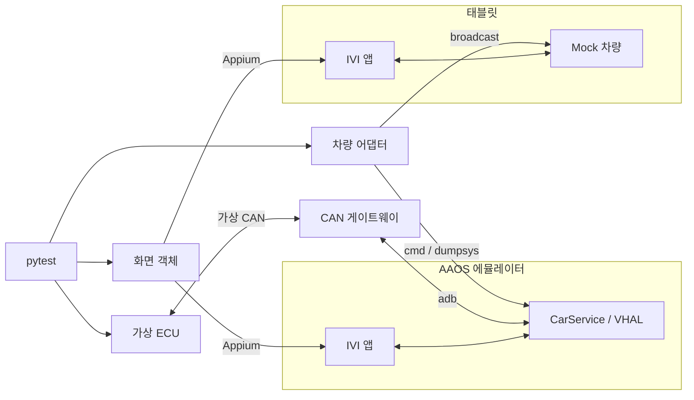

테스트 코드에는 확인할 내용만 적습니다. 화면에서 요소를 찾고 누르는 일은 화면 객체(`screens.py`)가, 신호를 넣고 읽는 일은 차량 어댑터(`vehicle.py`)가 합니다. 가상 ECU와 CAN 게이트웨이는 PC 안의 모의 환경입니다.

기기 종류는 `automotive` feature로 자동 판별합니다. 값을 넣고 되돌리는 방법, 주행 제한을 판정하는 방법, 화면을 누르는 방법은 기기마다 다른데, 이 차이는 어댑터와 `Device` 클래스 안에서 처리하고 테스트에는 드러나지 않게 했습니다. 앱 쪽도 같은 식으로 `VehicleDataSource` 인터페이스 아래에 CarPropertyManager 구현과 Mock 구현을 따로 두었습니다.

기기를 두 종류로 잡은 이유는 각각 볼 수 있는 것이 달라서입니다. 에뮬레이터로는 CarService와 에뮬레이터 VHAL을 거치는 경로를 검증할 수 있고, 태블릿에서는 터치 지연, 백그라운드 강제 종료, 설치 승인 같은 실기기 문제가 나옵니다. 실제로 원인을 찾는 데 가장 오래 걸린 두 건(3장의 1번, 2번)이 모두 태블릿에서 나왔습니다.

---

## 3. 결함과 원인 분석

1번부터 9번까지는 [GitHub 이슈](https://github.com/bugspeaker/opencabin-ivi/issues?q=is%3Aissue)로도 옮겨 두었습니다(라벨 `migrated`. 6번은 세 건으로 나눴습니다). 이슈의 생성일은 옮긴 날(2026-11-21)이고, 실제 발견일은 본문 첫 줄에 적었습니다. 10번부터 12번까지는 갤럭시 폴드에서 나온 것으로, 처음부터 이슈로 올렸습니다(라벨 `device:fold`). 열린 이슈는 알려진 결함([#21](https://github.com/bugspeaker/opencabin-ivi/issues/21))과 원인을 모르는 흔들림([#27](https://github.com/bugspeaker/opencabin-ivi/issues/27)) 두 건입니다.

| 번호 | 증상 | 원인 | 조치와 결과 | 이슈 |
|---|---|---|---|---|
| 1 | 태블릿에서 탭 한 번에 10초가 걸렸습니다. | 이 기기에서는 UiAutomator 터치 자체가 느렸습니다. | 누르는 동작만 adb로 바꿔 전체 시간이 7분 22초에서 1분 32초로 줄었습니다. | [#19](https://github.com/bugspeaker/opencabin-ivi/issues/19) |
| 2 | 실행할 때마다 21번째 테스트에서 앱이 사라졌습니다. | 화웨이 OS(iAware)가 반복 재시작을 크래시로 판단했습니다. | 프로세스는 그대로 두고 화면만 초기화하게 바꿨습니다. 3회 연속 실행에서 앱을 다시 띄운 적이 없었습니다. | [#20](https://github.com/bugspeaker/opencabin-ivi/issues/20) |
| 3 | AAOS 에뮬레이터 기본 SystemUI(1024×768)에서 운전석 온도 ▲가 눌리지 않았습니다. | 홈 버튼과 72×76 px 겹칩니다. | 플랫폼 쪽 문제라 `xfail(strict=True)`로 걸어 두었습니다. | [#21](https://github.com/bugspeaker/opencabin-ivi/issues/21) |
| 4 | 전체 실행에서만 실패했습니다. | 테스트 코드의 경쟁 조건이었습니다. | 조건 대기로 고쳤습니다. | [#22](https://github.com/bugspeaker/opencabin-ivi/issues/22) |
| 5 | 표시 단위를 섭씨로 바꾸자 실패했습니다. | 테스트가 화씨 표시를 가정했습니다. | 표시 단위 신호를 읽어 기대 값을 계산하게 고쳤습니다. | [#23](https://github.com/bugspeaker/opencabin-ivi/issues/23) |
| 6 | 회귀 테스트에서 앱 결함 3건이 나왔습니다. | 패널 겹침, 낮은 화면, 공백 한 칸이 원인이었습니다. | 앱을 고치고 회귀 테스트를 더했습니다. | [#24](https://github.com/bugspeaker/opencabin-ivi/issues/24), [#25](https://github.com/bugspeaker/opencabin-ivi/issues/25), [#26](https://github.com/bugspeaker/opencabin-ivi/issues/26) |
| 7 | 영상 차단 테스트가 한 번 흔들렸습니다. | 재현되지 않았습니다. | 반복 실행 5회 × 2기기(10번)에서 다시 나오지 않았습니다. 격리하지 않고 계속 기록합니다. | [#27](https://github.com/bugspeaker/opencabin-ivi/issues/27) |
| 8 | 차량 온도가 0.5°C 단위가 아니면 온도 버튼이 어긋난 값을 차량에 썼습니다. | 버튼이 '지금 값 ± 0.5'로 계산했습니다. | 0.5 단위에 맞춘 다음 값으로 계산하게 고쳤습니다. 경계값 E2E 6개가 두 기기에서 통과했습니다. | [#28](https://github.com/bugspeaker/opencabin-ivi/issues/28) |
| 9 | 막 켠 AAOS 에뮬레이터에서 실행하면 테스트 129개가 모두 준비 단계 오류로 끝났습니다. | UiAutomator2 계측 프로세스가 죽었는데, Appium 세션 하나에 모든 테스트가 묶여 있었습니다. 계측 프로세스가 죽는 원인은 확인하지 못했습니다. | 테스트를 시작할 때 세션을 확인하고, 끊겼으면 다시 붙이게 했습니다(`session_restart`로 기록). 일부러 끊은 시험 두 번에서 38개씩 모두 통과했습니다([확인 기록](evidence/2026-11-20-session-recovery/README.md)). | [#29](https://github.com/bugspeaker/opencabin-ivi/issues/29) |
| 10 | 갤럭시 폴드 가로에서 라디오 ⏭를 누르면 0.1 MHz만 올라갔습니다. | 버튼 줄에 약 300dp가 필요한데 폭이 약 235dp라 ⏭가 패널 밖으로 밀렸습니다. | 전원 버튼을 위 줄로 옮기고, 앱을 가로 전용(가장 작은 앱 영역 760×500dp)으로 정했습니다. 세 기기 전체 실행이 게이트를 통과했습니다. | [#42](https://github.com/bugspeaker/opencabin-ivi/issues/42) |
| 11 | 갤럭시 폴드 가로에서 운전석 열선 버튼이 가려졌습니다. | 좁은 화면에서 아래 바가 넘쳤습니다. | 좁은 배치에서는 아래 바의 버튼을 줄였습니다. | [#43](https://github.com/bugspeaker/opencabin-ivi/issues/43) |
| 12 | 갤럭시 폴드 가로에서 후보 카드 대신 아래 칩이 눌렸습니다. | 후보가 10px만 보였는데 테스트가 그대로 눌렀습니다. | 거의 가려진 요소는 스크롤해 보이게 하고, 그래도 가려져 있으면 누르지 않고 실패로 남기게 고쳤습니다. | [#44](https://github.com/bugspeaker/opencabin-ivi/issues/44) |
| 13 | D 기어로 멈춰 있을 때(신호 대기) AAOS 앱은 내비 검색과 키패드까지 막고, 태블릿은 영상을 막지 않았습니다. | 앱이 플랫폼의 제한 종류를 보지 않고 '제한 있음' 하나로 판단했고, Mock은 속도가 0보다 클 때만 제한했습니다. 요구사항도 정차(P)와 정지(D, 0 km/h)를 나누지 않았습니다. | 앱이 제한 종류(영상, 글자 입력, 키패드, 목록 길이)를 보고 막게 하고, Mock도 플랫폼과 같은 표를 쓰게 했습니다(앱 0.4.2). 시간에 따라 속도를 바꾸는 신호 대기 시나리오를 포함한 E2E 4개를 더했습니다. | [#47](https://github.com/bugspeaker/opencabin-ivi/issues/47) |

1번. 탭 한 번에 10초가 걸렸습니다

| 누르는 방법 | 화웨이 | AAOS 에뮬레이터 |
|---|---|---|
| `element.click()` | 10,377 ms | 577 ms |
| `mobile: clickGesture` | 10,099 ms | 501 ms |
| W3C actions | 10,430 ms | - |
| `adb shell input tap` | 117 ms | - |

테스트별 시간을 보니 클릭이 많은 테스트일수록 느렸습니다. 먼저 adb 왕복 시간을 쟀는데 65 ms라 원인이 아니었습니다. Appium 대기 설정(`waitForIdleTimeout`, `actionAcknowledgmentTimeout`)을 0으로 해도 그대로였고, 클릭 방식을 세 가지로 바꿔 봐도 모두 10초였습니다.

결국 이 기기에서는 UiAutomator가 넣는 터치 자체가 느리다고 보고, 요소는 Appium으로 찾되 누르는 것만 `adb shell input tap`으로 바꿨습니다. 화면 객체와 테스트 코드는 손대지 않았고, 환경 변수 `IVI_TAP`으로 방식을 바꿀 수 있습니다.

2번. 21번째 테스트에서 앱이 사라졌습니다

실패 자료로 저장된 logcat에 `Force stopping dev.opencabin.ivi … iAwareF[CrashClean]`이 찍혀 있었습니다. 테스트마다 `am start -S`로 프로세스를 죽였다 살렸는데, 화웨이 OS가 이것을 반복 크래시로 보고 앱을 강제 종료한 것입니다.

3단계에서는 앱이 안 뜨면 한 번 더 띄우고 그 사실을 `app_relaunch`로 기록하는 데까지만 했습니다. 4단계에서 프로세스 종료를 세션 시작 때 한 번만 하고, 테스트마다는 `--activity-clear-task`로 화면만 초기화하도록 바꿔서 원인을 없앴습니다.

3번부터 7번까지

**3번. SystemUI 버튼 겹침.** AAOS 에뮬레이터 기본 SystemUI(1024×768, `automotive_1024p_landscape`)에서 운전석 온도 ▲ `[192,682][268,758]`와 홈 버튼 `[188,682][264,758]`이 겹치고, 홈이 위에 있어서 탭을 가져갑니다. 다른 해상도나 다른 AAOS 이미지에서도 나오는지는 확인하지 않았습니다. `strict=True`로 걸어 두었기 때문에 결함이 고쳐지면 XPASS가 실패로 바뀌어 알 수 있습니다. `raises=DefectReproduced`도 주어, 겹침을 확인한 자리에서 낸 예외일 때만 xfailed가 됩니다. 처음에는 `raises`가 없어서 버튼을 못 찾은 오류나 Appium 세션 끊김까지 '알려진 결함'으로 통과했습니다(2026-11-20 검토에서 고쳤습니다).

**4번. 테스트 코드의 경쟁 조건.** `test_range_recovers_after_charging`이 전체 실행에서만 실패하고 혼자 돌리면 통과했습니다. 주행 가능 거리와 배터리는 서로 다른 신호라 따로 도착하는데, 거리만 기다린 뒤 배터리 값을 바로 assert한 것이 원인이었습니다. 배터리도 `wait_until`로 기다리게 고쳤고, 같은 모양이던 외기 온도 확인도 함께 고쳤습니다. 테스트의 대기에는 고정 sleep을 쓰지 않습니다.

**5번. 표시 단위 가정.** 1단계에 쓴 테스트가 SystemUI 온도를 화씨로 가정하고 있었습니다. `HVAC_TEMPERATURE_DISPLAY_UNITS`를 읽어 기대 글자를 계산하도록 바꿨고, 섭씨와 화씨 양쪽에서 통과하는 것을 확인했습니다.

**6번. 회귀 테스트로 찾은 앱 결함.**
- 음성 패널이 명령을 처리한 뒤에도 남아 안내 화면을 가렸습니다.
- 낮은 화면(1024×768)에서 후보 카드가 대답을 화면 밖으로 밀어내 요소를 찾지 못했습니다. UiAutomator는 화면 밖 요소를 찾지 못합니다.
- 목적지 글자 앞에 간격용으로 넣은 공백 한 칸 때문에 글자가 정확히 일치하지 않았습니다. 간격은 padding으로 바꿨습니다.

**7번. 한 번 흔들린 영상 차단 테스트.** `test_video_blocked_screen_follows_parking`이 7단계 반복 실행 중 한 번 흔들렸습니다. 정차한 뒤 차단 해제가 10초 안에 확인되지 않았습니다. 8단계 실행 2회에서는 재현되지 않았고, 2026-11-18 저녁에 두 기기에서 전체를 5회 반복(이 테스트 10번)했을 때도 10번 모두 한 번에 통과했습니다([반복 실행 통계](flaky-report.md)). 원인은 확인하지 못했습니다. 다시 흔들리면 재시도 기록과 첫 실패 자료로 원인을 볼 수 있게 두었습니다.

8번. 0.5°C 단위가 아닌 차량 값에서 온도 버튼이 어긋났습니다

경계값을 보강하면서, 차량 쪽(VHAL)에서 범위 밖 값(15.5°C, 28.5°C)이나 0.5°C 단위가 아닌 값(22.3°C)이 들어오는 경우를 테스트로 만들었습니다. 먼저 에뮬레이터에서 확인한 것은 이렇습니다.

| 경로 | 15.5°C | 22.3°C |
|---|---|---|
| `cmd car_service set-property-value` (앱과 같은 경로) | 거절 (`IllegalArgumentException`) | 받음 |
| `dumpsys VHAL --set` (차량 쪽 값) | 받음 | 받음 |

16.0~28.0°C 범위는 플랫폼이 정한 값이 아닙니다. 이 프로젝트가 에뮬레이터 VHAL 설정 덮어쓰기([`opencabin.json`](../ivi-app/privileged/vhaloverride/opencabin.json))에 좌석 area마다 `minFloatValue` 16.0, `maxFloatValue` 28.0으로 정했습니다. 같은 파일의 `HVAC_TEMPERATURE_SET` `configArray`에는 0.5°C 증분(`[160, 280, 5, …]`, 섭씨 × 10)도 적었지만, 위 표처럼 `set-property-value`가 거절한 것은 범위 밖 값뿐이고 단위가 어긋난 22.3°C는 받았습니다.

새 테스트를 고치기 전 앱으로 두 기기에서 돌렸더니, 22.3°C에서 +를 누르면 22.8°C, -를 누르면 21.8°C가 차량에 그대로 써졌습니다. 버튼이 '지금 값 ± 0.5'로 계산했기 때문입니다. CarService는 범위만 보고 단위는 보지 않아 이 값을 받았습니다.

앱의 버튼 계산을 '0.5 단위에 맞춘 바로 위(아래) 값'으로 바꿨습니다(`HvacSpec.stepUp`, `stepDown`, 앱 단위 테스트 3개). 22.3°C에서 +는 22.5°C, -는 22.0°C입니다. 같은 E2E가 두 기기에서 통과합니다.

실패했을 때 저장된 자료 한 묶음을 그대로 남겼습니다: [화면, UI 계층, 차량 상태, 맨 위 액티비티, logcat](samples/off-grid-temperature-aaos/). `vehicle.txt`의 `temp_driver=22.8`이 결함이 차량 값까지 갔다는 근거입니다.

### 세 번째 기기에서 찾은 배치 결함 (갤럭시 폴드)

2026-11-23에 갤럭시 폴드(1세대, Android 12)를 USB로 붙여 같은 테스트 129개를 돌렸습니다. 기기 설정 코드는 바꾸지 않았고, 태블릿과 같은 Mock 기기로 판별됐습니다. 위 표의 10번부터 12번까지([#42](https://github.com/bugspeaker/opencabin-ivi/issues/42), [#43](https://github.com/bugspeaker/opencabin-ivi/issues/43), [#44](https://github.com/bugspeaker/opencabin-ivi/issues/44))이고, 원자료는 [폴드 기록](evidence/2026-11-23-fold/README.md)에 있습니다.

| 시점 | 결과 |
|---|---|
| 수정 전 `c112673`, 앱 0.4.0 | 폴드: 115 통과, 5 실패, 9 건너뜀, flaky 0 sanity 25개는 모두 통과했습니다. |
| 수정 후 `7aaab6f`, 앱 0.4.1 | 폴드: 눕혀서, 세워서 각 122 통과, 7 건너뜀(AAOS 전용) 같은 APK로 태블릿 122 통과, 에뮬레이터 127 통과(알려진 결함 1)였고, 네 실행 모두 Release 게이트를 통과했습니다. |

| 실패한 테스트 | 원인 | 조치 |
|---|---|---|
| 라디오 3개 | 버튼 다섯 개에 약 300dp가 필요한데 줄 폭은 약 235dp였습니다. ⏭가 패널 밖으로 밀려 그 자리에 그려진 +가 눌렸습니다. | 전원 버튼을 위 줄로 옮겨 아래 줄에는 네 개만 두었습니다. |
| 열선 신호 1개 | 아래 바가 넘쳐 운전석 열선 버튼이 공조 타일 밑으로 들어갔습니다. | 좁은 화면에서는 아래 바의 버튼 수를 줄였습니다. |
| 목적지 후보 1개 | 화면이 낮아 세 번째 후보가 10px만 보였고, 그 가운데를 누르자 바로 아래 칩이 눌렸습니다. | 낮은 화면에서는 후보를 가로 카드 세 장으로 놓았습니다. 테스트도 거의 가려진 요소는 스크롤해 보이게 하고, 그래도 가려져 있으면 누르지 않고 실패로 남기게 고쳤습니다(`Screen.tap`). |

앱은 가로 전용으로 정하고, 지원하는 가장 작은 앱 영역을 760×500dp로 정했습니다. 좁은 배치는 앱 영역 폭이 1000dp 미만이거나 높이가 600dp 미만일 때만 쓰므로, 폭 1024dp인 에뮬레이터와 태블릿은 원래 배치 그대로입니다.

| 수정 전: ⏭ 없음 | 수정 후: 네 버튼 모두 |
|---|---|
| 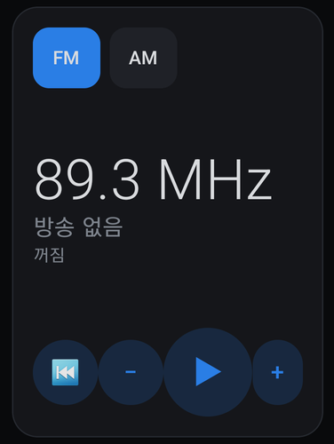 | 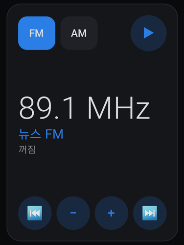 |

### 플랫폼 설정을 읽다 찾은 정지 상태 결함

2026-11-23에 AAOS 테스트 자료를 찾아보고 에뮬레이터의 UX 제한 설정을 읽었습니다. 플랫폼은 P가 아닌 채 멈춰 있으면(idling) 영상만 막는데(`0x10`), 앱은 두 기기에서 서로 다르게, 둘 다 플랫폼과 다르게 동작했습니다. 위 표의 13번([#47](https://github.com/bugspeaker/opencabin-ivi/issues/47))이고, 원자료는 [정지 상태 기록](evidence/2026-11-23-idling/README.md)에 있습니다.

| 상태 | 플랫폼 UX 제한 | 수정 전 AAOS 앱 | 수정 전 태블릿 | 수정 후 (두 기기) |
|---|---|---|---|---|
| P | 없음 (`0x0`) | 제한 없음 | 제한 없음 | 제한 없음 |
| D·N, 0 km/h | 영상만 (`0x10`) | 전부 막음 | 아무것도 막지 않음 | 영상만 막음 |
| D, 0 km/h 초과 | 전부 (`0xff`) | 전부 막음 | 전부 막음 | 전부 막음 |

앱은 기어와 속도가 아니라 플랫폼이 알려 준 제한 종류를 보고 막게 고쳤습니다. AOSP 문서도 시장마다 제한이 다를 수 있으니 주행 상태가 아니라 제한 정보를 보라고 권합니다. 테스트는 0 km/h 한 점만 보지 않도록, P → D 정지 → 3 km/h → 정지 → 60 km/h → N 정지 → P를 단계마다 2~3초씩 유지하며 제한과 화면이 바로 바뀌고 흔들리지 않는지 봅니다.

---

## 4. 검증 전략

### 4-1. 게이트 단계와 기준

| 단계 | 고르는 기준 | 기기당 시간 (실측 합) | 언제 | 통과 조건 |
|---|---|---|---|---|
| **unit** 195개 | 테스트 도구 자체가 맞는지 봅니다(기기 없이). | 약 20초 | 모든 PR, push | 실패 0 |
| **smoke** 13개 | 이 빌드를 올려도 되는지 봅니다. 앱 실행, 데이터 소스, 탭 이동, 공조의 화면↔차량 왕복(화면 + 한 번이 차량 22.5°C로, 차량 쪽 25.0°C가 화면으로)입니다. | 약 45초 | PR | failed, error 0 |
| **sanity** 25개 | 서비스마다 '화면→신호', '신호→화면' 대표 경로를 하나씩 보고, 주행 중 제한도 대표 경로를 봅니다. | 약 1분 45초 | main push (smoke와 함께) | failed, error 0. 재시도로 통과한 것은 flaky로 기록합니다. |
| **regression** 100개 | 경계값, 조합, 예전 결함의 재발, 대표가 아닌 경로를 봅니다. | 약 8분 40초~9분 30초 | Nightly | 위와 같습니다. |
| **spike** 6개 | AAOS 기본 SystemUI (1단계 기술 검증) | 약 15초 (AAOS만) | Nightly | 알려진 결함은 strict xfail로 둡니다. |
| **Release** 144개 | 전체를 반복해서 돌립니다. | 약 11분~12분 × 반복 | 릴리스 후보 | 아래 여섯 가지 조건 |

시간은 테스트마다 잰 시간의 합입니다. regression과 Release는 2026-11-24 144개 실행(두 기기 × 3회), smoke와 sanity는 개수가 그대로라 2026-11-18 값입니다.

Release 후보는 `workflow_dispatch`로 markers를 비우고 repeat 3으로 돌립니다. 반복이 끝나면 [`tools/release_gate.py`](../ivi-tests/tools/release_gate.py)가 이번 실행의 결과 파일(`reports/runs/*.json`)을 읽어 아래 여섯 조건을 확인하고, 하나라도 어기면 이유를 출력하고 실패합니다([ivi-ci.yml](../.github/workflows/ivi-ci.yml)의 'Release 게이트' 단계). 조건마다 통과 사례와 막는 사례를 단위 테스트로 확인했습니다([`unit/test_release_gate.py`](../ivi-tests/unit/test_release_gate.py)).

| 조건 | 검사하는 곳 |
|---|---|
| 1. 실행 완전성. 회차마다 필수 기기(AAOS, 태블릿)의 결과가 모두 있고, 각 결과에 지금 코드에서 수집한 테스트 144개가 빠짐없이 판정과 함께 있으며, pytest 종료 코드가 0이어야 합니다. 건너뜀은 기기 전용 마커(`aaos`, `tablet`)로 정한 것만 받습니다. 같은 회차·기기의 결과가 둘이거나 같은 테스트가 두 번 있으면 막습니다. 결과에 적힌 APK가 회차·기기마다 같아야 합니다. CI에서는 모든 결과가 이번 커밋에서, 커밋하지 않은 변경 없이 돈 것이어야 합니다. | `release_gate.py`가 [`tools/collect_tests.py`](../ivi-tests/tools/collect_tests.py)로 테스트 목록을 기기 없이 다시 모아 결과와 맞춥니다. 결과 파일의 목록만 보면 `-m smoke`로 일부만 돌렸거나 중간에 멈춘 실행을 알 수 없기 때문입니다. |
| 2. 모든 회차, 두 기기 모두 failed, error, xpassed가 0이어야 합니다. | `release_gate.py` |
| 3. 이번 Release 반복 안에서 flaky가 0이어야 합니다. 직전 실행과 비교하지 않고, 반복 중 재시도로 통과한 테스트가 하나라도 있으면 막습니다. | `release_gate.py` |
| 4. 격리 목록의 모든 줄에 사유, 등록일, 해제 조건이 있고, 2개 이하여야 합니다. 격리된 테스트도 결과는 따로 남깁니다. 목록 파일이 없으면 빈 목록으로 보지 않고 막습니다. | 칸이 빠진 줄은 목록을 읽을 때 실패합니다([`ivi/quarantine.py`](../ivi-tests/ivi/quarantine.py)). 개수는 `release_gate.py`가 봅니다. |
| 5. 요구사항 추적 누락이 0이어야 합니다. | PR마다 unit job([`unit/test_operations.py`](../ivi-tests/unit/test_operations.py))이 보고, Release에서 `release_gate.py`가 한 번 더 봅니다. |
| 6. xfailed가 된 테스트가 알려진 결함 목록([`known_defects.txt`](../ivi-tests/known_defects.txt))과 같아야 합니다. 회차·기기마다 따로 봅니다(한 회차에서 xfailed였다고 다른 회차를 넘기지 않습니다). 목록에 없는 xfail, 목록에 있는데 xfailed가 아니거나 돌지 않은 테스트, 목록 파일이 없는 경우를 막습니다. | `release_gate.py`가 봅니다. 목록과 코드의 `xfail(strict=True)`가 같은지, 모든 xfail에 `raises`가 있는지는 unit job이 확인합니다. |

조건 1은 2026-11-20 검토에서 더했습니다. 그전 게이트는 기기 목록을 결과 파일에서 유추해서, 태블릿이 처음부터 연결되지 않았거나 일부 테스트만 돌린 결과도 failed가 0이면 통과시킬 수 있었습니다. '실패한 테스트가 없다'와 '정한 검증을 끝까지 했다'는 다른 말이라 따로 봅니다. 실행기(`run_bench.py`)도 결과 파일의 판정만 믿지 않고 pytest 종료 코드를 함께 보고, 결과 파일의 실행 ID와 기기가 이번 실행의 것인지 확인합니다. `--repeat`는 1 이상만 받습니다(0이면 아무것도 돌리지 않고 통과처럼 끝났습니다).

2026-11-18 저녁의 5회 반복, 2026-11-19 재실행, 2026-11-20 전체 실행 결과에 지금 게이트를 돌리면 여섯 조건 모두 통과합니다([원자료와 다시 세는 명령](evidence/2026-11-18-repeat5/README.md)). 세 원자료는 결과 파일에 종료 코드, 커밋, APK를 남기기 전 형식이라, 조건 1은 테스트 목록 대조로 끝까지 돌았는지만 보고 그 사실을 '참고'로 출력합니다. e2e job은 아직 GitHub에서 돌리지 않았기 때문에, CI에서 이 단계가 실제로 Release 후보를 막은 기록은 없습니다.

smoke는 개수보다 실패했을 때 내릴 결정으로 정했습니다. smoke가 하나라도 실패하면 그 빌드는 머지하지 않고, sanity와 regression으로 넘기지 않습니다. 앱이 뜨지 않거나 화면↔차량 왕복이 끊긴 빌드에서 회귀를 돌려 봐야 같은 원인의 실패만 쌓이기 때문입니다. PR에서는 smoke만 돌아 이 결정이 그대로 적용됩니다. main push는 지금 smoke와 sanity를 한 번에 돌려서, smoke가 실패해도 sanity까지 돈 뒤 함께 실패로 끝납니다. 단계별로 끊어 돌리는 방식은 아직 넣지 않았습니다.

sanity는 처음에 55개(전체의 45%)까지 늘어 regression과 크기가 비슷해졌습니다. 위 기준으로 다시 보고, 같은 경로를 다른 화면에서 다시 확인하는 것, 조합, 경계값은 regression으로 내렸습니다. 서비스마다 남긴 대표 경로는 4-2 표에 있습니다.

### 4-2. 서비스별 검증

| 서비스 | 주요 위험 | 확인 방향 | 테스트 수 smoke / sanity / regression | 이 프로젝트에서 보지 못하는 것 |
|---|---|---|---|---|
| **HVAC** HVAC-01~06 | 다른 좌석 area에 값을 쓰거나, 범위 밖이나 단위가 어긋난 값을 쓰거나, 화면과 신호가 다를 수 있습니다. | **화면→신호** 버튼, 아래 바, 음성이 `HVAC_TEMPERATURE_SET`과 A/C 전 좌석 area를 바꾸는지 봅니다. **신호→화면** VHAL 값이 공조 화면, 홈, 아래 바에 같은 값으로 보이는지 봅니다. | 1 / 11 / 33 | 실제 공조 ECU의 응답 지연과 거절, 실차의 area 구성 |
| **차량 설정** BODY-01 SET-01 | 일부 문만 잠기거나, 설정이 재시작 뒤 사라질 수 있습니다. | **화면→신호** 도어 버튼이 모든 문 area의 `DOOR_LOCK`을 바꾸는지 봅니다. **신호→화면** 차량 쪽 문 열림이 화면에 보이는지, 속도 단위 설정이 차량 정보 표시에 반영되는지 봅니다. | 0 / 3 / 7 | 실제 BCM. 사이드 미러, 트렁크 같은 항목은 신호에 연결하지 않은 화면 상태입니다. |
| **주행 정보 패널** DRIVE-01 ENERGY-01, 02 | 속도와 기어를 잘못 보여 주거나, 거리 부족 경고가 빠질 수 있습니다. | **신호→화면** 속도, 기어, 주행 가능 거리, 배터리, 외기 온도를 봅니다. 거리 30, 29 km에서 경고와 충전소 안내가 뜨는지 봅니다. | 1 / 6 / 12 | AAOS 클러스터 디스플레이(보조 화면)와의 연동, 실제 계기판 |
| **미디어** MEDIA-01, 02 DRIVE-02 | 주행 중에 영상이 재생되거나(운전자 주의 분산), 소리가 겹칠 수 있습니다. | **신호→화면** 주행 중에는 영상을 막고, 정차하면 이어 보는지 봅니다. **앱 안** 음악, 라디오, 통화가 한 번에 하나만 소리를 내는지 봅니다. | 0 / 4 / 22 | 실제 스피커 출력, 블루투스 기기, 차량 오디오 시스템 |

서비스 이름 아래는 [요구사항](requirements.md) 번호이고, 주행 정보 패널은 앱 왼쪽의 계기판 역할 화면입니다. 테스트 수는 요구사항 표시(`@pytest.mark.req`)로 센 parametrize 케이스 수입니다. 한 테스트가 두 서비스에 걸치면 양쪽에 셉니다. 내비게이션, 후방 카메라, 음성, CAN, Test Bench는 [추적표](traceability.md)에 있습니다.

**검증 단계.** 앞 단계일수록 빠르고 기기가 필요 없으며, 뒤 단계일수록 실제 차량에 가깝습니다. 이 프로젝트는 3단계까지 했습니다.

| 단계 | 무엇으로 | 보는 것 | 이 프로젝트 |
|---|---|---|---|
| 1. 앱 단위 테스트 | JVM 테스트 (`HvacSpecTest`, `CabinAssistantTest`, `ScreenSizeTest`, `UxRulesTest`) | 공조 값의 범위와 단계 규칙, 말 → 동작 규칙, 화면 크기별 배치 등급, 주행 중 제한 표 | 33개 PR마다 GitHub에서 |
| 2. 프레임워크 단위 테스트 | 기기 없이 pytest (`ivi-tests/unit`) | 어댑터 명령 조립, 대기와 판정, 크래시 판정, Release 게이트 규칙, 요구사항 추적, 문서 링크 | 223개 PR마다 GitHub에서 |
| 3. 에뮬레이터·태블릿 E2E | AAOS 에뮬레이터(CarService, 가상 VHAL)와 태블릿(앱 안 Mock 차량) | 화면 ↔ 차량 신호, 위 표의 서비스별 위험 | 144개 × 2기기 Test Bench(작업 PC)에서 |
| 4. HIL, 실차 | 실제 ECU와 헤드 유닛, 차량 | 위 표 '이 프로젝트에서 보지 못하는 것' 열: ECU의 응답 지연과 거절, 실차 area 구성, 클러스터 디스플레이 연동, 스피커 출력 | 하지 않았습니다(경험 없음). |

3단계는 실제 하드웨어 없이 소프트웨어만으로 도는 단계라 SIL에 가깝습니다. 4단계로 넘길 항목은 위 표의 마지막 열에 적었습니다.

### 4-3. 판정 기준

| 판정 | 뜻 | PR · main · Nightly | Release |
|---|---|---|---|
| passed | 한 번에 통과한 테스트 | 통과 | 통과 |
| flaky | 실패했다가 재시도에서 통과한 테스트 | 통과. 통계에는 남깁니다. | 이번 반복 안에서 하나라도 있으면 막습니다. |
| failed / error | 재시도까지 실패했거나 준비, 정리 단계에서 실패한 테스트 | 실패 | 실패 |
| xfailed | 알려진 결함의 증상(`DefectReproduced`)으로 실패한 테스트 | 통과 | `known_defects.txt`에 있는 것만 통과합니다. |
| quarantined | 사유를 적고 격리 목록에 올린 테스트 | 통과 | 사유, 등록일, 해제 조건이 있고 2개 이하일 때만 통과합니다. |
| skipped | 기기 전용 테스트를 다른 기기에서 돌린 경우(`aaos`, `tablet` 마커) | 통과 | 기기 전용 마커로 건너뛴 것만 통과합니다. 그 밖의 건너뜀(예: 기기에 주행 영상이 없는 경우)은 막습니다. |
| 판정 없음, 중단 | 테스트가 판정 없이 끝났거나, 실행이 끝까지 가지 않은 경우(종료 코드가 0이 아님) | 실패 | 막습니다. |

재시도해서 통과한 테스트를 passed로 치면 흔들리는 테스트가 통계에서 사라집니다. 그래서 flaky로 따로 기록합니다. 앱을 다시 띄운 횟수와 신호 주입을 다시 시도한 횟수도 JUnit 결과와 누적 기록(`results.jsonl`)에 같이 남깁니다.

### 4-4. 테스트 범위 점검

추적표의 '연결 누락 0'은 범위가 충분하다는 뜻이 아니라서, 2026-11-23에 테스트 129개를 다른 기준으로 다시 대 보았습니다.

| 기준 | 찾은 빈 곳 | 더한 것 |
|---|---|---|
| 요구사항 조건 | 테스트가 없는 조건 2개(SYS-01.4 권한 없는 신호, HVAC-04.5 온도를 바꾸면 최대 냉방 해제) | AAOS에서 CAR_ENERGY 권한을 빼고 '값 없음'과 앱 유지를 보는 테스트, FULL 중 온도·AUTO를 바꾸는 테스트 |
| 주행 중 제한의 반대쪽 | 막는 쪽만 보고, 주행 중에도 허용해야 하는 것은 보지 않았습니다. | 접힌 미러 펴기, 충전소·주차 분류로 목적지 고르기. DRIVE-03 조건 5개를 조건 표에 더했습니다. |
| 앱의 testTag | 186개 중 약 30개를 테스트가 쓰지 않았습니다. | 미리 보기 취소, 도착 확인, 알림 모두 지우기, 키패드 `*`·`#`·⌫ |
| 경계값 | 키패드 길이, 라디오 대역 끝 | 13자리 제한, 끝에서 반대쪽으로 순환, FM/AM 주파수 따로 기억 |
| 기기·화면 | 지원하는 가장 작은 화면 760×500dp에서 돌린 적이 없었습니다. | 에뮬레이터를 760×500dp로 줄여 전체를 돌렸습니다. 앱 대상 테스트는 모두 통과했습니다. |
| 단위 테스트 커버리지 | 추적표 도구가 46%였고, 폴드 칸이 생긴 뒤로 멈춰 있었습니다. | 도구를 고치고, 추적표가 코드와 다르면 unit job이 실패하게 했습니다. |

조건 표는 27개에서 33개가 됐고 테스트가 없는 조건은 0개입니다. E2E는 129개에서 140개(regression 85 → 96)가 됐습니다. 같은 날 저녁 AAOS 자료를 더 찾아보다 정지 상태 결함([#47](https://github.com/bugspeaker/opencabin-ivi/issues/47))을 찾아, 조건 3개와 E2E 4개를 더 넣어 지금은 조건 36개, E2E 144개입니다. 앱의 `CabinController` 규칙을 JVM 단위 테스트로 옮기는 것은 앱 코드를 고쳐야 해서 남겼습니다. 점검 표와 기기별 결과는 [원자료](evidence/2026-11-23-coverage/README.md)에 있습니다.

---

## 5. E2E 테스트 설계

### 5-1. 양방향 검증과 area 단위 판정

A/C는 전 좌석에 적용되는 기능인데, 구현이 운전석 area에만 값을 써도 화면은 정상으로 보입니다. 화면만 보는 테스트로는 이 결함을 잡을 수 없어서, area별 값을 전부 읽어 확인합니다. 김서림 제거는 반대로 누른 유리의 신호만 켜지는지 봅니다.

차량 쪽에서 값이 바뀌었을 때 화면이 따라오는지 보는 반대 방향 테스트는 기능마다 따로 있습니다. 결과 페이지에는 AAOS에서 테스트 중 마지막으로 읽은 차량 값(예: `HVAC_TEMPERATURE_SET[0x1]=22.5`, 최대 3개)을 화면과 함께 보여 줍니다.

### 5-2. 설계 기법

| 기법 | 적용한 곳 |
|---|---|
| 경계값 | 온도 16.5→16.0°C와 27.5→28.0°C로 끝에 닿는 경로, 끝에서 꺼진 버튼, 범위 밖 차량 값(15.5, 28.5°C), 0.5°C 단위가 아닌 차량 값(22.3°C). 풍량 1과 7, 주행 가능 거리 31, 30, 29 km |
| 상태 전이 | 좌석 열선이 꺼짐, 2단, 1단, 꺼짐으로 도는 순서. 정차와 주행 사이의 전환 |
| 조합 | 좌석 두 곳과 올림, 내림 버튼. 앞 유리와 뒤 유리. km/mph 설정과 신호 |
| 규칙 충돌 | AUTO 중에 풍량을 직접 바꾸면 AUTO가 꺼지는지 봅니다. |
| 일관성 | 같은 열선 신호가 화면 세 곳에 같은 값으로 보이는지 봅니다. |
| 바뀌지 않음 | 운전석을 바꾼 뒤 조수석 신호와 화면이 1.5초 동안 그대로인지 봅니다(`stays`). 한 번만 보면 늦게 도착하는 잘못된 쓰기를 놓칩니다. |
| 주행 안전 | 주행 중 영상 차단, 검색과 키패드 잠금 |

### 5-3. 테스트 격리

차량 신호는 앱을 다시 띄워도 남습니다. 앞 테스트가 문을 열어 둔 채 끝나면 다음 테스트의 "누르면 열림" 확인이 거꾸로 됩니다. 그래서 테스트마다 차량 신호 12종을 기준 값으로 되돌립니다.

AAOS에서는 신호에 area를 곱하면 `--set`이 31번입니다. 하나씩 보내면 테스트마다 adb 왕복이 31번이라, adb shell 한 번에 묶어 보내고 성공 응답 31개를 세어 다 들어갔는지 확인합니다. 8단계 기준(당시 신호 11개, 26번)으로 테스트가 84개에서 108개로 늘었는데 테스트당 시간은 4.1초에서 3.7초로 줄었습니다.

태블릿의 Mock 차량은 값을 받으면 받은 이름 목록(`applied=...`)을 돌려줍니다. 앱이 꺼져 있어 브로드캐스트가 전달되지 않으면(화웨이) 그 자리에서 실패하므로, 주입이 빠진 채 뒤의 대기에서 엉뚱하게 실패하지 않습니다.

### 5-4. 신호 주입 명령

1단계에서 세 가지 명령을 비교했고, 두 가지만 씁니다.

| 명령 | 경로 | 쓰는 곳 |
|---|---|---|
| `cmd car_service set-property-value` | CarService를 거쳐 VHAL로 (앱과 같은 경로) | 운전석, 조수석 설정 온도. 앱이 쓰는 값을 같은 권한 경로로 바꿀 때 |
| `dumpsys <VHAL> --set` (root) | VHAL에 바로 | 차량(ECU) 쪽에서 값이 바뀐 상황을 만들 때. 속도, 기어 같은 읽기 전용 값과, A/C, 풍량, 도어처럼 쓰기 가능한 값의 '차량 쪽 변화' 모두 |
| `cmd car_service inject-vhal-event` | 이벤트만 보냅니다. | 쓰지 않습니다. 저장된 값이 바뀌지 않아 `get`으로 판정할 수 없습니다. |

둘을 나눈 기준은 '그 값을 누가 바꾸는가'입니다. 앱이 바꾸는 값을 테스트가 준비할 때는 앱과 같은 CarService 경로를 써야 권한과 범위 검사까지 같은 조건이 됩니다. 차량이 바꾸는 값은 CarService가 범위 밖 값을 거절하기 때문에(3장 8번) VHAL에 바로 넣어야 이상한 값이 올라오는 상황까지 만들 수 있습니다. 읽기는 모두 `cmd car_service get-property-value`로 합니다.

---

## 6. 테스트하기 쉽게 앱을 바꾼 점

| 문제 | 바꾼 것 |
|---|---|
| 토글이 켜졌는지를 색으로만 보여 줘서 자동화가 읽지 못했습니다. | 켜짐 상태를 접근성 `checked` 값으로 내보냈습니다. TalkBack 사용자도 같은 정보를 듣습니다. |
| 저장된 설정이 다음 테스트까지 남았습니다. | debug 빌드에만 있는 테스트 훅으로 설정을 초기화합니다. |
| 차마다 area 구성이 다릅니다. | area를 코드에 박아 두지 않고 `CarPropertyConfig`에서 읽습니다. |
| 권한이 없으면 신호를 읽을 수 없습니다. | 앱이 죽지 않고 '값 없음'으로 보여 줘서, 권한이 빠진 것을 화면에서 바로 알 수 있습니다. |
| Mock 주입이 들어갔는지 테스트가 알 수 없었습니다. | Mock 수신기가 받은 값의 이름을 돌려줍니다(debug 빌드). |

---

## 7. 기술 스택

| 분류 | 사용한 것 |
|---|---|
| 테스트 | Python, pytest, Appium (UiAutomator2) |
| 기기 제어 | ADB, shell, logcat, `dumpsys`, `cmd car_service` |
| 대상 앱 | Kotlin, Jetpack Compose, CarPropertyManager, Media3 |
| 차량 네트워크 (모의) | python-can (virtual 버스), cantools (DBC) |
| Test Bench | 표준 라이브러리 `http.server`로 만든 REST API, 원격 전원 제어 인터페이스 |
| 실행 환경 | AAOS 에뮬레이터 API 34, 화웨이 태블릿 (Android 12) |
| CI | GitHub Actions |

---

## 8. 운영과 CI

### 8-1. flaky 관리

| 장치 | 하는 일 |
|---|---|
| 실패 자료 | 테스트가 실패하면 정리 단계 전에 화면, UI 계층, 차량 상태, 맨 위 액티비티, logcat을 실행과 기기별 폴더(`reports/artifacts/<실행>-<기기>/`)에 저장합니다. 준비 단계 실패는 `__setup`, 정리 단계 실패는 `__teardown` 폴더로 나눕니다. 차량 정리는 준비보다 먼저 등록해 두어, 준비가 중간에 실패해도 다음 테스트가 앞 테스트의 차량 상태로 시작하지 않습니다. logcat은 버퍼를 지우지 않고 테스트 시작 시각부터 모읍니다(`logcat -T`). 같은 기기를 쓰는 다른 도구의 로그를 지우지 않기 위해서입니다. [실제 실패 자료 한 묶음](samples/off-grid-temperature-aaos/) |
| flaky 통계 | 테스트마다 불안정률과 p95 시간을 내고, 격리 후보와 해제 후보, 느린 테스트 다섯 개를 뽑습니다. [반복 실행 통계](flaky-report.md) |
| 격리 목록 | 사유, 등록일, 해제 조건 가운데 하나라도 빠진 줄은 받지 않습니다. 격리한 테스트도 계속 돌려서 데이터를 모읍니다. |
| 앱 크래시 | 앱이 죽었다가 다음 테스트의 `am start`로 다시 뜨면 화면만 봐서는 알 수 없습니다. 테스트마다 시작 시각 이후의 crash·system 버퍼에서 이 앱의 `FATAL EXCEPTION`, `Fatal signal`, `ANR in`을 찾아, 있으면 화면 판정이 통과해도 그 테스트를 실패로 하고 실패 자료에 `app_crash.txt`를 남깁니다(`ivi/crashes.py`). 다른 앱(Appium 서버)의 크래시는 보지 않고, 알려진 결함 xfail로 받지 않습니다. 두 기기에서 테스트 도중 `am crash`로 앱을 일부러 죽여 실패로 잡히는 것을 확인했습니다([확인 기록](evidence/2026-11-21-main/README.md#앱-크래시-판정-확인)). 시작 시각이 초 단위라 앞 테스트의 마지막 1초 안에 난 크래시는 다음 테스트에 잡힐 수 있습니다. |
| Appium 세션 | 실행 전체에서 세션 하나를 쓰고, 테스트를 시작할 때마다 UiAutomator2 서버까지 가는 가벼운 요청으로 확인합니다. 끊겼으면 닫고 다시 붙이며(서버가 다시 뜨는 중이면 3초 간격으로 3번까지), 그 일을 `session_restart`로 기록해 flaky 통계에 '세션 재연결'로 보여 줍니다. 테스트 도중에 끊긴 시도는 실패로 남고 재시도에서 다시 붙습니다([확인 기록](evidence/2026-11-20-session-recovery/README.md)). |
| 병렬 실행 | 기기마다 pytest 프로세스를 따로 띄웁니다. Appium 서버는 하나만 두고 UiAutomator2 `systemPort`만 기기별로 다르게 줍니다. |
| 대기 | 테스트의 대기에는 고정 sleep을 쓰지 않습니다. 바뀌기를 기다릴 때는 조건 대기(`wait_until`, 값이 같아지기를 기다릴 때는 `wait_value`), '바뀌지 않아야 함'은 정한 시간 동안 계속 읽어 한 번이라도 바뀌면 실패하는 `stays`를 씁니다. 요소가 아직 없음, adb 실패, 숫자로 아직 못 바꾸는 글자처럼 다시 볼 예외만 '아직 아님'으로 보고, 오타 같은 코드 오류는 기다리지 않고 바로 올립니다. 대기 안에서 부른 화면 객체는 따로 기다리지 않아 제한 시간이 겹치지 않습니다. Appium 세션이 끊긴 응답(`instrumentation process is not running` 등)은 다시 봐도 살아나지 않으므로 기다리지 않고 바로 실패로 올립니다. 세션은 다음 시도를 시작할 때 다시 붙습니다(아래 'Appium 세션' 행). 시간을 넘기면 마지막으로 읽은 값과 마지막 오류를 함께 남깁니다. 도구 쪽에는 고정 간격이 있습니다. 신호 주입 재시도 간격(0.3초), 세션 재연결 간격(3초), 원격 전원을 끈 뒤 기다리는 시간(2초)입니다. |

격리 후보는 불안정률이 10% 이상이고 5회 이상 실행된 테스트, 해제 후보는 격리 중에 20회 연속 통과한 테스트입니다. 후보가 올라와도 자동으로 격리하지는 않고 원인을 확인한 뒤 정합니다.

2026-11-18에 반복 실행을 하면서 두 가지를 고쳤습니다. 두 기기를 병렬로 돌리면 같은 테스트의 실패 자료가 같은 폴더에 덮어써지던 것을 실행과 기기별 폴더로 나눴고, 실패 메시지에 마지막으로 읽은 값이 남지 않던 것(`마지막 값: False`)을 실제 값이 남도록(`wait_value`) 바꿨습니다. 처음에는 경계값 테스트에만 적용했고, 2026-11-19에 값이 같아지기를 기다리는 대기 47곳을 모두 `wait_value`로, 고정 sleep 3곳을 `stays`로 바꿨습니다.

### 8-2. CI 파이프라인

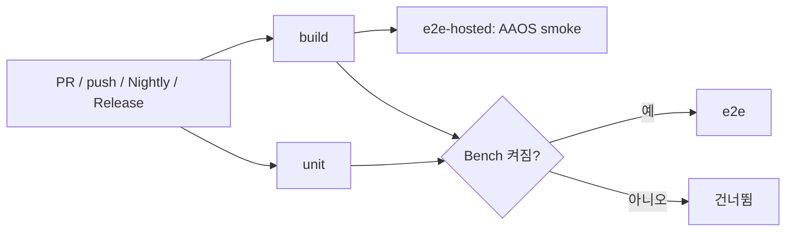

| job | 실행 위치 | 내용 |
|---|---|---|
| build | GitHub 호스트 | 앱을 빌드하고 앱 단위 테스트를 돌린 뒤 APK를 보관합니다. |
| unit | GitHub 호스트 | 기기 없이 프레임워크 단위 테스트를 돌립니다. 요구사항 추적 누락도 여기서 막습니다. |
| e2e-hosted | GitHub 호스트 | ubuntu 러너에서 KVM으로 매번 AAOS 에뮬레이터를 새로 띄우고(작업 PC와 같은 이미지와 화면, 창 없음) build job의 APK를 priv-app으로 넣은 뒤 smoke 13개를 돌립니다. 태블릿은 없습니다. 결과 파일, 실패 자료, 에뮬레이터·Appium 로그를 올리고 통과 수를 실행 요약에 씁니다([`ci_hosted_aaos.sh`](../ivi-tests/tools/ci_hosted_aaos.sh)). |
| e2e | self-hosted Test Bench | 두 기기에서 병렬로 돌리고 flaky 리포트를 냅니다. 저장소 변수 `IVI_BENCH=online`일 때만 돕니다. |

| 이벤트 | e2e 범위 |
|---|---|
| PR | smoke |
| main push | smoke + sanity |
| Nightly (매일 03:00 KST) | 전체 |
| Release 후보 (`workflow_dispatch`) | 전체, repeat 3 |

워크플로를 짜면서 정한 것들입니다.

- e2e는 Bench에서 APK를 다시 빌드합니다. AAOS에 priv-app으로 넣어 둔 앱과 서명 키가 같아야 덮어쓸 수 있는데, GitHub 호스트에서 만든 APK는 키가 다릅니다. e2e-hosted는 매번 새 에뮬레이터에 처음 넣으므로 build job의 APK를 그대로 씁니다.
- 기기에 있는 APK와 해시가 같으면 설치를 건너뜁니다. 화웨이는 adb 설치마다 기기 화면에서 승인해야 해서, 매번 설치하면 무인 실행이 멈춥니다.
- Bench가 한 대라 e2e job은 한 번에 하나만 돌게 했습니다. build와 unit에는 이 제한을 걸지 않았습니다.
- checkout 때 누적 기록 폴더를 지우지 않습니다. flaky 통계가 실행을 넘어 쌓여야 하기 때문입니다.
- 공개 저장소라 포크에서 온 PR은 e2e를 돌리지 않습니다(build와 unit만). `workflow_dispatch` 입력은 스크립트에 바로 넣지 않고 환경 변수로 넘깁니다.

### 8-3. GitHub 실행 기록

ivi-ci 워크플로의 build, unit, e2e-hosted job은 PR, main push, Nightly(매일 03:00 KST)마다 GitHub에서 돕니다. e2e job은 Test Bench(self-hosted 러너)를 켜 두지 않아서 건너뜁니다. 실행 횟수와 결과는 [Actions 실행 기록](https://github.com/bugspeaker/opencabin-ivi/actions/workflows/ivi-ci.yml)에 있습니다. 횟수를 문서에 적으면 PR마다 낡아서 링크로 둡니다.

| 이벤트 | build | unit | e2e-hosted | e2e |
|---|---|---|---|---|
| PR 생성, 갱신 | 앱 빌드와 앱 단위 테스트 (4~5분) | 프레임워크 단위 테스트 (15~30초) | AAOS 에뮬레이터 smoke 13개 (job 약 4~5분, smoke 약 1분) | 건너뜀 |
| main push (병합) | 같음 | 같음 | 같음 | 건너뜀 |
| Nightly | 같음 | 같음 | 같음 | 건너뜀 |

소개 사이트는 pages 워크플로가 `site/`나 `docs/images/`가 바뀐 main push마다 올립니다.

Actions 기록의 취소된 실행은 2회입니다. 하나는 첫 실행입니다. self-hosted 러너가 등록돼 있지 않으면 e2e job이 러너를 계속 기다리는데, 이 상태로는 Bench가 꺼져 있는 동안 PR 결과가 나오지 않습니다. 실행을 취소하고, e2e를 저장소 변수로 켜고 끌 수 있게 워크플로를 고쳤습니다. 다른 하나는 2026-11-21 e2e-hosted를 만들면서 고치기 전 커밋으로 잘못 시작한 수동 실행입니다.

e2e-hosted를 처음 만든 2026-11-21에는 브랜치에서 수동 실행(`workflow_dispatch`)으로 시험했습니다. 첫 실행은 호스트 러너의 avdmanager가 AVD를 `~/.android/avd`가 아닌 곳에 만들어 실패했고, 위치를 고정한 뒤 smoke 13개가 통과했습니다(부팅 25초, smoke 58초). 같은 날 시험 실행들의 unit job 실패는 아직 넣지 않은 원자료 문서를 가리키는 링크 때문이었습니다(끊긴 링크 검사가 막은 것).

앱 단위 테스트는 CI에서 처음으로 Gradle로 돌았습니다. 작업 PC는 사용자 폴더가 한글 경로라 Gradle 테스트 실행기가 죽어서, 그동안은 `java`로 직접 돌려 확인했습니다.

---

## 9. 한계와 다음 단계

### 한계

- 테스트 대상은 AAOS 에뮬레이터의 CarService와 VHAL(가상 차량 값)입니다. 실제 차량이나 HIL, 실물 Test Bench에서 해 본 것이 아닙니다.
- CAN 게이트웨이와 원격 전원 제어는 PC 안의 모의 환경입니다. 실제 ECU, CAN 장비, 전원 공급기에서 확인한 것이 아닙니다.
- AAOS 클러스터 디스플레이(보조 화면)와의 연동은 검증하지 않았습니다. 이 문서의 '주행 정보 패널'은 앱 왼쪽의 화면입니다.
- 앱은 가상 IVI입니다. 지도, 라디오, 통화는 가상 데이터이고, AI 어시스턴트는 LLM이 아니라 규칙 기반입니다. 운전자 보조 표시와 주변 차량은 연출입니다. 화면 구조는 공개 자료를 참고했고 타사 로고, 이미지, 코드는 쓰지 않았습니다.
- 앱도 이 프로젝트에서 만들어서 테스트에 필요한 testTag와 테스트 훅을 마음대로 넣을 수 있었습니다. 다른 팀이 만든 앱을 테스트하는 실제 환경과 다릅니다.
- GitHub에서 무인으로 도는 E2E는 호스트 러너의 AAOS 에뮬레이터 smoke 13개뿐입니다. 태블릿과 sanity 이상은 같은 명령(`run_bench.py`)을 작업 PC에서 실행해 확인했습니다. 공개 저장소라 개인 PC를 self-hosted 러너로 붙이지 않기로 했습니다.
- `test_out_of_range_signal_is_shown_safely`는 기기마다 기대값이 다릅니다. AAOS는 VHAL에 범위 밖 값을 바로 넣어 화면이 15.5°C를 그대로 보여 주는지, ▲ 한 번에 차량 값이 16.0°C가 되는지 봅니다. 태블릿의 Mock 차량은 받은 값을 16.0~28.0°C로 잘라 두므로 15.5°C는 16.0°C가 되고, ▲ 한 번에 16.5°C가 되는지만 봅니다. 범위 밖 값 표시는 AAOS에서만 확인한 것입니다.
- 테스트 쪽 차량 어댑터는 좌석 area를 에뮬레이터 값으로 고정했습니다(`SEAT_AREAS`, [`ivi/vehicle.py`](../ivi-tests/ivi/vehicle.py)). 앱이 `CarPropertyConfig`에서 읽은 area와 출처가 다른 기대값으로 두어, 설정이 틀렸을 때 앱과 테스트가 같이 틀리지 않게 하려는 것입니다. 다른 차종에서는 `cmd car_service get-property-config`로 읽은 area와 이 목록을 먼저 맞춰 봐야 합니다.
- 앱의 온도 범위(16.0~28.0°C)와 0.5°C 증분은 앱 코드(`HvacSpec`)에 고정했습니다. 좌석 area는 `CarPropertyConfig`에서 읽지만 범위와 증분은 읽지 않습니다. 차종마다 다르면 area별 최소·최대 값과 `HVAC_TEMPERATURE_SET`의 `configArray`에서 읽어야 합니다.
- 반복 실행은 2026-11-18 5회, 11-21 3회, 11-23 두 번(각 3회)이고 모두 같은 PC입니다. 기간에 걸친 flaky 추세는 아직 없습니다.
- 위 E2E 결과는 2026-11-24 커밋 `300b081`로 돌린 것입니다(두 기기 × 3회와 폴드 1회, 결과 파일마다 커밋, 커밋하지 않은 변경 여부, APK, 종료 코드 기록, 앱 0.4.2). 그 뒤에 바뀐 것은 문서, 사이트, 결과 자료, 원자료를 모두 합치는 도구([전체 실행 기록](run-history.md))입니다. 이전 실행들의 코드 시점은 [원자료 목록](evidence/README.md)에 있습니다.
- 2026-11-21 첫 반복에서 전원 테스트가 다시 켠 에뮬레이터를 기다리다 실패했습니다. PC 화면이 꺼진 상태에서 창 모드로 켠 에뮬레이터가 멈춘 것이라 창 없이 켜게 고쳤습니다. 재시도는 꺼진 에뮬레이터를 켜지 못하는 약점(AVD 이름을 켜진 에뮬레이터에서만 읽음)은 남아 있습니다([원자료](evidence/2026-11-21-main/README.md#첫-시도-전원-테스트가-멈춘-에뮬레이터를-기다리다-실패)).
- 막 켠 AAOS 에뮬레이터에서 UiAutomator2 계측 프로세스가 스스로 죽는 원인은 확인하지 못했습니다(2026-11-19, 11-20 두 번). 세션을 다시 붙여 그 뒤 테스트는 이어지지만, 그때 돌던 테스트는 재시도에서야 통과합니다.
- 사이드 미러, 트렁크, 차일드 락, 실내등, 전조등은 차량 신호에 연결하지 않은 화면 상태입니다.
- 갤럭시 폴드의 접힌 화면(커버)에서는 테스트하지 못했습니다. 접으면 앱 대신 잠금 화면이 떴습니다(삼성 기본 설정). 앱이 지원하는 가장 작은 화면(760×500dp)은 에뮬레이터 화면을 줄여 한 번 돌렸고, 앱 대상 테스트는 모두 통과했습니다([원자료](evidence/2026-11-23-coverage/README.md#4-가장-작은-지원-화면-760500dp)). 실기기에서 그 크기로는 돌리지 않았습니다.

### 다음 단계

1. 호스트 러너의 AAOS 에뮬레이터로 sanity까지 넓히고, 태블릿은 Bench 전용 PC나 비공개 저장소의 self-hosted 러너로 붙여 Nightly 기록을 남기려고 합니다.
2. 반복 실행을 Nightly로 쌓아 기간별 flaky 추세를 보려고 합니다.
3. 차량 네트워크는 SOME/IP와 DDS도 같은 방식의 모의 환경으로 해 보고, 실제 CAN 인터페이스가 생기면 게이트웨이를 그대로 붙여 보려고 합니다. ISO 26262와 A-SPICE는 계속 공부하려고 합니다.

---

## 10. 저장소 안내

| 경로 | 내용 |
|---|---|
| [ivi-tests/ivi/vehicle.py](../ivi-tests/ivi/vehicle.py) | 차량 어댑터, 신호 정의, 여러 신호를 한 번에 넣는 코드 |
| [ivi-tests/ivi/device.py](../ivi-tests/ivi/device.py) | 기기 판별, Appium 설정, 화면을 누르는 방법 |
| [ivi-tests/ivi/screens.py](../ivi-tests/ivi/screens.py) | 화면 객체 |
| [ivi-tests/ivi/waits.py](../ivi-tests/ivi/waits.py) | 조건 대기, 값 대기, 유지 확인 |
| [ivi-tests/ivi/results.py](../ivi-tests/ivi/results.py) | 판정을 나누고 기록하는 pytest 플러그인 |
| [ivi-tests/tests/conftest.py](../ivi-tests/tests/conftest.py) | 픽스처, 마커, 실패 자료 저장 |
| [ivi-tests/tests/test_vehicle_signals.py](../ivi-tests/tests/test_vehicle_signals.py) | 차량 신호 양방향 E2E |
| [ivi-tests/ivi/bench_api.py](../ivi-tests/ivi/bench_api.py), [power.py](../ivi-tests/ivi/power.py) | Test Bench REST API와 원격 전원 제어 |
| [ivi-tests/ivi/can_gateway.py](../ivi-tests/ivi/can_gateway.py), [dbc/opencabin.dbc](../ivi-tests/dbc/opencabin.dbc) | 가상 CAN 버스와 VHAL 게이트웨이, 프레임 정의 |
| [docs/requirements.md](requirements.md), [traceability.md](traceability.md) | 요구사항과 추적표 |
| [docs/decisions.md](decisions.md) | 결정 기록: 고른 것, 버린 것, 근거가 된 측정값 |
| [docs/flaky-report.md](flaky-report.md) | 반복 실행 통계 |
| [docs/run.md](run.md) | 실행 방법 |
| [ivi-tests/tools/](../ivi-tests/tools/) | 병렬 실행, flaky 통계, 설치, 결과 사이트, 추적표 만들기, API 서버 |
| [.github/workflows/ivi-ci.yml](../.github/workflows/ivi-ci.yml) | CI 워크플로 |
| [docs/phase1 ~ phase9](phase1-spike.md) | 단계별 설계와 검증 기록 |

| 홈 | 공조 (FULL 켬) | 주행 가능 거리 부족 |
|---|---|---|
|  |  |  |
