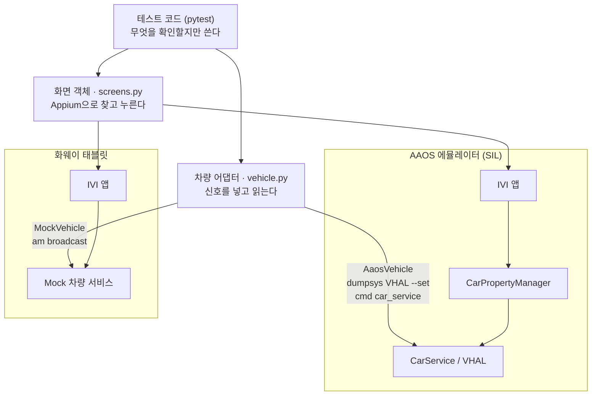
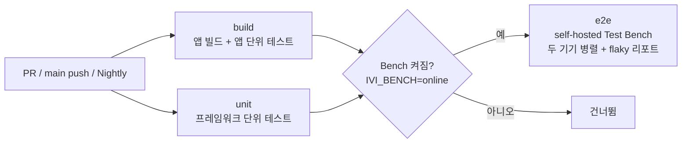

# OpenCabin IVI — AAOS IVI 테스트 자동화 포트폴리오

> **화면 터치부터 차량 신호(CarProperty/VHAL)까지, 하나의 테스트를 AAOS 에뮬레이터와 Android 태블릿에서 무인으로 돌리는 E2E 검증 환경**

지원 직무: 42dot Test Automation Engineer (IVI System)  
기준일: 2026-11-16 (8단계)


---

## 30초 요약

- **무엇을** — 직접 만든 가상 IVI 앱(Kotlin, Compose)을 대상으로 E2E 테스트 **108개**를 만들었습니다.
- **어디까지** — 화면 조작이 차량 신호로, 차량 신호가 화면으로 이어지는지 **양방향**으로 확인합니다. 신호는 **12종**이고, 좌석·도어 같은 **area 단위**까지 판정합니다.
- **어디서** — 같은 테스트가 AAOS 에뮬레이터(실제 CarService, VHAL)와 화웨이 태블릿(Mock)에서 돌고, 두 기기를 **병렬로 돌려 2.0배** 빨라졌습니다.
- **어떻게 운영** — 재시도로 통과해도 flaky로 기록하고, 격리 목록과 통계로 관리합니다. GitHub Actions에서 build와 unit이 **3회 연속 통과**했습니다.

| 지표 | 결과 |
|---|---|
| AAOS 에뮬레이터 | **106 passed**, 1 skipped, 1 xfailed (6분 40초) |
| 화웨이 태블릿 (Mock) | **102 passed**, 6 skipped (7분 6초) |
| 두 기기 병렬 | gate pass, **flaky 0**, 7분 20초 (차례로 돌리면 14분 28초) |
| 단위 테스트 | 프레임워크 33 passed, 앱 17 passed |
| GitHub Actions | 4회 실행 중 3회 success (1회는 문제 발견 후 취소, [§8](#8-운영과-ci)) |

xfailed 1건은 일부러 남긴 SystemUI 결함이고, skipped는 AAOS 전용 테스트입니다.

## 목차

1. [공고 요구사항과 근거](#1-공고-요구사항과-근거)
2. [테스트 환경 구조](#2-테스트-환경-구조)
3. [검증 전략](#3-검증-전략)
4. [E2E 테스트 설계](#4-e2e-테스트-설계)
5. [결함과 원인 분석 7건](#5-결함과-원인-분석-7건)
6. [테스트하기 쉽게 앱을 바꾼 점](#6-테스트하기-쉽게-앱을-바꾼-점)
7. [기술 스택](#7-기술-스택)
8. [운영과 CI](#8-운영과-ci)
9. [한계와 다음 단계](#9-한계와-다음-단계)
10. [저장소 안내](#10-저장소-안내)

---

## 1. 공고 요구사항과 근거

### 주요 업무

| 공고 업무 | 이 프로젝트에서 한 것 | 근거 |
|---|---|---|
| IVI 서비스별 검증 전략 | HVAC, 차량 설정, 클러스터, 미디어를 단계별로 검증 | [phase1](phase1-spike.md), [phase8](phase8-signals.md) |
| Smoke / Sanity / Regression 게이팅 | 마커 3종을 이벤트별로 실행 (PR, main, Nightly) | [phase4](phase4-operations.md) |
| UI ↔ CarProperty/VHAL E2E | 양방향 검증, area 단위 판정 | [§4-1](#4-1-양방향--area-단위-판정) |
| 터치부터 하위 연동까지 통합 | 거리 부족 → 경고 → 충전소 → 경로 안내 | [phase8](phase8-signals.md) |
| 프레임워크·스크립트 유지보수 | 화면 객체 패턴, 화면 개편 때 64개 중 1개만 수정 | [screens.py](../ivi-tests/ivi/screens.py) |
| ADB, CarPropertyManager로 Property Injection | 신호 성격에 따라 주입 명령 3가지 중 선택 | [§4-4](#4-4-신호-주입-명령-선택) |
| Flaky 최소화, 병렬 실행 | 재시도 기록, 격리, 통계, 두 기기 병렬 | [§8](#8-운영과-ci) |

### 자격요건

| 공고 자격요건 | 근거 |
|---|---|
| ✅ Android/AAOS 자동화 구축·운영 | AAOS 에뮬레이터와 실기기 태블릿에서 E2E 108개 실행, 결과 누적 기록 |
| ✅ Python 테스트 프레임워크 (Pytest) | 훅, 픽스처, 마커, 결과 기록용 자체 플러그인 |
| ✅ Appium 등 UI 자동화 도구 | Appium(UiAutomator2), AAOS 다중 사용자(user 10) 대응 |
| ✅ ADB, Logcat, Shell | adb 어댑터, 실패 시 logcat 자동 저장, logcat으로 강제 종료 원인 확인 |
| ✅ Git, CI/CD | PR 단위 작업, GitHub Actions 실행 3회 success ([§8](#8-운영과-ci)) |

### 우대사항

| 공고 우대사항 | 상태 |
|---|---|
| VHAL, CarService, CarPropertyManager | ✅ 신호 12종, area 구성, 권한 등급, priv-app 허용 목록 |
| 차량 네트워크 (Ethernet, DDS, SOME/IP, CAN) | ❌ 범위 밖 (VHAL 아래 계층) |
| REST API 자동화, 원격 전원 제어 | ❌ 아직 없음 |
| ISO 26262, A-SPICE | ❌ 학습 필요 |

---

## 2. 테스트 환경 구조



- **같은 테스트, 두 기기** — 기기 종류는 `automotive` feature로 자동 판별합니다.
- **기기 차이는 아래 계층에서 흡수** — 값 넣기와 복원, 주행 제한 판정, 누르는 방법은 어댑터와 `Device`가 맡습니다.
- **앱도 같은 원칙** — `VehicleDataSource` 아래에 실제 구현(CarPropertyManager)과 Mock 구현을 둡니다.

**왜 두 기기인가.** 에뮬레이터는 실제 CarService와 VHAL 경로를 검증하고, 태블릿은 실기기에서만 나는 문제(터치 지연, 백그라운드 강제 종료, 설치 승인)를 드러냅니다. 가장 오래 걸린 결함 분석 두 건이 모두 태블릿에서 나왔습니다([§5](#5-결함과-원인-분석-7건) ①②).

---

## 3. 검증 전략

### 3-1. 계층과 실행 시점

| 계층 | 확인하는 것 | 예 | 실행 시점 |
|---|---|---|---|
| unit | 테스트 도구 자체가 맞는가 | VHAL 출력 해석, flaky 판정 분류 | 모든 push |
| smoke | 빌드를 받을 수 있는가 | 앱 실행, 공조 제어 권한 | PR |
| sanity | 핵심 기능이 신호까지 이어지는가 | A/C 전 좌석, 주행 중 영상 차단 | main push |
| regression | 경계, 조합, 과거 결함 | 풍량 1/7, 거리 31/30/29 km | Nightly |
| spike | AAOS 기본 SystemUI | SystemUI 공조 바 | Nightly |

### 3-2. 판정 기준

| 판정 | 뜻 | 게이트 |
|---|---|---|
| passed | 한 번에 통과 | 통과 |
| flaky | 실패 후 재시도에서 통과 | 통과, **통계에 남김** |
| failed / error | 재시도까지 실패, 또는 준비·정리 실패 | **실패** |
| xfailed | 알려진 결함 (고쳐지면 알려 줌) | 통과 |
| quarantined | 격리 목록에 있음 (사유 필수) | 통과 |
| skipped | AAOS 전용 테스트를 태블릿에서 실행 | 통과 |

> **원칙: 재시도로 통과해도 숨기지 않는다.**  
> 재시도, 앱 재실행, 신호 주입 재시도는 모두 JUnit 결과와 누적 기록(`results.jsonl`)에 남습니다.

---

## 4. E2E 테스트 설계

### 4-1. 양방향 + area 단위 판정

```python
@pytest.mark.sanity
def test_ac_toggle_reaches_every_seat(app, car):
    """A/C를 끄면 전 좌석 area의 HVAC_AC_ON이 꺼진다 (운전석만 꺼지면 결함)."""
    climate = app.climate()
    climate.wait_checked("ac", True)

    climate.toggle("ac")
    wait_until(lambda: not any(car.signal_all(Signal.AC)), what="전 좌석 A/C 꺼짐")
    climate.wait_checked("ac", False)
```

- **화면만 보면 놓치는 결함을 잡습니다.** '전 좌석' 기능을 운전석 area에만 쓰는 구현은 화면상으로는 정상입니다. `signal_all`이 area별 값을 읽어 이를 잡아냅니다.
- **반대 방향도 따로 둡니다.** 차량이 값을 바꾸면 화면이 따라가는지 기능마다 확인합니다.
- **김서림은 반대로 확인합니다.** 누른 유리 하나만 켜지는지 봅니다.

### 4-2. 설계 기법

| 기법 | 적용 예 |
|---|---|
| 경계 값 | 온도 16/28°C, 풍량 1/7, 주행 가능 거리 31/30/29 km |
| 상태 전이 | 좌석 열선 꺼짐 → 2단 → 1단 → 꺼짐, 정차 ↔ 주행 |
| 조합 | 좌석 2 × 방향 2, 앞/뒤 유리, km/mph × 신호 |
| 규칙 충돌 | AUTO 중 풍량을 바꾸면 AUTO가 꺼진다 |
| 일관성 | 같은 열선 신호가 화면 세 곳에 같은 값으로 표시 |
| 주행 안전 | 주행 중 영상 차단, 검색과 키패드 잠금 |

### 4-3. 테스트 격리

**문제** — 차량 신호는 앱을 다시 띄워도 남습니다. 앞 테스트가 문을 열어 두면 다음 테스트의 "누르면 열림"이 거꾸로 됩니다.

**해결** — 테스트마다 신호 11개를 기준 값으로 되돌립니다. AAOS에서는 신호와 area를 합쳐 주입이 26번 필요한데, 이를 **adb shell 한 번으로 묶고 성공 개수를 세어 검증**합니다.

**결과** — 테스트는 84개에서 108개로 늘었지만, 테스트당 시간은 **4.1초 → 3.7초**로 줄었습니다.

<details>
<summary>코드 보기 (AaosVehicle.set_signals 요약)</summary>

```python
commands = [f"dumpsys {VHAL} --set {prop} {kind} {raw} -a {area}" for ... in areas]
out = self.adb.shell("; ".join(commands))
if out.count("Set property") == len(commands):   # 26개가 모두 들어갔는지 센다
    return                                        # 모자라면 한 번 더, 재시도 사실은 기록
```

</details>

### 4-4. 신호 주입 명령 선택

| 명령 | 경로 | 판단 |
|---|---|---|
| `cmd car_service set-property-value` | CarService → VHAL | ✅ 쓰기 가능한 값(HVAC). 앱과 같은 경로 |
| `dumpsys <VHAL> --set` (root) | VHAL 직접 | ✅ 읽기 전용 센서(속도, 기어, 거리). 주행 상태까지 실제로 바뀜 |
| `cmd car_service inject-vhal-event` | 이벤트만 | ❌ 저장 값이 그대로라 `get`으로 판정할 수 없음 |

---

## 5. 결함과 원인 분석 7건

| # | 증상 | 원인 | 조치와 결과 |
|---|---|---|---|
| ① | 태블릿에서 탭 한 번에 10초 | 이 기기에서 UiAutomator 터치가 느림 | 누르기만 adb로 → 전체 **7분 22초 → 1분 32초** |
| ② | 매 실행 21번째 테스트에서 앱이 사라짐 | OS(iAware)가 반복 재시작을 크래시로 판단 | 화면만 초기화 → 재실행 **0회** (3회 연속) |
| ③ | SystemUI 온도 ▲ 버튼이 안 눌림 | 홈 버튼과 72×76 px 겹침 | `xfail(strict=True)`로 남겨 감시 |
| ④ | 전체 실행에서만 실패 | 테스트 쪽 경쟁 조건 (내가 만든 결함) | 조건 대기로 수정, 고정 sleep 없음 |
| ⑤ | 섭씨로 바꾸자 실패 | 테스트가 화씨 표시를 가정 | 표시 단위 신호를 읽어 기대 값 계산 |
| ⑥ | 회귀 테스트가 앱 결함 3건 발견 | 패널 겹침, 작은 화면, 공백 한 칸 | 앱 수정 + 회귀 테스트 추가 |
| ⑦ | 영상 차단 테스트가 한 번 흔들림 | **아직 모름** | 반복 측정 예정 |

<details>
<summary><b>① 탭 한 번에 10초</b> — 가설을 하나씩 지운 과정</summary>

| 누르는 방법 | 화웨이 | AAOS 에뮬레이터 |
|---|---|---|
| `element.click()` | 10,377 ms | 577 ms |
| `mobile: clickGesture` | 10,099 ms | 501 ms |
| W3C actions | 10,430 ms | - |
| `adb shell input tap` | **117 ms** | - |

- adb 왕복은 65 ms라 원인이 아니었습니다.
- Appium 대기 설정(`waitForIdleTimeout` 등)을 0으로 해도 그대로였습니다.
- 클릭 방식 3가지 모두 10초였습니다.
- 결론: **요소 찾기는 Appium, 누르기만 adb**로 나눴습니다. 화면 객체와 테스트 코드는 바꾸지 않았고, `IVI_TAP`으로 방식을 바꿀 수 있습니다.

</details>

<details>
<summary><b>② 21번째 테스트에서 앱이 사라짐</b> — logcat으로 원인 확인</summary>

- 실패 자료의 logcat에 `Force stopping dev.opencabin.ivi … iAwareF[CrashClean]`이 있었습니다.
- 테스트마다 `am start -S`로 프로세스를 죽였다 살린 것을 OS가 반복 크래시로 판단했습니다.
- 1차(3단계): 다시 띄우고 `app_relaunch`로 기록했습니다. 통과시키되 숨기지 않았습니다.
- 2차(4단계): 프로세스 종료는 세션 시작 때 한 번만 하고, 테스트마다 화면만 초기화(`--activity-clear-task`)해서 원인을 없앴습니다.

</details>

<details>
<summary><b>③ ~ ⑦</b> 자세히</summary>

**③ SystemUI 버튼 겹침** — 운전석 온도 ▲ `[192,682][268,758]`와 홈 버튼 `[188,682][264,758]`이 겹치고, 홈이 위에 있어 탭을 가져갑니다. `strict=True`라서 고쳐지면 XPASS가 실패로 바뀌어 알려 줍니다.

**④ 테스트 쪽 경쟁 조건** — `test_range_recovers_after_charging`이 전체 실행에서만 실패했습니다. 주행 가능 거리와 배터리는 서로 다른 신호라 따로 도착하는데, 거리만 기다리고 배터리를 바로 확인했던 것이 원인입니다. 조건 대기(`wait_until`)로 바꾸고 같은 모양의 확인도 함께 고쳤습니다.

**⑤ 표시 단위 가정** — 1단계 테스트가 SystemUI 온도를 화씨로 가정했습니다. `HVAC_TEMPERATURE_DISPLAY_UNITS`를 읽어 기대 글자를 계산하도록 바꿔 섭씨와 화씨 모두 통과합니다.

**⑥ 회귀 테스트로 찾은 앱 결함**
- 음성 패널이 안내 화면을 가림
- 작은 화면(1024×768)에서 카드가 대답을 화면 밖으로 밀어내 요소를 못 찾음 (UiAutomator는 화면 밖 요소를 찾지 못함)
- 목적지 글자 앞 공백 한 칸이 정확히 일치 확인을 깸 → 간격을 padding으로

**⑦ 원인을 모르는 1건** — `test_video_blocked_screen_follows_parking`이 7단계 반복 중 한 번 흔들렸습니다(정차 후 차단 해제가 10초 안에 확인되지 않음). 8단계 실행 2회에서는 재현되지 않았습니다. 실패 자료로 추정만 하고 있으며, `run_bench.py --repeat 5`로 다시 측정할 계획입니다.

</details>

---

## 6. 테스트하기 쉽게 앱을 바꾼 점

| 문제 | 바꾼 것 |
|---|---|
| 토글 상태를 색으로만 표시해 자동화가 읽지 못함 | 접근성 `checked` 값으로 노출 (TalkBack에도 도움) |
| 저장 설정이 테스트 사이에 남음 | debug 빌드 전용 테스트 훅으로 초기화 (release에는 없음) |
| 차마다 area 구성이 다름 | area를 하드코딩하지 않고 `CarPropertyConfig`에서 읽음 |
| 권한 없는 신호 | 앱이 죽지 않고 '값 없음'으로 표시해 누락이 화면에 드러남 |

---

## 7. 기술 스택

| 분류 | 사용한 것 |
|---|---|
| 테스트 | Python, pytest, Appium (UiAutomator2) |
| 기기 제어 | ADB, shell, logcat, `dumpsys`, `cmd car_service` |
| 대상 앱 | Kotlin, Jetpack Compose, CarPropertyManager |
| 실행 환경 | AAOS 에뮬레이터 API 34, 화웨이 태블릿 (Android 12) |
| CI | GitHub Actions (호스트 러너 + self-hosted 러너 설계) |

---

## 8. 운영과 CI

### 8-1. 테스트가 흔들릴 때를 대비한 장치

| 장치 | 하는 일 |
|---|---|
| 실패 자료 | 실패 순간의 화면, 화면 구조, 차량 상태, 맨 위 액티비티, logcat을 자동 저장 |
| flaky 통계 | 테스트별 불안정률과 p95, 격리 후보와 해제 후보, 느린 테스트 상위 5개 |
| 격리 목록 | 사유가 없으면 거부. 격리해도 계속 돌려 데이터를 모음 |
| 병렬 실행 | 기기마다 pytest 프로세스. 한 Appium 서버에서 UiAutomator2 `systemPort`만 기기마다 다르게 |

격리 후보 기준은 불안정률 10% 이상이면서 5회 이상 실행된 테스트, 해제 후보는 20회 연속 통과한 테스트입니다.

### 8-2. CI 파이프라인



| 이벤트 | e2e 범위 |
|---|---|
| PR | smoke |
| main push | smoke + sanity |
| Nightly (매일 03:00 KST) | 전체 |

**설계하며 고려한 점**
- e2e는 Bench에서 다시 빌드합니다. priv-app 서명 키가 GitHub 호스트 빌드와 다르기 때문입니다.
- APK가 같으면 설치를 건너뜁니다. 실기기 설치 승인 창이 무인 실행을 막지 않게 하려는 것입니다.
- Bench가 하나뿐이라 e2e만 한 번에 하나씩 돌게 했고, build와 unit은 막지 않습니다.
- 누적 기록을 지우지 않아 flaky 통계가 실행을 넘어 쌓입니다.

### 8-3. GitHub 실행 기록 (2026-11-16)

| 실행 | 이벤트 | build | unit | e2e | 결과 |
|---|---|---|---|---|---|
| #1 | main push (수정 전) | ✅ | ✅ | 러너 대기 | 취소 |
| #2 | PR 생성 | ✅ 약 5분 | ✅ 15초 | 건너뜀 | ✅ success |
| #3 | PR 갱신 | ✅ | ✅ | 건너뜀 | ✅ success |
| #4 | 병합 후 main push | ✅ | ✅ | 건너뜀 | ✅ success |

**첫 실행에서 찾은 문제** — e2e가 self-hosted 러너를 무한정 기다려 실행이 끝나지 않았습니다. Bench가 꺼져 있으면 PR 결과가 영영 나오지 않는 구조였습니다. 그래서 e2e를 저장소 변수로 켜고 끄게 바꿨습니다.

**처음 확인한 것** — 앱 단위 테스트는 이 PC의 한글 경로 문제로 Gradle 대신 `java`로만 확인했었습니다. CI에서 처음으로 Gradle 경로로 통과했습니다.


---

## 9. 한계와 다음 단계

### 솔직하게 밝혀 둘 것

- **환경** — 대상은 AAOS **에뮬레이터**의 CarService와 VHAL입니다. 실제 차량, HIL, Test Bench 경험이 아닙니다.
- **앱** — 가상 IVI입니다. 지도, 라디오, 통화는 가상 데이터이고, AI 어시스턴트는 규칙 기반이며, 운전자 보조 표시는 연출입니다. 화면 구조는 공개 자료를 참고했고 타사 로고, 이미지, 코드는 쓰지 않았습니다.
- **CI** — build와 unit은 GitHub에서 통과했지만, **e2e는 아직 GitHub에서 돌리지 않았습니다.** 같은 명령을 이 PC에서 따로 실행해 확인했습니다.
- **반복 안정성** — 8단계 두 기기 병렬은 1회 측정입니다. 4단계에서는 3회 반복해 flaky 0이었습니다.
- **미연결 신호** — 사이드 미러, 트렁크, 차일드 락, 실내등, 전조등은 아직 화면 상태입니다.
- **개발 방식** — AI 코딩 도구를 활용해 만들었습니다. 구조, 판정 기준, 결함 분석은 직접 검토했고 설명할 수 있습니다.

### 다음 단계 (공고 우선순위 순)

1. self-hosted 러너를 등록해 e2e까지 GitHub에서 돌리고 Nightly 기록 남기기
2. `run_bench.py --repeat 5`로 반복 안정성 측정, ⑦의 원인 확인
3. 데모 영상: 신호 주입 → 화면 반응, 화면 조작 → VHAL 값, 실패 자료, 병렬 실행
4. 우대 항목 보강: 원격 전원 제어 모사, 결과 보고 REST API, ISO 26262·A-SPICE 학습

---

## 10. 저장소 안내

| 경로 | 내용 |
|---|---|
| [ivi-tests/ivi/vehicle.py](../ivi-tests/ivi/vehicle.py) | 차량 어댑터, 신호 정의, 묶음 주입 |
| [ivi-tests/ivi/device.py](../ivi-tests/ivi/device.py) | 기기 판별, Appium 설정, 누르는 방법 |
| [ivi-tests/ivi/screens.py](../ivi-tests/ivi/screens.py) | 화면 객체 |
| [ivi-tests/ivi/results.py](../ivi-tests/ivi/results.py) | 판정 분류와 기록 (pytest 플러그인) |
| [ivi-tests/tests/conftest.py](../ivi-tests/tests/conftest.py) | 픽스처, 마커, 실패 자료 저장 |
| [ivi-tests/tests/test_vehicle_signals.py](../ivi-tests/tests/test_vehicle_signals.py) | 차량 신호 양방향 E2E 24개 |
| [ivi-tests/tools/](../ivi-tests/tools/) | 병렬 실행, flaky 통계, 설치 |
| [.github/workflows/ivi-ci.yml](../.github/workflows/ivi-ci.yml) | CI 워크플로 |
| [docs/phase1 ~ phase8](phase1-spike.md) | 단계별 설계와 검증 기록 |

| 홈 | 공조 (전 좌석, 신호 연결) | 주행 가능 거리 부족 |
|---|---|---|
|  |  |  |
